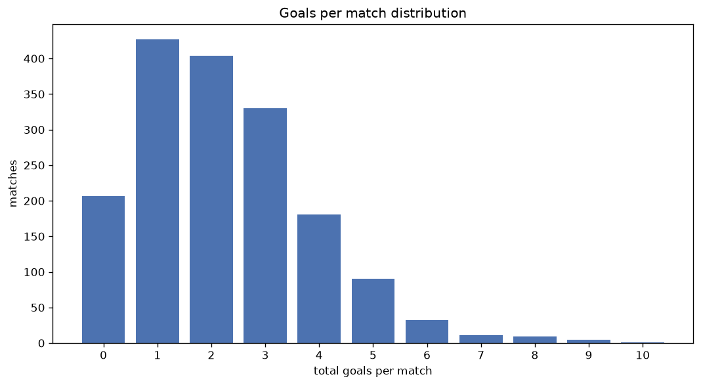
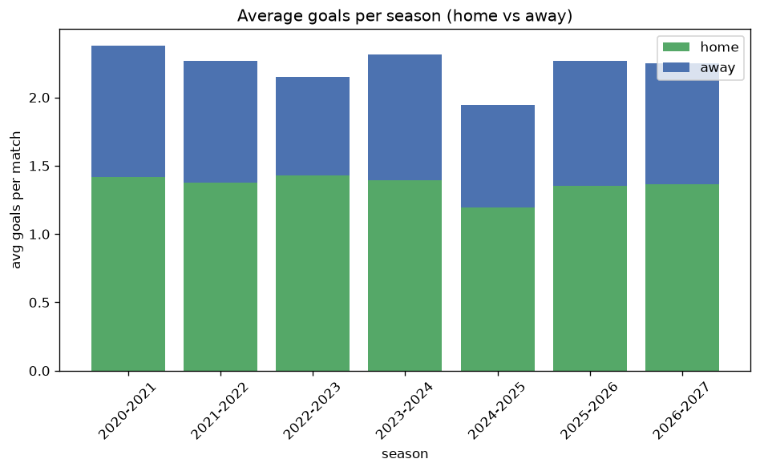

# Goal Analysis
- Report: `goals_analysis`
- Generated: 2026-10-29T01:52:49+00:00
- Script: `backend/scripts/analyze_goals.py` v1.0.0
- League: Ligue 1 (Algeria)
- Scope: league `algir1`

## 1. Goals per match distribution
| goals | matches | pct |
|---|---|---|
| 0 | 207 | 12.2% |
| 1 | 427 | 25.2% |
| 2 | 404 | 23.8% |
| 3 | 330 | 19.4% |
| 4 | 181 | 10.7% |
| 5 | 90 | 5.3% |
| 6 | 32 | 1.9% |
| 7 | 11 | 0.6% |
| 8 | 9 | 0.5% |
| 9 | 5 | 0.3% |
| 10 | 1 | 0.1% |

## 2. Goals per match per season
| season | matches | total goals | avg home | avg away | avg total |
|---|---|---|---|---|---|
| 2020-2021 | 379 | 902 | 1.42 | 0.96 | 2.38 |
| 2021-2022 | 306 | 693 | 1.376 | 0.889 | 2.265 |
| 2022-2023 | 240 | 516 | 1.429 | 0.721 | 2.15 |
| 2023-2024 | 240 | 556 | 1.392 | 0.925 | 2.317 |
| 2024-2025 | 240 | 467 | 1.192 | 0.754 | 1.946 |
| 2025-2026 | 240 | 544 | 1.354 | 0.912 | 2.267 |
| 2026-2027 | 52 | 117 | 1.365 | 0.885 | 2.25 |

## 3. Home vs away goal share
- Home goals: **2318** (61.1%)
- Away goals: **1477** (38.9%)
- Home/away ratio: **1.569**

| season | home goals | away goals | total | home pct | away pct |
|---|---|---|---|---|---|
| 2020-2021 | 538 | 364 | 902 | 59.6% | 40.4% |
| 2021-2022 | 421 | 272 | 693 | 60.8% | 39.2% |
| 2022-2023 | 343 | 173 | 516 | 66.5% | 33.5% |
| 2023-2024 | 334 | 222 | 556 | 60.1% | 39.9% |
| 2024-2025 | 286 | 181 | 467 | 61.2% | 38.8% |
| 2025-2026 | 325 | 219 | 544 | 59.7% | 40.3% |
| 2026-2027 | 71 | 46 | 117 | 60.7% | 39.3% |

## 4. BTTS (Both Teams To Score)
- Overall: **731** of `1697` (43.1%)

| season | matches | BTTS | pct |
|---|---|---|---|
| 2020-2021 | 379 | 175 | 46.2% |
| 2021-2022 | 306 | 122 | 39.9% |
| 2022-2023 | 240 | 96 | 40.0% |
| 2023-2024 | 240 | 107 | 44.6% |
| 2024-2025 | 240 | 95 | 39.6% |
| 2025-2026 | 240 | 117 | 48.8% |
| 2026-2027 | 52 | 19 | 36.5% |

## 5. Clean sheets
- Home clean sheets: **752** (44.3%)
- Away clean sheets: **421** (24.8%)
- Total clean sheets recorded: **1173**
- Matches with at least one clean sheet: **966** (56.9%)
- Both teams kept clean sheets (0-0): **207**

| season | matches | home CS | away CS | total CS | matches w/ CS |
|---|---|---|---|---|---|
| 2020-2021 | 379 | 152 | 89 | 241 | 204 (53.8%) |
| 2021-2022 | 306 | 142 | 85 | 227 | 184 (60.1%) |
| 2022-2023 | 240 | 119 | 56 | 175 | 144 (60.0%) |
| 2023-2024 | 240 | 101 | 60 | 161 | 133 (55.4%) |
| 2024-2025 | 240 | 120 | 67 | 187 | 145 (60.4%) |
| 2025-2026 | 240 | 93 | 50 | 143 | 123 (51.2%) |
| 2026-2027 | 52 | 25 | 14 | 39 | 33 (63.5%) |

## 6. Scoring intensity
- First-half goals: **1654** (43.7%)
- Second-half goals: **2127** (56.3%)
- Avg first-half goals per match: **0.978**
- Avg second-half goals per match: **1.258**
- Second-half-only scoring (HT 0-0, FT goals >= 1): **458** (27.0%)
- *6 match(es) excluded (no HT score recorded).*

| season | matches | 1st half | 2nd half | 1st half pct | 2nd half pct |
|---|---|---|---|---|---|
| 2020-2021 | 379 | 377 | 515 | 42.3% | 57.7% |
| 2021-2022 | 306 | 301 | 392 | 43.4% | 56.6% |
| 2022-2023 | 240 | 232 | 283 | 45.0% | 55.0% |
| 2023-2024 | 240 | 251 | 302 | 45.4% | 54.6% |
| 2024-2025 | 240 | 193 | 274 | 41.3% | 58.7% |
| 2025-2026 | 240 | 249 | 295 | 45.8% | 54.2% |
| 2026-2027 | 52 | 51 | 66 | 43.6% | 56.4% |

## 7. First-goal timing
- Matches with first-goal time recorded: `1487` of `1697` (87.6%)
- Goalless matches: `210`
- Min `1` | Max `108` | Mean `35.97` | Median (p50) `31`

| bucket | count | % of matches | % of scoring matches |
|---|---|---|---|
| 1-15 | 406 | 23.9% | 27.3% |
| 16-30 | 318 | 18.7% | 21.4% |
| 31-45 | 255 | 15.0% | 17.1% |
| 46-60 | 225 | 13.3% | 15.1% |
| 61-75 | 133 | 7.8% | 8.9% |
| 76-90 | 118 | 7.0% | 7.9% |
| 91-120 | 32 | 1.9% | 2.2% |

---
*All statistics are computed from PostgreSQL tables (read-only). Run with `python backend/scripts/analyze_goals.py` to regenerate.*

## Charts

