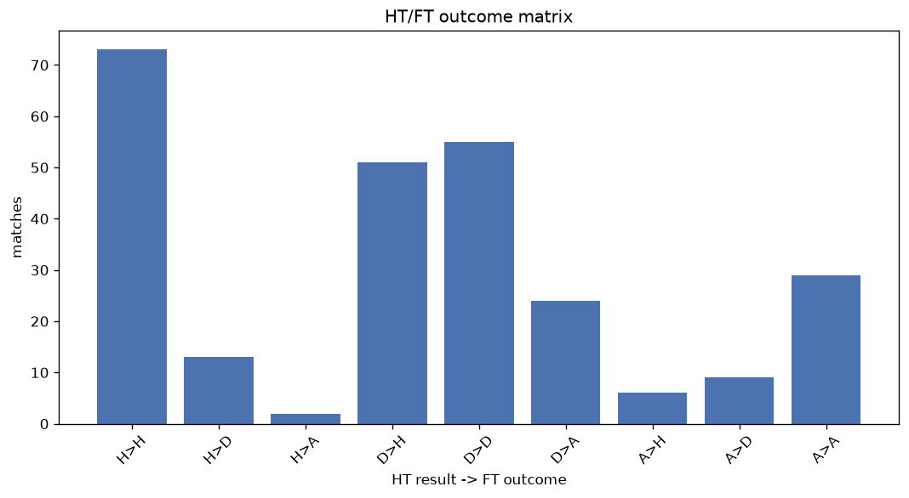
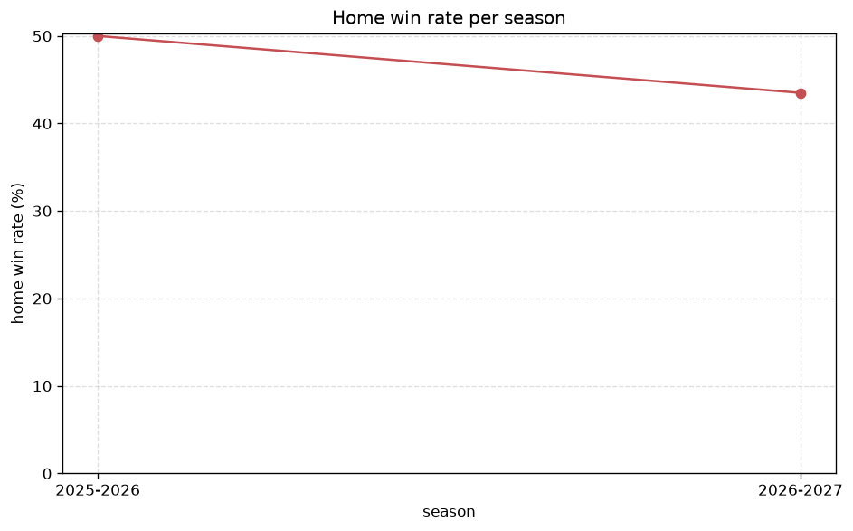

# Match Analysis
- Report: `matches_analysis`
- Generated: 2026-10-30T03:43:49+00:00
- Script: `backend/scripts/analyze_matches.py` v1.0.0
- League: Ligue 1 (Algeria)
- Scope: league `algir1`

## 1. Overall summary
| metric | value |
|---|---|
| Matches | 1697 |
| Home wins | 859 (50.6%) |
| Draws | 478 (28.2%) |
| Away wins | 360 (21.2%) |
| Total goals | 3795 |
| Average goals per match | 2.236 |
| Goalless matches | 207 (12.2%) |

## 2. Per-season breakdown
| season | matches | home wins | draws | away wins | total goals | avg goals | goalless |
|---|---|---|---|---|---|---|---|
| 2020-2021 | 379 | 194 (51.2%) | 104 (27.4%) | 81 (21.4%) | 902 | 2.38 | 37 (9.8%) |
| 2021-2022 | 306 | 147 (48.0%) | 86 (28.1%) | 73 (23.9%) | 693 | 2.265 | 43 (14.1%) |
| 2022-2023 | 240 | 137 (57.1%) | 64 (26.7%) | 39 (16.2%) | 516 | 2.15 | 31 (12.9%) |
| 2023-2024 | 240 | 123 (51.2%) | 61 (25.4%) | 56 (23.3%) | 556 | 2.317 | 28 (11.7%) |
| 2024-2025 | 240 | 116 (48.3%) | 75 (31.2%) | 49 (20.4%) | 467 | 1.946 | 42 (17.5%) |
| 2025-2026 | 240 | 120 (50.0%) | 70 (29.2%) | 50 (20.8%) | 544 | 2.267 | 20 (8.3%) |
| 2026-2027 | 52 | 22 (42.3%) | 18 (34.6%) | 12 (23.1%) | 117 | 2.25 | 6 (11.5%) |

## 3. HT/FT outcome matrix
| HT result \ FT result | Home | Draw | Away | total |
|---|---|---|---|---|
| HT home lead | 488 (83.6%) | 79 (13.5%) | 17 (2.9%) | 584 |
| HT draw | 334 (40.1%) | 344 (41.3%) | 154 (18.5%) | 832 |
| HT away lead | 34 (12.4%) | 55 (20.0%) | 186 (67.6%) | 275 |
- *6 match(es) excluded (no HT score recorded).*

## 4. Comeback matches
- Home comebacks (trailing at HT, won at FT): **34** (2.0%)
- Away comebacks (trailing at HT, won at FT): **17** (1.0%)

### Home comebacks
| season | home | away | HT | FT |
|---|---|---|---|---|
| 2020-2021 | Paradou | Bordj Bou Arreridj | 0-2 | 3-2 |
| 2020-2021 | ASO Chlef | Paradou | 0-1 | 2-1 |
| 2020-2021 | Paradou | Medea | 0-1 | 2-1 |
| 2020-2021 | Mlila | Biskra | 0-1 | 2-1 |
| 2020-2021 | MC Alger | ES Setif | 1-2 | 3-2 |
| 2020-2021 | USM Alger | Biskra | 0-1 | 2-1 |
| 2021-2022 | Biskra | Hussein Dey | 0-1 | 2-1 |
| 2022-2023 | Kabylie | Paradou | 0-1 | 2-1 |
| 2022-2023 | Magra | Kabylie | 0-1 | 2-1 |
| 2023-2024 | Magra | Biskra | 0-1 | 2-1 |
| 2023-2024 | Saoura | ASO Chlef | 1-2 | 3-2 |
| 2023-2024 | USM Alger | Saoura | 0-1 | 2-1 |
| 2023-2024 | Biskra | Saoura | 0-1 | 2-1 |
| 2023-2024 | Constantine | El Bayadh | 0-1 | 2-1 |
| 2023-2024 | Oran | US Souf | 0-1 | 2-1 |
| 2023-2024 | MC Alger | ASO Chlef | 1-3 | 6-3 |
| 2023-2024 | USM Alger | ASO Chlef | 0-1 | 2-1 |
| 2023-2024 | ES Setif | Paradou | 0-1 | 2-1 |
| 2024-2025 | Mostaganem | Oran | 0-1 | 2-1 |
| 2024-2025 | Olympique Akbou | Saoura | 0-1 | 2-1 |
| 2024-2025 | Magra | Oran | 0-1 | 2-1 |
| 2024-2025 | Paradou | Biskra | 0-1 | 2-1 |
| 2024-2025 | Saoura | Olympique Akbou | 0-1 | 2-1 |
| 2024-2025 | CR Belouizdad | Mostaganem | 0-1 | 3-2 |
| 2024-2025 | USM Alger | Constantine | 0-1 | 2-1 |
| 2024-2025 | CR Belouizdad | Paradou | 0-1 | 2-1 |
| 2024-2025 | Saoura | Paradou | 0-1 | 3-2 |
| 2025-2026 | ES Setif | Constantine | 0-1 | 2-1 |
| 2025-2026 | Oran | Paradou | 0-1 | 3-1 |
| 2025-2026 | Olympique Akbou | Paradou | 1-2 | 4-3 |
| 2025-2026 | Oran | Khenchela | 0-1 | 2-1 |
| 2025-2026 | MC Alger | Khenchela | 0-1 | 2-1 |
| 2025-2026 | Oran | Rouisset | 0-1 | 2-1 |
| 2026-2027 | Olympique Akbou | Ben Aknoun | 0-1 | 2-1 |

### Away comebacks
| season | home | away | HT | FT |
|---|---|---|---|---|
| 2020-2021 | Mlila | Constantine | 1-0 | 2-3 |
| 2021-2022 | Magra | Arba | 1-0 | 1-2 |
| 2021-2022 | Paradou | Arba | 1-0 | 1-2 |
| 2021-2022 | Hussein Dey | Saoura | 1-0 | 1-2 |
| 2021-2022 | Constantine | CR Belouizdad | 1-0 | 1-2 |
| 2021-2022 | Relizane | Saoura | 1-0 | 1-2 |
| 2021-2022 | Hussein Dey | CR Belouizdad | 2-1 | 3-5 |
| 2021-2022 | Relizane | Chelghoum | 1-0 | 1-2 |
| 2021-2022 | Hussein Dey | Relizane | 3-2 | 3-5 |
| 2022-2023 | Kabylie | ES Setif | 1-0 | 2-3 |
| 2022-2023 | Arba | Paradou | 1-0 | 1-3 |
| 2023-2024 | Khenchela | Paradou | 1-0 | 1-2 |
| 2023-2024 | Magra | USM Alger | 1-0 | 2-3 |
| 2024-2025 | Biskra | ASO Chlef | 1-0 | 1-2 |
| 2024-2025 | Khenchela | ES Setif | 1-0 | 2-3 |
| 2025-2026 | Ben Aknoun | MC Alger | 1-0 | 2-3 |
| 2025-2026 | Kabylie | Oran | 1-0 | 1-2 |

## 5. HT lead conversion
| HT state | matches | converted to win | held as draw | collapsed to loss |
|---|---|---|---|---|
| Home lead | 584 | 488 (83.6%) | 79 (13.5%) | 17 (2.9%) |
| Away lead | 275 | 186 (67.6%) | 55 (20.0%) | 34 (12.4%) |

### Matches level at half-time
| FT result | count | pct |
|---|---|---|
| Home win | 334 | 40.1% |
| Draw | 344 | 41.3% |
| Away win | 154 | 18.5% |
- *6 match(es) excluded (no HT score recorded).*

## 6. First-goal timing
- Matches with a first-goal time recorded: `1487` of `1697` (87.6%)

Outcome distribution by first-goal timing bucket:
| bucket | matches | % of matches | home | draw | away |
|---|---|---|---|---|---|
| 1-15 | 406 | 23.9% | 230 (56.7%) | 84 (20.7%) | 92 (22.7%) |
| 16-30 | 318 | 18.7% | 198 (62.3%) | 49 (15.4%) | 71 (22.3%) |
| 31-45 | 255 | 15.0% | 138 (54.1%) | 54 (21.2%) | 63 (24.7%) |
| 46-60 | 225 | 13.3% | 119 (52.9%) | 48 (21.3%) | 58 (25.8%) |
| 61-75 | 133 | 7.8% | 70 (52.6%) | 29 (21.8%) | 34 (25.6%) |
| 76-90 | 118 | 7.0% | 83 (70.3%) | 6 (5.1%) | 29 (24.6%) |
| 91-120 | 32 | 1.9% | 21 (65.6%) | 1 (3.1%) | 10 (31.2%) |

## 7. Goalless matches
- Overall: **207** of `1697` (12.2%)

| season | matches | goalless | pct |
|---|---|---|---|
| 2020-2021 | 379 | 37 | 9.8% |
| 2021-2022 | 306 | 43 | 14.1% |
| 2022-2023 | 240 | 31 | 12.9% |
| 2023-2024 | 240 | 28 | 11.7% |
| 2024-2025 | 240 | 42 | 17.5% |
| 2025-2026 | 240 | 20 | 8.3% |
| 2026-2027 | 52 | 6 | 11.5% |

---
*All statistics are computed from PostgreSQL tables (read-only). Run with `python backend/scripts/analyze_matches.py` to regenerate.*

## Charts

