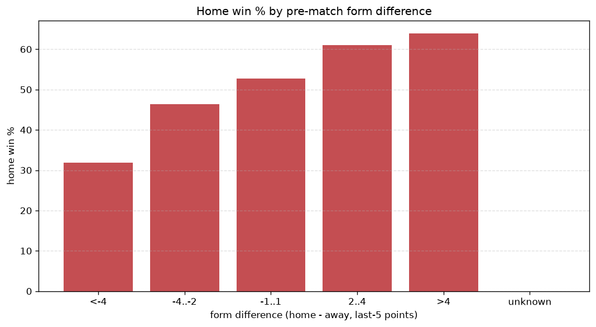
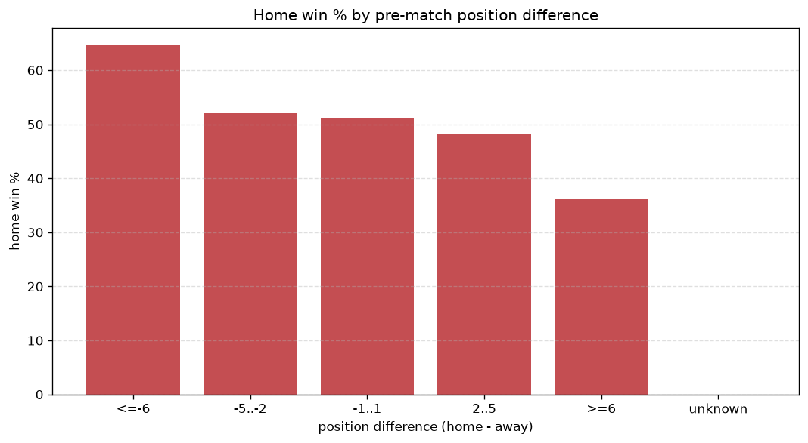

# Relationships Analysis
- Report: `relationships`
- Generated: 2026-10-27T01:39:27+00:00
- Script: `backend/scripts/analyze_relationships.py` v1.0.0
- League: Ligue 1 (Algeria)
- Scope: league `algir1`

- Matches analysed: **1645** (23 leakage-safe pre-match features).

## 1. Correlation matrix
_Pearson correlation of each pre-match feature with observed goals; sorted by |corr(total goals)|._

| feature | corr(home) | corr(away) | corr(total) |
|---|---|---|---|
| away_team_goals_conceded_last_5 | 0.229 | -0.051 | 0.136 |
| home_team_goals_conceded_last_5 | -0.053 | 0.239 | 0.113 |
| home_points_before_match | 0.182 | -0.056 | 0.099 |
| away_team_away_conceded_avg | 0.188 | -0.064 | 0.097 |
| away_position_before_match | 0.193 | -0.087 | 0.086 |
| home_team_home_conceded_avg | -0.047 | 0.185 | 0.084 |
| away_points_before_match | -0.014 | 0.117 | 0.065 |
| home_team_goals_scored_last_5 | 0.128 | -0.050 | 0.062 |
| away_team_away_win_rate | -0.127 | 0.072 | -0.047 |
| points_difference | 0.273 | -0.241 | 0.047 |
| home_team_home_goals_avg | 0.133 | -0.086 | 0.043 |
| position_difference | -0.220 | 0.188 | -0.042 |
| away_team_points_last_5 | -0.130 | 0.093 | -0.036 |
| away_team_wins_last_5 | -0.119 | 0.085 | -0.034 |
| home_position_before_match | -0.113 | 0.174 | 0.029 |
| rest_days_difference | -0.059 | 0.028 | -0.026 |
| away_rest_days | 0.051 | -0.020 | 0.025 |
| away_team_away_goals_avg | -0.087 | 0.064 | -0.023 |
| home_team_wins_last_5 | 0.107 | -0.097 | 0.017 |
| home_team_home_win_rate | 0.089 | -0.121 | -0.011 |
| home_team_points_last_5 | 0.120 | -0.122 | 0.011 |
| away_team_goals_scored_last_5 | -0.072 | 0.075 | -0.006 |
| home_rest_days | -0.006 | 0.008 | 0.001 |

## 2. Form vs outcome
_Home win/draw/away % per bucket of `home_team_points_last_5 - away_team_points_last_5`._

| bucket | matches | home | draw | away | home % | draw % | away % |
|---|---|---|---|---|---|---|---|
| <-4 | 283 | 90 | 89 | 104 | 31.8% | 31.4% | 36.7% |
| -4..-2 | 330 | 153 | 96 | 81 | 46.4% | 29.1% | 24.5% |
| -1..1 | 501 | 264 | 142 | 95 | 52.7% | 28.3% | 19.0% |
| 2..4 | 323 | 197 | 87 | 39 | 61.0% | 26.9% | 12.1% |
| >4 | 208 | 133 | 46 | 29 | 63.9% | 22.1% | 13.9% |
| unknown | 0 | 0 | 0 | 0 | - | - | - |

## 3. Position vs outcome
_Home win/draw/away % per bucket of `position_difference` (home position - away position; negative favours the home team)._

| bucket | matches | home | draw | away | home % | draw % | away % |
|---|---|---|---|---|---|---|---|
| <=-6 | 354 | 222 | 92 | 40 | 62.7% | 26.0% | 11.3% |
| -5..-2 | 311 | 171 | 93 | 47 | 55.0% | 29.9% | 15.1% |
| -1..1 | 234 | 122 | 71 | 41 | 52.1% | 30.3% | 17.5% |
| 2..5 | 347 | 166 | 93 | 88 | 47.8% | 26.8% | 25.4% |
| >=6 | 399 | 156 | 111 | 132 | 39.1% | 27.8% | 33.1% |
| unknown | 0 | 0 | 0 | 0 | - | - | - |

## 4. Rest advantage
_Home win/draw/away % per bucket of `rest_days_difference` (home rest - away rest). Matches with unknown rest are bucketed separately._

| bucket | matches | home | draw | away | home % | draw % | away % |
|---|---|---|---|---|---|---|---|
| <-1 | 292 | 163 | 76 | 53 | 55.8% | 26.0% | 18.2% |
| -1..0 | 169 | 95 | 43 | 31 | 56.2% | 25.4% | 18.3% |
| 0 | 679 | 350 | 184 | 145 | 51.5% | 27.1% | 21.4% |
| 1..2 | 222 | 96 | 72 | 54 | 43.2% | 32.4% | 24.3% |
| >2 | 220 | 103 | 65 | 52 | 46.8% | 29.5% | 23.6% |
| unknown | 63 | 30 | 20 | 13 | 47.6% | 31.7% | 20.6% |
- *63 match(es) had unknown rest difference (missing rest data on at least one side).*

## 5. Home team quality
_Home win rate by `home_team_home_win_rate` tier (split at 0.5)._

- `< 0.5` tier: **46.5%** home win (362/779)
- `>= 0.5` tier: **54.8%** home win (475/866)
- Home-win gap (>= split minus < split): **+8.3 pp**

| tier | label | matches | home | draw | away | home % |
|---|---|---|---|---|---|---|
| low | < 0.5 | 779 | 362 | 215 | 202 | 46.5% |
| high | >= 0.5 | 866 | 475 | 245 | 146 | 54.8% |

## 6. Feature averages by result
_Mean feature value per outcome; `range` is home-minus-away spread of the group means._

| feature | home mean | draw mean | away mean | range |
|---|---|---|---|---|
| points_difference | 1.897 | -0.807 | -5.779 | 7.676 |
| home_points_before_match | 22.983 | 20.680 | 17.595 | 5.388 |
| position_difference | -0.891 | 0.465 | 3.184 | 4.075 |
| away_points_before_match | 21.086 | 21.487 | 23.374 | 2.288 |
| home_position_before_match | 8.974 | 9.220 | 11.181 | 2.207 |
| away_position_before_match | 9.865 | 8.754 | 7.997 | 1.868 |
| home_team_goals_conceded_last_5 | 4.658 | 4.878 | 6.241 | 1.583 |
| home_team_points_last_5 | 6.395 | 5.957 | 5.020 | 1.375 |
| away_team_goals_conceded_last_5 | 5.357 | 4.237 | 4.445 | 1.120 |
| away_team_points_last_5 | 5.896 | 6.700 | 6.957 | 1.061 |
| home_team_goals_scored_last_5 | 5.152 | 4.709 | 4.270 | 0.882 |
| rest_days_difference | -0.617 | 0.252 | 0.203 | 0.869 |
| away_rest_days | 9.089 | 8.725 | 8.369 | 0.720 |
| away_team_goals_scored_last_5 | 4.834 | 5.167 | 5.552 | 0.718 |
| home_rest_days | 8.483 | 8.953 | 8.552 | 0.470 |
| home_team_wins_last_5 | 1.682 | 1.572 | 1.279 | 0.403 |
| away_team_wins_last_5 | 1.536 | 1.815 | 1.879 | 0.343 |
| home_team_home_goals_avg | 1.246 | 1.142 | 1.020 | 0.226 |
| home_team_home_conceded_avg | 0.710 | 0.722 | 0.925 | 0.215 |
| away_team_away_conceded_avg | 1.245 | 1.057 | 1.049 | 0.196 |
| away_team_away_goals_avg | 0.729 | 0.773 | 0.861 | 0.132 |
| home_team_home_win_rate | 0.481 | 0.460 | 0.384 | 0.097 |
| away_team_away_win_rate | 0.180 | 0.225 | 0.238 | 0.058 |

---
*All features are leakage-safe pre-match values built by `ml.features.build_features.build_rows` from strictly prior matches. Run with `python backend/scripts/analyze_relationships.py` to regenerate.*

## Charts

