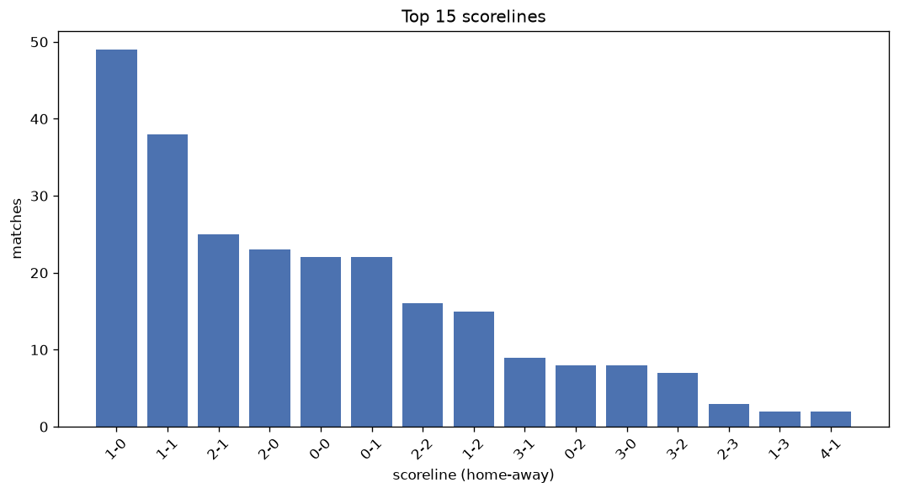
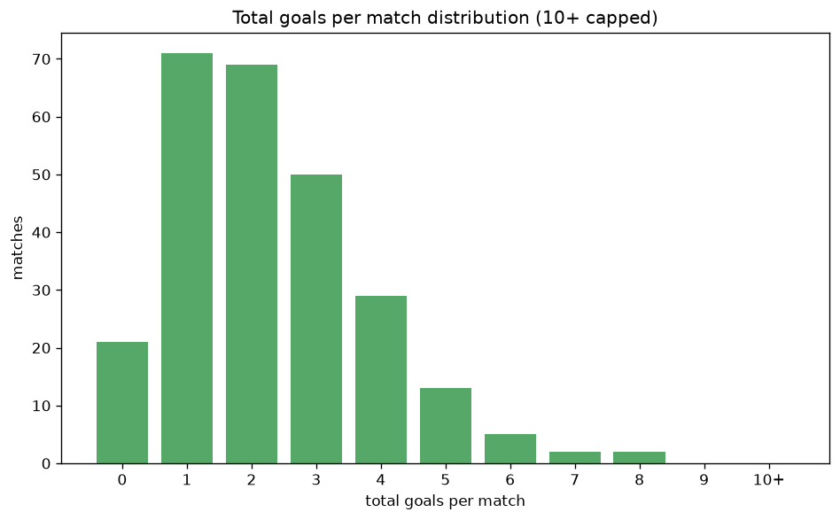

# Scoreline Analysis
- Report: `scoreline_analysis`
- Generated: 2026-10-30T03:43:56+00:00
- Script: `backend/scripts/analyze_scorelines.py` v1.0.0
- League: Ligue 1 (Algeria)
- Scope: league `algir1`

## 1. Scoreline frequency
- Matches analysed: **1697** across **7** seasons.
- Distinct scorelines seen: **44**.

| scoreline | count | pct |
|---|---|---|
| 1-0 | 295 | 17.4% |
| 0-0 | 207 | 12.2% |
| 1-1 | 203 | 12.0% |
| 2-1 | 183 | 10.8% |
| 2-0 | 154 | 9.1% |
| 0-1 | 132 | 7.8% |
| 1-2 | 71 | 4.2% |
| 2-2 | 61 | 3.6% |
| 3-1 | 56 | 3.3% |
| 3-0 | 54 | 3.2% |
| 0-2 | 47 | 2.8% |
| 3-2 | 34 | 2.0% |
| 1-3 | 31 | 1.8% |
| 4-0 | 29 | 1.7% |
| 0-3 | 22 | 1.3% |
| 2-3 | 21 | 1.2% |
| 4-1 | 16 | 0.9% |
| 1-4 | 9 | 0.5% |
| 5-1 | 8 | 0.5% |
| 3-3 | 6 | 0.4% |

## 2. Scoreline frequency per season

### 2020-2021
| scoreline | count | pct |
|---|---|---|
| 1-0 | 65 | 17.2% |
| 1-1 | 51 | 13.5% |
| 2-1 | 45 | 11.9% |
| 0-0 | 37 | 9.8% |
| 0-1 | 27 | 7.1% |

### 2021-2022
| scoreline | count | pct |
|---|---|---|
| 1-0 | 50 | 16.3% |
| 0-0 | 43 | 14.1% |
| 1-1 | 32 | 10.5% |
| 2-0 | 29 | 9.5% |
| 2-1 | 26 | 8.5% |

### 2022-2023
| scoreline | count | pct |
|---|---|---|
| 1-0 | 42 | 17.5% |
| 0-0 | 31 | 12.9% |
| 2-0 | 30 | 12.5% |
| 1-1 | 28 | 11.7% |
| 2-1 | 25 | 10.4% |

### 2023-2024
| scoreline | count | pct |
|---|---|---|
| 1-0 | 39 | 16.2% |
| 2-1 | 34 | 14.2% |
| 0-0 | 28 | 11.7% |
| 1-1 | 26 | 10.8% |
| 0-1 | 23 | 9.6% |

### 2024-2025
| scoreline | count | pct |
|---|---|---|
| 1-0 | 43 | 17.9% |
| 0-0 | 42 | 17.5% |
| 2-1 | 27 | 11.2% |
| 2-0 | 25 | 10.4% |
| 1-1 | 24 | 10.0% |

### 2025-2026
| scoreline | count | pct |
|---|---|---|
| 1-0 | 46 | 19.2% |
| 1-1 | 35 | 14.6% |
| 2-1 | 25 | 10.4% |
| 0-0 | 20 | 8.3% |
| 2-0 | 19 | 7.9% |

### 2026-2027
| scoreline | count | pct |
|---|---|---|
| 1-0 | 10 | 19.2% |
| 1-1 | 7 | 13.5% |
| 0-0 | 6 | 11.5% |
| 0-1 | 5 | 9.6% |
| 2-0 | 5 | 9.6% |

## 3. Total-goal histogram
_10+ groups all matches with 10 or more total goals._

| total goals | matches | pct |
|---|---|---|
| 0 | 207 | 12.2% |
| 1 | 427 | 25.2% |
| 2 | 404 | 23.8% |
| 3 | 330 | 19.4% |
| 4 | 181 | 10.7% |
| 5 | 90 | 5.3% |
| 6 | 32 | 1.9% |
| 7 | 11 | 0.6% |
| 8 | 9 | 0.5% |
| 9 | 5 | 0.3% |
| 10+ | 1 | 0.1% |

## 4. Extreme scorelines
- Matches with 7+ total goals: **26**

| season | date | scoreline | total goals |
|---|---|---|---|
| 2021-2022 | 2022-03-13 | 8-2 | 10 |
| 2020-2021 | 2021-07-27 | 5-4 | 9 |
| 2020-2021 | 2021-08-21 | 5-4 | 9 |
| 2021-2022 | 2022-04-29 | 4-5 | 9 |
| 2023-2024 | 2024-03-14 | 6-3 | 9 |
| 2023-2024 | 2024-03-23 | 4-5 | 9 |
| 2020-2021 | 2021-05-22 | 8-0 | 8 |
| 2020-2021 | 2021-08-24 | 4-4 | 8 |
| 2021-2022 | 2022-01-29 | 6-2 | 8 |
| 2021-2022 | 2022-03-27 | 3-5 | 8 |
| 2021-2022 | 2022-05-21 | 3-5 | 8 |
| 2021-2022 | 2022-05-27 | 0-8 | 8 |
| 2023-2024 | 2023-10-06 | 5-3 | 8 |
| 2025-2026 | 2026-02-14 | 3-5 | 8 |
| 2025-2026 | 2026-05-07 | 5-3 | 8 |
| 2020-2021 | 2021-03-12 | 5-2 | 7 |
| 2020-2021 | 2021-07-01 | 6-1 | 7 |
| 2021-2022 | 2022-05-10 | 7-0 | 7 |
| 2021-2022 | 2022-05-14 | 4-3 | 7 |
| 2022-2023 | 2023-07-15 | 5-2 | 7 |
| 2023-2024 | 2023-11-10 | 3-4 | 7 |
| 2023-2024 | 2023-11-25 | 3-4 | 7 |
| 2023-2024 | 2024-06-07 | 2-5 | 7 |
| 2024-2025 | 2025-06-12 | 5-2 | 7 |
| 2025-2026 | 2026-02-21 | 4-3 | 7 |
| 2025-2026 | 2026-04-05 | 7-0 | 7 |

## 5. Margin-of-victory distribution (decided matches)
- Decided matches: **1219** (draws: **478**)
- Average winning margin: **1.62**

| margin | matches | pct |
|---|---|---|
| 1 | 744 | 61.0% |
| 2 | 301 | 24.7% |
| 3+ | 174 | 14.3% |

## 6. Margin by outcome

### Home wins
- Matches: **859** | avg margin: **1.64** | max margin: **8**
| margin | matches | pct |
|---|---|---|
| 1 | 516 | 60.1% |
| 2 | 216 | 25.1% |
| 3+ | 127 | 14.8% |
- *Full match-by-match list available in `scoreline_analysis.json`.*

### Away wins
- Matches: **360** | avg margin: **1.58** | max margin: **8**
| margin | matches | pct |
|---|---|---|
| 1 | 228 | 63.3% |
| 2 | 85 | 23.6% |
| 3+ | 47 | 13.1% |
- *Full match-by-match list available in `scoreline_analysis.json`.*

## 7. Most common exact score by outcome type
| outcome | matches | most common score | count | pct |
|---|---|---|---|---|
| home | 859 | 1-0 | 295 | 34.3% |
| draw | 478 | 0-0 | 207 | 43.3% |
| away | 360 | 0-1 | 132 | 36.7% |

---
*All statistics are computed from PostgreSQL tables (read-only). Run with `python backend/scripts/analyze_scorelines.py` to regenerate.*

## Charts

