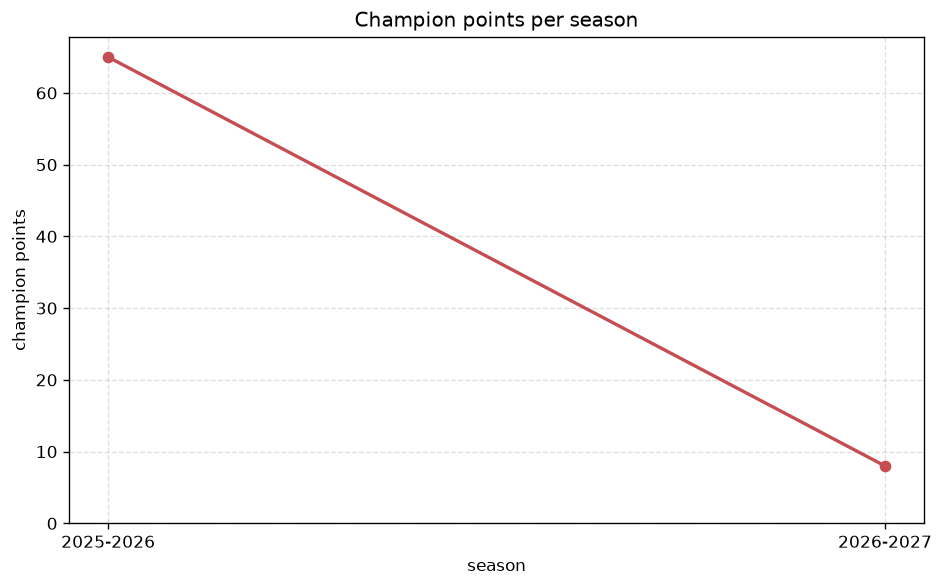
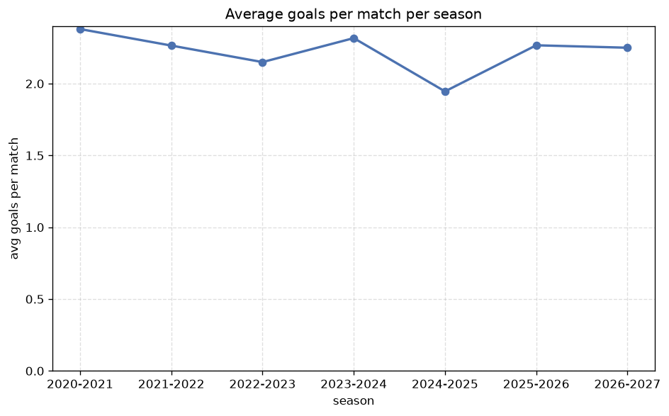

# Season Trends Analysis
- Report: `season_trends`
- Generated: 2026-10-30T03:43:55+00:00
- Script: `backend/scripts/analyze_seasons.py` v1.0.0
- League: Ligue 1 (Algeria)
- Scope: league `algir1`

## 1. Champions per season
| season | champion | pts | runner-up | margin |
|---|---|---|---|---|
| 2020-2021 | CR Belouizdad | 79 | Saoura | 7 pts |
| 2021-2022 | CR Belouizdad | 70 | Kabylie | 9 pts |
| 2022-2023 | CR Belouizdad | 64 | Constantine | 14 pts |
| 2023-2024 | MC Alger | 65 | CR Belouizdad | 12 pts |
| 2024-2025 | MC Alger | 58 | Kabylie | 2 pts |
| 2025-2026 | MC Alger | 65 | Saoura | 10 pts |
| 2026-2027 | CR Belouizdad | 15 | Oran | 1 pts |

## 2. Title-race tightness
- Tight races (margin <= 3 pts): **2** of 7 seasons
- Tightest race: **2026-2027** - CR Belouizdad beat Oran by **1** pts

| season | margin | tight |
|---|---|---|
| 2020-2021 | 7 pts |  |
| 2021-2022 | 9 pts |  |
| 2022-2023 | 14 pts |  |
| 2023-2024 | 12 pts |  |
| 2024-2025 | 2 pts | yes |
| 2025-2026 | 10 pts |  |
| 2026-2027 | 1 pts | yes |

## 3. Points thresholds
_Position-specific points per season. Key: 1 = champion, 2 = runner-up, 4 = CL line, 6 = Europa, 11 = last safe, 14 = bottom._

| season | pos 1 | pos 2 | pos 4 | pos 6 | pos 11 | pos 14 |
|---|---|---|---|---|---|---|
| 2020-2021 | 79 | 72 | 65 | 60 | 50 | 47 |
| 2021-2022 | 70 | 61 | 57 | 54 | 46 | 43 |
| 2022-2023 | 64 | 50 | 46 | 42 | 40 | 39 |
| 2023-2024 | 65 | 53 | 49 | 42 | 38 | 36 |
| 2024-2025 | 58 | 56 | 43 | 41 | 37 | 34 |
| 2025-2026 | 65 | 55 | 49 | 45 | 39 | 24 |
| 2026-2027 | 15 | 14 | 13 | 10 | 7 | 5 |

## 4. Relegation battle
| season | safe pos | safe pts | drop pos | drop pts | gap |
|---|---|---|---|---|---|
| 2020-2021 | 11 | 50 | 12 | 50 | 0 pts |
| 2021-2022 | 11 | 46 | 12 | 45 | 1 pts |
| 2022-2023 | 11 | 40 | 12 | 40 | 0 pts |
| 2023-2024 | 11 | 38 | 12 | 38 | 0 pts |
| 2024-2025 | 11 | 37 | 12 | 36 | 1 pts |
| 2025-2026 | 11 | 39 | 12 | 36 | 3 pts |
| 2026-2027 | 11 | 7 | 12 | 5 | 2 pts |

## 5. League-level trends
| season | matches | total goals | avg goals | home win | draw | away win | goalless | avg pts/team |
|---|---|---|---|---|---|---|---|---|
| 2020-2021 | 379 | 902 | 2.38 | 51.2% | 27.4% | 21.4% | 9.8% | 51.65 |
| 2021-2022 | 306 | 693 | 2.265 | 48.0% | 28.1% | 23.9% | 14.1% | 46.22 |
| 2022-2023 | 240 | 516 | 2.15 | 57.1% | 26.7% | 16.2% | 12.9% | 41.0 |
| 2023-2024 | 240 | 556 | 2.317 | 51.2% | 25.4% | 23.3% | 11.7% | 41.19 |
| 2024-2025 | 240 | 467 | 1.946 | 48.3% | 31.2% | 20.4% | 17.5% | 40.31 |
| 2025-2026 | 240 | 544 | 2.267 | 50.0% | 29.2% | 20.8% | 8.3% | 40.62 |
| 2026-2027 | 52 | 117 | 2.25 | 42.3% | 34.6% | 23.1% | 11.5% | 8.62 |

## 6. View divergence
- Largest divergence: **2021-2022** (goals view, avg abs position diff = 7.778)

_Avg absolute position difference between classic view and alternative view per season._

| season | classic vs luck | classic vs goals |
|---|---|---|
| 2020-2021 | 3.400 | 6.200 |
| 2021-2022 | 4.333 | 7.778 |
| 2022-2023 | 4.000 | 6.250 |
| 2023-2024 | 3.375 | 4.125 |
| 2024-2025 | 2.625 | 3.375 |
| 2025-2026 | 1.500 | 4.625 |
| 2026-2027 | 1.375 | 5.375 |

---
*All statistics are computed from PostgreSQL tables (read-only). Run with `python backend/scripts/analyze_seasons.py` to regenerate.*

## Charts

