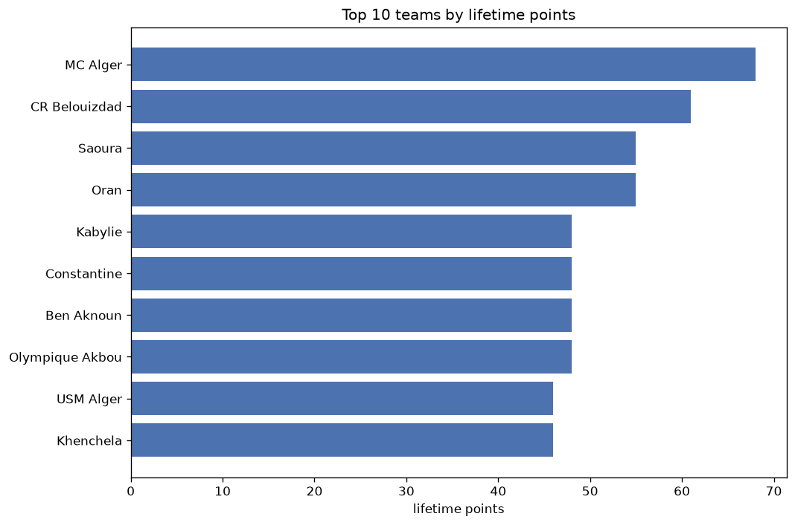
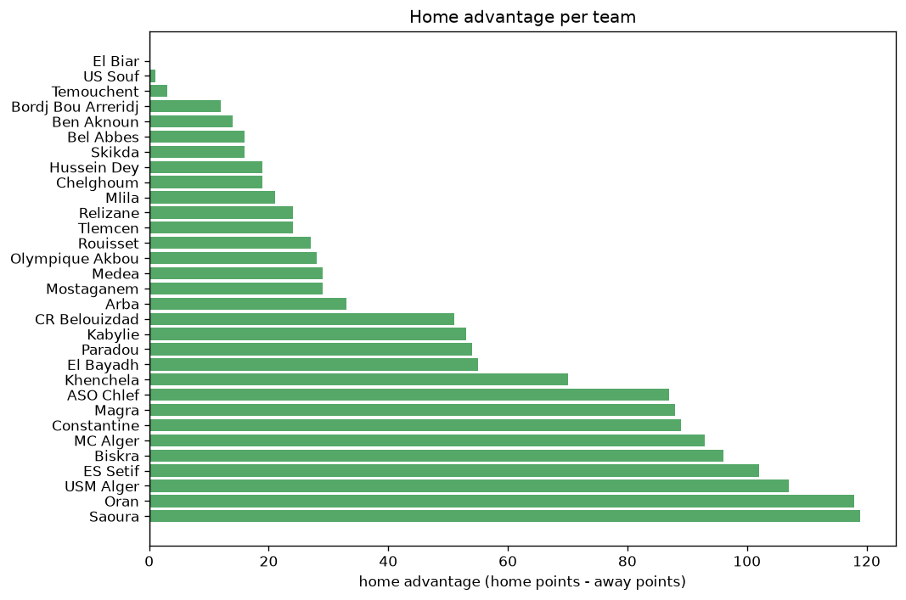

# Team Analysis
- Report: `teams_analysis`
- Generated: 2026-10-27T01:39:18+00:00
- Script: `backend/scripts/analyze_teams.py` v1.0.0
- League: Ligue 1 (Algeria)
- Scope: league `algir1`

- Teams: **31** | Seasons: **7** | Matches: **1696**

## 1. Team standings (lifetime)
| team | seasons | played | W | D | L | pts | GF | GA | GD | avg pts/season | best pos | worst pos | titles |
|---|---|---|---|---|---|---|---|---|---|---|---|---|---|
| CR Belouizdad | 7 | 199 | 109 | 62 | 28 | 389 | 311 | 145 | 166 | 55.57 | 1 | 3 | 4 |
| MC Alger | 7 | 195 | 96 | 62 | 37 | 350 | 255 | 145 | 110 | 50.0 | 1 | 10 | 3 |
| Kabylie | 7 | 198 | 84 | 65 | 49 | 317 | 244 | 167 | 77 | 45.29 | 2 | 14 | 0 |
| Saoura | 7 | 198 | 88 | 51 | 59 | 315 | 261 | 184 | 77 | 45.0 | 2 | 15 | 0 |
| Constantine | 7 | 200 | 81 | 62 | 57 | 305 | 252 | 193 | 59 | 43.57 | 2 | 10 | 0 |
| USM Alger | 7 | 198 | 81 | 58 | 59 | 301 | 246 | 183 | 63 | 43.0 | 4 | 11 | 0 |
| ES Setif | 7 | 197 | 83 | 51 | 63 | 300 | 248 | 189 | 59 | 42.86 | 3 | 12 | 0 |
| Oran | 7 | 198 | 75 | 61 | 62 | 286 | 209 | 197 | 12 | 40.86 | 2 | 13 | 0 |
| Paradou | 6 | 192 | 69 | 45 | 78 | 252 | 243 | 237 | 6 | 42.0 | 5 | 14 | 0 |
| ASO Chlef | 7 | 200 | 63 | 62 | 75 | 251 | 214 | 227 | -13 | 35.86 | 7 | 17 | 0 |
| Magra | 5 | 162 | 54 | 44 | 64 | 206 | 157 | 183 | -26 | 41.2 | 9 | 15 | 0 |
| Biskra | 6 | 168 | 46 | 56 | 66 | 194 | 138 | 184 | -46 | 32.33 | 10 | 16 | 0 |
| Khenchela | 5 | 126 | 47 | 29 | 50 | 170 | 130 | 149 | -19 | 34.0 | 7 | 13 | 0 |
| El Bayadh | 4 | 120 | 34 | 35 | 51 | 137 | 103 | 121 | -18 | 34.25 | 4 | 16 | 0 |
| Olympique Akbou | 3 | 66 | 24 | 20 | 22 | 92 | 67 | 60 | 7 | 30.67 | 6 | 11 | 0 |
| Medea | 2 | 72 | 23 | 18 | 31 | 87 | 73 | 96 | -23 | 43.5 | 10 | 15 | 0 |
| Ben Aknoun | 3 | 66 | 20 | 22 | 24 | 82 | 80 | 83 | -3 | 27.33 | 9 | 15 | 0 |
| Arba | 2 | 64 | 20 | 19 | 25 | 79 | 79 | 88 | -9 | 39.5 | 14 | 15 | 0 |
| Relizane | 2 | 71 | 17 | 19 | 35 | 70 | 68 | 136 | -68 | 35.0 | 12 | 17 | 0 |
| Hussein Dey | 2 | 72 | 16 | 21 | 35 | 69 | 79 | 111 | -32 | 34.5 | 13 | 16 | 0 |
| Tlemcen | 2 | 72 | 15 | 13 | 44 | 58 | 53 | 118 | -65 | 29.0 | 16 | 18 | 0 |
| Mostaganem | 2 | 60 | 12 | 17 | 31 | 53 | 41 | 83 | -42 | 26.5 | 14 | 15 | 0 |
| Rouisset | 2 | 37 | 13 | 10 | 14 | 49 | 37 | 39 | -2 | 24.5 | 4 | 12 | 0 |
| Chelghoum | 2 | 64 | 11 | 16 | 37 | 49 | 51 | 117 | -66 | 24.5 | 12 | 16 | 0 |
| Mlila | 1 | 38 | 13 | 8 | 17 | 47 | 37 | 55 | -18 | 47.0 | 14 | 14 | 0 |
| Bel Abbes | 1 | 38 | 9 | 11 | 18 | 38 | 32 | 58 | -26 | 38.0 | 18 | 18 | 0 |
| Bordj Bou Arreridj | 1 | 38 | 4 | 10 | 24 | 22 | 29 | 67 | -38 | 22.0 | 19 | 19 | 0 |
| Skikda | 1 | 38 | 5 | 3 | 30 | 18 | 17 | 73 | -56 | 18.0 | 20 | 20 | 0 |
| Temouchent | 1 | 8 | 2 | 3 | 3 | 9 | 6 | 9 | -3 | 9.0 | 7 | 7 | 0 |
| El Biar | 1 | 7 | 2 | 2 | 3 | 8 | 12 | 11 | 1 | 8.0 | 8 | 8 | 0 |
| US Souf | 1 | 30 | 2 | 1 | 27 | 7 | 22 | 86 | -64 | 7.0 | 16 | 16 | 0 |

## 2. Home vs away split
| team | home P | H-W | H-D | H-L | H-pts | away P | A-W | A-D | A-L | A-pts | adv |
|---|---|---|---|---|---|---|---|---|---|---|---|
| Saoura | 98 | 64 | 25 | 9 | 217 | 100 | 24 | 26 | 50 | 98 | 119 |
| Oran | 99 | 57 | 31 | 11 | 202 | 99 | 18 | 30 | 51 | 84 | 118 |
| USM Alger | 99 | 59 | 27 | 13 | 204 | 99 | 22 | 31 | 46 | 97 | 107 |
| ES Setif | 100 | 57 | 30 | 13 | 201 | 97 | 26 | 21 | 50 | 99 | 102 |
| MC Alger | 98 | 65 | 28 | 5 | 223 | 97 | 31 | 34 | 32 | 127 | 96 |
| Biskra | 84 | 39 | 28 | 17 | 145 | 84 | 7 | 28 | 49 | 49 | 96 |
| Constantine | 99 | 56 | 29 | 14 | 197 | 101 | 25 | 33 | 43 | 108 | 89 |
| Magra | 81 | 41 | 24 | 16 | 147 | 81 | 13 | 20 | 48 | 59 | 88 |
| ASO Chlef | 101 | 45 | 34 | 22 | 169 | 99 | 18 | 28 | 53 | 82 | 87 |
| Khenchela | 64 | 34 | 18 | 12 | 120 | 62 | 13 | 11 | 38 | 50 | 70 |
| El Bayadh | 60 | 26 | 18 | 16 | 96 | 60 | 8 | 17 | 35 | 41 | 55 |
| Paradou | 96 | 43 | 24 | 29 | 153 | 96 | 26 | 21 | 49 | 99 | 54 |
| Kabylie | 99 | 53 | 26 | 20 | 185 | 99 | 31 | 39 | 29 | 132 | 53 |
| CR Belouizdad | 98 | 67 | 19 | 12 | 220 | 101 | 42 | 43 | 16 | 169 | 51 |
| Arba | 32 | 16 | 8 | 8 | 56 | 32 | 4 | 11 | 17 | 23 | 33 |
| Medea | 36 | 15 | 13 | 8 | 58 | 36 | 8 | 5 | 23 | 29 | 29 |
| Mostaganem | 30 | 10 | 11 | 9 | 41 | 30 | 2 | 6 | 22 | 12 | 29 |
| Olympique Akbou | 33 | 17 | 9 | 7 | 60 | 33 | 7 | 11 | 15 | 32 | 28 |
| Rouisset | 18 | 11 | 5 | 2 | 38 | 19 | 2 | 5 | 12 | 11 | 27 |
| Relizane | 35 | 12 | 11 | 12 | 47 | 36 | 5 | 8 | 23 | 23 | 24 |
| Tlemcen | 36 | 11 | 8 | 17 | 41 | 36 | 4 | 5 | 27 | 17 | 24 |
| Mlila | 19 | 10 | 4 | 5 | 34 | 19 | 3 | 4 | 12 | 13 | 21 |
| Hussein Dey | 36 | 11 | 11 | 14 | 44 | 36 | 5 | 10 | 21 | 25 | 19 |
| Chelghoum | 32 | 8 | 10 | 14 | 34 | 32 | 3 | 6 | 23 | 15 | 19 |
| Bel Abbes | 19 | 7 | 6 | 6 | 27 | 19 | 2 | 5 | 12 | 11 | 16 |
| Skikda | 19 | 5 | 2 | 12 | 17 | 19 | 0 | 1 | 18 | 1 | 16 |
| Ben Aknoun | 32 | 13 | 9 | 10 | 48 | 34 | 7 | 13 | 14 | 34 | 14 |
| Bordj Bou Arreridj | 19 | 4 | 5 | 10 | 17 | 19 | 0 | 5 | 14 | 5 | 12 |
| Temouchent | 5 | 1 | 3 | 1 | 6 | 3 | 1 | 0 | 2 | 3 | 3 |
| US Souf | 15 | 1 | 1 | 13 | 4 | 15 | 1 | 0 | 14 | 3 | 1 |
| El Biar | 4 | 1 | 1 | 2 | 4 | 3 | 1 | 1 | 1 | 4 | 0 |

## 3. Top performers
### Best points per game (PPG)
| rank | team | PPG |
|---|---|---|
| 1 | CR Belouizdad | 1.96 |
| 2 | MC Alger | 1.79 |
| 3 | Kabylie | 1.60 |
| 4 | Saoura | 1.59 |
| 5 | Constantine | 1.52 |

### Most goals scored
| rank | team | goals |
|---|---|---|
| 1 | CR Belouizdad | 311 |
| 2 | Saoura | 261 |
| 3 | MC Alger | 255 |
| 4 | Constantine | 252 |
| 5 | ES Setif | 248 |

### Best goal difference
| rank | team | GD |
|---|---|---|
| 1 | CR Belouizdad | 166 |
| 2 | MC Alger | 110 |
| 3 | Kabylie | 77 |
| 4 | Saoura | 77 |
| 5 | USM Alger | 63 |

### Best defence (goals against per match, standings)
| rank | team | GA/match |
|---|---|---|
| 1 | CR Belouizdad | 0.729 |
| 2 | MC Alger | 0.744 |
| 3 | Kabylie | 0.843 |
| 4 | Olympique Akbou | 0.909 |
| 5 | USM Alger | 0.924 |

## 4. Team consistency
- Teams present in all **7** seasons: **9**

ASO Chlef, CR Belouizdad, Constantine, ES Setif, Kabylie, MC Alger, Oran, Saoura, USM Alger

## 5. Head-to-head dominance
- Distinct fixtures: **341** (showing the 15 most frequent)

| fixture | meetings | home wins | draws | away wins | home pct | draw pct | away pct |
|---|---|---|---|---|---|---|---|
| CR Belouizdad vs ASO Chlef | 14 | 5 | 4 | 5 | 35.7% | 28.6% | 35.7% |
| ES Setif vs Constantine | 13 | 9 | 1 | 3 | 69.2% | 7.7% | 23.1% |
| ES Setif vs Oran | 13 | 9 | 3 | 1 | 69.2% | 23.1% | 7.7% |
| Saoura vs USM Alger | 13 | 9 | 3 | 1 | 69.2% | 23.1% | 7.7% |
| CR Belouizdad vs ES Setif | 13 | 7 | 5 | 1 | 53.8% | 38.5% | 7.7% |
| Constantine vs ASO Chlef | 13 | 7 | 5 | 1 | 53.8% | 38.5% | 7.7% |
| Kabylie vs ASO Chlef | 13 | 7 | 3 | 3 | 53.8% | 23.1% | 23.1% |
| Oran vs ASO Chlef | 13 | 7 | 5 | 1 | 53.8% | 38.5% | 7.7% |
| ES Setif vs Kabylie | 13 | 5 | 5 | 3 | 38.5% | 38.5% | 23.1% |
| CR Belouizdad vs USM Alger | 13 | 4 | 6 | 3 | 30.8% | 46.2% | 23.1% |
| MC Alger vs ASO Chlef | 13 | 4 | 7 | 2 | 30.8% | 53.8% | 15.4% |
| Saoura vs Constantine | 12 | 10 | 2 | 0 | 83.3% | 16.7% | 0.0% |
| ES Setif vs MC Alger | 12 | 9 | 2 | 1 | 75.0% | 16.7% | 8.3% |
| MC Alger vs Constantine | 12 | 8 | 3 | 1 | 66.7% | 25.0% | 8.3% |
| Oran vs MC Alger | 12 | 8 | 2 | 2 | 66.7% | 16.7% | 16.7% |

## 6. Position per season (classic view)
_Cells show final position; '-' when the team was absent from that season._

| team | 2020-2021 | 2021-2022 | 2022-2023 | 2023-2024 | 2024-2025 | 2025-2026 | 2026-2027 |
|---|---|---|---|---|---|---|---|
| CR Belouizdad | 1 | 1 | 1 | 2 | 3 | 3 | 1 |
| MC Alger | 7 | 8 | 3 | 1 | 1 | 1 | 10 |
| Kabylie | 5 | 2 | 14 | 7 | 2 | 5 | 3 |
| Saoura | 2 | 3 | 5 | 9 | 4 | 2 | 15 |
| Constantine | 8 | 5 | 2 | 3 | 10 | 8 | 9 |
| USM Alger | 4 | 4 | 11 | 4 | 7 | 10 | 5 |
| ES Setif | 3 | 6 | 6 | 5 | 6 | 11 | 12 |
| Oran | 6 | 11 | 10 | 13 | 8 | 4 | 2 |
| Paradou | 11 | 7 | 9 | 6 | 5 | 14 | - |
| ASO Chlef | 17 | 9 | 7 | 8 | 13 | 13 | 14 |
| Magra | 9 | 13 | 13 | 12 | 15 | - | - |
| Biskra | 15 | 10 | 12 | 14 | 16 | - | 16 |
| Khenchela | - | - | 8 | 10 | 9 | 7 | 13 |
| El Bayadh | - | - | 4 | 11 | 12 | 16 | - |
| Olympique Akbou | - | - | - | - | 11 | 6 | 6 |
| Medea | 10 | 15 | - | - | - | - | - |
| Ben Aknoun | - | - | - | 15 | - | 9 | 11 |
| Arba | - | 14 | 15 | - | - | - | - |
| Relizane | 12 | 17 | - | - | - | - | - |
| Hussein Dey | 13 | 16 | - | - | - | - | - |
| Tlemcen | 16 | 18 | - | - | - | - | - |
| Mostaganem | - | - | - | - | 14 | 15 | - |
| Rouisset | - | - | - | - | - | 12 | 4 |
| Chelghoum | - | 12 | 16 | - | - | - | - |
| Mlila | 14 | - | - | - | - | - | - |
| Bel Abbes | 18 | - | - | - | - | - | - |
| Bordj Bou Arreridj | 19 | - | - | - | - | - | - |
| Skikda | 20 | - | - | - | - | - | - |
| Temouchent | - | - | - | - | - | - | 7 |
| El Biar | - | - | - | - | - | - | 8 |
| US Souf | - | - | - | 16 | - | - | - |

---
*All statistics are computed from PostgreSQL tables (read-only). Run with `python backend/scripts/analyze_teams.py` to regenerate.*

## Charts

