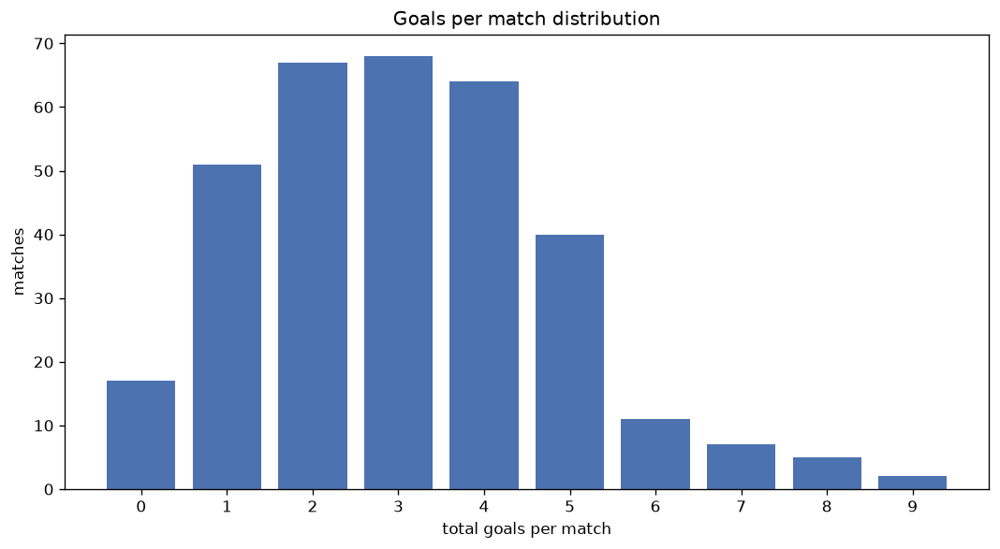
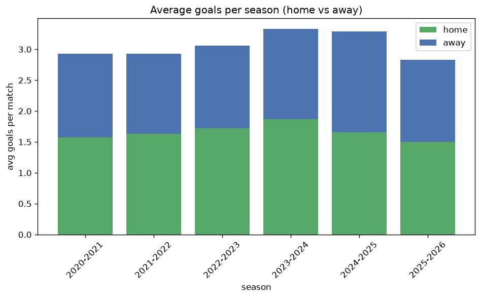

# Goal Analysis
- Report: `goals_analysis`
- Generated: 2026-10-30T03:44:11+00:00
- Script: `backend/scripts/analyze_goals.py` v1.0.0
- League: A-League (Australia)
- Scope: league `australia`

## 1. Goals per match distribution
| goals | matches | pct |
|---|---|---|
| 0 | 43 | 4.5% |
| 1 | 143 | 14.9% |
| 2 | 201 | 20.9% |
| 3 | 221 | 23.0% |
| 4 | 173 | 18.0% |
| 5 | 98 | 10.2% |
| 6 | 43 | 4.5% |
| 7 | 24 | 2.5% |
| 8 | 11 | 1.1% |
| 9 | 5 | 0.5% |

## 2. Goals per match per season
| season | matches | total goals | avg home | avg away | avg total |
|---|---|---|---|---|---|
| 2020-2021 | 156 | 457 | 1.577 | 1.353 | 2.929 |
| 2021-2022 | 156 | 457 | 1.635 | 1.295 | 2.929 |
| 2022-2023 | 156 | 477 | 1.724 | 1.333 | 3.058 |
| 2023-2024 | 162 | 540 | 1.87 | 1.463 | 3.333 |
| 2024-2025 | 169 | 556 | 1.657 | 1.633 | 3.29 |
| 2025-2026 | 163 | 462 | 1.497 | 1.337 | 2.834 |

## 3. Home vs away goal share
- Home goals: **1597** (54.2%)
- Away goals: **1352** (45.8%)
- Home/away ratio: **1.181**

| season | home goals | away goals | total | home pct | away pct |
|---|---|---|---|---|---|
| 2020-2021 | 246 | 211 | 457 | 53.8% | 46.2% |
| 2021-2022 | 255 | 202 | 457 | 55.8% | 44.2% |
| 2022-2023 | 269 | 208 | 477 | 56.4% | 43.6% |
| 2023-2024 | 303 | 237 | 540 | 56.1% | 43.9% |
| 2024-2025 | 280 | 276 | 556 | 50.4% | 49.6% |
| 2025-2026 | 244 | 218 | 462 | 52.8% | 47.2% |

## 4. BTTS (Both Teams To Score)
- Overall: **582** of `962` (60.5%)

| season | matches | BTTS | pct |
|---|---|---|---|
| 2020-2021 | 156 | 92 | 59.0% |
| 2021-2022 | 156 | 88 | 56.4% |
| 2022-2023 | 156 | 99 | 63.5% |
| 2023-2024 | 162 | 101 | 62.3% |
| 2024-2025 | 169 | 105 | 62.1% |
| 2025-2026 | 163 | 97 | 59.5% |

## 5. Clean sheets
- Home clean sheets: **235** (24.4%)
- Away clean sheets: **188** (19.5%)
- Total clean sheets recorded: **423**
- Matches with at least one clean sheet: **380** (39.5%)
- Both teams kept clean sheets (0-0): **43**

| season | matches | home CS | away CS | total CS | matches w/ CS |
|---|---|---|---|---|---|
| 2020-2021 | 156 | 40 | 33 | 73 | 64 (41.0%) |
| 2021-2022 | 156 | 46 | 28 | 74 | 68 (43.6%) |
| 2022-2023 | 156 | 35 | 26 | 61 | 57 (36.5%) |
| 2023-2024 | 162 | 40 | 28 | 68 | 61 (37.7%) |
| 2024-2025 | 169 | 37 | 35 | 72 | 64 (37.9%) |
| 2025-2026 | 163 | 37 | 38 | 75 | 66 (40.5%) |

## 6. Scoring intensity
- First-half goals: **1284** (43.6%)
- Second-half goals: **1659** (56.4%)
- Avg first-half goals per match: **1.337**
- Avg second-half goals per match: **1.728**
- Second-half-only scoring (HT 0-0, FT goals >= 1): **200** (20.8%)
- *2 match(es) excluded (no HT score recorded).*

| season | matches | 1st half | 2nd half | 1st half pct | 2nd half pct |
|---|---|---|---|---|---|
| 2020-2021 | 156 | 201 | 256 | 44.0% | 56.0% |
| 2021-2022 | 156 | 184 | 267 | 40.8% | 59.2% |
| 2022-2023 | 156 | 215 | 262 | 45.1% | 54.9% |
| 2023-2024 | 162 | 226 | 314 | 41.9% | 58.1% |
| 2024-2025 | 169 | 254 | 302 | 45.7% | 54.3% |
| 2025-2026 | 163 | 204 | 258 | 44.2% | 55.8% |

## 7. First-goal timing
- Matches with first-goal time recorded: `917` of `962` (95.3%)
- Goalless matches: `45`
- Min `1` | Max `99` | Mean `29.4` | Median (p50) `23`

| bucket | count | % of matches | % of scoring matches |
|---|---|---|---|
| 1-15 | 319 | 33.2% | 34.8% |
| 16-30 | 232 | 24.1% | 25.3% |
| 31-45 | 145 | 15.1% | 15.8% |
| 46-60 | 119 | 12.4% | 13.0% |
| 61-75 | 59 | 6.1% | 6.4% |
| 76-90 | 31 | 3.2% | 3.4% |
| 91-120 | 12 | 1.2% | 1.3% |

---
*All statistics are computed from PostgreSQL tables (read-only). Run with `python backend/scripts/analyze_goals.py` to regenerate.*

## Charts

