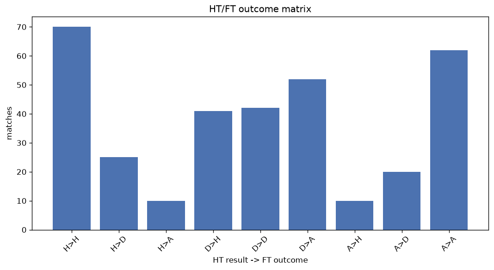
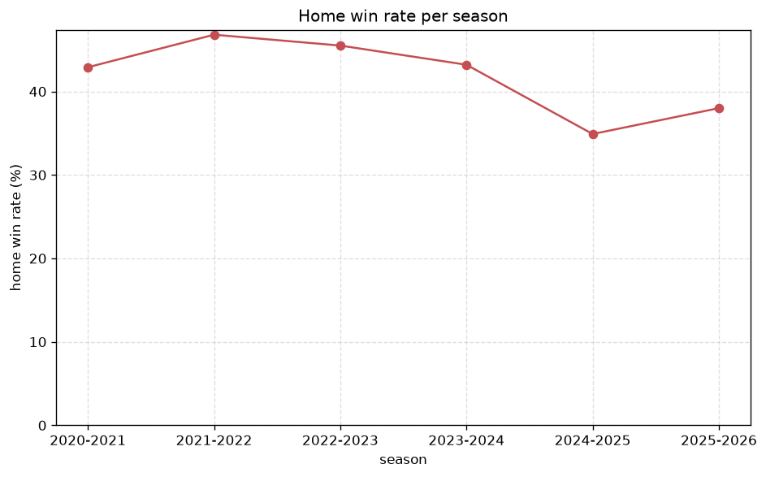

# Match Analysis
- Report: `matches_analysis`
- Generated: 2026-10-29T01:53:03+00:00
- Script: `backend/scripts/analyze_matches.py` v1.0.0
- League: A-League (Australia)
- Scope: league `australia`

## 1. Overall summary
| metric | value |
|---|---|
| Matches | 962 |
| Home wins | 402 (41.8%) |
| Draws | 241 (25.1%) |
| Away wins | 319 (33.2%) |
| Total goals | 2949 |
| Average goals per match | 3.065 |
| Goalless matches | 43 (4.5%) |

## 2. Per-season breakdown
| season | matches | home wins | draws | away wins | total goals | avg goals | goalless |
|---|---|---|---|---|---|---|---|
| 2020-2021 | 156 | 67 (42.9%) | 37 (23.7%) | 52 (33.3%) | 457 | 2.929 | 9 (5.8%) |
| 2021-2022 | 156 | 73 (46.8%) | 38 (24.4%) | 45 (28.8%) | 457 | 2.929 | 6 (3.8%) |
| 2022-2023 | 156 | 71 (45.5%) | 39 (25.0%) | 46 (29.5%) | 477 | 3.058 | 4 (2.6%) |
| 2023-2024 | 162 | 70 (43.2%) | 40 (24.7%) | 52 (32.1%) | 540 | 3.333 | 7 (4.3%) |
| 2024-2025 | 169 | 59 (34.9%) | 44 (26.0%) | 66 (39.1%) | 556 | 3.29 | 8 (4.7%) |
| 2025-2026 | 163 | 62 (38.0%) | 43 (26.4%) | 58 (35.6%) | 462 | 2.834 | 9 (5.5%) |

## 3. HT/FT outcome matrix
| HT result \ FT result | Home | Draw | Away | total |
|---|---|---|---|---|
| HT home lead | 243 (73.6%) | 69 (20.9%) | 18 (5.5%) | 330 |
| HT draw | 130 (34.5%) | 117 (31.0%) | 130 (34.5%) | 377 |
| HT away lead | 28 (11.1%) | 55 (21.7%) | 170 (67.2%) | 253 |
- *2 match(es) excluded (no HT score recorded).*

## 4. Comeback matches
- Home comebacks (trailing at HT, won at FT): **28** (2.9%)
- Away comebacks (trailing at HT, won at FT): **18** (1.9%)

### Home comebacks
| season | home | away | HT | FT |
|---|---|---|---|---|
| 2020-2021 | Central Coast Mariners | Melbourne City | 1-2 | 3-2 |
| 2020-2021 | Central Coast Mariners | Western United | 1-2 | 3-2 |
| 2020-2021 | Sydney FC | Newcastle Jets | 0-1 | 2-1 |
| 2020-2021 | WS Wanderers | Wellington Phoenix | 1-2 | 4-3 |
| 2020-2021 | Western United | Melbourne City | 0-1 | 2-1 |
| 2020-2021 | Perth Glory | Adelaide United | 0-1 | 2-1 |
| 2021-2022 | Macarthur FC | Newcastle Jets | 0-1 | 2-1 |
| 2021-2022 | Adelaide United | Central Coast Mariners | 0-1 | 2-1 |
| 2021-2022 | Macarthur FC | Perth Glory | 1-2 | 4-2 |
| 2022-2023 | Central Coast Mariners | Western United | 0-2 | 4-2 |
| 2022-2023 | Sydney FC | Central Coast Mariners | 1-2 | 3-2 |
| 2022-2023 | Perth Glory | Macarthur FC | 0-1 | 2-1 |
| 2022-2023 | Melbourne City | WS Wanderers | 0-1 | 3-2 |
| 2023-2024 | Perth Glory | Macarthur FC | 0-2 | 3-2 |
| 2023-2024 | Brisbane Roar | Newcastle Jets | 0-1 | 3-2 |
| 2023-2024 | Perth Glory | Brisbane Roar | 1-2 | 3-2 |
| 2023-2024 | Wellington Phoenix | Sydney FC | 0-1 | 2-1 |
| 2023-2024 | Western United | Macarthur FC | 0-2 | 4-2 |
| 2024-2025 | WS Wanderers | Melbourne Victory | 1-2 | 4-2 |
| 2024-2025 | Melbourne City | Brisbane Roar | 0-1 | 3-2 |
| 2024-2025 | Sydney FC | Newcastle Jets | 1-2 | 3-2 |
| 2025-2026 | Wellington Phoenix | Brisbane Roar | 0-1 | 2-1 |
| 2025-2026 | Melbourne City | Auckland FC | 0-1 | 2-1 |
| 2025-2026 | Perth Glory | Auckland FC | 0-1 | 2-1 |
| 2025-2026 | Central Coast Mariners | WS Wanderers | 0-1 | 3-2 |
| 2025-2026 | Newcastle Jets | WS Wanderers | 0-1 | 2-1 |
| 2025-2026 | Melbourne Victory | Central Coast Mariners | 0-1 | 4-1 |
| 2025-2026 | Adelaide United | Macarthur FC | 0-1 | 3-1 |

### Away comebacks
| season | home | away | HT | FT |
|---|---|---|---|---|
| 2020-2021 | Adelaide United | Perth Glory | 1-0 | 1-2 |
| 2020-2021 | Newcastle Jets | Melbourne Victory | 1-0 | 1-2 |
| 2021-2022 | Melbourne Victory | Newcastle Jets | 1-0 | 1-2 |
| 2022-2023 | Wellington Phoenix | Western United | 1-0 | 2-3 |
| 2022-2023 | Western United | Adelaide United | 1-0 | 2-3 |
| 2022-2023 | Wellington Phoenix | Melbourne Victory | 1-0 | 1-2 |
| 2023-2024 | Western United | Melbourne City | 1-0 | 1-2 |
| 2023-2024 | Adelaide United | Macarthur FC | 1-0 | 1-2 |
| 2024-2025 | Macarthur FC | Newcastle Jets | 1-0 | 1-2 |
| 2024-2025 | Brisbane Roar | Adelaide United | 2-1 | 2-3 |
| 2024-2025 | Sydney FC | Western United | 2-1 | 3-4 |
| 2024-2025 | Adelaide United | WS Wanderers | 2-1 | 2-3 |
| 2024-2025 | Melbourne Victory | Western United | 2-1 | 3-4 |
| 2024-2025 | Macarthur FC | Wellington Phoenix | 1-0 | 1-2 |
| 2024-2025 | Adelaide United | Macarthur FC | 3-2 | 4-5 |
| 2025-2026 | Brisbane Roar | Adelaide United | 1-0 | 2-3 |
| 2025-2026 | Brisbane Roar | Melbourne City | 1-0 | 2-3 |
| 2025-2026 | Melbourne City | Adelaide United | 1-0 | 1-2 |

## 5. HT lead conversion
| HT state | matches | converted to win | held as draw | collapsed to loss |
|---|---|---|---|---|
| Home lead | 330 | 243 (73.6%) | 69 (20.9%) | 18 (5.5%) |
| Away lead | 253 | 170 (67.2%) | 55 (21.7%) | 28 (11.1%) |

### Matches level at half-time
| FT result | count | pct |
|---|---|---|
| Home win | 130 | 34.5% |
| Draw | 117 | 31.0% |
| Away win | 130 | 34.5% |
- *2 match(es) excluded (no HT score recorded).*

## 6. First-goal timing
- Matches with a first-goal time recorded: `917` of `962` (95.3%)

Outcome distribution by first-goal timing bucket:
| bucket | matches | % of matches | home | draw | away |
|---|---|---|---|---|---|
| 1-15 | 319 | 33.2% | 139 (43.6%) | 67 (21.0%) | 113 (35.4%) |
| 16-30 | 232 | 24.1% | 94 (40.5%) | 59 (25.4%) | 79 (34.1%) |
| 31-45 | 145 | 15.1% | 66 (45.5%) | 33 (22.8%) | 46 (31.7%) |
| 46-60 | 119 | 12.4% | 59 (49.6%) | 21 (17.6%) | 39 (32.8%) |
| 61-75 | 59 | 6.1% | 20 (33.9%) | 13 (22.0%) | 26 (44.1%) |
| 76-90 | 31 | 3.2% | 15 (48.4%) | 4 (12.9%) | 12 (38.7%) |
| 91-120 | 12 | 1.2% | 8 (66.7%) | 1 (8.3%) | 3 (25.0%) |

## 7. Goalless matches
- Overall: **43** of `962` (4.5%)

| season | matches | goalless | pct |
|---|---|---|---|
| 2020-2021 | 156 | 9 | 5.8% |
| 2021-2022 | 156 | 6 | 3.8% |
| 2022-2023 | 156 | 4 | 2.6% |
| 2023-2024 | 162 | 7 | 4.3% |
| 2024-2025 | 169 | 8 | 4.7% |
| 2025-2026 | 163 | 9 | 5.5% |

---
*All statistics are computed from PostgreSQL tables (read-only). Run with `python backend/scripts/analyze_matches.py` to regenerate.*

## Charts

