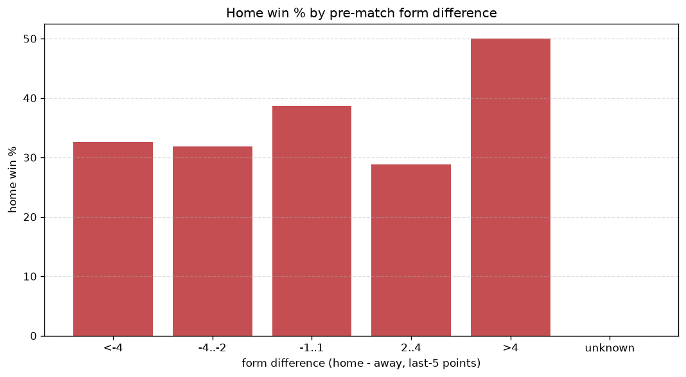
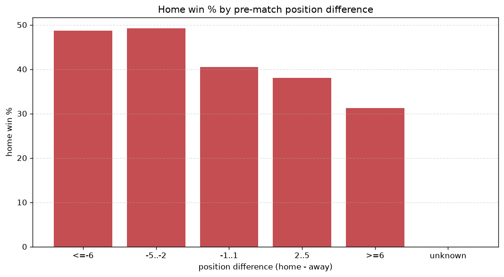

# Relationships Analysis
- Report: `relationships`
- Generated: 2026-10-30T03:44:18+00:00
- Script: `backend/scripts/analyze_relationships.py` v1.0.0
- League: A-League (Australia)
- Scope: league `australia`

- Matches analysed: **962** (23 leakage-safe pre-match features).

## 1. Correlation matrix
_Pearson correlation of each pre-match feature with observed goals; sorted by |corr(total goals)|._

| feature | corr(home) | corr(away) | corr(total) |
|---|---|---|---|
| home_team_goals_scored_last_5 | 0.115 | 0.050 | 0.122 |
| home_team_home_goals_avg | 0.096 | 0.056 | 0.112 |
| away_team_goals_conceded_last_5 | 0.106 | 0.018 | 0.094 |
| away_position_before_match | 0.133 | -0.021 | 0.088 |
| home_team_goals_conceded_last_5 | 0.011 | 0.105 | 0.078 |
| home_team_home_conceded_avg | 0.015 | 0.099 | 0.077 |
| home_points_before_match | 0.099 | -0.000 | 0.076 |
| rest_days_difference | 0.007 | 0.095 | 0.070 |
| away_team_goals_scored_last_5 | -0.010 | 0.104 | 0.062 |
| home_team_points_last_5 | 0.075 | 0.000 | 0.058 |
| points_difference | 0.153 | -0.089 | 0.058 |
| home_team_home_win_rate | 0.071 | -0.002 | 0.053 |
| position_difference | -0.137 | 0.083 | -0.050 |
| away_team_away_conceded_avg | 0.068 | -0.014 | 0.043 |
| away_team_away_goals_avg | 0.003 | 0.057 | 0.041 |
| away_points_before_match | -0.003 | 0.060 | 0.038 |
| home_rest_days | 0.000 | 0.055 | 0.038 |
| home_team_wins_last_5 | 0.056 | -0.013 | 0.035 |
| away_team_wins_last_5 | -0.027 | 0.078 | 0.032 |
| away_rest_days | 0.000 | -0.038 | -0.026 |
| away_team_points_last_5 | -0.044 | 0.086 | 0.024 |
| home_position_before_match | -0.057 | 0.093 | 0.019 |
| away_team_away_win_rate | -0.035 | 0.045 | 0.003 |

## 2. Form vs outcome
_Home win/draw/away % per bucket of `home_team_points_last_5 - away_team_points_last_5`._

| bucket | matches | home | draw | away | home % | draw % | away % |
|---|---|---|---|---|---|---|---|
| <-4 | 124 | 48 | 28 | 48 | 38.7% | 22.6% | 38.7% |
| -4..-2 | 220 | 81 | 50 | 89 | 36.8% | 22.7% | 40.5% |
| -1..1 | 313 | 132 | 87 | 94 | 42.2% | 27.8% | 30.0% |
| 2..4 | 181 | 78 | 45 | 58 | 43.1% | 24.9% | 32.0% |
| >4 | 124 | 63 | 31 | 30 | 50.8% | 25.0% | 24.2% |
| unknown | 0 | 0 | 0 | 0 | - | - | - |

## 3. Position vs outcome
_Home win/draw/away % per bucket of `position_difference` (home position - away position; negative favours the home team)._

| bucket | matches | home | draw | away | home % | draw % | away % |
|---|---|---|---|---|---|---|---|
| <=-6 | 115 | 56 | 23 | 36 | 48.7% | 20.0% | 31.3% |
| -5..-2 | 260 | 128 | 68 | 64 | 49.2% | 26.2% | 24.6% |
| -1..1 | 185 | 75 | 47 | 63 | 40.5% | 25.4% | 34.1% |
| 2..5 | 258 | 98 | 69 | 91 | 38.0% | 26.7% | 35.3% |
| >=6 | 144 | 45 | 34 | 65 | 31.2% | 23.6% | 45.1% |
| unknown | 0 | 0 | 0 | 0 | - | - | - |

## 4. Rest advantage
_Home win/draw/away % per bucket of `rest_days_difference` (home rest - away rest). Matches with unknown rest are bucketed separately._

| bucket | matches | home | draw | away | home % | draw % | away % |
|---|---|---|---|---|---|---|---|
| <-1 | 174 | 76 | 41 | 57 | 43.7% | 23.6% | 32.8% |
| -1..0 | 223 | 98 | 55 | 70 | 43.9% | 24.7% | 31.4% |
| 0 | 177 | 78 | 41 | 58 | 44.1% | 23.2% | 32.8% |
| 1..2 | 242 | 100 | 59 | 83 | 41.3% | 24.4% | 34.3% |
| >2 | 107 | 38 | 29 | 40 | 35.5% | 27.1% | 37.4% |
| unknown | 39 | 12 | 16 | 11 | 30.8% | 41.0% | 28.2% |
- *39 match(es) had unknown rest difference (missing rest data on at least one side).*

## 5. Home team quality
_Home win rate by `home_team_home_win_rate` tier (split at 0.5)._

- `< 0.5` tier: **40.5%** home win (240/593)
- `>= 0.5` tier: **43.9%** home win (162/369)
- Home-win gap (>= split minus < split): **+3.4 pp**

| tier | label | matches | home | draw | away | home % |
|---|---|---|---|---|---|---|
| low | < 0.5 | 593 | 240 | 141 | 212 | 40.5% |
| high | >= 0.5 | 369 | 162 | 100 | 107 | 43.9% |

## 6. Feature averages by result
_Mean feature value per outcome; `range` is home-minus-away spread of the group means._

| feature | home mean | draw mean | away mean | range |
|---|---|---|---|---|
| points_difference | 1.214 | -0.635 | -1.796 | 3.010 |
| home_points_before_match | 18.194 | 17.950 | 15.928 | 2.266 |
| position_difference | -0.617 | 0.253 | 1.028 | 1.645 |
| away_points_before_match | 16.980 | 18.585 | 17.724 | 1.605 |
| home_position_before_match | 6.607 | 6.602 | 7.480 | 0.878 |
| away_position_before_match | 7.224 | 6.349 | 6.451 | 0.875 |
| rest_days_difference | -0.300 | 0.107 | 0.318 | 0.618 |
| home_team_points_last_5 | 6.221 | 6.270 | 5.661 | 0.608 |
| home_team_goals_conceded_last_5 | 6.602 | 6.556 | 7.154 | 0.598 |
| away_team_goals_conceded_last_5 | 6.995 | 6.544 | 6.605 | 0.451 |
| away_team_goals_scored_last_5 | 6.602 | 7.046 | 6.984 | 0.444 |
| home_rest_days | 7.090 | 7.500 | 7.386 | 0.410 |
| away_team_points_last_5 | 5.930 | 6.249 | 6.288 | 0.358 |
| away_rest_days | 7.411 | 7.398 | 7.058 | 0.352 |
| home_team_goals_scored_last_5 | 6.873 | 6.705 | 6.527 | 0.346 |
| home_team_wins_last_5 | 1.684 | 1.734 | 1.495 | 0.239 |
| away_team_away_conceded_avg | 1.520 | 1.378 | 1.411 | 0.143 |
| home_team_home_conceded_avg | 1.194 | 1.226 | 1.301 | 0.107 |
| away_team_wins_last_5 | 1.619 | 1.710 | 1.690 | 0.090 |
| home_team_home_win_rate | 0.393 | 0.402 | 0.357 | 0.044 |
| away_team_away_goals_avg | 1.238 | 1.256 | 1.279 | 0.041 |
| away_team_away_win_rate | 0.311 | 0.333 | 0.328 | 0.022 |
| home_team_home_goals_avg | 1.460 | 1.448 | 1.451 | 0.012 |

---
*All features are leakage-safe pre-match values built by `ml.features.build_features.build_rows` from strictly prior matches. Run with `python backend/scripts/analyze_relationships.py` to regenerate.*

## Charts

