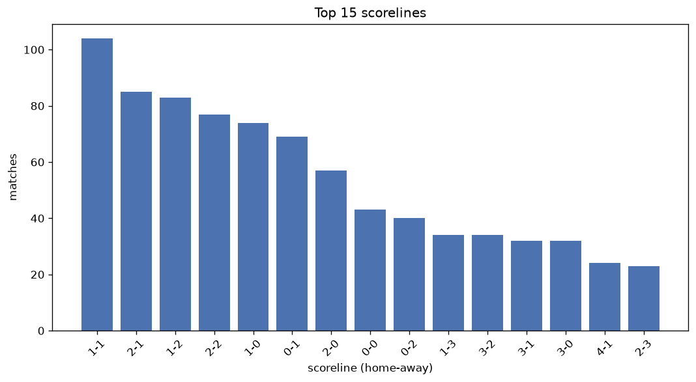
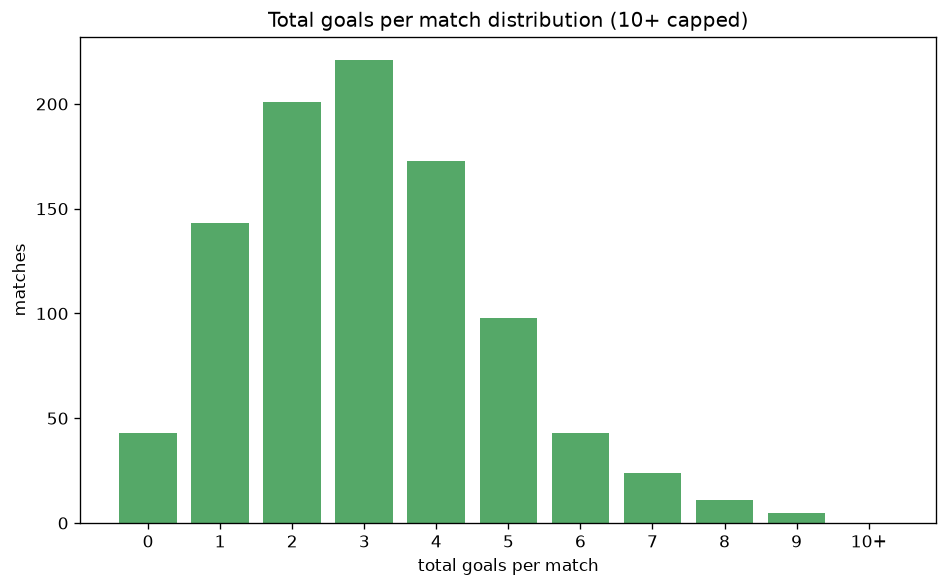

# Scoreline Analysis
- Report: `scoreline_analysis`
- Generated: 2026-10-26T01:26:06+00:00
- Script: `backend/scripts/analyze_scorelines.py` v1.0.0
- League: A-League (Australia)
- Scope: league `australia`

## 1. Scoreline frequency
- Matches analysed: **962** across **6** seasons.
- Distinct scorelines seen: **43**.

| scoreline | count | pct |
|---|---|---|
| 1-1 | 104 | 10.8% |
| 2-1 | 85 | 8.8% |
| 1-2 | 83 | 8.6% |
| 2-2 | 77 | 8.0% |
| 1-0 | 74 | 7.7% |
| 0-1 | 69 | 7.2% |
| 2-0 | 57 | 5.9% |
| 0-0 | 43 | 4.5% |
| 0-2 | 40 | 4.2% |
| 1-3 | 34 | 3.5% |
| 3-2 | 34 | 3.5% |
| 3-1 | 32 | 3.3% |
| 3-0 | 32 | 3.3% |
| 4-1 | 24 | 2.5% |
| 2-3 | 23 | 2.4% |
| 0-3 | 21 | 2.2% |
| 4-0 | 20 | 2.1% |
| 3-3 | 13 | 1.4% |
| 1-4 | 11 | 1.1% |
| 4-2 | 11 | 1.1% |

## 2. Scoreline frequency per season

### 2020-2021
| scoreline | count | pct |
|---|---|---|
| 1-1 | 18 | 11.5% |
| 1-2 | 17 | 10.9% |
| 2-1 | 14 | 9.0% |
| 0-1 | 11 | 7.1% |
| 1-0 | 11 | 7.1% |

### 2021-2022
| scoreline | count | pct |
|---|---|---|
| 1-1 | 17 | 10.9% |
| 2-1 | 15 | 9.6% |
| 1-0 | 14 | 9.0% |
| 2-2 | 13 | 8.3% |
| 1-2 | 12 | 7.7% |

### 2022-2023
| scoreline | count | pct |
|---|---|---|
| 2-1 | 21 | 13.5% |
| 1-1 | 19 | 12.2% |
| 1-0 | 13 | 8.3% |
| 0-1 | 13 | 8.3% |
| 2-2 | 12 | 7.7% |

### 2023-2024
| scoreline | count | pct |
|---|---|---|
| 1-2 | 16 | 9.9% |
| 1-1 | 15 | 9.3% |
| 2-2 | 12 | 7.4% |
| 2-1 | 12 | 7.4% |
| 2-0 | 12 | 7.4% |

### 2024-2025
| scoreline | count | pct |
|---|---|---|
| 2-2 | 16 | 9.5% |
| 1-1 | 15 | 8.9% |
| 1-2 | 13 | 7.7% |
| 1-0 | 13 | 7.7% |
| 0-1 | 11 | 6.5% |

### 2025-2026
| scoreline | count | pct |
|---|---|---|
| 1-1 | 20 | 12.3% |
| 1-2 | 16 | 9.8% |
| 2-1 | 15 | 9.2% |
| 0-1 | 15 | 9.2% |
| 2-2 | 14 | 8.6% |

## 3. Total-goal histogram
_10+ groups all matches with 10 or more total goals._

| total goals | matches | pct |
|---|---|---|
| 0 | 43 | 4.5% |
| 1 | 143 | 14.9% |
| 2 | 201 | 20.9% |
| 3 | 221 | 23.0% |
| 4 | 173 | 18.0% |
| 5 | 98 | 10.2% |
| 6 | 43 | 4.5% |
| 7 | 24 | 2.5% |
| 8 | 11 | 1.1% |
| 9 | 5 | 0.5% |
| 10+ | 0 | 0.0% |

## 4. Extreme scorelines
- Matches with 7+ total goals: **40**

| season | date | scoreline | total goals |
|---|---|---|---|
| 2020-2021 | 2021-01-23 | 5-4 | 9 |
| 2020-2021 | 2021-04-23 | 5-4 | 9 |
| 2023-2024 | 2023-12-28 | 8-1 | 9 |
| 2024-2025 | 2025-03-14 | 4-5 | 9 |
| 2025-2026 | 2025-12-26 | 4-5 | 9 |
| 2020-2021 | 2021-01-20 | 5-3 | 8 |
| 2022-2023 | 2023-02-19 | 4-4 | 8 |
| 2022-2023 | 2023-04-23 | 4-4 | 8 |
| 2023-2024 | 2023-10-29 | 5-3 | 8 |
| 2023-2024 | 2024-04-14 | 8-0 | 8 |
| 2023-2024 | 2024-04-28 | 7-1 | 8 |
| 2024-2025 | 2024-11-30 | 4-4 | 8 |
| 2024-2025 | 2025-03-01 | 4-4 | 8 |
| 2024-2025 | 2025-03-16 | 2-6 | 8 |
| 2024-2025 | 2025-03-29 | 5-3 | 8 |
| 2025-2026 | 2026-01-24 | 6-2 | 8 |
| 2020-2021 | 2021-02-06 | 5-2 | 7 |
| 2020-2021 | 2021-02-27 | 3-4 | 7 |
| 2020-2021 | 2021-03-15 | 4-3 | 7 |
| 2020-2021 | 2021-04-17 | 7-0 | 7 |
| 2020-2021 | 2021-05-28 | 1-6 | 7 |
| 2021-2022 | 2022-04-10 | 6-1 | 7 |
| 2022-2023 | 2023-02-04 | 6-1 | 7 |
| 2023-2024 | 2023-11-04 | 5-2 | 7 |
| 2023-2024 | 2023-12-04 | 4-3 | 7 |
| 2023-2024 | 2023-12-10 | 3-4 | 7 |
| 2023-2024 | 2024-01-13 | 4-3 | 7 |
| 2023-2024 | 2024-01-14 | 3-4 | 7 |
| 2023-2024 | 2024-02-04 | 4-3 | 7 |
| 2023-2024 | 2024-03-12 | 7-0 | 7 |
| 2023-2024 | 2024-04-21 | 3-4 | 7 |
| 2023-2024 | 2024-04-26 | 3-4 | 7 |
| 2023-2024 | 2024-04-27 | 3-4 | 7 |
| 2024-2025 | 2024-10-20 | 6-1 | 7 |
| 2024-2025 | 2024-11-02 | 3-4 | 7 |
| 2024-2025 | 2024-12-14 | 3-4 | 7 |
| 2024-2025 | 2025-01-10 | 3-4 | 7 |
| 2024-2025 | 2025-01-18 | 3-4 | 7 |
| 2024-2025 | 2025-02-22 | 6-1 | 7 |
| 2025-2026 | 2025-10-24 | 5-2 | 7 |

## 5. Margin-of-victory distribution (decided matches)
- Decided matches: **721** (draws: **241**)
- Average winning margin: **1.81**

| margin | matches | pct |
|---|---|---|
| 1 | 386 | 53.5% |
| 2 | 184 | 25.5% |
| 3+ | 151 | 20.9% |

## 6. Margin by outcome

### Home wins
- Matches: **402** | avg margin: **1.93** | max margin: **8**
| margin | matches | pct |
|---|---|---|
| 1 | 199 | 49.5% |
| 2 | 103 | 25.6% |
| 3+ | 100 | 24.9% |
- *Full match-by-match list available in `scoreline_analysis.json`.*

### Away wins
- Matches: **319** | avg margin: **1.66** | max margin: **6**
| margin | matches | pct |
|---|---|---|
| 1 | 187 | 58.6% |
| 2 | 81 | 25.4% |
| 3+ | 51 | 16.0% |
- *Full match-by-match list available in `scoreline_analysis.json`.*

## 7. Most common exact score by outcome type
| outcome | matches | most common score | count | pct |
|---|---|---|---|---|
| home | 402 | 2-1 | 85 | 21.1% |
| draw | 241 | 1-1 | 104 | 43.2% |
| away | 319 | 1-2 | 83 | 26.0% |

---
*All statistics are computed from PostgreSQL tables (read-only). Run with `python backend/scripts/analyze_scorelines.py` to regenerate.*

## Charts

