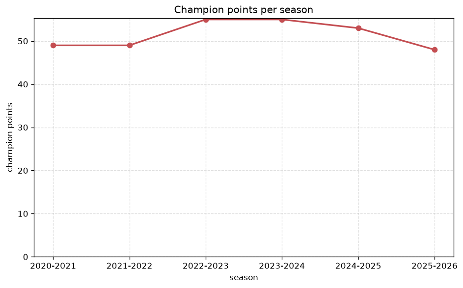
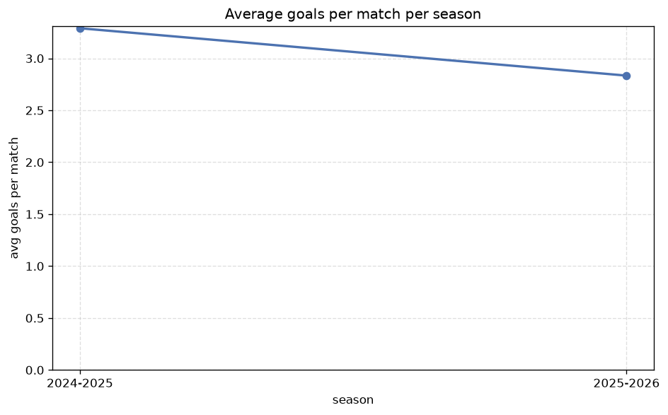

# Season Trends Analysis
- Report: `season_trends`
- Generated: 2026-10-30T03:44:14+00:00
- Script: `backend/scripts/analyze_seasons.py` v1.0.0
- League: A-League (Australia)
- Scope: league `australia`

## 1. Champions per season
| season | champion | pts | runner-up | margin |
|---|---|---|---|---|
| 2020-2021 | Melbourne City | 49 | Sydney FC | 2 pts |
| 2021-2022 | Melbourne City | 49 | Melbourne Victory | 1 pts |
| 2022-2023 | Melbourne City | 55 | Central Coast Mariners | 11 pts |
| 2023-2024 | Central Coast Mariners | 55 | Wellington Phoenix | 2 pts |
| 2024-2025 | Auckland FC | 53 | Melbourne City | 5 pts |
| 2025-2026 | Newcastle Jets | 48 | Adelaide United | 5 pts |

## 2. Title-race tightness
- Tight races (margin <= 3 pts): **3** of 6 seasons
- Tightest race: **2021-2022** - Melbourne City beat Melbourne Victory by **1** pts

| season | margin | tight |
|---|---|---|
| 2020-2021 | 2 pts | yes |
| 2021-2022 | 1 pts | yes |
| 2022-2023 | 11 pts |  |
| 2023-2024 | 2 pts | yes |
| 2024-2025 | 5 pts |  |
| 2025-2026 | 5 pts |  |

## 3. Points thresholds
_Position-specific points per season. Key: 1 = champion, 2 = runner-up, 4 = CL line, 6 = Europa, 9 = last safe, 12 = bottom._

| season | pos 1 | pos 2 | pos 4 | pos 6 | pos 9 | pos 12 |
|---|---|---|---|---|---|---|
| 2020-2021 | 49 | 47 | 40 | 39 | 34 | 19 |
| 2021-2022 | 49 | 48 | 43 | 39 | 29 | 18 |
| 2022-2023 | 55 | 44 | 41 | 35 | 29 | 26 |
| 2023-2024 | 55 | 53 | 41 | 39 | 30 | 22 |
| 2024-2025 | 53 | 48 | 46 | 38 | 30 | 21 |
| 2025-2026 | 48 | 43 | 40 | 38 | 32 | 21 |

## 4. Relegation battle
| season | safe pos | safe pts | drop pos | drop pts | gap |
|---|---|---|---|---|---|
| 2020-2021 | 9 | 34 | 10 | 28 | 6 pts |
| 2021-2022 | 9 | 29 | 10 | 27 | 2 pts |
| 2022-2023 | 9 | 29 | 10 | 29 | 0 pts |
| 2023-2024 | 9 | 30 | 10 | 28 | 2 pts |
| 2024-2025 | 9 | 30 | 10 | 26 | 4 pts |
| 2025-2026 | 9 | 32 | 10 | 31 | 1 pts |

## 5. League-level trends
| season | matches | total goals | avg goals | home win | draw | away win | goalless | avg pts/team |
|---|---|---|---|---|---|---|---|---|
| 2020-2021 | 156 | 457 | 2.929 | 42.9% | 23.7% | 33.3% | 5.8% | 35.92 |
| 2021-2022 | 156 | 457 | 2.929 | 46.8% | 24.4% | 28.8% | 3.8% | 35.83 |
| 2022-2023 | 156 | 477 | 3.058 | 45.5% | 25.0% | 29.5% | 2.6% | 35.75 |
| 2023-2024 | 162 | 540 | 3.333 | 43.2% | 24.7% | 32.1% | 4.3% | 37.17 |
| 2024-2025 | 169 | 556 | 3.29 | 34.9% | 26.0% | 39.1% | 4.7% | 35.62 |
| 2025-2026 | 163 | 462 | 2.834 | 38.0% | 26.4% | 35.6% | 5.5% | 35.58 |

## 6. View divergence
- Largest divergence: **2023-2024** (goals view, avg abs position diff = 4.833)

_Avg absolute position difference between classic view and alternative view per season._

| season | classic vs luck | classic vs goals |
|---|---|---|
| 2020-2021 | 2.167 | 4.167 |
| 2021-2022 | 1.667 | 2.833 |
| 2022-2023 | 1.667 | 2.333 |
| 2023-2024 | 2.333 | 4.833 |
| 2024-2025 | 1.846 | 4.154 |
| 2025-2026 | 2.833 | 2.833 |

---
*All statistics are computed from PostgreSQL tables (read-only). Run with `python backend/scripts/analyze_seasons.py` to regenerate.*

## Charts

