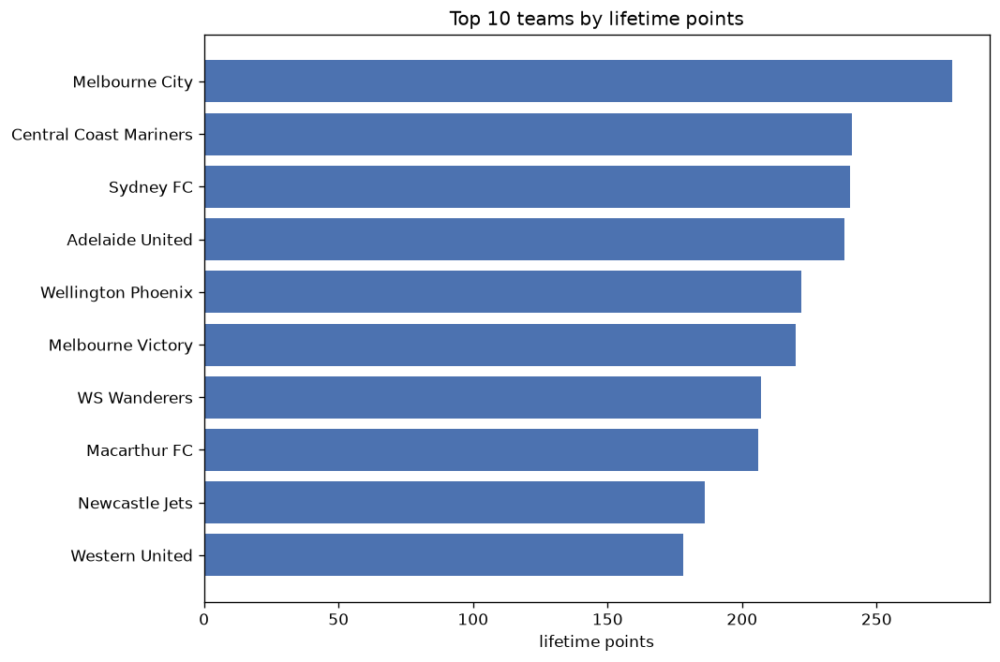
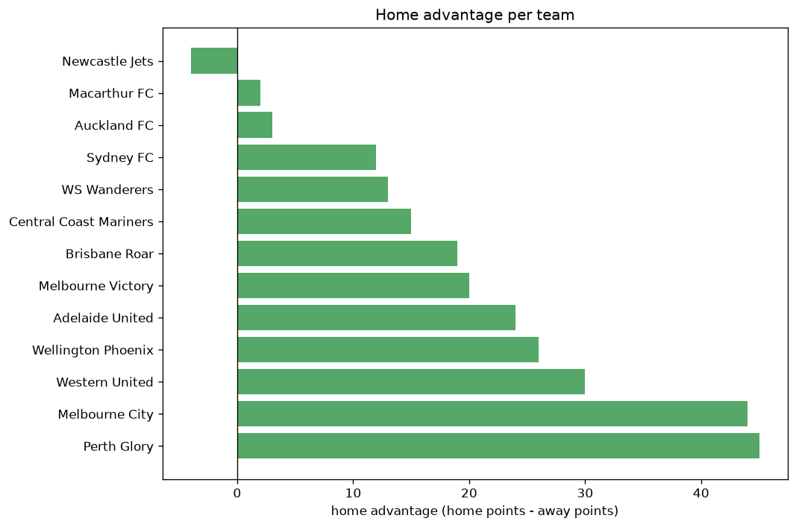

# Team Analysis
- Report: `teams_analysis`
- Generated: 2026-10-27T01:39:41+00:00
- Script: `backend/scripts/analyze_teams.py` v1.0.0
- League: A-League (Australia)
- Scope: league `australia`

- Teams: **13** | Seasons: **6** | Matches: **962**

## 1. Team standings (lifetime)
| team | seasons | played | W | D | L | pts | GF | GA | GD | avg pts/season | best pos | worst pos | titles |
|---|---|---|---|---|---|---|---|---|---|---|---|---|---|
| Melbourne City | 6 | 158 | 80 | 38 | 40 | 278 | 298 | 195 | 103 | 46.33 | 1 | 6 | 3 |
| Central Coast Mariners | 6 | 157 | 67 | 40 | 50 | 241 | 252 | 221 | 31 | 40.17 | 1 | 10 | 1 |
| Sydney FC | 6 | 161 | 67 | 39 | 55 | 240 | 258 | 221 | 37 | 40.0 | 2 | 8 | 0 |
| Adelaide United | 6 | 159 | 65 | 43 | 51 | 238 | 282 | 266 | 16 | 39.67 | 2 | 8 | 0 |
| Wellington Phoenix | 6 | 157 | 61 | 39 | 57 | 222 | 222 | 245 | -23 | 37.0 | 2 | 11 | 0 |
| Melbourne Victory | 6 | 158 | 59 | 43 | 56 | 220 | 233 | 222 | 11 | 36.67 | 2 | 12 | 0 |
| WS Wanderers | 6 | 157 | 55 | 42 | 60 | 207 | 247 | 239 | 8 | 34.5 | 4 | 12 | 0 |
| Macarthur FC | 6 | 157 | 56 | 38 | 63 | 206 | 234 | 268 | -34 | 34.33 | 5 | 12 | 0 |
| Newcastle Jets | 6 | 159 | 50 | 36 | 73 | 186 | 238 | 259 | -21 | 31.0 | 1 | 11 | 1 |
| Western United | 5 | 131 | 51 | 25 | 55 | 178 | 195 | 216 | -21 | 35.6 | 3 | 11 | 0 |
| Brisbane Roar | 6 | 157 | 44 | 41 | 72 | 173 | 192 | 242 | -50 | 28.83 | 4 | 12 | 0 |
| Perth Glory | 6 | 157 | 37 | 40 | 80 | 151 | 200 | 297 | -97 | 25.17 | 9 | 13 | 0 |
| Auckland FC | 2 | 56 | 29 | 18 | 9 | 105 | 98 | 58 | 40 | 52.5 | 1 | 3 | 1 |

## 2. Home vs away split
| team | home P | H-W | H-D | H-L | H-pts | away P | A-W | A-D | A-L | A-pts | adv |
|---|---|---|---|---|---|---|---|---|---|---|---|
| Perth Glory | 79 | 26 | 20 | 33 | 98 | 78 | 11 | 20 | 47 | 53 | 45 |
| Melbourne City | 79 | 48 | 17 | 14 | 161 | 79 | 32 | 21 | 26 | 117 | 44 |
| Western United | 65 | 30 | 14 | 21 | 104 | 66 | 21 | 11 | 34 | 74 | 30 |
| Wellington Phoenix | 78 | 35 | 19 | 24 | 124 | 79 | 26 | 20 | 33 | 98 | 26 |
| Adelaide United | 80 | 37 | 20 | 23 | 131 | 79 | 28 | 23 | 28 | 107 | 24 |
| Melbourne Victory | 79 | 33 | 21 | 25 | 120 | 79 | 26 | 22 | 31 | 100 | 20 |
| Brisbane Roar | 79 | 25 | 21 | 33 | 96 | 78 | 19 | 20 | 39 | 77 | 19 |
| Central Coast Mariners | 79 | 35 | 23 | 21 | 128 | 78 | 32 | 17 | 29 | 113 | 15 |
| WS Wanderers | 78 | 31 | 17 | 30 | 110 | 79 | 24 | 25 | 30 | 97 | 13 |
| Sydney FC | 79 | 35 | 21 | 23 | 126 | 82 | 32 | 18 | 32 | 114 | 12 |
| Auckland FC | 29 | 15 | 9 | 5 | 54 | 27 | 14 | 9 | 4 | 51 | 3 |
| Macarthur FC | 79 | 27 | 23 | 29 | 104 | 78 | 29 | 15 | 34 | 102 | 2 |
| Newcastle Jets | 79 | 25 | 16 | 38 | 91 | 80 | 25 | 20 | 35 | 95 | -4 |

## 3. Top performers
### Best points per game (PPG)
| rank | team | PPG |
|---|---|---|
| 1 | Auckland FC | 1.88 |
| 2 | Melbourne City | 1.76 |
| 3 | Central Coast Mariners | 1.53 |
| 4 | Adelaide United | 1.50 |
| 5 | Sydney FC | 1.49 |

### Most goals scored
| rank | team | goals |
|---|---|---|
| 1 | Melbourne City | 298 |
| 2 | Adelaide United | 282 |
| 3 | Sydney FC | 258 |
| 4 | Central Coast Mariners | 252 |
| 5 | WS Wanderers | 247 |

### Best goal difference
| rank | team | GD |
|---|---|---|
| 1 | Melbourne City | 103 |
| 2 | Auckland FC | 40 |
| 3 | Sydney FC | 37 |
| 4 | Central Coast Mariners | 31 |
| 5 | Adelaide United | 16 |

### Best defence (goals against per match, standings)
| rank | team | GA/match |
|---|---|---|
| 1 | Auckland FC | 1.077 |
| 2 | Melbourne City | 1.229 |
| 3 | Sydney FC | 1.389 |
| 4 | Central Coast Mariners | 1.408 |
| 5 | Melbourne Victory | 1.408 |

## 4. Team consistency
- Teams present in all **6** seasons: **11**

Adelaide United, Brisbane Roar, Central Coast Mariners, Macarthur FC, Melbourne City, Melbourne Victory, Newcastle Jets, Perth Glory, Sydney FC, WS Wanderers, Wellington Phoenix

## 5. Head-to-head dominance
- Distinct fixtures: **78** (showing the 15 most frequent)

| fixture | meetings | home wins | draws | away wins | home pct | draw pct | away pct |
|---|---|---|---|---|---|---|---|
| Sydney FC vs WS Wanderers | 18 | 8 | 3 | 7 | 44.4% | 16.7% | 38.9% |
| Central Coast Mariners vs Newcastle Jets | 18 | 7 | 2 | 9 | 38.9% | 11.1% | 50.0% |
| Melbourne City vs Melbourne Victory | 18 | 5 | 7 | 6 | 27.8% | 38.9% | 33.3% |
| Sydney FC vs Melbourne Victory | 17 | 8 | 3 | 6 | 47.1% | 17.6% | 35.3% |
| Adelaide United vs Melbourne Victory | 17 | 7 | 5 | 5 | 41.2% | 29.4% | 29.4% |
| Macarthur FC vs WS Wanderers | 17 | 6 | 4 | 7 | 35.3% | 23.5% | 41.2% |
| Melbourne City vs Brisbane Roar | 16 | 9 | 2 | 5 | 56.2% | 12.5% | 31.2% |
| Macarthur FC vs Newcastle Jets | 16 | 5 | 5 | 6 | 31.2% | 31.2% | 37.5% |
| Brisbane Roar vs Newcastle Jets | 15 | 9 | 1 | 5 | 60.0% | 6.7% | 33.3% |
| Wellington Phoenix vs Melbourne Victory | 15 | 9 | 2 | 4 | 60.0% | 13.3% | 26.7% |
| Adelaide United vs Perth Glory | 15 | 7 | 4 | 4 | 46.7% | 26.7% | 26.7% |
| Melbourne City vs Perth Glory | 15 | 7 | 2 | 6 | 46.7% | 13.3% | 40.0% |
| Sydney FC vs Newcastle Jets | 15 | 7 | 4 | 4 | 46.7% | 26.7% | 26.7% |
| Brisbane Roar vs Wellington Phoenix | 15 | 6 | 5 | 4 | 40.0% | 33.3% | 26.7% |
| Macarthur FC vs Wellington Phoenix | 15 | 5 | 2 | 8 | 33.3% | 13.3% | 53.3% |

## 6. Position per season (classic view)
_Cells show final position; '-' when the team was absent from that season._

| team | 2020-2021 | 2021-2022 | 2022-2023 | 2023-2024 | 2024-2025 | 2025-2026 |
|---|---|---|---|---|---|---|
| Melbourne City | 1 | 1 | 1 | 6 | 2 | 6 |
| Central Coast Mariners | 3 | 5 | 2 | 1 | 10 | 9 |
| Sydney FC | 2 | 8 | 5 | 4 | 7 | 5 |
| Adelaide United | 5 | 4 | 3 | 8 | 6 | 2 |
| Wellington Phoenix | 7 | 6 | 6 | 2 | 11 | 8 |
| Melbourne Victory | 12 | 2 | 11 | 3 | 5 | 4 |
| WS Wanderers | 8 | 10 | 4 | 7 | 4 | 12 |
| Macarthur FC | 6 | 7 | 12 | 5 | 8 | 7 |
| Newcastle Jets | 11 | 9 | 10 | 10 | 9 | 1 |
| Western United | 10 | 3 | 7 | 11 | 3 | - |
| Brisbane Roar | 4 | 11 | 8 | 9 | 12 | 11 |
| Perth Glory | 9 | 12 | 9 | 12 | 13 | 10 |
| Auckland FC | - | - | - | - | 1 | 3 |

---
*All statistics are computed from PostgreSQL tables (read-only). Run with `python backend/scripts/analyze_teams.py` to regenerate.*

## Charts

