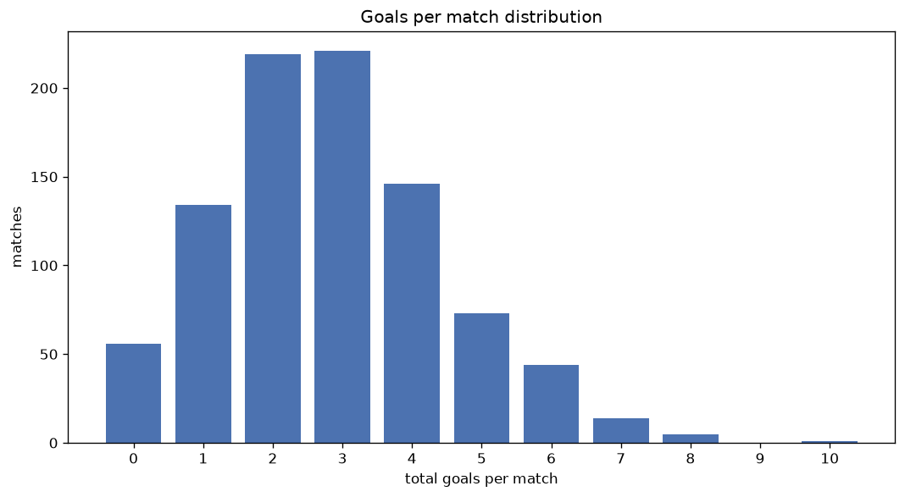
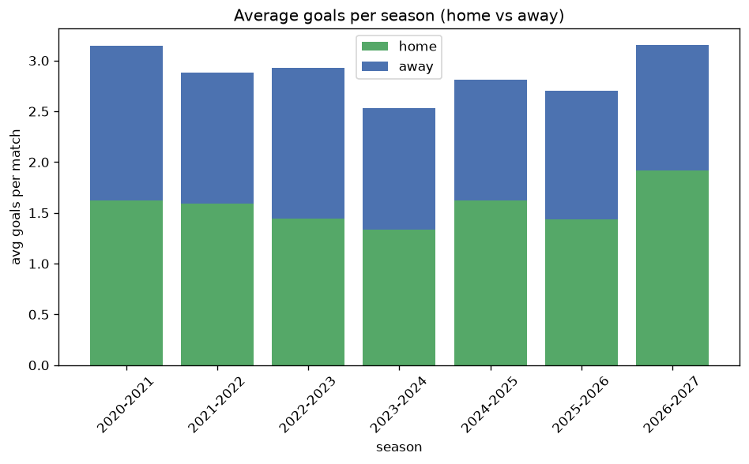

# Goal Analysis
- Report: `goals_analysis`
- Generated: 2026-10-26T01:26:18+00:00
- Script: `backend/scripts/analyze_goals.py` v1.0.0
- League: Bundesliga (Austria)
- Scope: league `austria1`

## 1. Goals per match distribution
| goals | matches | pct |
|---|---|---|
| 0 | 56 | 6.1% |
| 1 | 134 | 14.7% |
| 2 | 219 | 24.0% |
| 3 | 221 | 24.2% |
| 4 | 146 | 16.0% |
| 5 | 73 | 8.0% |
| 6 | 44 | 4.8% |
| 7 | 14 | 1.5% |
| 8 | 5 | 0.5% |
| 9 | 0 | 0.0% |
| 10 | 1 | 0.1% |

## 2. Goals per match per season
| season | matches | total goals | avg home | avg away | avg total |
|---|---|---|---|---|---|
| 2020-2021 | 132 | 415 | 1.621 | 1.523 | 3.144 |
| 2021-2022 | 132 | 380 | 1.591 | 1.288 | 2.879 |
| 2022-2023 | 132 | 386 | 1.447 | 1.477 | 2.924 |
| 2023-2024 | 132 | 334 | 1.333 | 1.197 | 2.53 |
| 2024-2025 | 132 | 371 | 1.621 | 1.189 | 2.811 |
| 2025-2026 | 195 | 527 | 1.436 | 1.267 | 2.703 |
| 2026-2027 | 58 | 183 | 1.914 | 1.241 | 3.155 |

## 3. Home vs away goal share
- Home goals: **1396** (53.8%)
- Away goals: **1200** (46.2%)
- Home/away ratio: **1.163**

| season | home goals | away goals | total | home pct | away pct |
|---|---|---|---|---|---|
| 2020-2021 | 214 | 201 | 415 | 51.6% | 48.4% |
| 2021-2022 | 210 | 170 | 380 | 55.3% | 44.7% |
| 2022-2023 | 191 | 195 | 386 | 49.5% | 50.5% |
| 2023-2024 | 176 | 158 | 334 | 52.7% | 47.3% |
| 2024-2025 | 214 | 157 | 371 | 57.7% | 42.3% |
| 2025-2026 | 280 | 247 | 527 | 53.1% | 46.9% |
| 2026-2027 | 111 | 72 | 183 | 60.7% | 39.3% |

## 4. BTTS (Both Teams To Score)
- Overall: **501** of `913` (54.9%)

| season | matches | BTTS | pct |
|---|---|---|---|
| 2020-2021 | 132 | 74 | 56.1% |
| 2021-2022 | 132 | 77 | 58.3% |
| 2022-2023 | 132 | 77 | 58.3% |
| 2023-2024 | 132 | 56 | 42.4% |
| 2024-2025 | 132 | 78 | 59.1% |
| 2025-2026 | 195 | 108 | 55.4% |
| 2026-2027 | 58 | 31 | 53.4% |

## 5. Clean sheets
- Home clean sheets: **254** (27.8%)
- Away clean sheets: **214** (23.4%)
- Total clean sheets recorded: **468**
- Matches with at least one clean sheet: **412** (45.1%)
- Both teams kept clean sheets (0-0): **56**

| season | matches | home CS | away CS | total CS | matches w/ CS |
|---|---|---|---|---|---|
| 2020-2021 | 132 | 30 | 36 | 66 | 58 (43.9%) |
| 2021-2022 | 132 | 30 | 30 | 60 | 55 (41.7%) |
| 2022-2023 | 132 | 34 | 28 | 62 | 55 (41.7%) |
| 2023-2024 | 132 | 49 | 39 | 88 | 76 (57.6%) |
| 2024-2025 | 132 | 37 | 27 | 64 | 54 (40.9%) |
| 2025-2026 | 195 | 58 | 41 | 99 | 87 (44.6%) |
| 2026-2027 | 58 | 16 | 13 | 29 | 27 (46.6%) |

## 6. Scoring intensity
- First-half goals: **1170** (45.1%)
- Second-half goals: **1426** (54.9%)
- Avg first-half goals per match: **1.281**
- Avg second-half goals per match: **1.562**
- Second-half-only scoring (HT 0-0, FT goals >= 1): **183** (20.0%)

| season | matches | 1st half | 2nd half | 1st half pct | 2nd half pct |
|---|---|---|---|---|---|
| 2020-2021 | 132 | 189 | 226 | 45.5% | 54.5% |
| 2021-2022 | 132 | 171 | 209 | 45.0% | 55.0% |
| 2022-2023 | 132 | 168 | 218 | 43.5% | 56.5% |
| 2023-2024 | 132 | 153 | 181 | 45.8% | 54.2% |
| 2024-2025 | 132 | 152 | 219 | 41.0% | 59.0% |
| 2025-2026 | 195 | 247 | 280 | 46.9% | 53.1% |
| 2026-2027 | 58 | 90 | 93 | 49.2% | 50.8% |

## 7. First-goal timing
- Matches with first-goal time recorded: `857` of `913` (93.9%)
- Goalless matches: `56`
- Min `1` | Max `97` | Mean `29.7` | Median (p50) `24`

| bucket | count | % of matches | % of scoring matches |
|---|---|---|---|
| 1-15 | 310 | 34.0% | 36.2% |
| 16-30 | 196 | 21.5% | 22.9% |
| 31-45 | 147 | 16.1% | 17.2% |
| 46-60 | 100 | 11.0% | 11.7% |
| 61-75 | 54 | 5.9% | 6.3% |
| 76-90 | 43 | 4.7% | 5.0% |
| 91-120 | 7 | 0.8% | 0.8% |

---
*All statistics are computed from PostgreSQL tables (read-only). Run with `python backend/scripts/analyze_goals.py` to regenerate.*

## Charts

