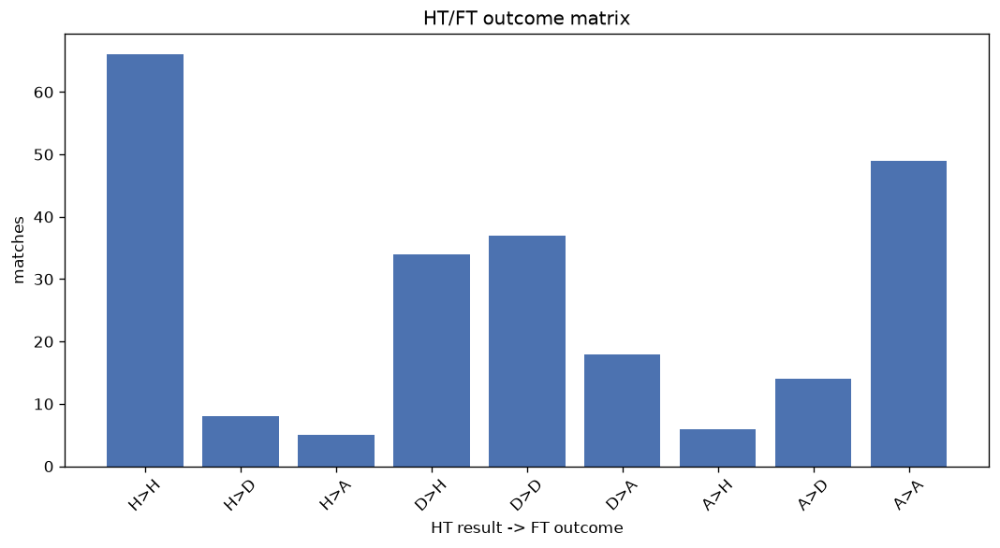
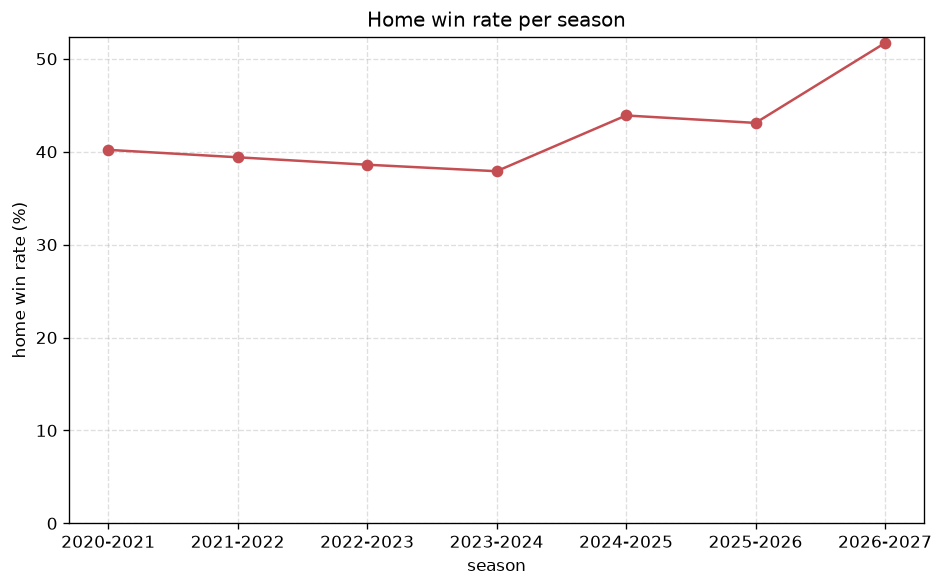

# Match Analysis
- Report: `matches_analysis`
- Generated: 2026-10-29T01:53:19+00:00
- Script: `backend/scripts/analyze_matches.py` v1.0.0
- League: Bundesliga (Austria)
- Scope: league `austria1`

## 1. Overall summary
| metric | value |
|---|---|
| Matches | 915 |
| Home wins | 379 (41.4%) |
| Draws | 233 (25.5%) |
| Away wins | 303 (33.1%) |
| Total goals | 2604 |
| Average goals per match | 2.846 |
| Goalless matches | 56 (6.1%) |

## 2. Per-season breakdown
| season | matches | home wins | draws | away wins | total goals | avg goals | goalless |
|---|---|---|---|---|---|---|---|
| 2020-2021 | 132 | 53 (40.2%) | 29 (22.0%) | 50 (37.9%) | 415 | 3.144 | 8 (6.1%) |
| 2021-2022 | 132 | 52 (39.4%) | 41 (31.1%) | 39 (29.5%) | 380 | 2.879 | 5 (3.8%) |
| 2022-2023 | 132 | 51 (38.6%) | 28 (21.2%) | 53 (40.2%) | 386 | 2.924 | 7 (5.3%) |
| 2023-2024 | 132 | 50 (37.9%) | 39 (29.5%) | 43 (32.6%) | 334 | 2.53 | 12 (9.1%) |
| 2024-2025 | 132 | 58 (43.9%) | 34 (25.8%) | 40 (30.3%) | 371 | 2.811 | 10 (7.6%) |
| 2025-2026 | 195 | 84 (43.1%) | 50 (25.6%) | 61 (31.3%) | 527 | 2.703 | 12 (6.2%) |
| 2026-2027 | 60 | 31 (51.7%) | 12 (20.0%) | 17 (28.3%) | 191 | 3.183 | 2 (3.3%) |

## 3. HT/FT outcome matrix
| HT result \ FT result | Home | Draw | Away | total |
|---|---|---|---|---|
| HT home lead | 239 (80.5%) | 37 (12.5%) | 21 (7.1%) | 297 |
| HT draw | 117 (32.6%) | 139 (38.7%) | 103 (28.7%) | 359 |
| HT away lead | 23 (8.9%) | 57 (22.0%) | 179 (69.1%) | 259 |

## 4. Comeback matches
- Home comebacks (trailing at HT, won at FT): **23** (2.5%)
- Away comebacks (trailing at HT, won at FT): **21** (2.3%)

### Home comebacks
| season | home | away | HT | FT |
|---|---|---|---|---|
| 2020-2021 | Ried | Tirol | 1-2 | 3-2 |
| 2020-2021 | Salzburg | LASK | 0-1 | 3-1 |
| 2020-2021 | Austria Vienna | Altach | 0-1 | 5-1 |
| 2020-2021 | Altach | Ried | 0-1 | 2-1 |
| 2021-2022 | LASK | Admira | 0-1 | 3-1 |
| 2021-2022 | Salzburg | Hartberg | 0-1 | 2-1 |
| 2022-2023 | Altach | Austria Vienna | 0-1 | 3-2 |
| 2022-2023 | Sturm Graz | Wolfsberger AC | 0-1 | 3-2 |
| 2022-2023 | Austria Vienna | Altach | 0-1 | 2-1 |
| 2023-2024 | Hartberg | BW Linz | 1-2 | 3-2 |
| 2024-2025 | Austria Vienna | Wolfsberger AC | 0-1 | 3-1 |
| 2024-2025 | Sturm Graz | Tirol | 1-2 | 4-2 |
| 2024-2025 | Austria Vienna | BW Linz | 0-1 | 2-1 |
| 2024-2025 | Wolfsberger AC | LASK | 0-1 | 2-1 |
| 2024-2025 | Salzburg | Sturm Graz | 0-1 | 3-1 |
| 2025-2026 | Austria Vienna | Ried | 0-2 | 3-2 |
| 2025-2026 | SK Rapid | Sturm Graz | 0-1 | 2-1 |
| 2025-2026 | BW Linz | Ried | 0-2 | 3-2 |
| 2025-2026 | Ried | Altach | 0-1 | 3-2 |
| 2025-2026 | Tirol | Wolfsberger AC | 0-1 | 3-1 |
| 2025-2026 | LASK | SK Rapid | 0-1 | 3-1 |
| 2026-2027 | Hartberg | A. Lustenau | 1-2 | 4-3 |
| 2026-2027 | Altach | Austria Vienna | 0-1 | 2-1 |

### Away comebacks
| season | home | away | HT | FT |
|---|---|---|---|---|
| 2020-2021 | Admira | Hartberg | 2-1 | 2-3 |
| 2020-2021 | Tirol | Ried | 1-0 | 1-3 |
| 2021-2022 | Sturm Graz | Salzburg | 1-0 | 1-3 |
| 2021-2022 | SK Rapid | Admira | 1-0 | 1-2 |
| 2021-2022 | Admira | Ried | 1-0 | 1-2 |
| 2021-2022 | SK Rapid | Salzburg | 1-0 | 1-2 |
| 2021-2022 | Admira | Austria Vienna | 1-0 | 1-2 |
| 2022-2023 | Ried | Tirol | 1-0 | 1-2 |
| 2022-2023 | Ried | Altach | 2-1 | 2-3 |
| 2023-2024 | Wolfsberger AC | Salzburg | 1-0 | 1-2 |
| 2023-2024 | Wolfsberger AC | Sturm Graz | 1-0 | 1-2 |
| 2023-2024 | SK Rapid | A. Klagenfurt | 1-0 | 2-3 |
| 2023-2024 | A. Lustenau | LASK | 1-0 | 1-3 |
| 2023-2024 | Altach | Hartberg | 1-0 | 1-2 |
| 2024-2025 | Grazer AK | Wolfsberger AC | 3-0 | 3-4 |
| 2024-2025 | SK Rapid | Wolfsberger AC | 1-0 | 1-3 |
| 2025-2026 | Wolfsberger AC | Ried | 1-0 | 1-2 |
| 2025-2026 | Salzburg | Tirol | 2-0 | 2-3 |
| 2025-2026 | Sturm Graz | Tirol | 1-0 | 1-3 |
| 2025-2026 | Hartberg | Salzburg | 1-0 | 1-2 |
| 2026-2027 | Wolfsberger AC | LASK | 1-0 | 1-3 |

## 5. HT lead conversion
| HT state | matches | converted to win | held as draw | collapsed to loss |
|---|---|---|---|---|
| Home lead | 297 | 239 (80.5%) | 37 (12.5%) | 21 (7.1%) |
| Away lead | 259 | 179 (69.1%) | 57 (22.0%) | 23 (8.9%) |

### Matches level at half-time
| FT result | count | pct |
|---|---|---|
| Home win | 117 | 32.6% |
| Draw | 139 | 38.7% |
| Away win | 103 | 28.7% |

## 6. First-goal timing
- Matches with a first-goal time recorded: `859` of `915` (93.9%)

Outcome distribution by first-goal timing bucket:
| bucket | matches | % of matches | home | draw | away |
|---|---|---|---|---|---|
| 1-15 | 311 | 34.0% | 124 (39.9%) | 66 (21.2%) | 121 (38.9%) |
| 16-30 | 196 | 21.4% | 94 (48.0%) | 43 (21.9%) | 59 (30.1%) |
| 31-45 | 148 | 16.2% | 72 (48.6%) | 29 (19.6%) | 47 (31.8%) |
| 46-60 | 100 | 10.9% | 39 (39.0%) | 28 (28.0%) | 33 (33.0%) |
| 61-75 | 54 | 5.9% | 18 (33.3%) | 7 (13.0%) | 29 (53.7%) |
| 76-90 | 43 | 4.7% | 25 (58.1%) | 4 (9.3%) | 14 (32.6%) |
| 91-120 | 7 | 0.8% | 7 (100.0%) | 0 (0.0%) | 0 (0.0%) |

## 7. Goalless matches
- Overall: **56** of `915` (6.1%)

| season | matches | goalless | pct |
|---|---|---|---|
| 2020-2021 | 132 | 8 | 6.1% |
| 2021-2022 | 132 | 5 | 3.8% |
| 2022-2023 | 132 | 7 | 5.3% |
| 2023-2024 | 132 | 12 | 9.1% |
| 2024-2025 | 132 | 10 | 7.6% |
| 2025-2026 | 195 | 12 | 6.2% |
| 2026-2027 | 60 | 2 | 3.3% |

---
*All statistics are computed from PostgreSQL tables (read-only). Run with `python backend/scripts/analyze_matches.py` to regenerate.*

## Charts

