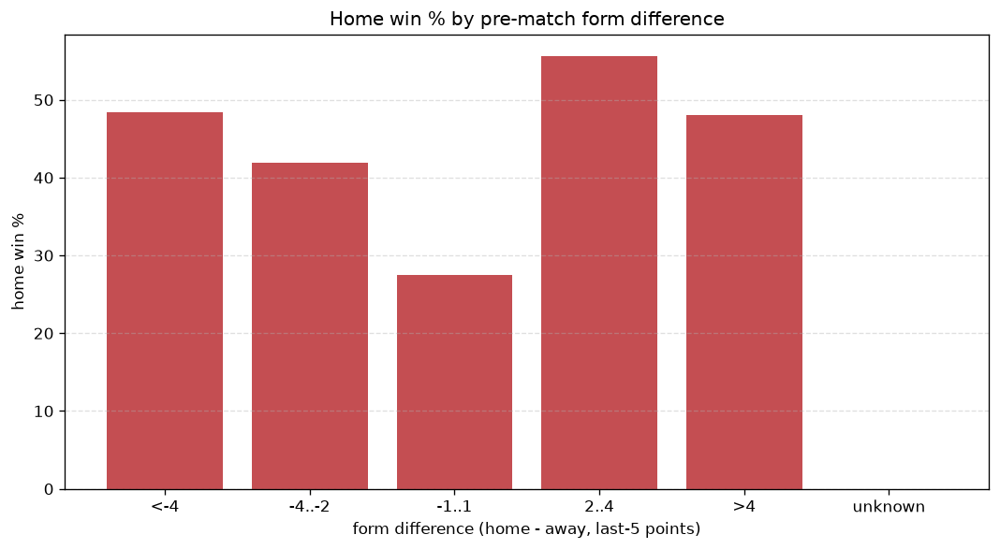
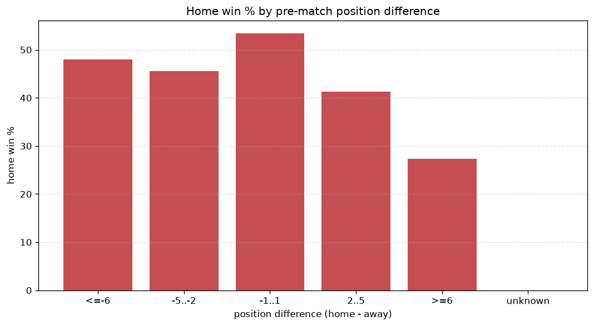

# Relationships Analysis
- Report: `relationships`
- Generated: 2026-10-29T01:53:27+00:00
- Script: `backend/scripts/analyze_relationships.py` v1.0.0
- League: Bundesliga (Austria)
- Scope: league `austria1`

- Matches analysed: **855** (23 leakage-safe pre-match features).

## 1. Correlation matrix
_Pearson correlation of each pre-match feature with observed goals; sorted by |corr(total goals)|._

| feature | corr(home) | corr(away) | corr(total) |
|---|---|---|---|
| away_points_before_match | -0.103 | 0.026 | -0.061 |
| rest_days_difference | 0.049 | 0.014 | 0.048 |
| away_rest_days | -0.058 | -0.004 | -0.048 |
| away_team_away_conceded_avg | 0.038 | -0.105 | -0.047 |
| home_position_before_match | -0.160 | 0.109 | -0.044 |
| position_difference | -0.238 | 0.197 | -0.042 |
| home_team_home_goals_avg | 0.103 | -0.056 | 0.040 |
| home_rest_days | -0.049 | -0.001 | -0.039 |
| points_difference | 0.241 | -0.206 | 0.037 |
| home_points_before_match | 0.070 | -0.122 | -0.035 |
| away_team_goals_conceded_last_5 | 0.037 | -0.079 | -0.029 |
| home_team_goals_conceded_last_5 | -0.094 | 0.065 | -0.026 |
| home_team_home_win_rate | 0.139 | -0.116 | 0.024 |
| away_position_before_match | 0.169 | -0.163 | 0.013 |
| away_team_away_win_rate | -0.116 | 0.139 | 0.011 |
| away_team_points_last_5 | -0.112 | 0.107 | -0.009 |
| home_team_points_last_5 | 0.085 | -0.101 | -0.007 |
| home_team_home_conceded_avg | -0.092 | 0.107 | 0.007 |
| home_team_goals_scored_last_5 | 0.066 | -0.065 | 0.004 |
| away_team_wins_last_5 | -0.110 | 0.111 | -0.004 |
| home_team_wins_last_5 | 0.102 | -0.105 | 0.002 |
| away_team_away_goals_avg | -0.121 | 0.131 | 0.002 |
| away_team_goals_scored_last_5 | -0.117 | 0.123 | -0.001 |

## 2. Form vs outcome
_Home win/draw/away % per bucket of `home_team_points_last_5 - away_team_points_last_5`._

| bucket | matches | home | draw | away | home % | draw % | away % |
|---|---|---|---|---|---|---|---|
| <-4 | 127 | 35 | 36 | 56 | 27.6% | 28.3% | 44.1% |
| -4..-2 | 187 | 61 | 58 | 68 | 32.6% | 31.0% | 36.4% |
| -1..1 | 262 | 101 | 67 | 94 | 38.5% | 25.6% | 35.9% |
| 2..4 | 154 | 80 | 36 | 38 | 51.9% | 23.4% | 24.7% |
| >4 | 125 | 71 | 24 | 30 | 56.8% | 19.2% | 24.0% |
| unknown | 0 | 0 | 0 | 0 | - | - | - |

## 3. Position vs outcome
_Home win/draw/away % per bucket of `position_difference` (home position - away position; negative favours the home team)._

| bucket | matches | home | draw | away | home % | draw % | away % |
|---|---|---|---|---|---|---|---|
| <=-6 | 109 | 68 | 21 | 20 | 62.4% | 19.3% | 18.3% |
| -5..-2 | 211 | 106 | 49 | 56 | 50.2% | 23.2% | 26.5% |
| -1..1 | 188 | 78 | 43 | 67 | 41.5% | 22.9% | 35.6% |
| 2..5 | 233 | 71 | 69 | 93 | 30.5% | 29.6% | 39.9% |
| >=6 | 114 | 25 | 39 | 50 | 21.9% | 34.2% | 43.9% |
| unknown | 0 | 0 | 0 | 0 | - | - | - |

## 4. Rest advantage
_Home win/draw/away % per bucket of `rest_days_difference` (home rest - away rest). Matches with unknown rest are bucketed separately._

| bucket | matches | home | draw | away | home % | draw % | away % |
|---|---|---|---|---|---|---|---|
| <-1 | 29 | 9 | 7 | 13 | 31.0% | 24.1% | 44.8% |
| -1..0 | 201 | 81 | 49 | 71 | 40.3% | 24.4% | 35.3% |
| 0 | 337 | 137 | 94 | 106 | 40.7% | 27.9% | 31.5% |
| 1..2 | 235 | 100 | 57 | 78 | 42.6% | 24.3% | 33.2% |
| >2 | 17 | 6 | 5 | 6 | 35.3% | 29.4% | 35.3% |
| unknown | 36 | 15 | 9 | 12 | 41.7% | 25.0% | 33.3% |
- *36 match(es) had unknown rest difference (missing rest data on at least one side).*

## 5. Home team quality
_Home win rate by `home_team_home_win_rate` tier (split at 0.5)._

- `< 0.5` tier: **36.0%** home win (205/570)
- `>= 0.5` tier: **50.2%** home win (143/285)
- Home-win gap (>= split minus < split): **+14.2 pp**

| tier | label | matches | home | draw | away | home % |
|---|---|---|---|---|---|---|
| low | < 0.5 | 570 | 205 | 155 | 210 | 36.0% |
| high | >= 0.5 | 285 | 143 | 66 | 76 | 50.2% |

## 6. Feature averages by result
_Mean feature value per outcome; `range` is home-minus-away spread of the group means._

| feature | home mean | draw mean | away mean | range |
|---|---|---|---|---|
| points_difference | 2.879 | -1.665 | -2.619 | 5.498 |
| home_points_before_match | 17.730 | 15.403 | 14.213 | 3.517 |
| position_difference | -1.497 | 1.000 | 1.255 | 2.752 |
| away_points_before_match | 14.851 | 17.068 | 16.832 | 2.217 |
| away_rest_days | 9.138 | 11.217 | 10.642 | 2.079 |
| home_rest_days | 9.216 | 11.198 | 10.657 | 1.982 |
| away_position_before_match | 7.480 | 5.982 | 5.850 | 1.630 |
| away_team_goals_scored_last_5 | 5.661 | 6.299 | 6.913 | 1.252 |
| away_team_points_last_5 | 5.368 | 6.448 | 6.510 | 1.143 |
| home_position_before_match | 5.983 | 6.982 | 7.105 | 1.122 |
| home_team_points_last_5 | 6.382 | 5.683 | 5.552 | 0.830 |
| away_team_goals_conceded_last_5 | 6.523 | 5.765 | 6.066 | 0.758 |
| home_team_goals_conceded_last_5 | 5.776 | 6.462 | 6.497 | 0.721 |
| home_team_goals_scored_last_5 | 6.356 | 6.027 | 5.878 | 0.479 |
| away_team_wins_last_5 | 1.394 | 1.787 | 1.794 | 0.400 |
| home_team_wins_last_5 | 1.753 | 1.534 | 1.444 | 0.309 |
| away_team_away_goals_avg | 1.127 | 1.198 | 1.429 | 0.302 |
| home_team_home_conceded_avg | 1.147 | 1.271 | 1.345 | 0.197 |
| home_team_home_goals_avg | 1.502 | 1.349 | 1.325 | 0.177 |
| away_team_away_conceded_avg | 1.475 | 1.414 | 1.338 | 0.137 |
| home_team_home_win_rate | 0.417 | 0.357 | 0.312 | 0.105 |
| rest_days_difference | 0.078 | -0.019 | 0.015 | 0.097 |
| away_team_away_win_rate | 0.261 | 0.313 | 0.354 | 0.093 |

---
*All features are leakage-safe pre-match values built by `ml.features.build_features.build_rows` from strictly prior matches. Run with `python backend/scripts/analyze_relationships.py` to regenerate.*

## Charts

