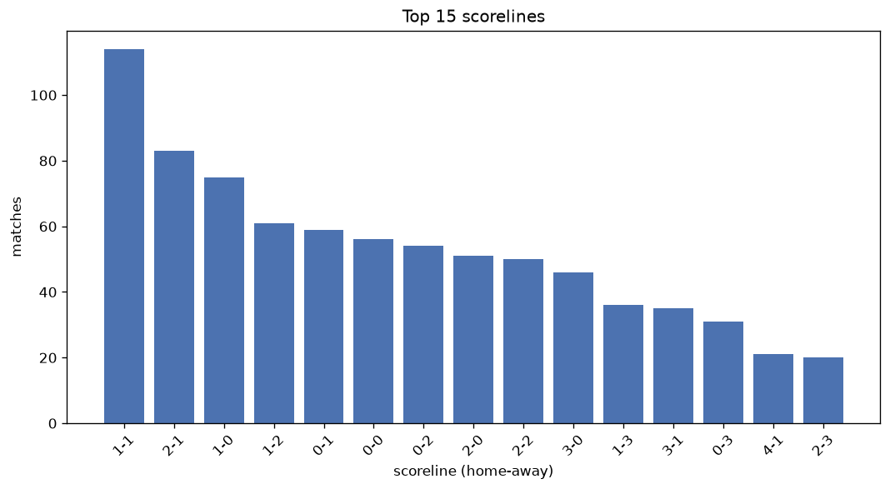
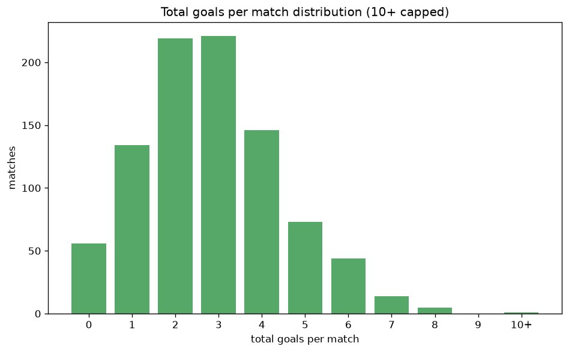

# Scoreline Analysis
- Report: `scoreline_analysis`
- Generated: 2026-10-26T01:26:22+00:00
- Script: `backend/scripts/analyze_scorelines.py` v1.0.0
- League: Bundesliga (Austria)
- Scope: league `austria1`

## 1. Scoreline frequency
- Matches analysed: **913** across **7** seasons.
- Distinct scorelines seen: **37**.

| scoreline | count | pct |
|---|---|---|
| 1-1 | 114 | 12.5% |
| 2-1 | 83 | 9.1% |
| 1-0 | 75 | 8.2% |
| 1-2 | 61 | 6.7% |
| 0-1 | 59 | 6.5% |
| 0-0 | 56 | 6.1% |
| 0-2 | 54 | 5.9% |
| 2-0 | 51 | 5.6% |
| 2-2 | 50 | 5.5% |
| 3-0 | 46 | 5.0% |
| 1-3 | 36 | 3.9% |
| 3-1 | 35 | 3.8% |
| 0-3 | 31 | 3.4% |
| 4-1 | 21 | 2.3% |
| 2-3 | 20 | 2.2% |
| 3-2 | 16 | 1.8% |
| 4-0 | 16 | 1.8% |
| 3-3 | 12 | 1.3% |
| 4-2 | 11 | 1.2% |
| 0-4 | 9 | 1.0% |

## 2. Scoreline frequency per season

### 2020-2021
| scoreline | count | pct |
|---|---|---|
| 1-1 | 16 | 12.1% |
| 2-1 | 11 | 8.3% |
| 0-2 | 10 | 7.6% |
| 0-1 | 9 | 6.8% |
| 0-0 | 8 | 6.1% |

### 2021-2022
| scoreline | count | pct |
|---|---|---|
| 1-1 | 22 | 16.7% |
| 2-1 | 12 | 9.1% |
| 0-1 | 11 | 8.3% |
| 2-2 | 11 | 8.3% |
| 1-0 | 9 | 6.8% |

### 2022-2023
| scoreline | count | pct |
|---|---|---|
| 1-1 | 13 | 9.8% |
| 1-2 | 13 | 9.8% |
| 2-1 | 12 | 9.1% |
| 1-0 | 11 | 8.3% |
| 0-1 | 9 | 6.8% |

### 2023-2024
| scoreline | count | pct |
|---|---|---|
| 1-1 | 17 | 12.9% |
| 1-0 | 14 | 10.6% |
| 2-0 | 13 | 9.8% |
| 0-0 | 12 | 9.1% |
| 0-1 | 10 | 7.6% |

### 2024-2025
| scoreline | count | pct |
|---|---|---|
| 2-1 | 18 | 13.6% |
| 1-1 | 16 | 12.1% |
| 1-2 | 15 | 11.4% |
| 0-0 | 10 | 7.6% |
| 0-1 | 10 | 7.6% |

### 2025-2026
| scoreline | count | pct |
|---|---|---|
| 1-1 | 24 | 12.3% |
| 1-0 | 22 | 11.3% |
| 2-1 | 19 | 9.7% |
| 0-2 | 15 | 7.7% |
| 2-2 | 13 | 6.7% |

### 2026-2027
| scoreline | count | pct |
|---|---|---|
| 3-0 | 7 | 12.1% |
| 1-1 | 6 | 10.3% |
| 0-2 | 6 | 10.3% |
| 1-0 | 5 | 8.6% |
| 2-1 | 5 | 8.6% |

## 3. Total-goal histogram
_10+ groups all matches with 10 or more total goals._

| total goals | matches | pct |
|---|---|---|
| 0 | 56 | 6.1% |
| 1 | 134 | 14.7% |
| 2 | 219 | 24.0% |
| 3 | 221 | 24.2% |
| 4 | 146 | 16.0% |
| 5 | 73 | 8.0% |
| 6 | 44 | 4.8% |
| 7 | 14 | 1.5% |
| 8 | 5 | 0.5% |
| 9 | 0 | 0.0% |
| 10+ | 1 | 0.1% |

## 4. Extreme scorelines
- Matches with 7+ total goals: **20**

| season | date | scoreline | total goals |
|---|---|---|---|
| 2020-2021 | 2020-11-28 | 2-8 | 10 |
| 2020-2021 | 2020-10-04 | 7-1 | 8 |
| 2020-2021 | 2021-03-14 | 3-5 | 8 |
| 2020-2021 | 2021-03-21 | 3-5 | 8 |
| 2021-2022 | 2021-08-01 | 7-1 | 8 |
| 2026-2027 | 2026-08-16 | 8-0 | 8 |
| 2020-2021 | 2020-10-25 | 3-4 | 7 |
| 2020-2021 | 2020-11-22 | 4-3 | 7 |
| 2021-2022 | 2021-08-07 | 4-3 | 7 |
| 2021-2022 | 2021-09-26 | 3-4 | 7 |
| 2021-2022 | 2021-10-03 | 5-2 | 7 |
| 2022-2023 | 2022-09-04 | 3-4 | 7 |
| 2023-2024 | 2024-02-24 | 7-0 | 7 |
| 2024-2025 | 2024-10-19 | 5-2 | 7 |
| 2024-2025 | 2024-11-23 | 7-0 | 7 |
| 2024-2025 | 2024-11-30 | 3-4 | 7 |
| 2025-2026 | 2025-10-19 | 3-4 | 7 |
| 2025-2026 | 2026-03-15 | 2-5 | 7 |
| 2026-2027 | 2026-10-11 | 4-3 | 7 |
| 2026-2027 | 2026-10-18 | 6-1 | 7 |

## 5. Margin-of-victory distribution (decided matches)
- Decided matches: **681** (draws: **232**)
- Average winning margin: **1.9**

| margin | matches | pct |
|---|---|---|
| 1 | 322 | 47.3% |
| 2 | 195 | 28.6% |
| 3+ | 164 | 24.1% |

## 6. Margin by outcome

### Home wins
- Matches: **379** | avg margin: **1.96** | max margin: **8**
| margin | matches | pct |
|---|---|---|
| 1 | 177 | 46.7% |
| 2 | 97 | 25.6% |
| 3+ | 105 | 27.7% |
- *Full match-by-match list available in `scoreline_analysis.json`.*

### Away wins
- Matches: **302** | avg margin: **1.81** | max margin: **6**
| margin | matches | pct |
|---|---|---|
| 1 | 145 | 48.0% |
| 2 | 98 | 32.5% |
| 3+ | 59 | 19.5% |
- *Full match-by-match list available in `scoreline_analysis.json`.*

## 7. Most common exact score by outcome type
| outcome | matches | most common score | count | pct |
|---|---|---|---|---|
| home | 379 | 2-1 | 83 | 21.9% |
| draw | 232 | 1-1 | 114 | 49.1% |
| away | 302 | 1-2 | 61 | 20.2% |

---
*All statistics are computed from PostgreSQL tables (read-only). Run with `python backend/scripts/analyze_scorelines.py` to regenerate.*

## Charts

