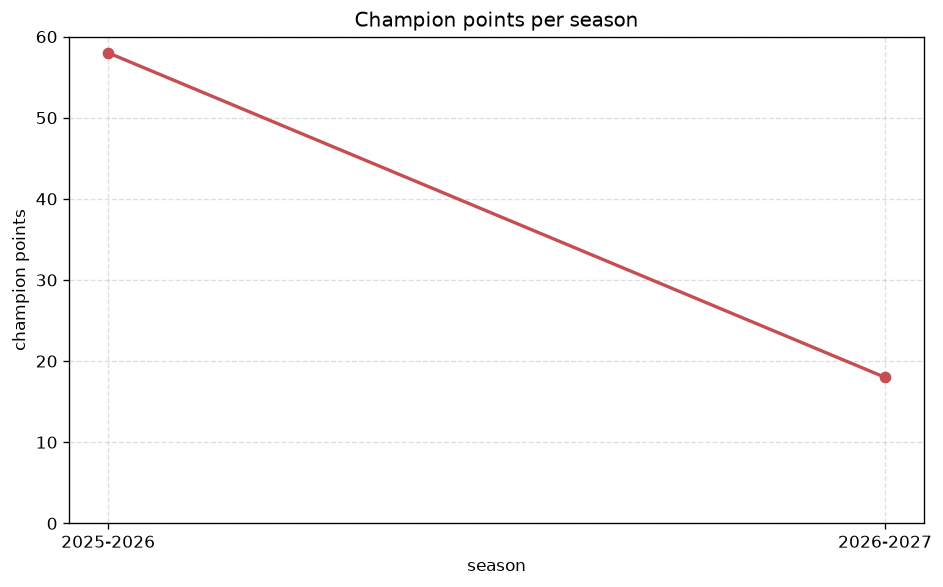
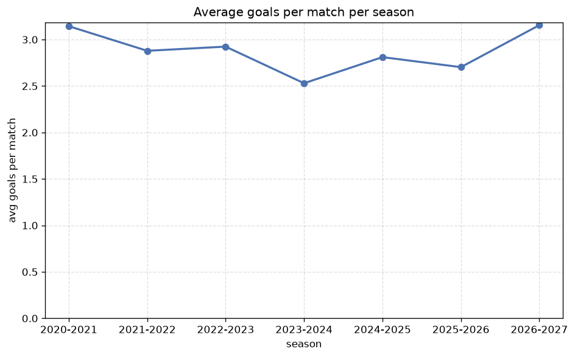

# Season Trends Analysis
- Report: `season_trends`
- Generated: 2026-10-29T01:53:24+00:00
- Script: `backend/scripts/analyze_seasons.py` v1.0.0
- League: Bundesliga (Austria)
- Scope: league `austria1`

## 1. Champions per season
| season | champion | pts | runner-up | margin |
|---|---|---|---|---|
| 2020-2021 | Salzburg | 52 | SK Rapid | 7 pts |
| 2021-2022 | Salzburg | 55 | Sturm Graz | 18 pts |
| 2022-2023 | Salzburg | 55 | Sturm Graz | 7 pts |
| 2023-2024 | Salzburg | 50 | Sturm Graz | 4 pts |
| 2024-2025 | Sturm Graz | 46 | Austria Vienna | 0 pts |
| 2025-2026 | LASK | 58 | Sturm Graz | 2 pts |
| 2026-2027 | SK Rapid | 27 | Salzburg | 3 pts |

## 2. Title-race tightness
- Tight races (margin <= 3 pts): **3** of 7 seasons
- Tightest race: **2024-2025** - Sturm Graz beat Austria Vienna by **0** pts

| season | margin | tight |
|---|---|---|
| 2020-2021 | 7 pts |  |
| 2021-2022 | 18 pts |  |
| 2022-2023 | 7 pts |  |
| 2023-2024 | 4 pts |  |
| 2024-2025 | 0 pts | yes |
| 2025-2026 | 2 pts | yes |
| 2026-2027 | 3 pts | yes |

## 3. Points thresholds
_Position-specific points per season. Key: 1 = champion, 2 = runner-up, 4 = CL line, 6 = Europa, 9 = last safe, 12 = bottom._

| season | pos 1 | pos 2 | pos 4 | pos 6 | pos 9 | pos 12 |
|---|---|---|---|---|---|---|
| 2020-2021 | 52 | 45 | 39 | 30 | 21 | 14 |
| 2021-2022 | 55 | 37 | 33 | 30 | 23 | 13 |
| 2022-2023 | 55 | 48 | 35 | 30 | 21 | 17 |
| 2023-2024 | 50 | 46 | 34 | 33 | 19 | 10 |
| 2024-2025 | 46 | 46 | 36 | 33 | 21 | 16 |
| 2025-2026 | 58 | 56 | 48 | 47 | 41 | 29 |
| 2026-2027 | 27 | 24 | 18 | 14 | 9 | 5 |

## 4. Relegation battle
| season | safe pos | safe pts | drop pos | drop pts | gap |
|---|---|---|---|---|---|
| 2020-2021 | 9 | 21 | 10 | 21 | 0 pts |
| 2021-2022 | 9 | 23 | 10 | 22 | 1 pts |
| 2022-2023 | 9 | 21 | 10 | 18 | 3 pts |
| 2023-2024 | 9 | 19 | 10 | 19 | 0 pts |
| 2024-2025 | 9 | 21 | 10 | 19 | 2 pts |
| 2025-2026 | 9 | 41 | 10 | 40 | 1 pts |
| 2026-2027 | 9 | 9 | 10 | 8 | 1 pts |

## 5. League-level trends
| season | matches | total goals | avg goals | home win | draw | away win | goalless | avg pts/team |
|---|---|---|---|---|---|---|---|---|
| 2020-2021 | 132 | 415 | 3.144 | 40.2% | 22.0% | 37.9% | 6.1% | 30.58 |
| 2021-2022 | 132 | 380 | 2.879 | 39.4% | 31.1% | 29.5% | 3.8% | 29.58 |
| 2022-2023 | 132 | 386 | 2.924 | 38.6% | 21.2% | 40.2% | 5.3% | 30.67 |
| 2023-2024 | 132 | 334 | 2.53 | 37.9% | 29.5% | 32.6% | 9.1% | 29.75 |
| 2024-2025 | 132 | 371 | 2.811 | 43.9% | 25.8% | 30.3% | 7.6% | 30.17 |
| 2025-2026 | 195 | 527 | 2.703 | 43.1% | 25.6% | 31.3% | 6.2% | 44.58 |
| 2026-2027 | 60 | 191 | 3.183 | 51.7% | 20.0% | 28.3% | 3.3% | 14.0 |

## 6. View divergence
- Largest divergence: **2023-2024** (goals view, avg abs position diff = 5.000)

_Avg absolute position difference between classic view and alternative view per season._

| season | classic vs luck | classic vs goals |
|---|---|---|
| 2020-2021 | 2.333 | 3.667 |
| 2021-2022 | 2.833 | 2.667 |
| 2022-2023 | 2.500 | 4.333 |
| 2023-2024 | 1.667 | 5.000 |
| 2024-2025 | 2.333 | 3.000 |
| 2025-2026 | 3.167 | 3.667 |
| 2026-2027 | 1.167 | 2.500 |

---
*All statistics are computed from PostgreSQL tables (read-only). Run with `python backend/scripts/analyze_seasons.py` to regenerate.*

## Charts

