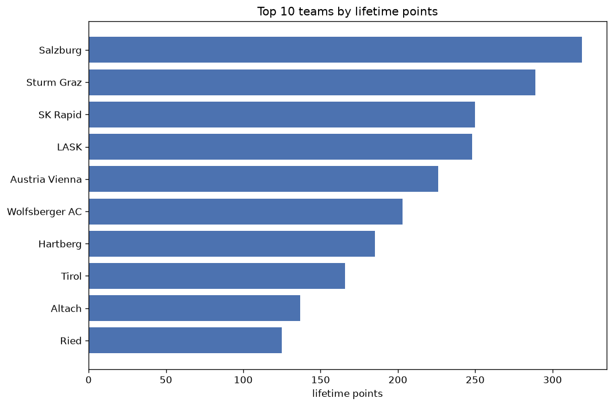
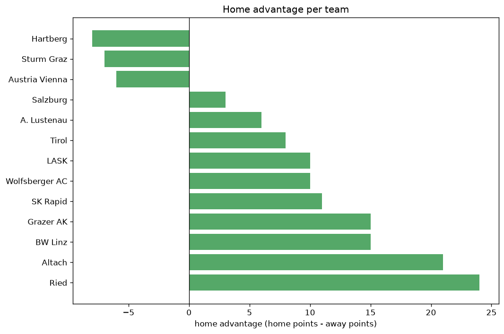

# Team Analysis
- Report: `teams_analysis`
- Generated: 2026-10-29T01:53:22+00:00
- Script: `backend/scripts/analyze_teams.py` v1.0.0
- League: Bundesliga (Austria)
- Scope: league `austria1`

- Teams: **16** | Seasons: **7** | Matches: **915**

## 1. Team standings (lifetime)
| team | seasons | played | W | D | L | pts | GF | GA | GD | avg pts/season | best pos | worst pos | titles |
|---|---|---|---|---|---|---|---|---|---|---|---|---|---|
| Salzburg | 7 | 152 | 96 | 34 | 22 | 322 | 324 | 130 | 194 | 46.0 | 1 | 3 | 4 |
| Sturm Graz | 7 | 152 | 83 | 41 | 28 | 290 | 274 | 157 | 117 | 41.43 | 1 | 4 | 1 |
| SK Rapid | 7 | 154 | 70 | 40 | 44 | 250 | 253 | 179 | 74 | 35.71 | 1 | 6 | 1 |
| LASK | 7 | 152 | 70 | 38 | 44 | 248 | 246 | 183 | 63 | 35.43 | 1 | 8 | 1 |
| Austria Vienna | 7 | 152 | 63 | 37 | 52 | 226 | 215 | 197 | 18 | 32.29 | 2 | 11 | 0 |
| Wolfsberger AC | 7 | 153 | 58 | 29 | 66 | 203 | 231 | 237 | -6 | 29.0 | 3 | 12 | 0 |
| Hartberg | 7 | 152 | 46 | 47 | 59 | 185 | 189 | 233 | -44 | 26.43 | 4 | 11 | 0 |
| Tirol | 7 | 152 | 42 | 40 | 70 | 166 | 192 | 253 | -61 | 23.71 | 6 | 11 | 0 |
| Altach | 7 | 152 | 33 | 38 | 81 | 137 | 135 | 245 | -110 | 19.57 | 8 | 12 | 0 |
| Ried | 5 | 111 | 33 | 27 | 51 | 126 | 128 | 183 | -55 | 25.2 | 4 | 11 | 0 |
| A. Klagenfurt | 4 | 88 | 29 | 28 | 31 | 115 | 117 | 144 | -27 | 28.75 | 5 | 9 | 0 |
| BW Linz | 3 | 76 | 22 | 15 | 39 | 81 | 89 | 116 | -27 | 27.0 | 6 | 12 | 0 |
| Grazer AK | 3 | 64 | 14 | 21 | 29 | 63 | 77 | 113 | -36 | 21.0 | 8 | 12 | 0 |
| A. Lustenau | 3 | 54 | 11 | 12 | 31 | 45 | 54 | 110 | -56 | 15.0 | 8 | 12 | 0 |
| Admira | 2 | 44 | 7 | 13 | 24 | 34 | 47 | 81 | -34 | 17.0 | 11 | 12 | 0 |
| St. Polten | 1 | 22 | 5 | 6 | 11 | 21 | 33 | 43 | -10 | 21.0 | 9 | 9 | 0 |

## 2. Home vs away split
| team | home P | H-W | H-D | H-L | H-pts | away P | A-W | A-D | A-L | A-pts | adv |
|---|---|---|---|---|---|---|---|---|---|---|---|
| Ried | 56 | 24 | 15 | 17 | 87 | 55 | 9 | 12 | 34 | 39 | 48 |
| SK Rapid | 78 | 44 | 12 | 22 | 144 | 76 | 26 | 28 | 22 | 106 | 38 |
| Altach | 76 | 21 | 22 | 33 | 85 | 76 | 12 | 16 | 48 | 52 | 33 |
| BW Linz | 38 | 16 | 7 | 15 | 55 | 38 | 6 | 8 | 24 | 26 | 29 |
| Salzburg | 76 | 52 | 13 | 11 | 169 | 76 | 44 | 21 | 11 | 153 | 16 |
| Sturm Graz | 76 | 45 | 18 | 13 | 153 | 76 | 38 | 23 | 15 | 137 | 16 |
| Austria Vienna | 75 | 33 | 21 | 21 | 120 | 77 | 30 | 16 | 31 | 106 | 14 |
| Hartberg | 77 | 25 | 24 | 28 | 99 | 75 | 21 | 23 | 31 | 86 | 13 |
| Grazer AK | 31 | 8 | 14 | 9 | 38 | 33 | 6 | 7 | 20 | 25 | 13 |
| A. Lustenau | 27 | 8 | 4 | 15 | 28 | 27 | 3 | 8 | 16 | 17 | 11 |
| LASK | 76 | 38 | 15 | 23 | 129 | 76 | 32 | 23 | 21 | 119 | 10 |
| Admira | 22 | 5 | 4 | 13 | 19 | 22 | 2 | 9 | 11 | 15 | 4 |
| A. Klagenfurt | 44 | 14 | 17 | 13 | 59 | 44 | 15 | 11 | 18 | 56 | 3 |
| Tirol | 76 | 18 | 28 | 30 | 82 | 76 | 24 | 12 | 40 | 84 | -2 |
| Wolfsberger AC | 76 | 27 | 16 | 33 | 97 | 77 | 31 | 13 | 33 | 106 | -9 |
| St. Polten | 11 | 1 | 3 | 7 | 6 | 11 | 4 | 3 | 4 | 15 | -9 |

## 3. Top performers
### Best points per game (PPG)
| rank | team | PPG |
|---|---|---|
| 1 | Salzburg | 2.12 |
| 2 | Sturm Graz | 1.91 |
| 3 | LASK | 1.63 |
| 4 | SK Rapid | 1.62 |
| 5 | Austria Vienna | 1.49 |

### Most goals scored
| rank | team | goals |
|---|---|---|
| 1 | Salzburg | 324 |
| 2 | Sturm Graz | 274 |
| 3 | SK Rapid | 253 |
| 4 | LASK | 246 |
| 5 | Wolfsberger AC | 231 |

### Best goal difference
| rank | team | GD |
|---|---|---|
| 1 | Salzburg | 194 |
| 2 | Sturm Graz | 117 |
| 3 | SK Rapid | 74 |
| 4 | LASK | 63 |
| 5 | Austria Vienna | 18 |

### Best defence (goals against per match, standings)
| rank | team | GA/match |
|---|---|---|
| 1 | Salzburg | 0.855 |
| 2 | Sturm Graz | 1.033 |
| 3 | SK Rapid | 1.162 |
| 4 | LASK | 1.204 |
| 5 | Austria Vienna | 1.296 |

## 4. Team consistency
- Teams present in all **7** seasons: **9**

Altach, Austria Vienna, Hartberg, LASK, SK Rapid, Salzburg, Sturm Graz, Tirol, Wolfsberger AC

## 5. Head-to-head dominance
- Distinct fixtures: **113** (showing the 15 most frequent)

| fixture | meetings | home wins | draws | away wins | home pct | draw pct | away pct |
|---|---|---|---|---|---|---|---|
| Hartberg vs Austria Vienna | 15 | 8 | 1 | 6 | 53.3% | 6.7% | 40.0% |
| SK Rapid vs LASK | 15 | 8 | 4 | 3 | 53.3% | 26.7% | 20.0% |
| Salzburg vs SK Rapid | 15 | 8 | 3 | 4 | 53.3% | 20.0% | 26.7% |
| Salzburg vs Austria Vienna | 15 | 7 | 1 | 7 | 46.7% | 6.7% | 46.7% |
| SK Rapid vs Hartberg | 15 | 6 | 3 | 6 | 40.0% | 20.0% | 40.0% |
| SK Rapid vs Sturm Graz | 15 | 6 | 5 | 4 | 40.0% | 33.3% | 26.7% |
| Salzburg vs Hartberg | 15 | 6 | 2 | 7 | 40.0% | 13.3% | 46.7% |
| Salzburg vs Sturm Graz | 15 | 6 | 6 | 3 | 40.0% | 40.0% | 20.0% |
| Sturm Graz vs Hartberg | 15 | 6 | 4 | 5 | 40.0% | 26.7% | 33.3% |
| LASK vs Austria Vienna | 15 | 5 | 5 | 5 | 33.3% | 33.3% | 33.3% |
| LASK vs Sturm Graz | 15 | 5 | 4 | 6 | 33.3% | 26.7% | 40.0% |
| Tirol vs Altach | 15 | 5 | 6 | 4 | 33.3% | 40.0% | 26.7% |
| Wolfsberger AC vs Altach | 15 | 5 | 4 | 6 | 33.3% | 26.7% | 40.0% |
| Wolfsberger AC vs Tirol | 15 | 5 | 4 | 6 | 33.3% | 26.7% | 40.0% |
| Salzburg vs LASK | 15 | 4 | 2 | 9 | 26.7% | 13.3% | 60.0% |

## 6. Position per season (classic view)
_Cells show final position; '-' when the team was absent from that season._

| team | 2020-2021 | 2021-2022 | 2022-2023 | 2023-2024 | 2024-2025 | 2025-2026 | 2026-2027 |
|---|---|---|---|---|---|---|---|
| Salzburg | 1 | 1 | 1 | 1 | 3 | 3 | 2 |
| Sturm Graz | 4 | 2 | 2 | 2 | 1 | 2 | 4 |
| SK Rapid | 2 | 5 | 5 | 6 | 5 | 5 | 1 |
| LASK | 3 | 8 | 3 | 3 | 7 | 1 | 3 |
| Austria Vienna | 8 | 4 | 4 | 7 | 2 | 6 | 11 |
| Wolfsberger AC | 5 | 3 | 9 | 8 | 4 | 9 | 12 |
| Hartberg | 7 | 10 | 11 | 4 | 8 | 7 | 6 |
| Tirol | 6 | 9 | 7 | 11 | 10 | 10 | 7 |
| Altach | 10 | 12 | 12 | 9 | 11 | 8 | 9 |
| Ried | 11 | 7 | 10 | - | - | 4 | 5 |
| A. Klagenfurt | - | 6 | 6 | 5 | 9 | - | - |
| BW Linz | - | - | - | 10 | 6 | 12 | - |
| Grazer AK | - | - | - | - | 12 | 11 | 8 |
| A. Lustenau | - | - | 8 | 12 | - | - | 10 |
| Admira | 12 | 11 | - | - | - | - | - |
| St. Polten | 9 | - | - | - | - | - | - |

---
*All statistics are computed from PostgreSQL tables (read-only). Run with `python backend/scripts/analyze_teams.py` to regenerate.*

## Charts

