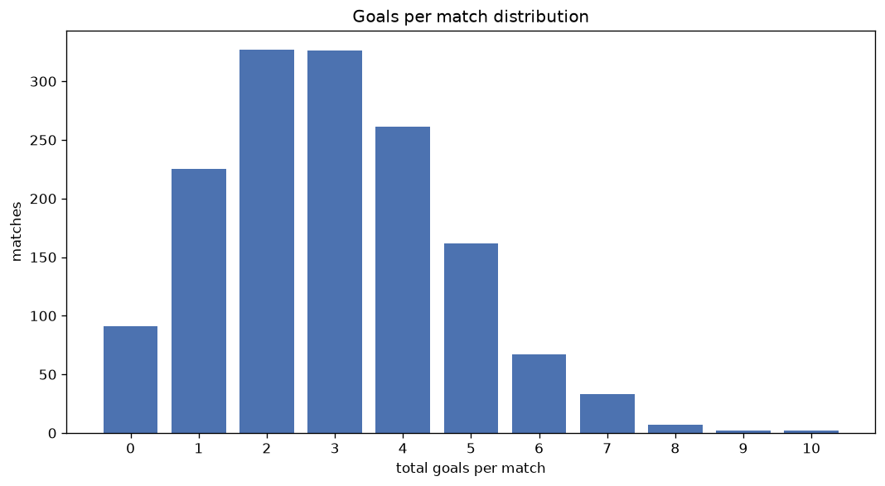
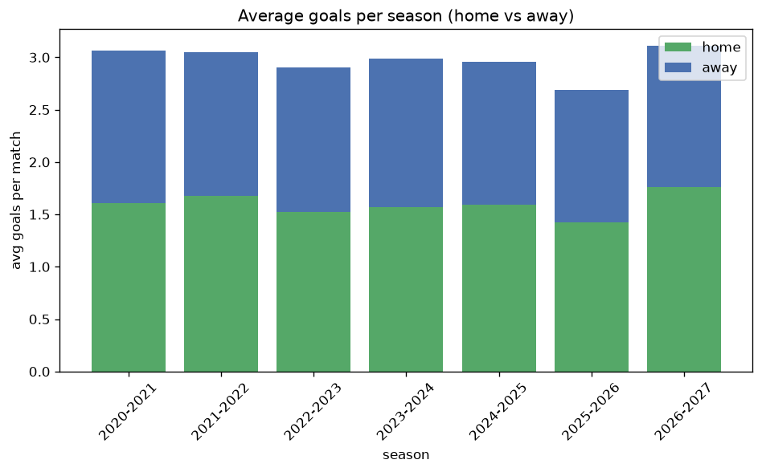

# Goal Analysis
- Report: `goals_analysis`
- Generated: 2026-10-29T01:53:37+00:00
- Script: `backend/scripts/analyze_goals.py` v1.0.0
- League: 2. Liga (Austria)
- Scope: league `austria2`

## 1. Goals per match distribution
| goals | matches | pct |
|---|---|---|
| 0 | 91 | 6.1% |
| 1 | 225 | 15.0% |
| 2 | 327 | 21.8% |
| 3 | 326 | 21.7% |
| 4 | 261 | 17.4% |
| 5 | 162 | 10.8% |
| 6 | 67 | 4.5% |
| 7 | 33 | 2.2% |
| 8 | 7 | 0.5% |
| 9 | 2 | 0.1% |
| 10 | 2 | 0.1% |

## 2. Goals per match per season
| season | matches | total goals | avg home | avg away | avg total |
|---|---|---|---|---|---|
| 2020-2021 | 240 | 736 | 1.608 | 1.458 | 3.067 |
| 2021-2022 | 240 | 732 | 1.675 | 1.375 | 3.05 |
| 2022-2023 | 240 | 696 | 1.525 | 1.375 | 2.9 |
| 2023-2024 | 240 | 716 | 1.567 | 1.417 | 2.983 |
| 2024-2025 | 240 | 710 | 1.592 | 1.367 | 2.958 |
| 2025-2026 | 223 | 599 | 1.422 | 1.265 | 2.686 |
| 2026-2027 | 80 | 249 | 1.762 | 1.35 | 3.112 |

## 3. Home vs away goal share
- Home goals: **2370** (53.4%)
- Away goals: **2068** (46.6%)
- Home/away ratio: **1.146**

| season | home goals | away goals | total | home pct | away pct |
|---|---|---|---|---|---|
| 2020-2021 | 386 | 350 | 736 | 52.4% | 47.6% |
| 2021-2022 | 402 | 330 | 732 | 54.9% | 45.1% |
| 2022-2023 | 366 | 330 | 696 | 52.6% | 47.4% |
| 2023-2024 | 376 | 340 | 716 | 52.5% | 47.5% |
| 2024-2025 | 382 | 328 | 710 | 53.8% | 46.2% |
| 2025-2026 | 317 | 282 | 599 | 52.9% | 47.1% |
| 2026-2027 | 141 | 108 | 249 | 56.6% | 43.4% |

## 4. BTTS (Both Teams To Score)
- Overall: **814** of `1503` (54.2%)

| season | matches | BTTS | pct |
|---|---|---|---|
| 2020-2021 | 240 | 131 | 54.6% |
| 2021-2022 | 240 | 134 | 55.8% |
| 2022-2023 | 240 | 127 | 52.9% |
| 2023-2024 | 240 | 131 | 54.6% |
| 2024-2025 | 240 | 135 | 56.2% |
| 2025-2026 | 223 | 112 | 50.2% |
| 2026-2027 | 80 | 44 | 55.0% |

## 5. Clean sheets
- Home clean sheets: **416** (27.7%)
- Away clean sheets: **364** (24.2%)
- Total clean sheets recorded: **780**
- Matches with at least one clean sheet: **689** (45.8%)
- Both teams kept clean sheets (0-0): **91**

| season | matches | home CS | away CS | total CS | matches w/ CS |
|---|---|---|---|---|---|
| 2020-2021 | 240 | 64 | 59 | 123 | 109 (45.4%) |
| 2021-2022 | 240 | 68 | 52 | 120 | 106 (44.2%) |
| 2022-2023 | 240 | 65 | 62 | 127 | 113 (47.1%) |
| 2023-2024 | 240 | 70 | 51 | 121 | 109 (45.4%) |
| 2024-2025 | 240 | 63 | 58 | 121 | 105 (43.8%) |
| 2025-2026 | 223 | 66 | 63 | 129 | 111 (49.8%) |
| 2026-2027 | 80 | 20 | 19 | 39 | 36 (45.0%) |

## 6. Scoring intensity
- First-half goals: **2013** (45.5%)
- Second-half goals: **2416** (54.5%)
- Avg first-half goals per match: **1.342**
- Avg second-half goals per match: **1.611**
- Second-half-only scoring (HT 0-0, FT goals >= 1): **311** (20.7%)
- *3 match(es) excluded (no HT score recorded).*

| season | matches | 1st half | 2nd half | 1st half pct | 2nd half pct |
|---|---|---|---|---|---|
| 2020-2021 | 240 | 331 | 405 | 45.0% | 55.0% |
| 2021-2022 | 240 | 329 | 403 | 44.9% | 55.1% |
| 2022-2023 | 240 | 295 | 401 | 42.4% | 57.6% |
| 2023-2024 | 240 | 336 | 380 | 46.9% | 53.1% |
| 2024-2025 | 240 | 323 | 381 | 45.9% | 54.1% |
| 2025-2026 | 223 | 284 | 312 | 47.7% | 52.3% |
| 2026-2027 | 80 | 115 | 134 | 46.2% | 53.8% |

## 7. First-goal timing
- Matches with first-goal time recorded: `1409` of `1503` (93.7%)
- Goalless matches: `94`
- Min `1` | Max `96` | Mean `29.06` | Median (p50) `23`

| bucket | count | % of matches | % of scoring matches |
|---|---|---|---|
| 1-15 | 514 | 34.2% | 36.5% |
| 16-30 | 347 | 23.1% | 24.6% |
| 31-45 | 224 | 14.9% | 15.9% |
| 46-60 | 160 | 10.6% | 11.4% |
| 61-75 | 92 | 6.1% | 6.5% |
| 76-90 | 56 | 3.7% | 4.0% |
| 91-120 | 16 | 1.1% | 1.1% |

---
*All statistics are computed from PostgreSQL tables (read-only). Run with `python backend/scripts/analyze_goals.py` to regenerate.*

## Charts

