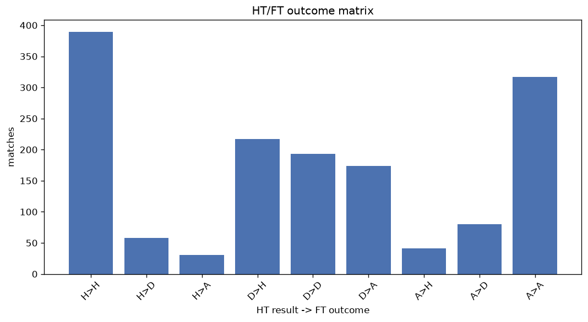
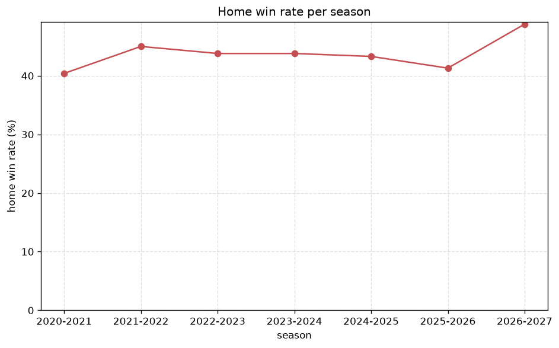

# Match Analysis
- Report: `matches_analysis`
- Generated: 2026-10-30T03:44:44+00:00
- Script: `backend/scripts/analyze_matches.py` v1.0.0
- League: 2. Liga (Austria)
- Scope: league `austria2`

## 1. Overall summary
| metric | value |
|---|---|
| Matches | 1503 |
| Home wins | 650 (43.2%) |
| Draws | 331 (22.0%) |
| Away wins | 522 (34.7%) |
| Total goals | 4438 |
| Average goals per match | 2.953 |
| Goalless matches | 91 (6.1%) |

## 2. Per-season breakdown
| season | matches | home wins | draws | away wins | total goals | avg goals | goalless |
|---|---|---|---|---|---|---|---|
| 2020-2021 | 240 | 97 (40.4%) | 50 (20.8%) | 93 (38.8%) | 736 | 3.067 | 14 (5.8%) |
| 2021-2022 | 240 | 108 (45.0%) | 56 (23.3%) | 76 (31.7%) | 732 | 3.05 | 14 (5.8%) |
| 2022-2023 | 240 | 105 (43.8%) | 54 (22.5%) | 81 (33.8%) | 696 | 2.9 | 14 (5.8%) |
| 2023-2024 | 240 | 105 (43.8%) | 48 (20.0%) | 87 (36.2%) | 716 | 2.983 | 12 (5.0%) |
| 2024-2025 | 240 | 104 (43.3%) | 51 (21.2%) | 85 (35.4%) | 710 | 2.958 | 16 (6.7%) |
| 2025-2026 | 223 | 92 (41.3%) | 58 (26.0%) | 73 (32.7%) | 599 | 2.686 | 18 (8.1%) |
| 2026-2027 | 80 | 39 (48.8%) | 14 (17.5%) | 27 (33.8%) | 249 | 3.112 | 3 (3.8%) |

## 3. HT/FT outcome matrix
| HT result \ FT result | Home | Draw | Away | total |
|---|---|---|---|---|
| HT home lead | 389 (81.4%) | 58 (12.1%) | 31 (6.5%) | 478 |
| HT draw | 217 (37.2%) | 193 (33.0%) | 174 (29.8%) | 584 |
| HT away lead | 41 (9.4%) | 80 (18.3%) | 317 (72.4%) | 438 |
- *3 match(es) excluded (no HT score recorded).*

## 4. Comeback matches
- Home comebacks (trailing at HT, won at FT): **41** (2.7%)
- Away comebacks (trailing at HT, won at FT): **31** (2.1%)

### Home comebacks
| season | home | away | HT | FT |
|---|---|---|---|---|
| 2020-2021 | Lafnitz | A. Klagenfurt | 0-1 | 2-1 |
| 2020-2021 | Floridsdorfer AC | Austria Vienna (Am) | 0-1 | 2-1 |
| 2020-2021 | Horn | SK Rapid II | 1-2 | 3-2 |
| 2020-2021 | Horn | Floridsdorfer AC | 0-1 | 2-1 |
| 2020-2021 | FC Juniors | SK Rapid II | 0-1 | 2-1 |
| 2020-2021 | Lafnitz | Horn | 0-1 | 3-2 |
| 2020-2021 | A. Lustenau | SK Rapid II | 1-2 | 3-2 |
| 2021-2022 | SK Rapid II | Grazer AK | 0-1 | 2-1 |
| 2021-2022 | Liefering | Dornbirn | 0-1 | 4-2 |
| 2021-2022 | Amstetten | SK Rapid II | 1-2 | 5-2 |
| 2021-2022 | Vorwarts Steyr | Kapfenberg | 0-1 | 3-1 |
| 2021-2022 | St. Polten | FC Juniors | 0-1 | 2-1 |
| 2021-2022 | Floridsdorfer AC | Grazer AK | 0-1 | 2-1 |
| 2021-2022 | St. Polten | Wacker Innsbruck | 0-1 | 3-1 |
| 2022-2023 | Horn | BW Linz | 0-1 | 2-1 |
| 2022-2023 | Vorwarts Steyr | Dornbirn | 0-1 | 2-1 |
| 2022-2023 | Vorwarts Steyr | Admira | 0-1 | 2-1 |
| 2022-2023 | Kapfenberg | Dornbirn | 0-1 | 2-1 |
| 2022-2023 | Liefering | Lafnitz | 0-1 | 3-1 |
| 2022-2023 | BW Linz | Sturm Graz II | 0-1 | 2-1 |
| 2023-2024 | Leoben | Horn | 1-2 | 3-2 |
| 2023-2024 | Liefering | Bregenz | 0-1 | 2-1 |
| 2023-2024 | First Vienna | Admira | 0-1 | 2-1 |
| 2023-2024 | Horn | Amstetten | 0-1 | 3-1 |
| 2023-2024 | Kapfenberg | Amstetten | 1-2 | 4-2 |
| 2023-2024 | First Vienna | Kapfenberg | 0-2 | 4-2 |
| 2023-2024 | Dornbirn | St. Polten | 0-1 | 3-1 |
| 2024-2025 | Amstetten | Sturm Graz II | 0-1 | 3-1 |
| 2024-2025 | First Vienna | St. Polten | 0-1 | 2-1 |
| 2024-2025 | Bregenz | Lafnitz | 0-1 | 4-1 |
| 2024-2025 | First Vienna | Liefering | 0-1 | 3-1 |
| 2024-2025 | Horn | ASK Voitsberg | 0-1 | 2-1 |
| 2024-2025 | Bregenz | Amstetten | 0-1 | 2-1 |
| 2024-2025 | Amstetten | Admira | 1-2 | 3-2 |
| 2025-2026 | St. Polten | First Vienna | 0-1 | 2-1 |
| 2025-2026 | Liefering | A. Salzburg | 1-2 | 3-2 |
| 2025-2026 | Hertha Wels | SK Rapid II | 1-2 | 3-2 |
| 2025-2026 | St. Polten | A. Salzburg | 0-1 | 2-1 |
| 2025-2026 | A. Klagenfurt | SK Rapid II | 0-1 | 2-1 |
| 2026-2027 | BW Linz | Hertha Wels | 0-1 | 4-1 |
| 2026-2027 | St. Polten | Bregenz | 0-1 | 2-1 |

### Away comebacks
| season | home | away | HT | FT |
|---|---|---|---|---|
| 2020-2021 | Austria Vienna (Am) | Horn | 1-0 | 1-2 |
| 2020-2021 | SK Rapid II | Lafnitz | 1-0 | 2-3 |
| 2020-2021 | A. Lustenau | Lafnitz | 1-0 | 2-3 |
| 2020-2021 | A. Klagenfurt | SK Rapid II | 2-1 | 2-3 |
| 2020-2021 | Vorwarts Steyr | Amstetten | 1-0 | 1-2 |
| 2020-2021 | FC Juniors | Floridsdorfer AC | 2-0 | 2-3 |
| 2020-2021 | Lafnitz | Austria Vienna (Am) | 1-0 | 1-2 |
| 2020-2021 | Floridsdorfer AC | Horn | 1-0 | 1-2 |
| 2020-2021 | Amstetten | SK Rapid II | 2-1 | 2-3 |
| 2021-2022 | St. Polten | SK Rapid II | 1-0 | 1-2 |
| 2021-2022 | Vorwarts Steyr | A. Lustenau | 1-0 | 1-2 |
| 2021-2022 | Horn | Liefering | 1-0 | 2-3 |
| 2021-2022 | A. Lustenau | Floridsdorfer AC | 1-0 | 1-2 |
| 2021-2022 | Kapfenberg | A. Lustenau | 1-0 | 1-2 |
| 2022-2023 | St. Polten | Floridsdorfer AC | 1-0 | 1-2 |
| 2022-2023 | Liefering | Floridsdorfer AC | 1-0 | 1-2 |
| 2022-2023 | Horn | Austria Vienna (Am) | 1-0 | 1-2 |
| 2022-2023 | Vorwarts Steyr | Amstetten | 1-0 | 2-3 |
| 2023-2024 | First Vienna | Grazer AK | 2-0 | 2-3 |
| 2023-2024 | Amstetten | Ried | 2-1 | 2-3 |
| 2023-2024 | Sturm Graz II | Dornbirn | 2-0 | 2-3 |
| 2023-2024 | Horn | Floridsdorfer AC | 1-0 | 2-3 |
| 2023-2024 | Kapfenberg | Liefering | 1-0 | 1-3 |
| 2024-2025 | ASK Voitsberg | Amstetten | 1-0 | 1-2 |
| 2024-2025 | Amstetten | Ried | 2-1 | 2-3 |
| 2024-2025 | Horn | St. Polten | 2-1 | 2-4 |
| 2024-2025 | Bregenz | Stripfing | 1-0 | 1-3 |
| 2025-2026 | A. Klagenfurt | St. Polten | 1-0 | 1-2 |
| 2025-2026 | SK Rapid II | A. Lustenau | 1-0 | 1-2 |
| 2025-2026 | A. Salzburg | Sturm Graz II | 1-0 | 1-2 |
| 2025-2026 | Liefering | Hertha Wels | 2-1 | 2-5 |

## 5. HT lead conversion
| HT state | matches | converted to win | held as draw | collapsed to loss |
|---|---|---|---|---|
| Home lead | 478 | 389 (81.4%) | 58 (12.1%) | 31 (6.5%) |
| Away lead | 438 | 317 (72.4%) | 80 (18.3%) | 41 (9.4%) |

### Matches level at half-time
| FT result | count | pct |
|---|---|---|
| Home win | 217 | 37.2% |
| Draw | 193 | 33.0% |
| Away win | 174 | 29.8% |
- *3 match(es) excluded (no HT score recorded).*

## 6. First-goal timing
- Matches with a first-goal time recorded: `1409` of `1503` (93.7%)

Outcome distribution by first-goal timing bucket:
| bucket | matches | % of matches | home | draw | away |
|---|---|---|---|---|---|
| 1-15 | 514 | 34.2% | 236 (45.9%) | 74 (14.4%) | 204 (39.7%) |
| 16-30 | 347 | 23.1% | 160 (46.1%) | 67 (19.3%) | 120 (34.6%) |
| 31-45 | 224 | 14.9% | 104 (46.4%) | 45 (20.1%) | 75 (33.5%) |
| 46-60 | 160 | 10.6% | 72 (45.0%) | 34 (21.2%) | 54 (33.8%) |
| 61-75 | 92 | 6.1% | 36 (39.1%) | 13 (14.1%) | 43 (46.7%) |
| 76-90 | 56 | 3.7% | 32 (57.1%) | 7 (12.5%) | 17 (30.4%) |
| 91-120 | 16 | 1.1% | 7 (43.8%) | 0 (0.0%) | 9 (56.2%) |

## 7. Goalless matches
- Overall: **91** of `1503` (6.1%)

| season | matches | goalless | pct |
|---|---|---|---|
| 2020-2021 | 240 | 14 | 5.8% |
| 2021-2022 | 240 | 14 | 5.8% |
| 2022-2023 | 240 | 14 | 5.8% |
| 2023-2024 | 240 | 12 | 5.0% |
| 2024-2025 | 240 | 16 | 6.7% |
| 2025-2026 | 223 | 18 | 8.1% |
| 2026-2027 | 80 | 3 | 3.8% |

---
*All statistics are computed from PostgreSQL tables (read-only). Run with `python backend/scripts/analyze_matches.py` to regenerate.*

## Charts

