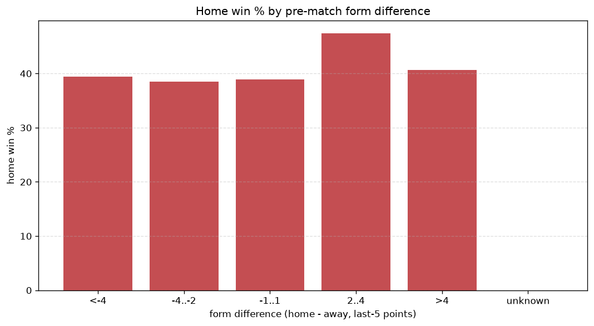
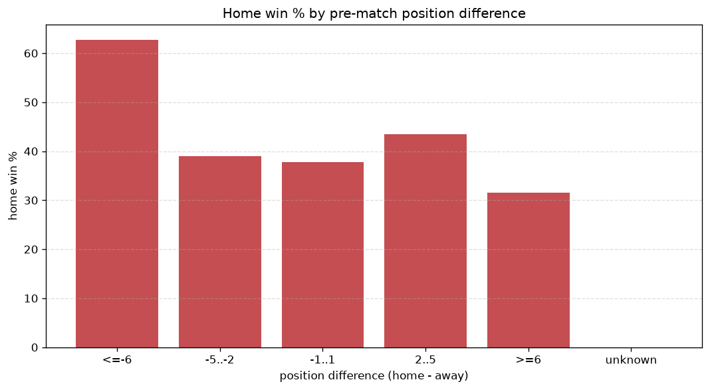

# Relationships Analysis
- Report: `relationships`
- Generated: 2026-10-29T01:53:44+00:00
- Script: `backend/scripts/analyze_relationships.py` v1.0.0
- League: 2. Liga (Austria)
- Scope: league `austria2`

- Matches analysed: **1423** (23 leakage-safe pre-match features).

## 1. Correlation matrix
_Pearson correlation of each pre-match feature with observed goals; sorted by |corr(total goals)|._

| feature | corr(home) | corr(away) | corr(total) |
|---|---|---|---|
| home_position_before_match | -0.082 | 0.178 | 0.066 |
| away_team_goals_conceded_last_5 | 0.176 | -0.099 | 0.065 |
| home_team_home_conceded_avg | -0.012 | 0.101 | 0.064 |
| away_team_away_win_rate | -0.087 | 0.009 | -0.061 |
| away_team_points_last_5 | -0.120 | 0.051 | -0.057 |
| away_team_wins_last_5 | -0.127 | 0.062 | -0.053 |
| away_position_before_match | 0.158 | -0.097 | 0.052 |
| away_team_away_goals_avg | -0.037 | -0.028 | -0.049 |
| home_team_goals_conceded_last_5 | -0.063 | 0.127 | 0.043 |
| home_team_home_win_rate | 0.082 | -0.142 | -0.039 |
| rest_days_difference | 0.016 | 0.033 | 0.036 |
| away_team_away_conceded_avg | 0.115 | -0.073 | 0.036 |
| home_team_wins_last_5 | 0.089 | -0.141 | -0.033 |
| home_team_points_last_5 | 0.096 | -0.147 | -0.033 |
| away_team_goals_scored_last_5 | -0.048 | 0.021 | -0.022 |
| away_rest_days | -0.028 | 0.001 | -0.021 |
| position_difference | -0.172 | 0.197 | 0.010 |
| home_team_goals_scored_last_5 | 0.098 | -0.111 | -0.005 |
| home_team_home_goals_avg | 0.079 | -0.090 | -0.004 |
| points_difference | 0.182 | -0.190 | 0.004 |
| away_points_before_match | -0.057 | 0.057 | -0.003 |
| home_rest_days | -0.020 | 0.018 | -0.002 |
| home_points_before_match | 0.082 | -0.087 | -0.000 |

## 2. Form vs outcome
_Home win/draw/away % per bucket of `home_team_points_last_5 - away_team_points_last_5`._

| bucket | matches | home | draw | away | home % | draw % | away % |
|---|---|---|---|---|---|---|---|
| <-4 | 234 | 66 | 47 | 121 | 28.2% | 20.1% | 51.7% |
| -4..-2 | 301 | 119 | 54 | 128 | 39.5% | 17.9% | 42.5% |
| -1..1 | 374 | 157 | 99 | 118 | 42.0% | 26.5% | 31.6% |
| 2..4 | 284 | 145 | 67 | 72 | 51.1% | 23.6% | 25.4% |
| >4 | 230 | 124 | 50 | 56 | 53.9% | 21.7% | 24.3% |
| unknown | 0 | 0 | 0 | 0 | - | - | - |

## 3. Position vs outcome
_Home win/draw/away % per bucket of `position_difference` (home position - away position; negative favours the home team)._

| bucket | matches | home | draw | away | home % | draw % | away % |
|---|---|---|---|---|---|---|---|
| <=-6 | 297 | 175 | 58 | 64 | 58.9% | 19.5% | 21.5% |
| -5..-2 | 300 | 141 | 70 | 89 | 47.0% | 23.3% | 29.7% |
| -1..1 | 222 | 91 | 47 | 84 | 41.0% | 21.2% | 37.8% |
| 2..5 | 307 | 113 | 78 | 116 | 36.8% | 25.4% | 37.8% |
| >=6 | 297 | 91 | 64 | 142 | 30.6% | 21.5% | 47.8% |
| unknown | 0 | 0 | 0 | 0 | - | - | - |

## 4. Rest advantage
_Home win/draw/away % per bucket of `rest_days_difference` (home rest - away rest). Matches with unknown rest are bucketed separately._

| bucket | matches | home | draw | away | home % | draw % | away % |
|---|---|---|---|---|---|---|---|
| <-1 | 161 | 76 | 31 | 54 | 47.2% | 19.3% | 33.5% |
| -1..0 | 215 | 86 | 41 | 88 | 40.0% | 19.1% | 40.9% |
| 0 | 598 | 260 | 140 | 198 | 43.5% | 23.4% | 33.1% |
| 1..2 | 347 | 150 | 81 | 116 | 43.2% | 23.3% | 33.4% |
| >2 | 53 | 21 | 11 | 21 | 39.6% | 20.8% | 39.6% |
| unknown | 49 | 18 | 13 | 18 | 36.7% | 26.5% | 36.7% |
- *49 match(es) had unknown rest difference (missing rest data on at least one side).*

## 5. Home team quality
_Home win rate by `home_team_home_win_rate` tier (split at 0.5)._

- `< 0.5` tier: **38.1%** home win (333/875)
- `>= 0.5` tier: **50.7%** home win (278/548)
- Home-win gap (>= split minus < split): **+12.6 pp**

| tier | label | matches | home | draw | away | home % |
|---|---|---|---|---|---|---|
| low | < 0.5 | 875 | 333 | 200 | 342 | 38.1% |
| high | >= 0.5 | 548 | 278 | 117 | 153 | 50.7% |

## 6. Feature averages by result
_Mean feature value per outcome; `range` is home-minus-away spread of the group means._

| feature | home mean | draw mean | away mean | range |
|---|---|---|---|---|
| points_difference | 2.319 | 0.038 | -2.990 | 5.309 |
| home_points_before_match | 21.874 | 18.315 | 18.384 | 3.559 |
| position_difference | -1.501 | 0.167 | 1.798 | 3.299 |
| away_points_before_match | 19.555 | 18.278 | 21.374 | 3.096 |
| home_position_before_match | 7.725 | 8.691 | 9.408 | 1.683 |
| away_rest_days | 10.295 | 9.020 | 10.669 | 1.649 |
| away_position_before_match | 9.226 | 8.524 | 7.610 | 1.616 |
| away_team_goals_conceded_last_5 | 7.183 | 6.388 | 5.762 | 1.422 |
| home_team_points_last_5 | 6.779 | 6.082 | 5.543 | 1.236 |
| home_rest_days | 10.167 | 9.378 | 10.543 | 1.165 |
| away_team_points_last_5 | 5.951 | 5.890 | 6.925 | 1.036 |
| home_team_goals_conceded_last_5 | 6.169 | 6.489 | 7.192 | 1.023 |
| home_team_goals_scored_last_5 | 6.990 | 6.394 | 6.006 | 0.984 |
| away_team_goals_scored_last_5 | 6.563 | 6.177 | 6.952 | 0.775 |
| rest_days_difference | -0.123 | 0.352 | -0.126 | 0.478 |
| home_team_wins_last_5 | 1.918 | 1.694 | 1.509 | 0.409 |
| away_team_wins_last_5 | 1.617 | 1.628 | 1.996 | 0.379 |
| away_team_away_conceded_avg | 1.523 | 1.400 | 1.310 | 0.213 |
| home_team_home_goals_avg | 1.516 | 1.408 | 1.341 | 0.176 |
| home_team_home_conceded_avg | 1.227 | 1.326 | 1.360 | 0.134 |
| home_team_home_win_rate | 0.422 | 0.362 | 0.332 | 0.090 |
| away_team_away_win_rate | 0.301 | 0.332 | 0.350 | 0.048 |
| away_team_away_goals_avg | 1.289 | 1.323 | 1.293 | 0.035 |

---
*All features are leakage-safe pre-match values built by `ml.features.build_features.build_rows` from strictly prior matches. Run with `python backend/scripts/analyze_relationships.py` to regenerate.*

## Charts

