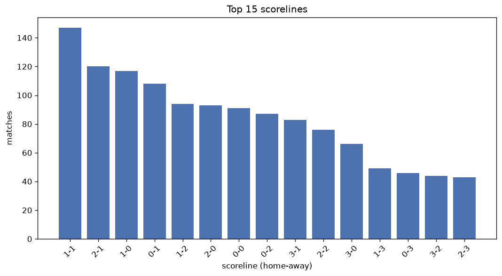
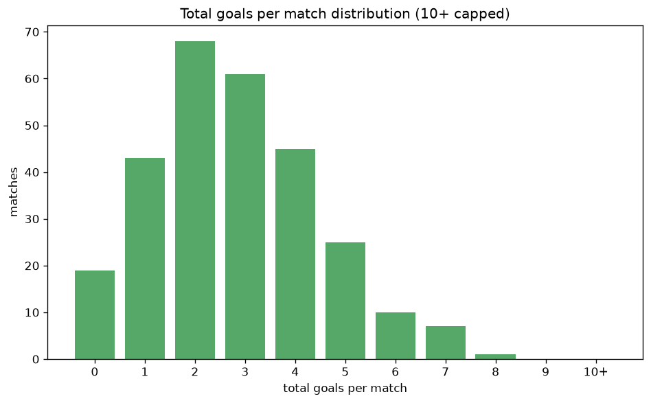

# Scoreline Analysis
- Report: `scoreline_analysis`
- Generated: 2026-10-27T01:40:31+00:00
- Script: `backend/scripts/analyze_scorelines.py` v1.0.0
- League: 2. Liga (Austria)
- Scope: league `austria2`

## 1. Scoreline frequency
- Matches analysed: **1503** across **7** seasons.
- Distinct scorelines seen: **43**.

| scoreline | count | pct |
|---|---|---|
| 1-1 | 147 | 9.8% |
| 2-1 | 120 | 8.0% |
| 1-0 | 117 | 7.8% |
| 0-1 | 108 | 7.2% |
| 1-2 | 94 | 6.3% |
| 2-0 | 93 | 6.2% |
| 0-0 | 91 | 6.1% |
| 0-2 | 87 | 5.8% |
| 3-1 | 83 | 5.5% |
| 2-2 | 76 | 5.1% |
| 3-0 | 66 | 4.4% |
| 1-3 | 49 | 3.3% |
| 0-3 | 46 | 3.1% |
| 3-2 | 44 | 2.9% |
| 2-3 | 43 | 2.9% |
| 4-0 | 30 | 2.0% |
| 4-1 | 27 | 1.8% |
| 1-4 | 25 | 1.7% |
| 0-4 | 23 | 1.5% |
| 2-4 | 16 | 1.1% |

## 2. Scoreline frequency per season

### 2020-2021
| scoreline | count | pct |
|---|---|---|
| 1-1 | 24 | 10.0% |
| 1-2 | 18 | 7.5% |
| 0-1 | 18 | 7.5% |
| 1-0 | 16 | 6.7% |
| 2-1 | 15 | 6.2% |

### 2021-2022
| scoreline | count | pct |
|---|---|---|
| 1-1 | 25 | 10.4% |
| 2-1 | 19 | 7.9% |
| 2-0 | 17 | 7.1% |
| 1-0 | 17 | 7.1% |
| 2-2 | 15 | 6.2% |

### 2022-2023
| scoreline | count | pct |
|---|---|---|
| 1-1 | 24 | 10.0% |
| 2-1 | 23 | 9.6% |
| 0-1 | 19 | 7.9% |
| 1-0 | 18 | 7.5% |
| 2-0 | 17 | 7.1% |

### 2023-2024
| scoreline | count | pct |
|---|---|---|
| 1-0 | 25 | 10.4% |
| 1-1 | 22 | 9.2% |
| 2-0 | 16 | 6.7% |
| 1-2 | 15 | 6.2% |
| 2-1 | 15 | 6.2% |

### 2024-2025
| scoreline | count | pct |
|---|---|---|
| 2-1 | 22 | 9.2% |
| 1-1 | 22 | 9.2% |
| 0-1 | 21 | 8.8% |
| 3-1 | 17 | 7.1% |
| 1-2 | 16 | 6.7% |

### 2025-2026
| scoreline | count | pct |
|---|---|---|
| 1-1 | 25 | 11.2% |
| 2-1 | 20 | 9.0% |
| 0-2 | 19 | 8.5% |
| 1-0 | 18 | 8.1% |
| 0-0 | 18 | 8.1% |

### 2026-2027
| scoreline | count | pct |
|---|---|---|
| 0-1 | 8 | 10.0% |
| 1-0 | 8 | 10.0% |
| 0-2 | 6 | 7.5% |
| 2-1 | 6 | 7.5% |
| 1-1 | 5 | 6.2% |

## 3. Total-goal histogram
_10+ groups all matches with 10 or more total goals._

| total goals | matches | pct |
|---|---|---|
| 0 | 91 | 6.1% |
| 1 | 225 | 15.0% |
| 2 | 327 | 21.8% |
| 3 | 326 | 21.7% |
| 4 | 261 | 17.4% |
| 5 | 162 | 10.8% |
| 6 | 67 | 4.5% |
| 7 | 33 | 2.2% |
| 8 | 7 | 0.5% |
| 9 | 2 | 0.1% |
| 10+ | 2 | 0.1% |

## 4. Extreme scorelines
- Matches with 7+ total goals: **44**

| season | date | scoreline | total goals |
|---|---|---|---|
| 2023-2024 | 2024-04-05 | 7-3 | 10 |
| 2024-2025 | 2025-04-04 | 6-4 | 10 |
| 2024-2025 | 2024-08-09 | 4-5 | 9 |
| 2024-2025 | 2024-10-01 | 3-6 | 9 |
| 2020-2021 | 2021-03-07 | 6-2 | 8 |
| 2020-2021 | 2021-04-16 | 8-0 | 8 |
| 2020-2021 | 2021-05-23 | 4-4 | 8 |
| 2021-2022 | 2021-09-12 | 6-2 | 8 |
| 2024-2025 | 2025-05-24 | 5-3 | 8 |
| 2025-2026 | 2025-08-09 | 4-4 | 8 |
| 2026-2027 | 2026-10-23 | 2-6 | 8 |
| 2020-2021 | 2020-09-20 | 5-2 | 7 |
| 2020-2021 | 2020-11-20 | 6-1 | 7 |
| 2020-2021 | 2021-02-26 | 4-3 | 7 |
| 2020-2021 | 2021-04-13 | 1-6 | 7 |
| 2020-2021 | 2021-04-14 | 2-5 | 7 |
| 2021-2022 | 2021-08-07 | 5-2 | 7 |
| 2021-2022 | 2021-10-01 | 2-5 | 7 |
| 2021-2022 | 2021-10-15 | 6-1 | 7 |
| 2021-2022 | 2021-11-19 | 5-2 | 7 |
| 2021-2022 | 2022-02-25 | 2-5 | 7 |
| 2021-2022 | 2022-04-03 | 3-4 | 7 |
| 2021-2022 | 2022-04-08 | 5-2 | 7 |
| 2021-2022 | 2022-05-03 | 4-3 | 7 |
| 2021-2022 | 2022-05-22 | 5-2 | 7 |
| 2022-2023 | 2022-07-29 | 4-3 | 7 |
| 2022-2023 | 2022-08-02 | 4-3 | 7 |
| 2022-2023 | 2022-08-12 | 2-5 | 7 |
| 2022-2023 | 2022-10-07 | 2-5 | 7 |
| 2022-2023 | 2022-10-21 | 6-1 | 7 |
| 2022-2023 | 2023-04-28 | 4-3 | 7 |
| 2022-2023 | 2023-05-07 | 2-5 | 7 |
| 2023-2024 | 2023-10-27 | 5-2 | 7 |
| 2023-2024 | 2023-11-25 | 1-6 | 7 |
| 2023-2024 | 2024-05-17 | 2-5 | 7 |
| 2023-2024 | 2024-05-25 | 4-3 | 7 |
| 2024-2025 | 2024-12-06 | 3-4 | 7 |
| 2025-2026 | 2025-10-24 | 4-3 | 7 |
| 2025-2026 | 2025-11-07 | 5-2 | 7 |
| 2025-2026 | 2025-12-05 | 6-1 | 7 |
| 2025-2026 | 2026-03-06 | 4-3 | 7 |
| 2025-2026 | 2026-03-20 | 2-5 | 7 |
| 2026-2027 | 2026-08-30 | 5-2 | 7 |
| 2026-2027 | 2026-09-18 | 3-4 | 7 |

## 5. Margin-of-victory distribution (decided matches)
- Decided matches: **1172** (draws: **331**)
- Average winning margin: **1.91**

| margin | matches | pct |
|---|---|---|
| 1 | 538 | 45.9% |
| 2 | 346 | 29.5% |
| 3+ | 288 | 24.6% |

## 6. Margin by outcome

### Home wins
- Matches: **650** | avg margin: **1.96** | max margin: **8**
| margin | matches | pct |
|---|---|---|
| 1 | 289 | 44.5% |
| 2 | 194 | 29.8% |
| 3+ | 167 | 25.7% |
- *Full match-by-match list available in `scoreline_analysis.json`.*

### Away wins
- Matches: **522** | avg margin: **1.86** | max margin: **6**
| margin | matches | pct |
|---|---|---|
| 1 | 249 | 47.7% |
| 2 | 152 | 29.1% |
| 3+ | 121 | 23.2% |
- *Full match-by-match list available in `scoreline_analysis.json`.*

## 7. Most common exact score by outcome type
| outcome | matches | most common score | count | pct |
|---|---|---|---|---|
| home | 650 | 2-1 | 120 | 18.5% |
| draw | 331 | 1-1 | 147 | 44.4% |
| away | 522 | 0-1 | 108 | 20.7% |

---
*All statistics are computed from PostgreSQL tables (read-only). Run with `python backend/scripts/analyze_scorelines.py` to regenerate.*

## Charts

