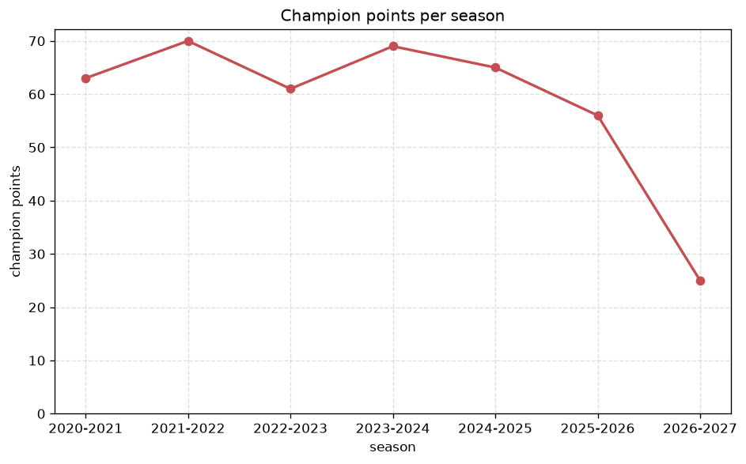
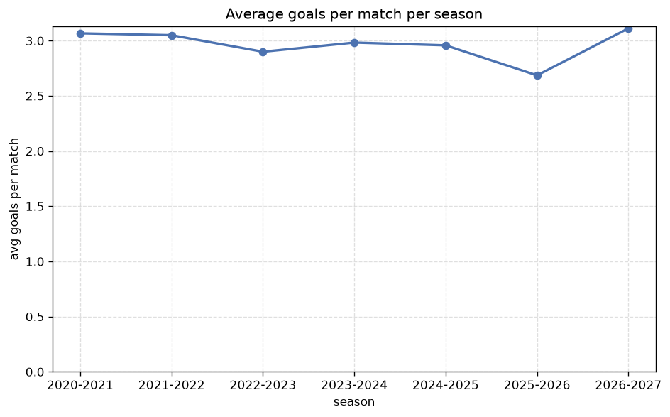

# Season Trends Analysis
- Report: `season_trends`
- Generated: 2026-10-30T03:44:49+00:00
- Script: `backend/scripts/analyze_seasons.py` v1.0.0
- League: 2. Liga (Austria)
- Scope: league `austria2`

## 1. Champions per season
| season | champion | pts | runner-up | margin |
|---|---|---|---|---|
| 2020-2021 | BW Linz | 63 | Liefering | 0 pts |
| 2021-2022 | A. Lustenau | 70 | Floridsdorfer AC | 5 pts |
| 2022-2023 | BW Linz | 61 | Grazer AK | 1 pts |
| 2023-2024 | Grazer AK | 69 | Ried | 10 pts |
| 2024-2025 | Ried | 65 | Admira | 6 pts |
| 2025-2026 | St. Polten | 56 | A. Lustenau | 1 pts |
| 2026-2027 | BW Linz | 25 | First Vienna | 0 pts |

## 2. Title-race tightness
- Tight races (margin <= 3 pts): **4** of 7 seasons
- Tightest race: **2020-2021** - BW Linz beat Liefering by **0** pts

| season | margin | tight |
|---|---|---|
| 2020-2021 | 0 pts | yes |
| 2021-2022 | 5 pts |  |
| 2022-2023 | 1 pts | yes |
| 2023-2024 | 10 pts |  |
| 2024-2025 | 6 pts |  |
| 2025-2026 | 1 pts | yes |
| 2026-2027 | 0 pts | yes |

## 3. Points thresholds
_Position-specific points per season. Key: 1 = champion, 2 = runner-up, 4 = CL line, 6 = Europa, 13 = last safe, 16 = bottom._

| season | pos 1 | pos 2 | pos 4 | pos 6 | pos 13 | pos 16 |
|---|---|---|---|---|---|---|
| 2020-2021 | 63 | 63 | 57 | 46 | 30 | 30 |
| 2021-2022 | 70 | 65 | 52 | 46 | 28 | 22 |
| 2022-2023 | 61 | 60 | 48 | 45 | 34 | 29 |
| 2023-2024 | 69 | 59 | 51 | 47 | 35 | 16 |
| 2024-2025 | 65 | 59 | 53 | 43 | 34 | 16 |
| 2025-2026 | 56 | 55 | 48 | 47 | 31 | 10 |
| 2026-2027 | 25 | 25 | 18 | 16 | 8 | 7 |

## 4. Relegation battle
| season | safe pos | safe pts | drop pos | drop pts | gap |
|---|---|---|---|---|---|
| 2020-2021 | 13 | 30 | 14 | 30 | 0 pts |
| 2021-2022 | 13 | 28 | 14 | 25 | 3 pts |
| 2022-2023 | 13 | 34 | 14 | 32 | 2 pts |
| 2023-2024 | 13 | 35 | 14 | 33 | 2 pts |
| 2024-2025 | 13 | 34 | 14 | 32 | 2 pts |
| 2025-2026 | 13 | 31 | 14 | 22 | 9 pts |
| 2026-2027 | 13 | 8 | 14 | 8 | 0 pts |

## 5. League-level trends
| season | matches | total goals | avg goals | home win | draw | away win | goalless | avg pts/team |
|---|---|---|---|---|---|---|---|---|
| 2020-2021 | 240 | 736 | 3.067 | 40.4% | 20.8% | 38.8% | 5.8% | 41.88 |
| 2021-2022 | 240 | 732 | 3.05 | 45.0% | 23.3% | 31.7% | 5.8% | 41.5 |
| 2022-2023 | 240 | 696 | 2.9 | 43.8% | 22.5% | 33.8% | 5.8% | 41.62 |
| 2023-2024 | 240 | 716 | 2.983 | 43.8% | 20.0% | 36.2% | 5.0% | 42.0 |
| 2024-2025 | 240 | 710 | 2.958 | 43.3% | 21.2% | 35.4% | 6.7% | 41.81 |
| 2025-2026 | 223 | 599 | 2.686 | 41.3% | 26.0% | 32.7% | 8.1% | 38.19 |
| 2026-2027 | 80 | 249 | 3.112 | 48.8% | 17.5% | 33.8% | 3.8% | 14.12 |

## 6. View divergence
- Largest divergence: **2022-2023** (goals view, avg abs position diff = 7.000)

_Avg absolute position difference between classic view and alternative view per season._

| season | classic vs luck | classic vs goals |
|---|---|---|
| 2020-2021 | 2.875 | 4.875 |
| 2021-2022 | 2.875 | 6.000 |
| 2022-2023 | 3.750 | 7.000 |
| 2023-2024 | 2.375 | 6.750 |
| 2024-2025 | 2.375 | 5.500 |
| 2025-2026 | 2.875 | 6.875 |
| 2026-2027 | 1.375 | 6.250 |

---
*All statistics are computed from PostgreSQL tables (read-only). Run with `python backend/scripts/analyze_seasons.py` to regenerate.*

## Charts

