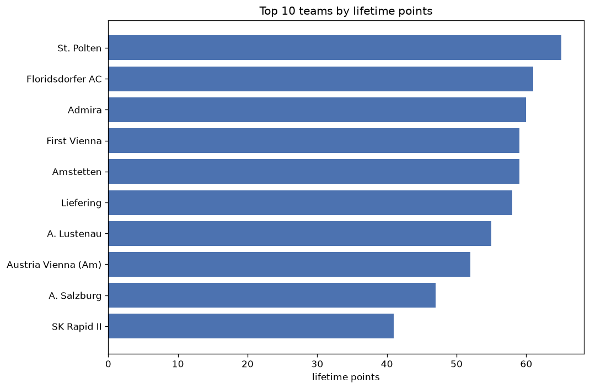
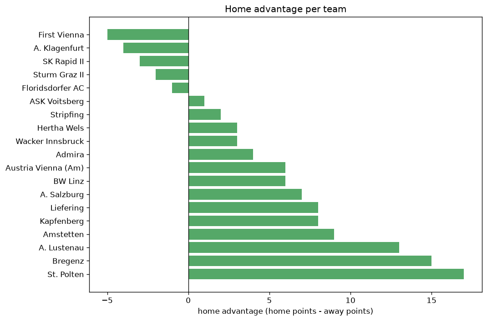

# Team Analysis
- Report: `teams_analysis`
- Generated: 2026-10-30T03:44:47+00:00
- Script: `backend/scripts/analyze_teams.py` v1.0.0
- League: 2. Liga (Austria)
- Scope: league `austria2`

- Teams: **27** | Seasons: **7** | Matches: **1503**

## 1. Team standings (lifetime)
| team | seasons | played | W | D | L | pts | GF | GA | GD | avg pts/season | best pos | worst pos | titles |
|---|---|---|---|---|---|---|---|---|---|---|---|---|---|
| Liefering | 7 | 189 | 85 | 43 | 61 | 298 | 338 | 275 | 63 | 42.57 | 2 | 9 | 0 |
| Floridsdorfer AC | 7 | 188 | 83 | 46 | 59 | 295 | 264 | 190 | 74 | 42.14 | 2 | 9 | 0 |
| St. Polten | 6 | 159 | 76 | 30 | 53 | 258 | 251 | 188 | 63 | 43.0 | 1 | 12 | 1 |
| Amstetten | 7 | 189 | 66 | 51 | 72 | 249 | 287 | 294 | -7 | 35.57 | 5 | 16 | 0 |
| Kapfenberg | 7 | 189 | 63 | 35 | 91 | 224 | 249 | 336 | -87 | 32.0 | 3 | 15 | 0 |
| Grazer AK | 4 | 120 | 64 | 29 | 27 | 221 | 202 | 137 | 65 | 55.25 | 1 | 7 | 1 |
| Admira | 5 | 129 | 60 | 31 | 38 | 211 | 193 | 143 | 50 | 42.2 | 2 | 10 | 0 |
| First Vienna | 5 | 129 | 62 | 25 | 42 | 211 | 188 | 150 | 38 | 42.2 | 2 | 7 | 0 |
| BW Linz | 4 | 100 | 62 | 17 | 21 | 203 | 210 | 91 | 119 | 50.75 | 1 | 3 | 3 |
| Lafnitz | 5 | 150 | 58 | 27 | 65 | 201 | 245 | 261 | -16 | 40.2 | 4 | 16 | 0 |
| A. Lustenau | 4 | 119 | 54 | 30 | 35 | 192 | 180 | 136 | 44 | 48.0 | 1 | 13 | 1 |
| Horn | 5 | 150 | 49 | 30 | 71 | 177 | 192 | 259 | -67 | 35.4 | 4 | 15 | 0 |
| SK Rapid II | 6 | 159 | 46 | 34 | 79 | 172 | 211 | 294 | -83 | 28.67 | 11 | 16 | 0 |
| Austria Vienna (Am) | 5 | 129 | 38 | 31 | 60 | 145 | 157 | 223 | -66 | 29.0 | 3 | 16 | 0 |
| Sturm Graz II | 5 | 129 | 33 | 29 | 67 | 128 | 174 | 241 | -67 | 25.6 | 8 | 15 | 0 |
| Dornbirn | 4 | 120 | 37 | 17 | 66 | 128 | 150 | 221 | -71 | 32.0 | 7 | 16 | 0 |
| Ried | 2 | 60 | 38 | 10 | 12 | 124 | 126 | 45 | 81 | 62.0 | 1 | 2 | 1 |
| Wacker Innsbruck | 3 | 70 | 32 | 15 | 23 | 111 | 108 | 85 | 23 | 37.0 | 4 | 9 | 0 |
| Bregenz | 4 | 99 | 28 | 24 | 47 | 108 | 139 | 177 | -38 | 27.0 | 10 | 15 | 0 |
| Vorwarts Steyr | 3 | 90 | 25 | 24 | 41 | 99 | 105 | 161 | -56 | 33.0 | 10 | 16 | 0 |
| A. Klagenfurt | 2 | 59 | 27 | 14 | 18 | 95 | 98 | 76 | 22 | 47.5 | 3 | 10 | 0 |
| Stripfing | 3 | 73 | 20 | 19 | 34 | 79 | 95 | 127 | -32 | 26.33 | 13 | 16 | 0 |
| FC Juniors | 2 | 60 | 14 | 18 | 28 | 60 | 75 | 120 | -45 | 30.0 | 8 | 15 | 0 |
| A. Salzburg | 2 | 38 | 14 | 11 | 13 | 53 | 53 | 51 | 2 | 26.5 | 6 | 9 | 0 |
| Leoben | 1 | 30 | 15 | 6 | 9 | 51 | 47 | 31 | 16 | 51.0 | 3 | 3 | 0 |
| ASK Voitsberg | 2 | 40 | 12 | 8 | 20 | 44 | 49 | 60 | -11 | 22.0 | 10 | 14 | 0 |
| Hertha Wels | 2 | 39 | 11 | 8 | 20 | 41 | 52 | 66 | -14 | 20.5 | 12 | 14 | 0 |

## 2. Home vs away split
| team | home P | H-W | H-D | H-L | H-pts | away P | A-W | A-D | A-L | A-pts | adv |
|---|---|---|---|---|---|---|---|---|---|---|---|
| BW Linz | 50 | 38 | 7 | 5 | 121 | 50 | 24 | 10 | 16 | 82 | 39 |
| Grazer AK | 60 | 37 | 15 | 8 | 126 | 60 | 27 | 14 | 19 | 95 | 31 |
| Admira | 64 | 35 | 15 | 14 | 120 | 65 | 25 | 16 | 24 | 91 | 29 |
| Kapfenberg | 95 | 36 | 18 | 41 | 126 | 94 | 27 | 17 | 50 | 98 | 28 |
| Amstetten | 95 | 36 | 30 | 29 | 138 | 94 | 30 | 21 | 43 | 111 | 27 |
| Horn | 75 | 30 | 12 | 33 | 102 | 75 | 19 | 18 | 38 | 75 | 27 |
| Liefering | 95 | 46 | 24 | 25 | 162 | 94 | 39 | 19 | 36 | 136 | 26 |
| Vorwarts Steyr | 45 | 16 | 13 | 16 | 61 | 45 | 9 | 11 | 25 | 38 | 23 |
| Floridsdorfer AC | 94 | 46 | 20 | 28 | 158 | 94 | 37 | 26 | 31 | 137 | 21 |
| Lafnitz | 75 | 32 | 15 | 28 | 111 | 75 | 26 | 12 | 37 | 90 | 21 |
| Bregenz | 48 | 17 | 13 | 18 | 64 | 51 | 11 | 11 | 29 | 44 | 20 |
| St. Polten | 80 | 41 | 15 | 24 | 138 | 79 | 35 | 15 | 29 | 120 | 18 |
| A. Lustenau | 60 | 30 | 14 | 16 | 104 | 59 | 24 | 16 | 19 | 88 | 16 |
| First Vienna | 64 | 34 | 10 | 20 | 112 | 65 | 28 | 15 | 22 | 99 | 13 |
| Stripfing | 37 | 13 | 7 | 17 | 46 | 36 | 7 | 12 | 17 | 33 | 13 |
| SK Rapid II | 78 | 25 | 15 | 38 | 90 | 81 | 21 | 19 | 41 | 82 | 8 |
| Ried | 30 | 20 | 6 | 4 | 66 | 30 | 18 | 4 | 8 | 58 | 8 |
| A. Klagenfurt | 29 | 16 | 3 | 10 | 51 | 30 | 11 | 11 | 8 | 44 | 7 |
| A. Salzburg | 19 | 8 | 6 | 5 | 30 | 19 | 6 | 5 | 8 | 23 | 7 |
| Hertha Wels | 20 | 6 | 5 | 9 | 23 | 19 | 5 | 3 | 11 | 18 | 5 |
| Sturm Graz II | 65 | 17 | 15 | 33 | 66 | 64 | 16 | 14 | 34 | 62 | 4 |
| FC Juniors | 30 | 8 | 8 | 14 | 32 | 30 | 6 | 10 | 14 | 28 | 4 |
| Leoben | 15 | 8 | 3 | 4 | 27 | 15 | 7 | 3 | 5 | 24 | 3 |
| Wacker Innsbruck | 34 | 16 | 8 | 10 | 56 | 36 | 16 | 7 | 13 | 55 | 1 |
| Austria Vienna (Am) | 66 | 17 | 20 | 29 | 71 | 63 | 21 | 11 | 31 | 74 | -3 |
| ASK Voitsberg | 20 | 5 | 5 | 10 | 20 | 20 | 7 | 3 | 10 | 24 | -4 |
| Dornbirn | 60 | 17 | 9 | 34 | 60 | 60 | 20 | 8 | 32 | 68 | -8 |

## 3. Top performers
### Best points per game (PPG)
| rank | team | PPG |
|---|---|---|
| 1 | Ried | 2.07 |
| 2 | BW Linz | 2.03 |
| 3 | Grazer AK | 1.84 |
| 4 | Leoben | 1.70 |
| 5 | Admira | 1.64 |

### Most goals scored
| rank | team | goals |
|---|---|---|
| 1 | Liefering | 338 |
| 2 | Amstetten | 287 |
| 3 | Floridsdorfer AC | 264 |
| 4 | St. Polten | 251 |
| 5 | Kapfenberg | 249 |

### Best goal difference
| rank | team | GD |
|---|---|---|
| 1 | BW Linz | 119 |
| 2 | Ried | 81 |
| 3 | Floridsdorfer AC | 74 |
| 4 | Grazer AK | 65 |
| 5 | Liefering | 63 |

### Best defence (goals against per match, standings)
| rank | team | GA/match |
|---|---|---|
| 1 | Ried | 0.750 |
| 2 | BW Linz | 0.910 |
| 3 | Floridsdorfer AC | 1.011 |
| 4 | Leoben | 1.033 |
| 5 | Admira | 1.109 |

## 4. Team consistency
- Teams present in all **7** seasons: **4**

Amstetten, Floridsdorfer AC, Kapfenberg, Liefering

## 5. Head-to-head dominance
- Distinct fixtures: **301** (showing the 15 most frequent)

| fixture | meetings | home wins | draws | away wins | home pct | draw pct | away pct |
|---|---|---|---|---|---|---|---|
| Liefering vs Floridsdorfer AC | 13 | 8 | 2 | 3 | 61.5% | 15.4% | 23.1% |
| Kapfenberg vs Amstetten | 13 | 7 | 4 | 2 | 53.8% | 30.8% | 15.4% |
| Floridsdorfer AC vs Amstetten | 13 | 6 | 4 | 3 | 46.2% | 30.8% | 23.1% |
| Liefering vs Kapfenberg | 13 | 5 | 0 | 8 | 38.5% | 0.0% | 61.5% |
| Floridsdorfer AC vs Kapfenberg | 12 | 5 | 5 | 2 | 41.7% | 41.7% | 16.7% |
| Liefering vs Amstetten | 12 | 3 | 5 | 4 | 25.0% | 41.7% | 33.3% |
| St. Polten vs Kapfenberg | 11 | 8 | 1 | 2 | 72.7% | 9.1% | 18.2% |
| Amstetten vs SK Rapid II | 11 | 7 | 3 | 1 | 63.6% | 27.3% | 9.1% |
| St. Polten vs Floridsdorfer AC | 11 | 7 | 1 | 3 | 63.6% | 9.1% | 27.3% |
| Floridsdorfer AC vs SK Rapid II | 11 | 5 | 1 | 5 | 45.5% | 9.1% | 45.5% |
| St. Polten vs Liefering | 11 | 5 | 2 | 4 | 45.5% | 18.2% | 36.4% |
| Lafnitz vs Horn | 10 | 7 | 1 | 2 | 70.0% | 10.0% | 20.0% |
| Lafnitz vs Kapfenberg | 10 | 7 | 0 | 3 | 70.0% | 0.0% | 30.0% |
| Lafnitz vs Floridsdorfer AC | 10 | 6 | 2 | 2 | 60.0% | 20.0% | 20.0% |
| Liefering vs Horn | 10 | 6 | 0 | 4 | 60.0% | 0.0% | 40.0% |

## 6. Position per season (classic view)
_Cells show final position; '-' when the team was absent from that season._

| team | 2020-2021 | 2021-2022 | 2022-2023 | 2023-2024 | 2024-2025 | 2025-2026 | 2026-2027 |
|---|---|---|---|---|---|---|---|
| Liefering | 2 | 6 | 9 | 6 | 6 | 5 | 8 |
| Floridsdorfer AC | 9 | 2 | 5 | 5 | 9 | 4 | 9 |
| St. Polten | - | 8 | 3 | 9 | 4 | 1 | 12 |
| Amstetten | 12 | 5 | 6 | 16 | 7 | 6 | 5 |
| Kapfenberg | 10 | 12 | 13 | 12 | 3 | 13 | 15 |
| Grazer AK | 6 | 7 | 2 | 1 | - | - | - |
| Admira | - | - | 10 | 7 | 2 | 3 | 4 |
| First Vienna | - | - | 7 | 4 | 5 | 7 | 2 |
| BW Linz | 1 | 3 | 1 | - | - | - | 1 |
| Lafnitz | 5 | 4 | 8 | 11 | 16 | - | - |
| A. Lustenau | 13 | 1 | - | - | 11 | 2 | - |
| Horn | 15 | 13 | 4 | 8 | 15 | - | - |
| SK Rapid II | 14 | 11 | 15 | - | 12 | 11 | 16 |
| Austria Vienna (Am) | 11 | 14 | 16 | - | - | 8 | 3 |
| Sturm Graz II | - | - | 12 | 15 | 8 | 14 | 13 |
| Dornbirn | 7 | 16 | 11 | 14 | - | - | - |
| Ried | - | - | - | 2 | 1 | - | - |
| Wacker Innsbruck | 4 | 9 | - | - | - | - | 7 |
| Bregenz | - | - | - | 10 | 10 | 15 | 11 |
| Vorwarts Steyr | 16 | 10 | 14 | - | - | - | - |
| A. Klagenfurt | 3 | - | - | - | - | 10 | - |
| Stripfing | - | - | - | 13 | 13 | 16 | - |
| FC Juniors | 8 | 15 | - | - | - | - | - |
| A. Salzburg | - | - | - | - | - | 9 | 6 |
| Leoben | - | - | - | 3 | - | - | - |
| ASK Voitsberg | - | - | - | - | 14 | - | 10 |
| Hertha Wels | - | - | - | - | - | 12 | 14 |

---
*All statistics are computed from PostgreSQL tables (read-only). Run with `python backend/scripts/analyze_teams.py` to regenerate.*

## Charts

