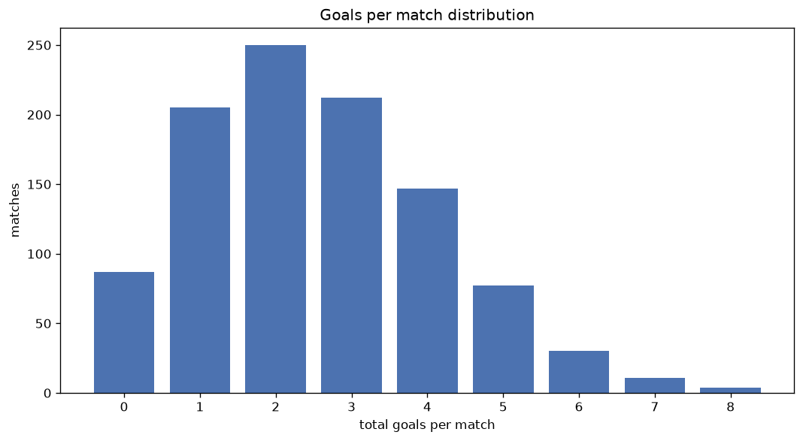
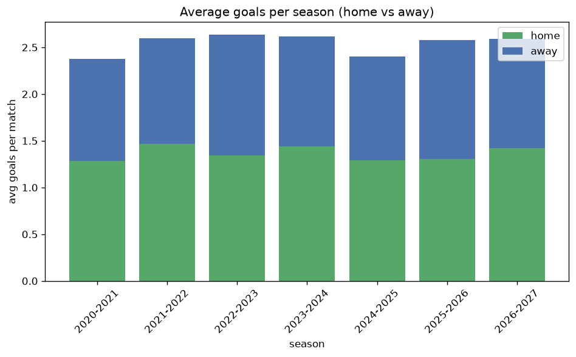

# Goal Analysis
- Report: `goals_analysis`
- Generated: 2026-10-29T01:53:53+00:00
- Script: `backend/scripts/analyze_goals.py` v1.0.0
- League: Premier League (Azerbaijan)
- Scope: league `azer`

## 1. Goals per match distribution
| goals | matches | pct |
|---|---|---|
| 0 | 87 | 8.5% |
| 1 | 205 | 20.0% |
| 2 | 250 | 24.4% |
| 3 | 212 | 20.7% |
| 4 | 147 | 14.4% |
| 5 | 77 | 7.5% |
| 6 | 30 | 2.9% |
| 7 | 11 | 1.1% |
| 8 | 4 | 0.4% |

## 2. Goals per match per season
| season | matches | total goals | avg home | avg away | avg total |
|---|---|---|---|---|---|
| 2020-2021 | 112 | 266 | 1.286 | 1.089 | 2.375 |
| 2021-2022 | 112 | 291 | 1.464 | 1.134 | 2.598 |
| 2022-2023 | 180 | 475 | 1.344 | 1.294 | 2.639 |
| 2023-2024 | 180 | 471 | 1.439 | 1.178 | 2.617 |
| 2024-2025 | 180 | 432 | 1.289 | 1.111 | 2.4 |
| 2025-2026 | 200 | 515 | 1.305 | 1.27 | 2.575 |
| 2026-2027 | 59 | 153 | 1.424 | 1.169 | 2.593 |

## 3. Home vs away goal share
- Home goals: **1386** (53.2%)
- Away goals: **1217** (46.8%)
- Home/away ratio: **1.139**

| season | home goals | away goals | total | home pct | away pct |
|---|---|---|---|---|---|
| 2020-2021 | 144 | 122 | 266 | 54.1% | 45.9% |
| 2021-2022 | 164 | 127 | 291 | 56.4% | 43.6% |
| 2022-2023 | 242 | 233 | 475 | 50.9% | 49.1% |
| 2023-2024 | 259 | 212 | 471 | 55.0% | 45.0% |
| 2024-2025 | 232 | 200 | 432 | 53.7% | 46.3% |
| 2025-2026 | 261 | 254 | 515 | 50.7% | 49.3% |
| 2026-2027 | 84 | 69 | 153 | 54.9% | 45.1% |

## 4. BTTS (Both Teams To Score)
- Overall: **466** of `1023` (45.6%)

| season | matches | BTTS | pct |
|---|---|---|---|
| 2020-2021 | 112 | 52 | 46.4% |
| 2021-2022 | 112 | 47 | 42.0% |
| 2022-2023 | 180 | 85 | 47.2% |
| 2023-2024 | 180 | 85 | 47.2% |
| 2024-2025 | 180 | 79 | 43.9% |
| 2025-2026 | 200 | 91 | 45.5% |
| 2026-2027 | 59 | 27 | 45.8% |

## 5. Clean sheets
- Home clean sheets: **337** (32.9%)
- Away clean sheets: **307** (30.0%)
- Total clean sheets recorded: **644**
- Matches with at least one clean sheet: **557** (54.4%)
- Both teams kept clean sheets (0-0): **87**

| season | matches | home CS | away CS | total CS | matches w/ CS |
|---|---|---|---|---|---|
| 2020-2021 | 112 | 39 | 35 | 74 | 60 (53.6%) |
| 2021-2022 | 112 | 38 | 35 | 73 | 65 (58.0%) |
| 2022-2023 | 180 | 54 | 56 | 110 | 95 (52.8%) |
| 2023-2024 | 180 | 62 | 44 | 106 | 95 (52.8%) |
| 2024-2025 | 180 | 62 | 54 | 116 | 101 (56.1%) |
| 2025-2026 | 200 | 63 | 64 | 127 | 109 (54.5%) |
| 2026-2027 | 59 | 19 | 19 | 38 | 32 (54.2%) |

## 6. Scoring intensity
- First-half goals: **1121** (43.1%)
- Second-half goals: **1479** (56.9%)
- Avg first-half goals per match: **1.098**
- Avg second-half goals per match: **1.449**
- Second-half-only scoring (HT 0-0, FT goals >= 1): **273** (26.7%)
- *2 match(es) excluded (no HT score recorded).*

| season | matches | 1st half | 2nd half | 1st half pct | 2nd half pct |
|---|---|---|---|---|---|
| 2020-2021 | 112 | 107 | 159 | 40.2% | 59.8% |
| 2021-2022 | 112 | 129 | 162 | 44.3% | 55.7% |
| 2022-2023 | 180 | 193 | 282 | 40.6% | 59.4% |
| 2023-2024 | 180 | 202 | 269 | 42.9% | 57.1% |
| 2024-2025 | 180 | 201 | 231 | 46.5% | 53.5% |
| 2025-2026 | 200 | 222 | 290 | 43.4% | 56.6% |
| 2026-2027 | 59 | 67 | 86 | 43.8% | 56.2% |

## 7. First-goal timing
- Matches with first-goal time recorded: `935` of `1023` (91.4%)
- Goalless matches: `88`
- Min `1` | Max `99` | Mean `34.54` | Median (p50) `30`

| bucket | count | % of matches | % of scoring matches |
|---|---|---|---|
| 1-15 | 259 | 25.3% | 27.7% |
| 16-30 | 212 | 20.7% | 22.7% |
| 31-45 | 159 | 15.5% | 17.0% |
| 46-60 | 155 | 15.2% | 16.6% |
| 61-75 | 81 | 7.9% | 8.7% |
| 76-90 | 48 | 4.7% | 5.1% |
| 91-120 | 21 | 2.1% | 2.2% |

---
*All statistics are computed from PostgreSQL tables (read-only). Run with `python backend/scripts/analyze_goals.py` to regenerate.*

## Charts

