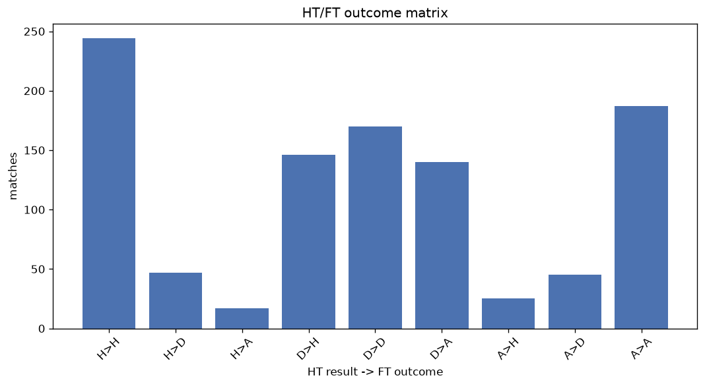
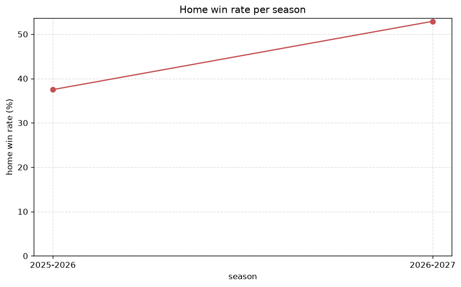

# Match Analysis
- Report: `matches_analysis`
- Generated: 2026-10-30T03:45:01+00:00
- Script: `backend/scripts/analyze_matches.py` v1.0.0
- League: Premier League (Azerbaijan)
- Scope: league `azer`

## 1. Overall summary
| metric | value |
|---|---|
| Matches | 1023 |
| Home wins | 415 (40.6%) |
| Draws | 263 (25.7%) |
| Away wins | 345 (33.7%) |
| Total goals | 2603 |
| Average goals per match | 2.544 |
| Goalless matches | 87 (8.5%) |

## 2. Per-season breakdown
| season | matches | home wins | draws | away wins | total goals | avg goals | goalless |
|---|---|---|---|---|---|---|---|
| 2020-2021 | 112 | 43 (38.4%) | 38 (33.9%) | 31 (27.7%) | 266 | 2.375 | 14 (12.5%) |
| 2021-2022 | 112 | 46 (41.1%) | 25 (22.3%) | 41 (36.6%) | 291 | 2.598 | 8 (7.1%) |
| 2022-2023 | 180 | 72 (40.0%) | 46 (25.6%) | 62 (34.4%) | 475 | 2.639 | 15 (8.3%) |
| 2023-2024 | 180 | 79 (43.9%) | 41 (22.8%) | 60 (33.3%) | 471 | 2.617 | 11 (6.1%) |
| 2024-2025 | 180 | 73 (40.6%) | 50 (27.8%) | 57 (31.7%) | 432 | 2.4 | 15 (8.3%) |
| 2025-2026 | 200 | 75 (37.5%) | 49 (24.5%) | 76 (38.0%) | 515 | 2.575 | 18 (9.0%) |
| 2026-2027 | 59 | 27 (45.8%) | 14 (23.7%) | 18 (30.5%) | 153 | 2.593 | 6 (10.2%) |

## 3. HT/FT outcome matrix
| HT result \ FT result | Home | Draw | Away | total |
|---|---|---|---|---|
| HT home lead | 244 (79.2%) | 47 (15.3%) | 17 (5.5%) | 308 |
| HT draw | 146 (32.0%) | 170 (37.3%) | 140 (30.7%) | 456 |
| HT away lead | 25 (9.7%) | 45 (17.5%) | 187 (72.8%) | 257 |
- *2 match(es) excluded (no HT score recorded).*

## 4. Comeback matches
- Home comebacks (trailing at HT, won at FT): **25** (2.4%)
- Away comebacks (trailing at HT, won at FT): **17** (1.7%)

### Home comebacks
| season | home | away | HT | FT |
|---|---|---|---|---|
| 2020-2021 | Sabail | Sabah Baku | 0-1 | 2-1 |
| 2020-2021 | Qarabag | Zira | 0-1 | 3-2 |
| 2021-2022 | Shamakhi | Neftci Baku | 1-2 | 3-2 |
| 2022-2023 | Sabah Baku | Neftci Baku | 0-1 | 2-1 |
| 2022-2023 | Sabail | Kapaz | 0-1 | 4-1 |
| 2022-2023 | Kapaz | Shamakhi | 0-1 | 2-1 |
| 2022-2023 | Qarabag | Neftci Baku | 0-1 | 3-1 |
| 2022-2023 | Sabah Baku | Gabala | 0-1 | 2-1 |
| 2022-2023 | Zira | Sumqayit | 0-1 | 3-1 |
| 2022-2023 | Shamakhi | Sabail | 0-1 | 2-1 |
| 2022-2023 | Sabah Baku | Gabala | 1-2 | 3-2 |
| 2023-2024 | Sabah Baku | Sumqayit | 0-1 | 3-1 |
| 2023-2024 | Sabail | Turan Tovuz | 0-1 | 2-1 |
| 2024-2025 | Araz | Sabail | 0-1 | 3-2 |
| 2024-2025 | Turan Tovuz | Shamakhi | 1-2 | 3-2 |
| 2024-2025 | Kapaz | Sabah Baku | 1-2 | 3-2 |
| 2024-2025 | Zira | Qarabag | 0-2 | 3-2 |
| 2024-2025 | Sabah Baku | Turan Tovuz | 0-1 | 2-1 |
| 2024-2025 | Turan Tovuz | Sabah Baku | 0-1 | 2-1 |
| 2025-2026 | Zira | Shamakhi | 0-1 | 2-1 |
| 2025-2026 | Araz | Karvan | 0-1 | 2-1 |
| 2025-2026 | Shamakhi | Zira | 0-1 | 2-1 |
| 2025-2026 | Sabah Baku | Qarabag | 0-1 | 2-1 |
| 2026-2027 | Shamakhi | Safa Baku | 0-1 | 3-2 |
| 2026-2027 | Sumqayit | Araz | 0-1 | 2-1 |

### Away comebacks
| season | home | away | HT | FT |
|---|---|---|---|---|
| 2021-2022 | Neftci Baku | Sabah Baku | 1-0 | 1-2 |
| 2021-2022 | Shamakhi | Neftci Baku | 1-0 | 1-2 |
| 2022-2023 | Gabala | Neftci Baku | 1-0 | 1-2 |
| 2022-2023 | Turan Tovuz | Sumqayit | 2-1 | 2-3 |
| 2022-2023 | Sumqayit | Sabail | 1-0 | 1-3 |
| 2022-2023 | Kapaz | Neftci Baku | 1-0 | 1-3 |
| 2023-2024 | Neftci Baku | Sumqayit | 1-0 | 1-2 |
| 2023-2024 | Gabala | Sabail | 2-0 | 2-3 |
| 2023-2024 | Turan Tovuz | Qarabag | 1-0 | 1-3 |
| 2023-2024 | Araz | Kapaz | 1-0 | 1-2 |
| 2024-2025 | Kapaz | Sabah Baku | 2-0 | 2-3 |
| 2024-2025 | Qarabag | Turan Tovuz | 1-0 | 1-2 |
| 2024-2025 | Sumqayit | Shamakhi | 1-0 | 1-2 |
| 2024-2025 | Neftci Baku | Zira | 2-1 | 2-4 |
| 2025-2026 | Turan Tovuz | Qarabag | 1-0 | 1-2 |
| 2025-2026 | Karvan | Zira | 1-0 | 2-3 |
| 2025-2026 | Karvan | Neftci Baku | 1-0 | 1-2 |

## 5. HT lead conversion
| HT state | matches | converted to win | held as draw | collapsed to loss |
|---|---|---|---|---|
| Home lead | 308 | 244 (79.2%) | 47 (15.3%) | 17 (5.5%) |
| Away lead | 257 | 187 (72.8%) | 45 (17.5%) | 25 (9.7%) |

### Matches level at half-time
| FT result | count | pct |
|---|---|---|
| Home win | 146 | 32.0% |
| Draw | 170 | 37.3% |
| Away win | 140 | 30.7% |
- *2 match(es) excluded (no HT score recorded).*

## 6. First-goal timing
- Matches with a first-goal time recorded: `935` of `1023` (91.4%)

Outcome distribution by first-goal timing bucket:
| bucket | matches | % of matches | home | draw | away |
|---|---|---|---|---|---|
| 1-15 | 259 | 25.3% | 131 (50.6%) | 44 (17.0%) | 84 (32.4%) |
| 16-30 | 212 | 20.7% | 83 (39.2%) | 53 (25.0%) | 76 (35.8%) |
| 31-45 | 159 | 15.5% | 70 (44.0%) | 31 (19.5%) | 58 (36.5%) |
| 46-60 | 155 | 15.2% | 64 (41.3%) | 33 (21.3%) | 58 (37.4%) |
| 61-75 | 81 | 7.9% | 39 (48.1%) | 9 (11.1%) | 33 (40.7%) |
| 76-90 | 48 | 4.7% | 19 (39.6%) | 6 (12.5%) | 23 (47.9%) |
| 91-120 | 21 | 2.1% | 9 (42.9%) | 0 (0.0%) | 12 (57.1%) |

## 7. Goalless matches
- Overall: **87** of `1023` (8.5%)

| season | matches | goalless | pct |
|---|---|---|---|
| 2020-2021 | 112 | 14 | 12.5% |
| 2021-2022 | 112 | 8 | 7.1% |
| 2022-2023 | 180 | 15 | 8.3% |
| 2023-2024 | 180 | 11 | 6.1% |
| 2024-2025 | 180 | 15 | 8.3% |
| 2025-2026 | 200 | 18 | 9.0% |
| 2026-2027 | 59 | 6 | 10.2% |

---
*All statistics are computed from PostgreSQL tables (read-only). Run with `python backend/scripts/analyze_matches.py` to regenerate.*

## Charts

