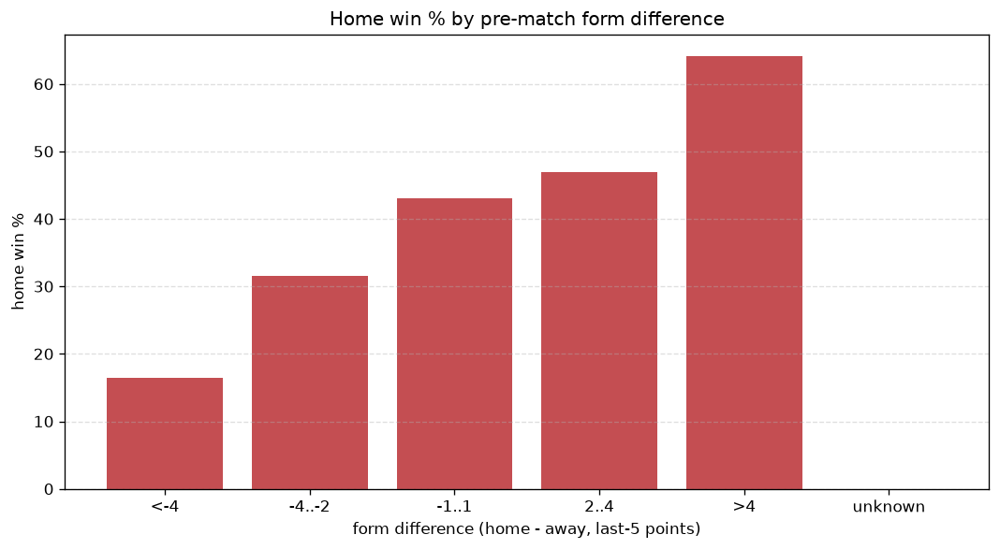
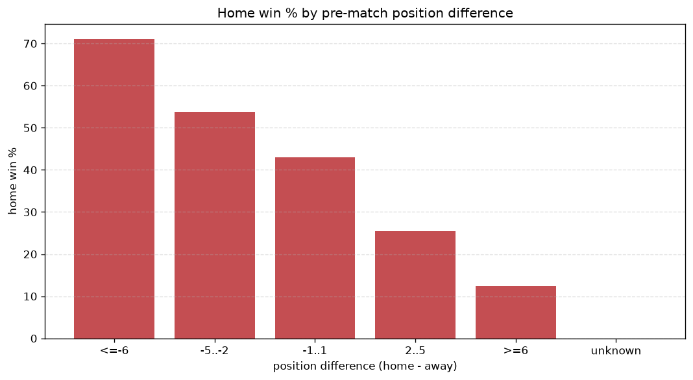

# Relationships Analysis
- Report: `relationships`
- Generated: 2026-10-26T01:26:55+00:00
- Script: `backend/scripts/analyze_relationships.py` v1.0.0
- League: Premier League (Azerbaijan)
- Scope: league `azer`

- Matches analysed: **964** (23 leakage-safe pre-match features).

## 1. Correlation matrix
_Pearson correlation of each pre-match feature with observed goals; sorted by |corr(total goals)|._

| feature | corr(home) | corr(away) | corr(total) |
|---|---|---|---|
| home_team_goals_scored_last_5 | 0.282 | -0.100 | 0.156 |
| home_team_wins_last_5 | 0.245 | -0.097 | 0.128 |
| home_team_points_last_5 | 0.242 | -0.101 | 0.122 |
| home_team_home_goals_avg | 0.232 | -0.095 | 0.119 |
| home_team_home_win_rate | 0.204 | -0.102 | 0.091 |
| home_points_before_match | 0.188 | -0.096 | 0.082 |
| home_position_before_match | -0.256 | 0.179 | -0.077 |
| away_team_goals_scored_last_5 | -0.139 | 0.235 | 0.060 |
| position_difference | -0.348 | 0.307 | -0.057 |
| home_team_goals_conceded_last_5 | -0.128 | 0.066 | -0.056 |
| away_team_away_goals_avg | -0.137 | 0.227 | 0.055 |
| points_difference | 0.349 | -0.312 | 0.055 |
| rest_days_difference | -0.034 | 0.110 | 0.053 |
| home_team_home_conceded_avg | -0.126 | 0.083 | -0.042 |
| home_rest_days | 0.000 | 0.048 | 0.035 |
| away_points_before_match | -0.132 | 0.188 | 0.030 |
| away_team_points_last_5 | -0.160 | 0.218 | 0.030 |
| away_team_away_win_rate | -0.173 | 0.231 | 0.029 |
| away_team_wins_last_5 | -0.167 | 0.219 | 0.024 |
| away_rest_days | 0.011 | 0.017 | 0.021 |
| away_team_goals_conceded_last_5 | 0.125 | -0.131 | 0.005 |
| away_team_away_conceded_avg | 0.184 | -0.210 | -0.005 |
| away_position_before_match | 0.233 | -0.252 | 0.005 |

## 2. Form vs outcome
_Home win/draw/away % per bucket of `home_team_points_last_5 - away_team_points_last_5`._

| bucket | matches | home | draw | away | home % | draw % | away % |
|---|---|---|---|---|---|---|---|
| <-4 | 171 | 28 | 40 | 103 | 16.4% | 23.4% | 60.2% |
| -4..-2 | 187 | 59 | 51 | 77 | 31.6% | 27.3% | 41.2% |
| -1..1 | 265 | 114 | 67 | 84 | 43.0% | 25.3% | 31.7% |
| 2..4 | 185 | 87 | 59 | 39 | 47.0% | 31.9% | 21.1% |
| >4 | 156 | 100 | 32 | 24 | 64.1% | 20.5% | 15.4% |
| unknown | 0 | 0 | 0 | 0 | - | - | - |

## 3. Position vs outcome
_Home win/draw/away % per bucket of `position_difference` (home position - away position; negative favours the home team)._

| bucket | matches | home | draw | away | home % | draw % | away % |
|---|---|---|---|---|---|---|---|
| <=-6 | 83 | 59 | 15 | 9 | 71.1% | 18.1% | 10.8% |
| -5..-2 | 268 | 144 | 74 | 50 | 53.7% | 27.6% | 18.7% |
| -1..1 | 237 | 102 | 63 | 72 | 43.0% | 26.6% | 30.4% |
| 2..5 | 279 | 71 | 72 | 136 | 25.4% | 25.8% | 48.7% |
| >=6 | 97 | 12 | 25 | 60 | 12.4% | 25.8% | 61.9% |
| unknown | 0 | 0 | 0 | 0 | - | - | - |

## 4. Rest advantage
_Home win/draw/away % per bucket of `rest_days_difference` (home rest - away rest). Matches with unknown rest are bucketed separately._

| bucket | matches | home | draw | away | home % | draw % | away % |
|---|---|---|---|---|---|---|---|
| <-1 | 106 | 46 | 32 | 28 | 43.4% | 30.2% | 26.4% |
| -1..0 | 229 | 104 | 62 | 63 | 45.4% | 27.1% | 27.5% |
| 0 | 236 | 85 | 64 | 87 | 36.0% | 27.1% | 36.9% |
| 1..2 | 335 | 135 | 76 | 124 | 40.3% | 22.7% | 37.0% |
| >2 | 27 | 8 | 7 | 12 | 29.6% | 25.9% | 44.4% |
| unknown | 31 | 10 | 8 | 13 | 32.3% | 25.8% | 41.9% |
- *31 match(es) had unknown rest difference (missing rest data on at least one side).*

## 5. Home team quality
_Home win rate by `home_team_home_win_rate` tier (split at 0.5)._

- `< 0.5` tier: **35.1%** home win (228/650)
- `>= 0.5` tier: **51.0%** home win (160/314)
- Home-win gap (>= split minus < split): **+15.9 pp**

| tier | label | matches | home | draw | away | home % |
|---|---|---|---|---|---|---|
| low | < 0.5 | 650 | 228 | 170 | 252 | 35.1% |
| high | >= 0.5 | 314 | 160 | 79 | 75 | 51.0% |

## 6. Feature averages by result
_Mean feature value per outcome; `range` is home-minus-away spread of the group means._

| feature | home mean | draw mean | away mean | range |
|---|---|---|---|---|
| points_difference | 6.015 | -0.498 | -8.055 | 14.071 |
| away_points_before_match | 19.260 | 22.566 | 26.590 | 7.330 |
| home_points_before_match | 25.276 | 22.068 | 18.535 | 6.741 |
| position_difference | -1.665 | 0.349 | 2.119 | 3.784 |
| away_position_before_match | 6.492 | 5.373 | 4.450 | 2.043 |
| home_team_goals_scored_last_5 | 6.763 | 5.398 | 4.765 | 1.998 |
| away_team_points_last_5 | 5.407 | 6.265 | 7.394 | 1.987 |
| home_team_points_last_5 | 7.070 | 6.020 | 5.116 | 1.953 |
| away_team_goals_scored_last_5 | 5.085 | 5.635 | 6.945 | 1.860 |
| home_position_before_match | 4.827 | 5.723 | 6.569 | 1.741 |
| away_team_goals_conceded_last_5 | 6.451 | 5.675 | 5.021 | 1.430 |
| home_team_goals_conceded_last_5 | 5.459 | 5.791 | 6.275 | 0.816 |
| away_team_wins_last_5 | 1.379 | 1.667 | 2.107 | 0.728 |
| home_team_wins_last_5 | 1.966 | 1.578 | 1.315 | 0.652 |
| home_rest_days | 8.575 | 9.083 | 9.140 | 0.564 |
| away_rest_days | 8.585 | 9.133 | 8.873 | 0.548 |
| away_team_away_conceded_avg | 1.420 | 1.224 | 0.986 | 0.434 |
| away_team_away_goals_avg | 0.984 | 1.127 | 1.322 | 0.338 |
| home_team_home_goals_avg | 1.399 | 1.180 | 1.076 | 0.323 |
| rest_days_difference | -0.005 | -0.050 | 0.258 | 0.308 |
| away_team_away_win_rate | 0.278 | 0.347 | 0.430 | 0.152 |
| home_team_home_conceded_avg | 1.063 | 1.113 | 1.194 | 0.131 |
| home_team_home_win_rate | 0.419 | 0.360 | 0.314 | 0.105 |

---
*All features are leakage-safe pre-match values built by `ml.features.build_features.build_rows` from strictly prior matches. Run with `python backend/scripts/analyze_relationships.py` to regenerate.*

## Charts

