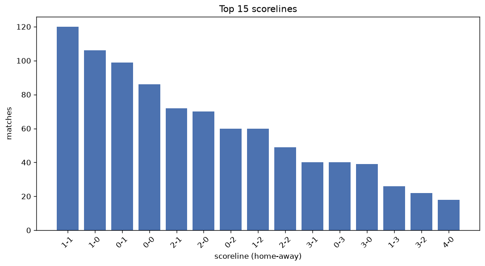
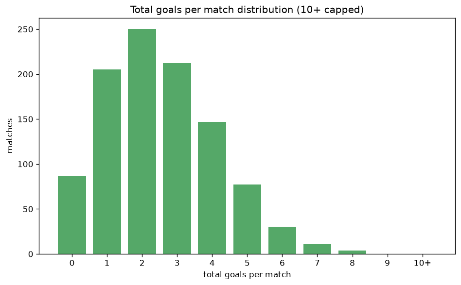

# Scoreline Analysis
- Report: `scoreline_analysis`
- Generated: 2026-10-29T01:53:59+00:00
- Script: `backend/scripts/analyze_scorelines.py` v1.0.0
- League: Premier League (Azerbaijan)
- Scope: league `azer`

## 1. Scoreline frequency
- Matches analysed: **1023** across **7** seasons.
- Distinct scorelines seen: **37**.

| scoreline | count | pct |
|---|---|---|
| 1-1 | 120 | 11.7% |
| 1-0 | 106 | 10.4% |
| 0-1 | 99 | 9.7% |
| 0-0 | 87 | 8.5% |
| 2-1 | 73 | 7.1% |
| 2-0 | 70 | 6.8% |
| 0-2 | 60 | 5.9% |
| 1-2 | 60 | 5.9% |
| 2-2 | 49 | 4.8% |
| 3-1 | 40 | 3.9% |
| 0-3 | 40 | 3.9% |
| 3-0 | 39 | 3.8% |
| 1-3 | 26 | 2.5% |
| 3-2 | 22 | 2.2% |
| 4-0 | 18 | 1.8% |
| 2-3 | 15 | 1.5% |
| 0-4 | 14 | 1.4% |
| 5-0 | 13 | 1.3% |
| 1-4 | 12 | 1.2% |
| 4-1 | 11 | 1.1% |

## 2. Scoreline frequency per season

### 2020-2021
| scoreline | count | pct |
|---|---|---|
| 1-1 | 16 | 14.3% |
| 0-0 | 14 | 12.5% |
| 2-1 | 10 | 8.9% |
| 1-0 | 10 | 8.9% |
| 0-1 | 8 | 7.1% |

### 2021-2022
| scoreline | count | pct |
|---|---|---|
| 1-1 | 13 | 11.6% |
| 2-0 | 11 | 9.8% |
| 0-1 | 10 | 8.9% |
| 1-2 | 10 | 8.9% |
| 1-0 | 8 | 7.1% |

### 2022-2023
| scoreline | count | pct |
|---|---|---|
| 1-1 | 20 | 11.1% |
| 1-0 | 16 | 8.9% |
| 0-1 | 15 | 8.3% |
| 0-0 | 15 | 8.3% |
| 2-1 | 14 | 7.8% |

### 2023-2024
| scoreline | count | pct |
|---|---|---|
| 1-0 | 22 | 12.2% |
| 0-1 | 21 | 11.7% |
| 1-1 | 18 | 10.0% |
| 2-0 | 16 | 8.9% |
| 1-2 | 13 | 7.2% |

### 2024-2025
| scoreline | count | pct |
|---|---|---|
| 1-1 | 26 | 14.4% |
| 1-0 | 24 | 13.3% |
| 0-1 | 21 | 11.7% |
| 0-0 | 15 | 8.3% |
| 0-2 | 12 | 6.7% |

### 2025-2026
| scoreline | count | pct |
|---|---|---|
| 1-1 | 21 | 10.5% |
| 1-0 | 19 | 9.5% |
| 0-1 | 18 | 9.0% |
| 0-0 | 18 | 9.0% |
| 2-1 | 16 | 8.0% |

### 2026-2027
| scoreline | count | pct |
|---|---|---|
| 1-0 | 7 | 11.9% |
| 0-0 | 6 | 10.2% |
| 0-1 | 6 | 10.2% |
| 1-1 | 6 | 10.2% |
| 2-1 | 5 | 8.5% |

## 3. Total-goal histogram
_10+ groups all matches with 10 or more total goals._

| total goals | matches | pct |
|---|---|---|
| 0 | 87 | 8.5% |
| 1 | 205 | 20.0% |
| 2 | 250 | 24.4% |
| 3 | 212 | 20.7% |
| 4 | 147 | 14.4% |
| 5 | 77 | 7.5% |
| 6 | 30 | 2.9% |
| 7 | 11 | 1.1% |
| 8 | 4 | 0.4% |
| 9 | 0 | 0.0% |
| 10+ | 0 | 0.0% |

## 4. Extreme scorelines
- Matches with 7+ total goals: **15**

| season | date | scoreline | total goals |
|---|---|---|---|
| 2021-2022 | 2022-04-15 | 8-0 | 8 |
| 2022-2023 | 2022-09-18 | 1-7 | 8 |
| 2023-2024 | 2023-11-04 | 7-1 | 8 |
| 2025-2026 | 2026-03-10 | 7-1 | 8 |
| 2020-2021 | 2020-11-01 | 6-1 | 7 |
| 2020-2021 | 2020-11-21 | 6-1 | 7 |
| 2022-2023 | 2022-08-14 | 5-2 | 7 |
| 2022-2023 | 2022-09-11 | 4-3 | 7 |
| 2023-2024 | 2023-12-08 | 1-6 | 7 |
| 2023-2024 | 2024-03-29 | 1-6 | 7 |
| 2023-2024 | 2024-05-17 | 4-3 | 7 |
| 2024-2025 | 2024-10-04 | 4-3 | 7 |
| 2024-2025 | 2025-01-19 | 5-2 | 7 |
| 2025-2026 | 2026-04-06 | 7-0 | 7 |
| 2025-2026 | 2026-05-22 | 3-4 | 7 |

## 5. Margin-of-victory distribution (decided matches)
- Decided matches: **760** (draws: **263**)
- Average winning margin: **1.88**

| margin | matches | pct |
|---|---|---|
| 1 | 379 | 49.9% |
| 2 | 206 | 27.1% |
| 3+ | 175 | 23.0% |

## 6. Margin by outcome

### Home wins
- Matches: **415** | avg margin: **1.93** | max margin: **8**
| margin | matches | pct |
|---|---|---|
| 1 | 204 | 49.2% |
| 2 | 113 | 27.2% |
| 3+ | 98 | 23.6% |
- *Full match-by-match list available in `scoreline_analysis.json`.*

### Away wins
- Matches: **345** | avg margin: **1.83** | max margin: **6**
| margin | matches | pct |
|---|---|---|
| 1 | 175 | 50.7% |
| 2 | 93 | 27.0% |
| 3+ | 77 | 22.3% |
- *Full match-by-match list available in `scoreline_analysis.json`.*

## 7. Most common exact score by outcome type
| outcome | matches | most common score | count | pct |
|---|---|---|---|---|
| home | 415 | 1-0 | 106 | 25.5% |
| draw | 263 | 1-1 | 120 | 45.6% |
| away | 345 | 0-1 | 99 | 28.7% |

---
*All statistics are computed from PostgreSQL tables (read-only). Run with `python backend/scripts/analyze_scorelines.py` to regenerate.*

## Charts

