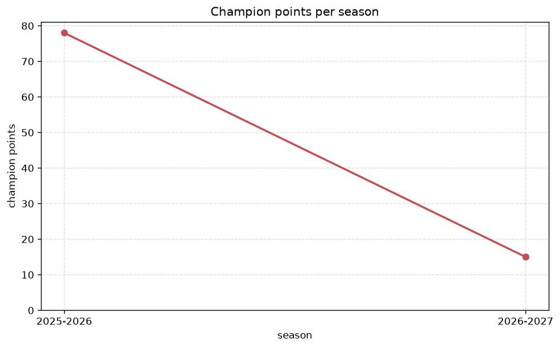
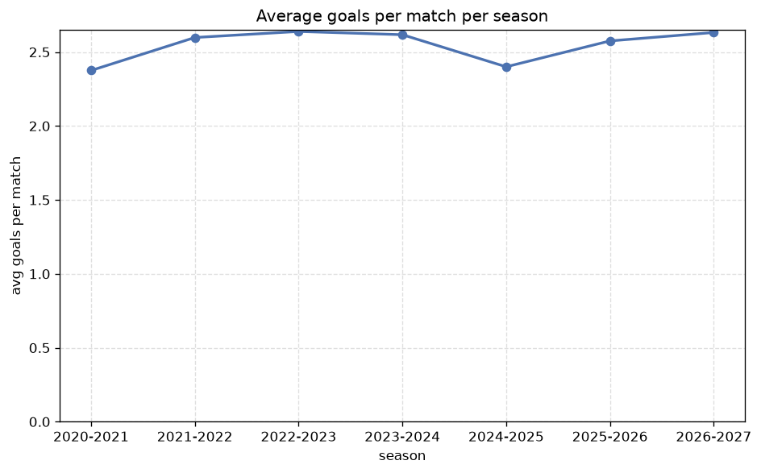

# Season Trends Analysis
- Report: `season_trends`
- Generated: 2026-10-30T03:45:06+00:00
- Script: `backend/scripts/analyze_seasons.py` v1.0.0
- League: Premier League (Azerbaijan)
- Scope: league `azer`

## 1. Champions per season
| season | champion | pts | runner-up | margin |
|---|---|---|---|---|
| 2020-2021 | Neftci Baku | 59 | Qarabag | 2 pts |
| 2021-2022 | Qarabag | 69 | Neftci Baku | 19 pts |
| 2022-2023 | Qarabag | 90 | Sabah Baku | 9 pts |
| 2023-2024 | Qarabag | 83 | Zira | 25 pts |
| 2024-2025 | Qarabag | 89 | Zira | 15 pts |
| 2025-2026 | Sabah Baku | 78 | Qarabag | 9 pts |
| 2026-2027 | Sabah FC | 20 | Sabah Baku | 1 pts |

## 2. Title-race tightness
- Tight races (margin <= 3 pts): **2** of 7 seasons
- Tightest race: **2026-2027** - Sabah FC beat Sabah Baku by **1** pts

| season | margin | tight |
|---|---|---|
| 2020-2021 | 2 pts | yes |
| 2021-2022 | 19 pts |  |
| 2022-2023 | 9 pts |  |
| 2023-2024 | 25 pts |  |
| 2024-2025 | 15 pts |  |
| 2025-2026 | 9 pts |  |
| 2026-2027 | 1 pts | yes |

## 3. Points thresholds
_Position-specific points per season. Key: 1 = champion, 2 = runner-up, 4 = CL line, 6 = Europa, 9 = last safe, 12 = bottom._

| season | pos 1 | pos 2 | pos 4 | pos 6 | pos 9 | pos 12 |
|---|---|---|---|---|---|---|
| 2020-2021 | 59 | 57 | 38 | 26 | - | - |
| 2021-2022 | 69 | 50 | 45 | 22 | - | - |
| 2022-2023 | 90 | 81 | 50 | 39 | 29 | - |
| 2023-2024 | 83 | 58 | 57 | 48 | 35 | - |
| 2024-2025 | 89 | 74 | 55 | 43 | 32 | - |
| 2025-2026 | 78 | 69 | 59 | 46 | 34 | 15 |
| 2026-2027 | 20 | 19 | 18 | 15 | 10 | 3 |

## 4. Relegation battle
| season | safe pos | safe pts | drop pos | drop pts | gap |
|---|---|---|---|---|---|
| 2020-2021 | 9 | - | 10 | - | - |
| 2021-2022 | 9 | - | 10 | - | - |
| 2022-2023 | 9 | 29 | 10 | 25 | 4 pts |
| 2023-2024 | 9 | 35 | 10 | 26 | 9 pts |
| 2024-2025 | 9 | 32 | 10 | 22 | 10 pts |
| 2025-2026 | 9 | 34 | 10 | 31 | 3 pts |
| 2026-2027 | 9 | 10 | 10 | 8 | 2 pts |

## 5. League-level trends
| season | matches | total goals | avg goals | home win | draw | away win | goalless | avg pts/team |
|---|---|---|---|---|---|---|---|---|
| 2020-2021 | 112 | 266 | 2.375 | 38.4% | 33.9% | 27.7% | 12.5% | 37.25 |
| 2021-2022 | 112 | 291 | 2.598 | 41.1% | 22.3% | 36.6% | 7.1% | 38.88 |
| 2022-2023 | 180 | 475 | 2.639 | 40.0% | 25.6% | 34.4% | 8.3% | 49.4 |
| 2023-2024 | 180 | 471 | 2.617 | 43.9% | 22.8% | 33.3% | 6.1% | 49.9 |
| 2024-2025 | 180 | 432 | 2.4 | 40.6% | 27.8% | 31.7% | 8.3% | 49.0 |
| 2025-2026 | 200 | 515 | 2.575 | 37.5% | 24.5% | 38.0% | 9.0% | 42.38 |
| 2026-2027 | 59 | 153 | 2.593 | 45.8% | 23.7% | 30.5% | 10.2% | 12.54 |

## 6. View divergence
- Largest divergence: **2026-2027** (goals view, avg abs position diff = 4.462)

_Avg absolute position difference between classic view and alternative view per season._

| season | classic vs luck | classic vs goals |
|---|---|---|
| 2020-2021 | 1.500 | 2.250 |
| 2021-2022 | 1.500 | 2.500 |
| 2022-2023 | 1.200 | 1.800 |
| 2023-2024 | 2.000 | 3.600 |
| 2024-2025 | 1.600 | 3.200 |
| 2025-2026 | 2.462 | 2.923 |
| 2026-2027 | 2.308 | 4.462 |

---
*All statistics are computed from PostgreSQL tables (read-only). Run with `python backend/scripts/analyze_seasons.py` to regenerate.*

## Charts

