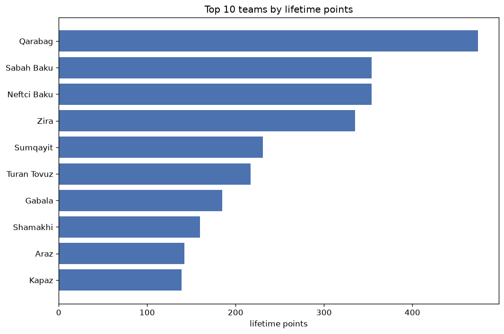
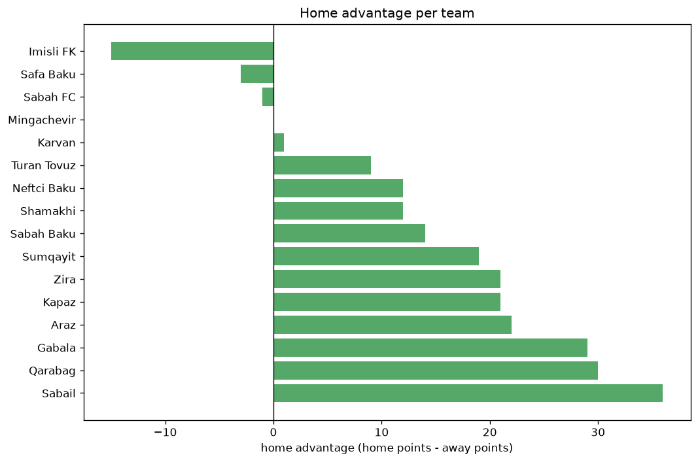

# Team Analysis
- Report: `teams_analysis`
- Generated: 2026-10-26T01:26:50+00:00
- Script: `backend/scripts/analyze_teams.py` v1.0.0
- League: Premier League (Azerbaijan)
- Scope: league `azer`

- Teams: **16** | Seasons: **7** | Matches: **1021**

## 1. Team standings (lifetime)
| team | seasons | played | W | D | L | pts | GF | GA | GD | avg pts/season | best pos | worst pos | titles |
|---|---|---|---|---|---|---|---|---|---|---|---|---|---|
| Qarabag | 7 | 204 | 145 | 39 | 20 | 474 | 495 | 146 | 349 | 67.71 | 1 | 4 | 4 |
| Sabah Baku | 7 | 204 | 101 | 51 | 52 | 354 | 338 | 208 | 130 | 50.57 | 1 | 5 | 1 |
| Neftci Baku | 7 | 207 | 100 | 54 | 53 | 354 | 321 | 224 | 97 | 50.57 | 1 | 6 | 1 |
| Zira | 7 | 207 | 90 | 65 | 52 | 335 | 253 | 203 | 50 | 47.86 | 2 | 6 | 0 |
| Sumqayit | 7 | 205 | 61 | 48 | 96 | 231 | 203 | 300 | -97 | 33.0 | 3 | 9 | 0 |
| Turan Tovuz | 5 | 151 | 58 | 43 | 50 | 217 | 186 | 174 | 12 | 43.4 | 3 | 6 | 0 |
| Gabala | 6 | 173 | 47 | 44 | 82 | 185 | 177 | 258 | -81 | 30.83 | 4 | 11 | 0 |
| Shamakhi | 6 | 169 | 35 | 55 | 79 | 160 | 151 | 236 | -85 | 26.67 | 6 | 10 | 0 |
| Araz | 4 | 115 | 37 | 31 | 47 | 142 | 116 | 157 | -41 | 35.5 | 3 | 13 | 0 |
| Kapaz | 5 | 150 | 35 | 34 | 81 | 139 | 135 | 266 | -131 | 27.8 | 7 | 11 | 0 |
| Sabail | 5 | 164 | 31 | 39 | 94 | 132 | 148 | 280 | -132 | 26.4 | 7 | 10 | 0 |
| Imisli FK | 2 | 42 | 9 | 14 | 19 | 41 | 31 | 59 | -28 | 20.5 | 9 | 10 | 0 |
| Sabah FC | 1 | 7 | 6 | 1 | 0 | 19 | 18 | 1 | 17 | 19.0 | 1 | 1 | 1 |
| Karvan | 1 | 33 | 3 | 6 | 24 | 15 | 23 | 66 | -43 | 15.0 | 12 | 12 | 0 |
| Safa Baku | 1 | 10 | 1 | 0 | 9 | 3 | 5 | 20 | -15 | 3.0 | 12 | 12 | 0 |
| Mingachevir | 1 | 1 | 0 | 0 | 1 | 0 | 0 | 2 | -2 | 0.0 | 13 | 13 | 0 |

## 2. Home vs away split
| team | home P | H-W | H-D | H-L | H-pts | away P | A-W | A-D | A-L | A-pts | adv |
|---|---|---|---|---|---|---|---|---|---|---|---|
| Sabail | 82 | 21 | 21 | 40 | 84 | 82 | 10 | 18 | 54 | 48 | 36 |
| Qarabag | 103 | 79 | 15 | 9 | 252 | 101 | 66 | 24 | 11 | 222 | 30 |
| Gabala | 88 | 27 | 26 | 35 | 107 | 85 | 20 | 18 | 47 | 78 | 29 |
| Araz | 59 | 22 | 16 | 21 | 82 | 56 | 15 | 15 | 26 | 60 | 22 |
| Zira | 104 | 48 | 34 | 22 | 178 | 103 | 42 | 31 | 30 | 157 | 21 |
| Kapaz | 75 | 21 | 17 | 37 | 80 | 75 | 14 | 17 | 44 | 59 | 21 |
| Sumqayit | 103 | 34 | 23 | 46 | 125 | 102 | 27 | 25 | 50 | 106 | 19 |
| Sabah Baku | 102 | 52 | 28 | 22 | 184 | 102 | 49 | 23 | 30 | 170 | 14 |
| Neftci Baku | 104 | 52 | 27 | 25 | 183 | 103 | 48 | 27 | 28 | 171 | 12 |
| Shamakhi | 83 | 20 | 26 | 37 | 86 | 86 | 15 | 29 | 42 | 74 | 12 |
| Turan Tovuz | 74 | 32 | 17 | 25 | 113 | 77 | 26 | 26 | 25 | 104 | 9 |
| Karvan | 17 | 2 | 2 | 13 | 8 | 16 | 1 | 4 | 11 | 7 | 1 |
| Mingachevir | 0 | 0 | 0 | 0 | 0 | 1 | 0 | 0 | 1 | 0 | 0 |
| Sabah FC | 3 | 3 | 0 | 0 | 9 | 4 | 3 | 1 | 0 | 10 | -1 |
| Safa Baku | 5 | 0 | 0 | 5 | 0 | 5 | 1 | 0 | 4 | 3 | -3 |
| Imisli FK | 19 | 1 | 10 | 8 | 13 | 23 | 8 | 4 | 11 | 28 | -15 |

## 3. Top performers
### Best points per game (PPG)
| rank | team | PPG |
|---|---|---|
| 1 | Sabah FC | 2.71 |
| 2 | Qarabag | 2.32 |
| 3 | Sabah Baku | 1.74 |
| 4 | Neftci Baku | 1.71 |
| 5 | Zira | 1.62 |

### Most goals scored
| rank | team | goals |
|---|---|---|
| 1 | Qarabag | 495 |
| 2 | Sabah Baku | 338 |
| 3 | Neftci Baku | 321 |
| 4 | Zira | 253 |
| 5 | Sumqayit | 203 |

### Best goal difference
| rank | team | GD |
|---|---|---|
| 1 | Qarabag | 349 |
| 2 | Sabah Baku | 130 |
| 3 | Neftci Baku | 97 |
| 4 | Zira | 50 |
| 5 | Sabah FC | 17 |

### Best defence (goals against per match, standings)
| rank | team | GA/match |
|---|---|---|
| 1 | Sabah FC | 0.143 |
| 2 | Qarabag | 0.716 |
| 3 | Zira | 0.981 |
| 4 | Sabah Baku | 1.020 |
| 5 | Neftci Baku | 1.082 |

## 4. Team consistency
- Teams present in all **7** seasons: **5**

Neftci Baku, Qarabag, Sabah Baku, Sumqayit, Zira

## 5. Head-to-head dominance
- Distinct fixtures: **93** (showing the 15 most frequent)

| fixture | meetings | home wins | draws | away wins | home pct | draw pct | away pct |
|---|---|---|---|---|---|---|---|
| Neftci Baku vs Zira | 24 | 12 | 7 | 5 | 50.0% | 29.2% | 20.8% |
| Neftci Baku vs Qarabag | 24 | 10 | 2 | 12 | 41.7% | 8.3% | 50.0% |
| Qarabag vs Sumqayit | 24 | 10 | 2 | 12 | 41.7% | 8.3% | 50.0% |
| Sumqayit vs Zira | 24 | 10 | 7 | 7 | 41.7% | 29.2% | 29.2% |
| Neftci Baku vs Sabah Baku | 24 | 8 | 7 | 9 | 33.3% | 29.2% | 37.5% |
| Zira vs Sabah Baku | 24 | 7 | 8 | 9 | 29.2% | 33.3% | 37.5% |
| Neftci Baku vs Sumqayit | 24 | 6 | 8 | 10 | 25.0% | 33.3% | 41.7% |
| Qarabag vs Zira | 24 | 6 | 9 | 9 | 25.0% | 37.5% | 37.5% |
| Sumqayit vs Sabah Baku | 23 | 10 | 5 | 8 | 43.5% | 21.7% | 34.8% |
| Qarabag vs Sabah Baku | 23 | 9 | 8 | 6 | 39.1% | 34.8% | 26.1% |
| Qarabag vs Sabail | 20 | 12 | 2 | 6 | 60.0% | 10.0% | 30.0% |
| Sabah Baku vs Gabala | 20 | 12 | 2 | 6 | 60.0% | 10.0% | 30.0% |
| Sabah Baku vs Sabail | 20 | 11 | 4 | 5 | 55.0% | 20.0% | 25.0% |
| Sumqayit vs Sabail | 20 | 11 | 1 | 8 | 55.0% | 5.0% | 40.0% |
| Neftci Baku vs Sabail | 20 | 9 | 3 | 8 | 45.0% | 15.0% | 40.0% |

## 6. Position per season (classic view)
_Cells show final position; '-' when the team was absent from that season._

| team | 2020-2021 | 2021-2022 | 2022-2023 | 2023-2024 | 2024-2025 | 2025-2026 | 2026-2027 |
|---|---|---|---|---|---|---|---|
| Qarabag | 2 | 1 | 1 | 1 | 1 | 2 | 4 |
| Sabah Baku | 5 | 5 | 2 | 3 | 5 | 1 | 2 |
| Neftci Baku | 1 | 2 | 3 | 5 | 6 | 4 | 3 |
| Zira | 4 | 3 | 5 | 2 | 2 | 5 | 6 |
| Sumqayit | 3 | 7 | 8 | 4 | 8 | 7 | 9 |
| Turan Tovuz | - | - | 6 | 6 | 4 | 3 | 5 |
| Gabala | 7 | 4 | 4 | 10 | - | 10 | 11 |
| Shamakhi | 6 | 6 | 10 | - | 7 | 8 | 8 |
| Araz | - | - | - | 8 | 3 | 6 | 13 |
| Kapaz | - | - | 7 | 9 | 9 | 11 | 7 |
| Sabail | 8 | 8 | 9 | 7 | 10 | - | - |
| Imisli FK | - | - | - | - | - | 9 | 10 |
| Sabah FC | - | - | - | - | - | - | 1 |
| Karvan | - | - | - | - | - | 12 | - |
| Safa Baku | - | - | - | - | - | - | 12 |
| Mingachevir | - | - | - | - | - | 13 | - |

---
*All statistics are computed from PostgreSQL tables (read-only). Run with `python backend/scripts/analyze_teams.py` to regenerate.*

## Charts

