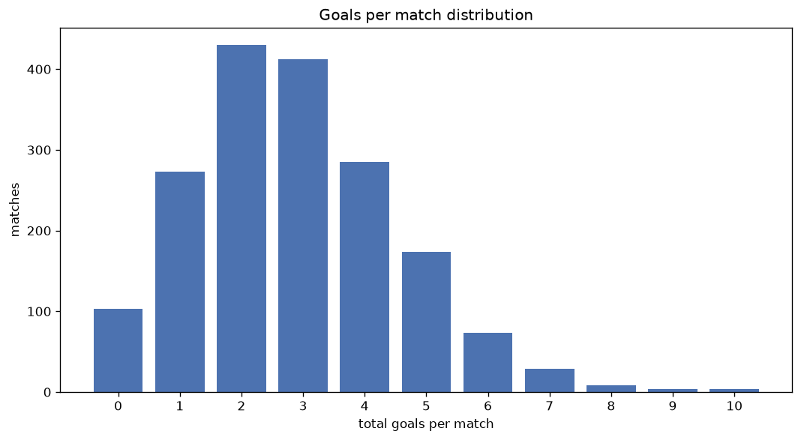
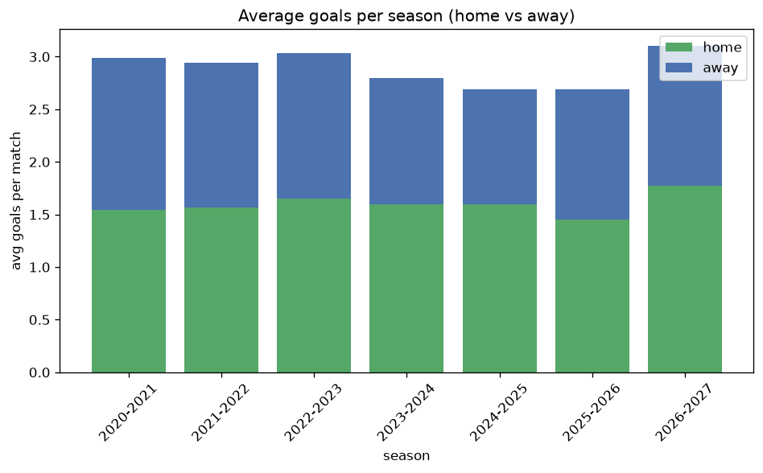

# Goal Analysis
- Report: `goals_analysis`
- Generated: 2026-10-26T01:27:04+00:00
- Script: `backend/scripts/analyze_goals.py` v1.0.0
- League: Jupiler Pro League (Belgium)
- Scope: league `belgium1`

## 1. Goals per match distribution
| goals | matches | pct |
|---|---|---|
| 0 | 103 | 5.7% |
| 1 | 273 | 15.2% |
| 2 | 430 | 24.0% |
| 3 | 412 | 23.0% |
| 4 | 285 | 15.9% |
| 5 | 174 | 9.7% |
| 6 | 73 | 4.1% |
| 7 | 29 | 1.6% |
| 8 | 8 | 0.4% |
| 9 | 4 | 0.2% |
| 10 | 4 | 0.2% |

## 2. Goals per match per season
| season | matches | total goals | avg home | avg away | avg total |
|---|---|---|---|---|---|
| 2020-2021 | 306 | 914 | 1.542 | 1.444 | 2.987 |
| 2021-2022 | 306 | 900 | 1.565 | 1.376 | 2.941 |
| 2022-2023 | 306 | 929 | 1.65 | 1.386 | 3.036 |
| 2023-2024 | 240 | 672 | 1.596 | 1.204 | 2.8 |
| 2024-2025 | 240 | 645 | 1.596 | 1.092 | 2.688 |
| 2025-2026 | 321 | 864 | 1.449 | 1.243 | 2.692 |
| 2026-2027 | 76 | 236 | 1.776 | 1.329 | 3.105 |

## 3. Home vs away goal share
- Home goals: **2822** (54.7%)
- Away goals: **2338** (45.3%)
- Home/away ratio: **1.207**

| season | home goals | away goals | total | home pct | away pct |
|---|---|---|---|---|---|
| 2020-2021 | 472 | 442 | 914 | 51.6% | 48.4% |
| 2021-2022 | 479 | 421 | 900 | 53.2% | 46.8% |
| 2022-2023 | 505 | 424 | 929 | 54.4% | 45.6% |
| 2023-2024 | 383 | 289 | 672 | 57.0% | 43.0% |
| 2024-2025 | 383 | 262 | 645 | 59.4% | 40.6% |
| 2025-2026 | 465 | 399 | 864 | 53.8% | 46.2% |
| 2026-2027 | 135 | 101 | 236 | 57.2% | 42.8% |

## 4. BTTS (Both Teams To Score)
- Overall: **985** of `1795` (54.9%)

| season | matches | BTTS | pct |
|---|---|---|---|
| 2020-2021 | 306 | 187 | 61.1% |
| 2021-2022 | 306 | 162 | 52.9% |
| 2022-2023 | 306 | 170 | 55.6% |
| 2023-2024 | 240 | 131 | 54.6% |
| 2024-2025 | 240 | 127 | 52.9% |
| 2025-2026 | 321 | 175 | 54.5% |
| 2026-2027 | 76 | 33 | 43.4% |

## 5. Clean sheets
- Home clean sheets: **514** (28.6%)
- Away clean sheets: **399** (22.2%)
- Total clean sheets recorded: **913**
- Matches with at least one clean sheet: **810** (45.1%)
- Both teams kept clean sheets (0-0): **103**

| season | matches | home CS | away CS | total CS | matches w/ CS |
|---|---|---|---|---|---|
| 2020-2021 | 306 | 71 | 62 | 133 | 119 (38.9%) |
| 2021-2022 | 306 | 82 | 74 | 156 | 144 (47.1%) |
| 2022-2023 | 306 | 80 | 71 | 151 | 136 (44.4%) |
| 2023-2024 | 240 | 69 | 52 | 121 | 109 (45.4%) |
| 2024-2025 | 240 | 87 | 48 | 135 | 113 (47.1%) |
| 2025-2026 | 321 | 97 | 74 | 171 | 146 (45.5%) |
| 2026-2027 | 76 | 28 | 18 | 46 | 43 (56.6%) |

## 6. Scoring intensity
- First-half goals: **2272** (44.3%)
- Second-half goals: **2860** (55.7%)
- Avg first-half goals per match: **1.27**
- Avg second-half goals per match: **1.599**
- Second-half-only scoring (HT 0-0, FT goals >= 1): **376** (20.9%)
- *6 match(es) excluded (no HT score recorded).*

| season | matches | 1st half | 2nd half | 1st half pct | 2nd half pct |
|---|---|---|---|---|---|
| 2020-2021 | 306 | 377 | 537 | 41.2% | 58.8% |
| 2021-2022 | 306 | 383 | 504 | 43.2% | 56.8% |
| 2022-2023 | 306 | 423 | 496 | 46.0% | 54.0% |
| 2023-2024 | 240 | 302 | 370 | 44.9% | 55.1% |
| 2024-2025 | 240 | 292 | 348 | 45.6% | 54.4% |
| 2025-2026 | 321 | 391 | 473 | 45.3% | 54.7% |
| 2026-2027 | 76 | 104 | 132 | 44.1% | 55.9% |

## 7. First-goal timing
- Matches with first-goal time recorded: `1686` of `1795` (93.9%)
- Goalless matches: `109`
- Min `1` | Max `100` | Mean `30.5` | Median (p50) `25.0`

| bucket | count | % of matches | % of scoring matches |
|---|---|---|---|
| 1-15 | 567 | 31.6% | 33.6% |
| 16-30 | 390 | 21.7% | 23.1% |
| 31-45 | 316 | 17.6% | 18.7% |
| 46-60 | 209 | 11.6% | 12.4% |
| 61-75 | 104 | 5.8% | 6.2% |
| 76-90 | 86 | 4.8% | 5.1% |
| 91-120 | 14 | 0.8% | 0.8% |

---
*All statistics are computed from PostgreSQL tables (read-only). Run with `python backend/scripts/analyze_goals.py` to regenerate.*

## Charts

