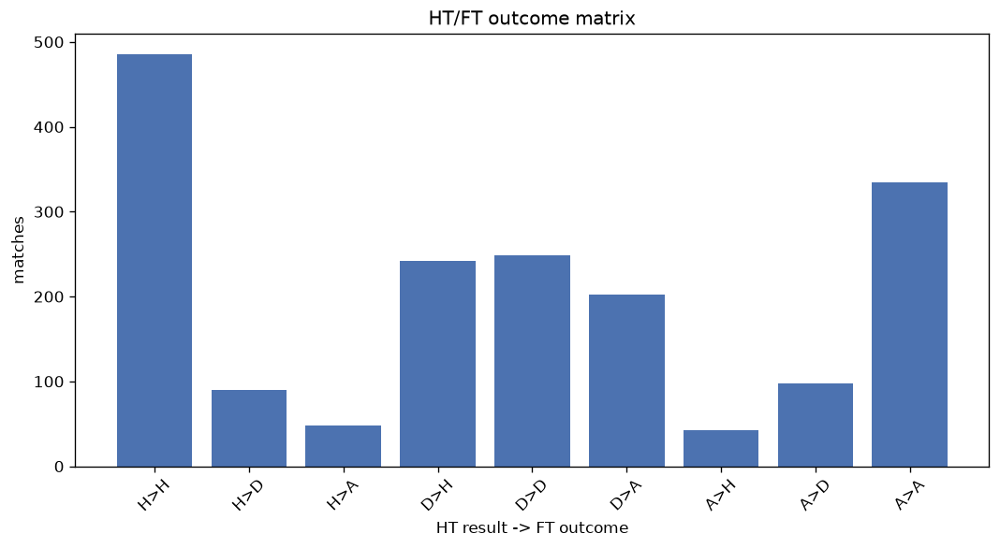
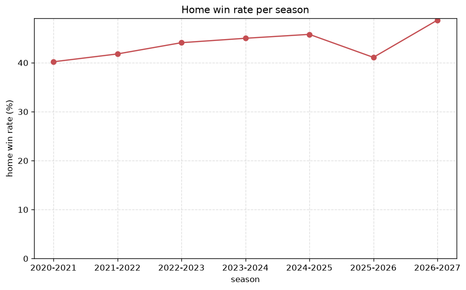

# Match Analysis
- Report: `matches_analysis`
- Generated: 2026-10-26T01:27:03+00:00
- Script: `backend/scripts/analyze_matches.py` v1.0.0
- League: Jupiler Pro League (Belgium)
- Scope: league `belgium1`

## 1. Overall summary
| metric | value |
|---|---|
| Matches | 1795 |
| Home wins | 773 (43.1%) |
| Draws | 436 (24.3%) |
| Away wins | 586 (32.6%) |
| Total goals | 5160 |
| Average goals per match | 2.875 |
| Goalless matches | 103 (5.7%) |

## 2. Per-season breakdown
| season | matches | home wins | draws | away wins | total goals | avg goals | goalless |
|---|---|---|---|---|---|---|---|
| 2020-2021 | 306 | 123 (40.2%) | 70 (22.9%) | 113 (36.9%) | 914 | 2.987 | 14 (4.6%) |
| 2021-2022 | 306 | 128 (41.8%) | 68 (22.2%) | 110 (35.9%) | 900 | 2.941 | 12 (3.9%) |
| 2022-2023 | 306 | 135 (44.1%) | 68 (22.2%) | 103 (33.7%) | 929 | 3.036 | 15 (4.9%) |
| 2023-2024 | 240 | 108 (45.0%) | 65 (27.1%) | 67 (27.9%) | 672 | 2.8 | 12 (5.0%) |
| 2024-2025 | 240 | 110 (45.8%) | 69 (28.8%) | 61 (25.4%) | 645 | 2.688 | 22 (9.2%) |
| 2025-2026 | 321 | 132 (41.1%) | 81 (25.2%) | 108 (33.6%) | 864 | 2.692 | 25 (7.8%) |
| 2026-2027 | 76 | 37 (48.7%) | 15 (19.7%) | 24 (31.6%) | 236 | 3.105 | 3 (3.9%) |

## 3. HT/FT outcome matrix
| HT result \ FT result | Home | Draw | Away | total |
|---|---|---|---|---|
| HT home lead | 485 (77.8%) | 90 (14.4%) | 48 (7.7%) | 623 |
| HT draw | 242 (35.0%) | 248 (35.8%) | 202 (29.2%) | 692 |
| HT away lead | 42 (8.9%) | 98 (20.7%) | 334 (70.5%) | 474 |
- *6 match(es) excluded (no HT score recorded).*

## 4. Comeback matches
- Home comebacks (trailing at HT, won at FT): **42** (2.3%)
- Away comebacks (trailing at HT, won at FT): **48** (2.7%)

### Home comebacks
| season | home | away | HT | FT |
|---|---|---|---|---|
| 2020-2021 | Cercle Brugge KSV | Antwerp | 0-1 | 2-1 |
| 2020-2021 | Beerschot VA | Beveren | 1-2 | 3-2 |
| 2020-2021 | Oostende | Gent | 0-1 | 2-1 |
| 2020-2021 | Club Brugge KV | Genk | 1-2 | 3-2 |
| 2020-2021 | St. Liege | Gent | 0-1 | 2-1 |
| 2020-2021 | Waregem | Eupen | 0-1 | 2-1 |
| 2020-2021 | Antwerp | Genk | 0-1 | 3-2 |
| 2021-2022 | KV Mechelen | Antwerp | 0-1 | 3-2 |
| 2021-2022 | Seraing | Cercle Brugge KSV | 0-1 | 2-1 |
| 2021-2022 | Gent | Cercle Brugge KSV | 0-1 | 2-1 |
| 2021-2022 | Royale Union SG | Seraing | 0-2 | 4-2 |
| 2021-2022 | Waregem | Antwerp | 0-1 | 2-1 |
| 2021-2022 | Oostende | Eupen | 0-1 | 2-1 |
| 2021-2022 | Waregem | KV Mechelen | 0-1 | 3-2 |
| 2021-2022 | Royale Union SG | Cercle Brugge KSV | 0-2 | 3-2 |
| 2021-2022 | Leuven | Cercle Brugge KSV | 1-2 | 3-2 |
| 2021-2022 | Antwerp | Beerschot VA | 0-1 | 2-1 |
| 2022-2023 | Leuven | Oostende | 0-1 | 2-1 |
| 2022-2023 | Eupen | KV Mechelen | 0-1 | 2-1 |
| 2022-2023 | Charleroi | Waregem | 0-1 | 3-2 |
| 2022-2023 | Antwerp | Cercle Brugge KSV | 0-1 | 2-1 |
| 2023-2024 | Gent | Eupen | 0-1 | 2-1 |
| 2023-2024 | St. Liege | Anderlecht | 0-2 | 3-2 |
| 2023-2024 | Charleroi | Westerlo | 0-1 | 3-2 |
| 2023-2024 | Anderlecht | RWDM Brussels | 0-1 | 2-1 |
| 2023-2024 | St. Truiden | Gent | 0-1 | 4-1 |
| 2023-2024 | Anderlecht | St. Truiden | 0-1 | 4-1 |
| 2023-2024 | St. Truiden | Club Brugge KV | 0-1 | 2-1 |
| 2024-2025 | Genk | Club Brugge KV | 0-1 | 3-2 |
| 2024-2025 | Beerschot VA | Cercle Brugge KSV | 0-2 | 3-2 |
| 2024-2025 | Antwerp | Westerlo | 1-2 | 3-2 |
| 2024-2025 | Antwerp | Club Brugge KV | 0-1 | 2-1 |
| 2024-2025 | Leuven | Dender | 1-2 | 3-2 |
| 2025-2026 | Club Brugge KV | Genk | 0-1 | 2-1 |
| 2025-2026 | Gent | Anderlecht | 1-2 | 4-2 |
| 2025-2026 | Club Brugge KV | Waregem | 1-2 | 4-3 |
| 2025-2026 | Anderlecht | Gent | 0-1 | 3-1 |
| 2025-2026 | St. Liege | Leuven | 0-1 | 2-1 |
| 2025-2026 | RAAL La Louviere | Cercle Brugge KSV | 0-1 | 4-1 |
| 2025-2026 | Lommel SK | Dender | 0-1 | 3-2 |
| 2026-2027 | Waregem | Genk | 0-1 | 2-1 |
| 2026-2027 | Antwerp | Beveren | 0-1 | 2-1 |

### Away comebacks
| season | home | away | HT | FT |
|---|---|---|---|---|
| 2020-2021 | Waregem | Genk | 1-0 | 1-2 |
| 2020-2021 | KV Mechelen | Cercle Brugge KSV | 1-0 | 2-3 |
| 2020-2021 | Kortrijk | Antwerp | 1-0 | 1-3 |
| 2020-2021 | Waregem | Antwerp | 1-0 | 1-3 |
| 2020-2021 | KV Mechelen | Beerschot VA | 2-1 | 2-3 |
| 2020-2021 | KV Mechelen | Beveren | 1-0 | 2-3 |
| 2020-2021 | Cercle Brugge KSV | Charleroi | 2-0 | 3-4 |
| 2020-2021 | Leuven | Oostende | 1-0 | 1-2 |
| 2020-2021 | Eupen | Waregem | 1-0 | 2-3 |
| 2020-2021 | Waregem | Leuven | 2-1 | 2-3 |
| 2020-2021 | Beveren | Kortrijk | 2-1 | 3-4 |
| 2020-2021 | Beerschot VA | Oostende | 1-0 | 1-2 |
| 2021-2022 | Genk | Oostende | 2-1 | 3-4 |
| 2021-2022 | KV Mechelen | Eupen | 1-0 | 1-3 |
| 2021-2022 | Kortrijk | Genk | 1-0 | 1-2 |
| 2021-2022 | Seraing | Oostende | 1-0 | 2-3 |
| 2021-2022 | Waregem | Cercle Brugge KSV | 1-0 | 2-4 |
| 2021-2022 | St. Truiden | Genk | 1-0 | 1-2 |
| 2021-2022 | St. Liege | St. Truiden | 1-0 | 1-2 |
| 2021-2022 | Royale Union SG | Antwerp | 1-0 | 1-2 |
| 2021-2022 | St. Liege | KV Mechelen | 1-0 | 1-2 |
| 2022-2023 | KV Mechelen | Seraing | 2-1 | 2-3 |
| 2022-2023 | Waregem | Leuven | 1-0 | 2-5 |
| 2022-2023 | KV Mechelen | Anderlecht | 1-0 | 1-3 |
| 2022-2023 | Kortrijk | Waregem | 1-0 | 1-3 |
| 2022-2023 | Seraing | St. Truiden | 1-0 | 1-2 |
| 2022-2023 | Eupen | Charleroi | 1-0 | 1-2 |
| 2022-2023 | Anderlecht | Waregem | 2-1 | 2-3 |
| 2022-2023 | Kortrijk | Royale Union SG | 2-1 | 2-4 |
| 2023-2024 | Westerlo | KV Mechelen | 2-0 | 2-3 |
| 2023-2024 | Leuven | Cercle Brugge KSV | 1-0 | 1-2 |
| 2023-2024 | Club Brugge KV | Anderlecht | 1-0 | 1-2 |
| 2024-2025 | Royale Union SG | Cercle Brugge KSV | 1-0 | 1-3 |
| 2024-2025 | Anderlecht | Dender | 2-1 | 2-3 |
| 2024-2025 | Charleroi | Royale Union SG | 1-0 | 1-2 |
| 2024-2025 | Kortrijk | Westerlo | 1-0 | 1-2 |
| 2024-2025 | Westerlo | Charleroi | 1-0 | 1-3 |
| 2025-2026 | Charleroi | Waregem | 1-0 | 1-2 |
| 2025-2026 | St. Truiden | Genk | 1-0 | 1-2 |
| 2025-2026 | KV Mechelen | St. Truiden | 1-0 | 1-3 |
| 2025-2026 | Cercle Brugge KSV | Leuven | 1-0 | 1-2 |
| 2025-2026 | Gent | St. Truiden | 1-0 | 1-2 |
| 2025-2026 | Club Brugge KV | RAAL La Louviere | 2-0 | 2-3 |
| 2025-2026 | Charleroi | Club Brugge KV | 1-0 | 1-2 |
| 2025-2026 | St. Truiden | Club Brugge KV | 1-0 | 1-2 |
| 2025-2026 | KV Mechelen | Anderlecht | 1-0 | 1-2 |
| 2025-2026 | Cercle Brugge KSV | Waregem | 1-0 | 2-3 |
| 2026-2027 | Cercle Brugge KSV | Anderlecht | 1-0 | 1-2 |

## 5. HT lead conversion
| HT state | matches | converted to win | held as draw | collapsed to loss |
|---|---|---|---|---|
| Home lead | 623 | 485 (77.8%) | 90 (14.4%) | 48 (7.7%) |
| Away lead | 474 | 334 (70.5%) | 98 (20.7%) | 42 (8.9%) |

### Matches level at half-time
| FT result | count | pct |
|---|---|---|
| Home win | 242 | 35.0% |
| Draw | 248 | 35.8% |
| Away win | 202 | 29.2% |
- *6 match(es) excluded (no HT score recorded).*

## 6. First-goal timing
- Matches with a first-goal time recorded: `1686` of `1795` (93.9%)

Outcome distribution by first-goal timing bucket:
| bucket | matches | % of matches | home | draw | away |
|---|---|---|---|---|---|
| 1-15 | 567 | 31.6% | 255 (45.0%) | 120 (21.2%) | 192 (33.9%) |
| 16-30 | 390 | 21.7% | 178 (45.6%) | 79 (20.3%) | 133 (34.1%) |
| 31-45 | 316 | 17.6% | 154 (48.7%) | 66 (20.9%) | 96 (30.4%) |
| 46-60 | 209 | 11.6% | 93 (44.5%) | 37 (17.7%) | 79 (37.8%) |
| 61-75 | 104 | 5.8% | 42 (40.4%) | 18 (17.3%) | 44 (42.3%) |
| 76-90 | 86 | 4.8% | 41 (47.7%) | 13 (15.1%) | 32 (37.2%) |
| 91-120 | 14 | 0.8% | 6 (42.9%) | 0 (0.0%) | 8 (57.1%) |

## 7. Goalless matches
- Overall: **103** of `1795` (5.7%)

| season | matches | goalless | pct |
|---|---|---|---|
| 2020-2021 | 306 | 14 | 4.6% |
| 2021-2022 | 306 | 12 | 3.9% |
| 2022-2023 | 306 | 15 | 4.9% |
| 2023-2024 | 240 | 12 | 5.0% |
| 2024-2025 | 240 | 22 | 9.2% |
| 2025-2026 | 321 | 25 | 7.8% |
| 2026-2027 | 76 | 3 | 3.9% |

---
*All statistics are computed from PostgreSQL tables (read-only). Run with `python backend/scripts/analyze_matches.py` to regenerate.*

## Charts

