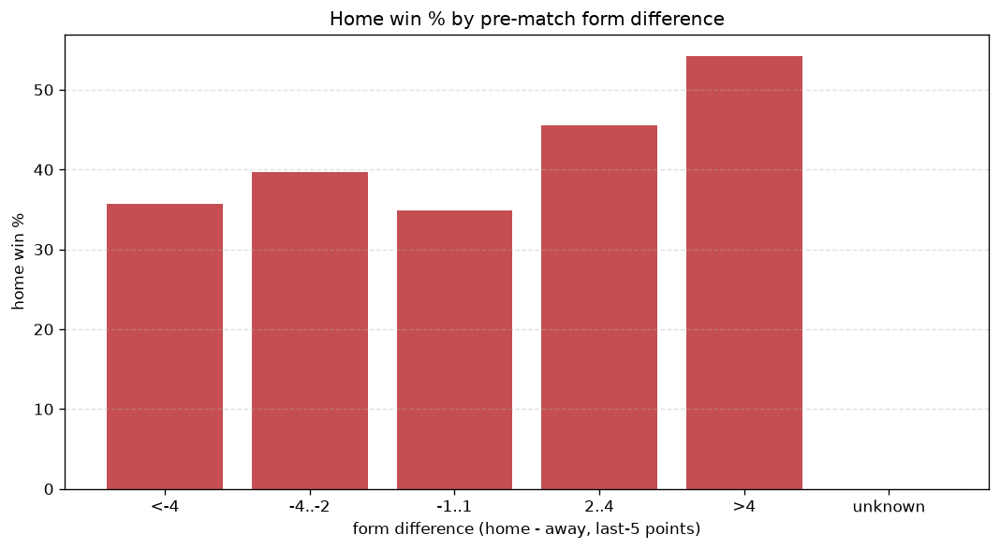
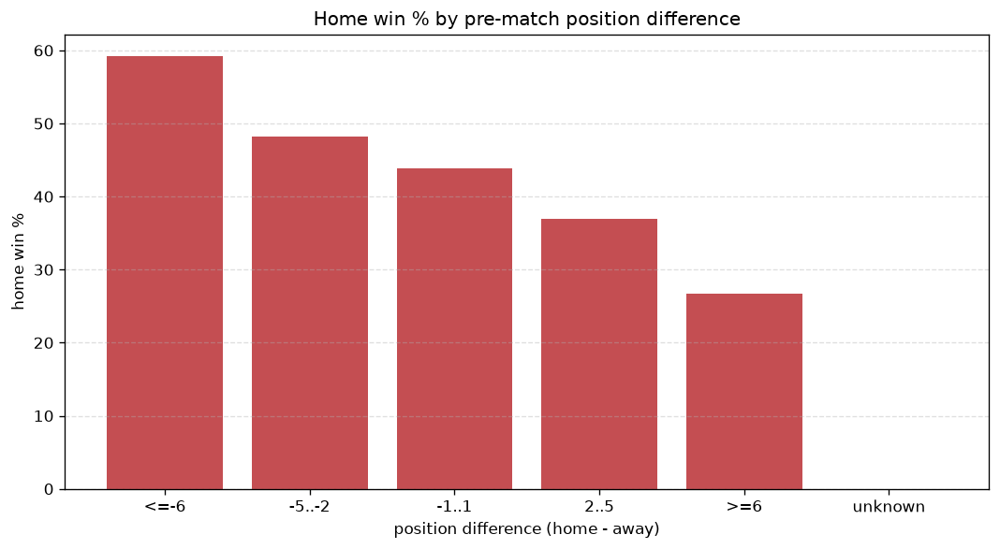

# Relationships Analysis
- Report: `relationships`
- Generated: 2026-10-27T01:41:10+00:00
- Script: `backend/scripts/analyze_relationships.py` v1.0.0
- League: Jupiler Pro League (Belgium)
- Scope: league `belgium1`

- Matches analysed: **1719** (23 leakage-safe pre-match features).

## 1. Correlation matrix
_Pearson correlation of each pre-match feature with observed goals; sorted by |corr(total goals)|._

| feature | corr(home) | corr(away) | corr(total) |
|---|---|---|---|
| home_team_goals_scored_last_5 | 0.135 | -0.034 | 0.081 |
| home_team_home_goals_avg | 0.148 | -0.055 | 0.077 |
| home_team_points_last_5 | 0.143 | -0.067 | 0.064 |
| home_team_wins_last_5 | 0.136 | -0.060 | 0.063 |
| away_team_away_conceded_avg | 0.121 | -0.045 | 0.062 |
| away_team_goals_conceded_last_5 | 0.125 | -0.053 | 0.060 |
| away_team_away_goals_avg | -0.019 | 0.101 | 0.057 |
| home_team_home_conceded_avg | -0.041 | 0.117 | 0.051 |
| home_team_home_win_rate | 0.118 | -0.081 | 0.035 |
| position_difference | -0.235 | 0.212 | -0.032 |
| points_difference | 0.245 | -0.230 | 0.028 |
| away_position_before_match | 0.155 | -0.134 | 0.025 |
| home_points_before_match | 0.109 | -0.084 | 0.025 |
| away_team_goals_scored_last_5 | -0.069 | 0.108 | 0.023 |
| away_team_away_win_rate | -0.060 | 0.097 | 0.022 |
| home_position_before_match | -0.171 | 0.161 | -0.020 |
| home_rest_days | 0.005 | -0.032 | -0.018 |
| away_rest_days | 0.021 | -0.048 | -0.017 |
| away_points_before_match | -0.067 | 0.081 | 0.005 |
| away_team_wins_last_5 | -0.107 | 0.124 | 0.005 |
| home_team_goals_conceded_last_5 | -0.079 | 0.091 | 0.003 |
| away_team_points_last_5 | -0.108 | 0.115 | -0.002 |
| rest_days_difference | -0.034 | 0.035 | -0.002 |

## 2. Form vs outcome
_Home win/draw/away % per bucket of `home_team_points_last_5 - away_team_points_last_5`._

| bucket | matches | home | draw | away | home % | draw % | away % |
|---|---|---|---|---|---|---|---|
| <-4 | 275 | 81 | 68 | 126 | 29.5% | 24.7% | 45.8% |
| -4..-2 | 375 | 142 | 94 | 139 | 37.9% | 25.1% | 37.1% |
| -1..1 | 475 | 205 | 124 | 146 | 43.2% | 26.1% | 30.7% |
| 2..4 | 346 | 167 | 81 | 98 | 48.3% | 23.4% | 28.3% |
| >4 | 248 | 141 | 54 | 53 | 56.9% | 21.8% | 21.4% |
| unknown | 0 | 0 | 0 | 0 | - | - | - |

## 3. Position vs outcome
_Home win/draw/away % per bucket of `position_difference` (home position - away position; negative favours the home team)._

| bucket | matches | home | draw | away | home % | draw % | away % |
|---|---|---|---|---|---|---|---|
| <=-6 | 380 | 225 | 81 | 74 | 59.2% | 21.3% | 19.5% |
| -5..-2 | 328 | 158 | 80 | 90 | 48.2% | 24.4% | 27.4% |
| -1..1 | 278 | 122 | 68 | 88 | 43.9% | 24.5% | 31.7% |
| 2..5 | 344 | 127 | 101 | 116 | 36.9% | 29.4% | 33.7% |
| >=6 | 389 | 104 | 91 | 194 | 26.7% | 23.4% | 49.9% |
| unknown | 0 | 0 | 0 | 0 | - | - | - |

## 4. Rest advantage
_Home win/draw/away % per bucket of `rest_days_difference` (home rest - away rest). Matches with unknown rest are bucketed separately._

| bucket | matches | home | draw | away | home % | draw % | away % |
|---|---|---|---|---|---|---|---|
| <-1 | 165 | 74 | 37 | 54 | 44.8% | 22.4% | 32.7% |
| -1..0 | 380 | 183 | 93 | 104 | 48.2% | 24.5% | 27.4% |
| 0 | 561 | 237 | 132 | 192 | 42.2% | 23.5% | 34.2% |
| 1..2 | 505 | 195 | 126 | 184 | 38.6% | 25.0% | 36.4% |
| >2 | 55 | 27 | 13 | 15 | 49.1% | 23.6% | 27.3% |
| unknown | 53 | 20 | 20 | 13 | 37.7% | 37.7% | 24.5% |
- *53 match(es) had unknown rest difference (missing rest data on at least one side).*

## 5. Home team quality
_Home win rate by `home_team_home_win_rate` tier (split at 0.5)._

- `< 0.5` tier: **38.3%** home win (401/1048)
- `>= 0.5` tier: **49.9%** home win (335/671)
- Home-win gap (>= split minus < split): **+11.6 pp**

| tier | label | matches | home | draw | away | home % |
|---|---|---|---|---|---|---|
| low | < 0.5 | 1048 | 401 | 257 | 390 | 38.3% |
| high | >= 0.5 | 671 | 335 | 164 | 172 | 49.9% |

## 6. Feature averages by result
_Mean feature value per outcome; `range` is home-minus-away spread of the group means._

| feature | home mean | draw mean | away mean | range |
|---|---|---|---|---|
| points_difference | 3.386 | -1.090 | -4.162 | 7.548 |
| position_difference | -1.673 | 0.413 | 2.400 | 4.073 |
| home_points_before_match | 24.401 | 21.945 | 20.445 | 3.956 |
| away_points_before_match | 21.015 | 23.036 | 24.607 | 3.592 |
| home_position_before_match | 8.500 | 9.259 | 10.785 | 2.285 |
| away_position_before_match | 10.173 | 8.846 | 8.384 | 1.788 |
| away_team_points_last_5 | 5.902 | 6.323 | 6.920 | 1.018 |
| home_team_points_last_5 | 6.639 | 6.002 | 5.658 | 0.980 |
| away_team_goals_conceded_last_5 | 6.773 | 6.302 | 5.940 | 0.834 |
| home_team_goals_scored_last_5 | 6.776 | 6.204 | 5.996 | 0.779 |
| away_team_goals_scored_last_5 | 6.215 | 6.394 | 6.984 | 0.769 |
| home_team_goals_conceded_last_5 | 6.205 | 6.496 | 6.872 | 0.667 |
| away_rest_days | 8.113 | 7.711 | 7.803 | 0.402 |
| away_team_wins_last_5 | 1.586 | 1.720 | 1.945 | 0.359 |
| home_rest_days | 8.036 | 7.713 | 7.903 | 0.323 |
| home_team_wins_last_5 | 1.829 | 1.618 | 1.518 | 0.311 |
| home_team_home_goals_avg | 1.536 | 1.425 | 1.327 | 0.209 |
| rest_days_difference | -0.077 | 0.002 | 0.100 | 0.177 |
| away_team_away_conceded_avg | 1.504 | 1.411 | 1.362 | 0.142 |
| home_team_home_conceded_avg | 1.160 | 1.209 | 1.288 | 0.128 |
| away_team_away_goals_avg | 1.177 | 1.201 | 1.284 | 0.107 |
| home_team_home_win_rate | 0.428 | 0.399 | 0.358 | 0.070 |
| away_team_away_win_rate | 0.293 | 0.314 | 0.337 | 0.044 |

---
*All features are leakage-safe pre-match values built by `ml.features.build_features.build_rows` from strictly prior matches. Run with `python backend/scripts/analyze_relationships.py` to regenerate.*

## Charts

