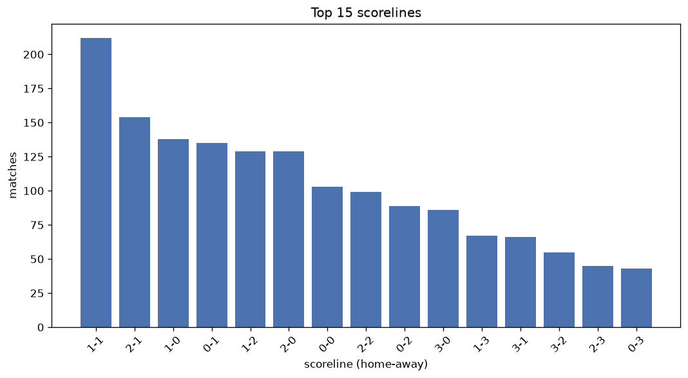
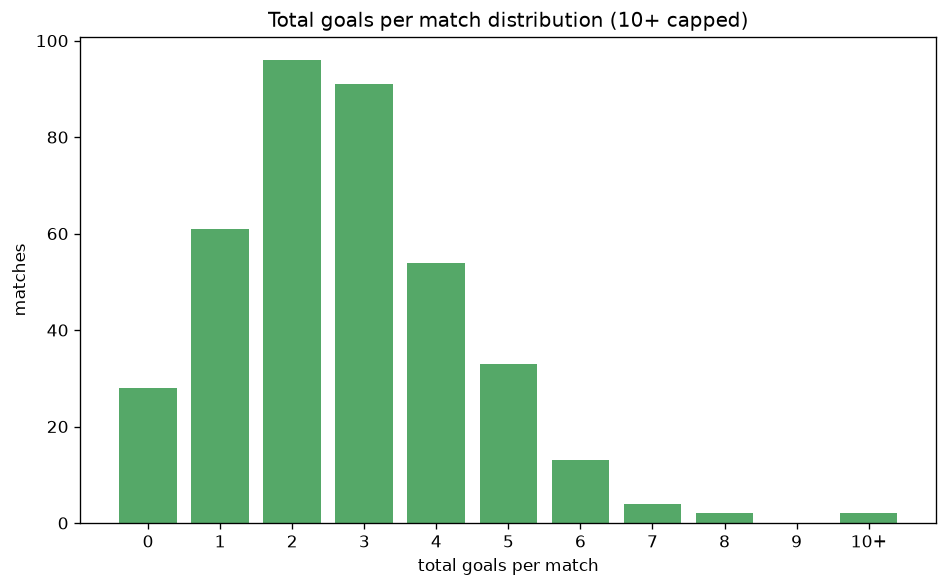

# Scoreline Analysis
- Report: `scoreline_analysis`
- Generated: 2026-10-30T03:45:28+00:00
- Script: `backend/scripts/analyze_scorelines.py` v1.0.0
- League: Jupiler Pro League (Belgium)
- Scope: league `belgium1`

## 1. Scoreline frequency
- Matches analysed: **1799** across **7** seasons.
- Distinct scorelines seen: **46**.

| scoreline | count | pct |
|---|---|---|
| 1-1 | 212 | 11.8% |
| 2-1 | 155 | 8.6% |
| 1-0 | 138 | 7.7% |
| 0-1 | 135 | 7.5% |
| 1-2 | 129 | 7.2% |
| 2-0 | 129 | 7.2% |
| 0-0 | 103 | 5.7% |
| 2-2 | 99 | 5.5% |
| 0-2 | 89 | 4.9% |
| 3-0 | 86 | 4.8% |
| 1-3 | 67 | 3.7% |
| 3-1 | 66 | 3.7% |
| 3-2 | 56 | 3.1% |
| 2-3 | 45 | 2.5% |
| 0-3 | 43 | 2.4% |
| 4-0 | 34 | 1.9% |
| 4-1 | 31 | 1.7% |
| 4-2 | 29 | 1.6% |
| 0-4 | 20 | 1.1% |
| 5-0 | 19 | 1.1% |

## 2. Scoreline frequency per season

### 2020-2021
| scoreline | count | pct |
|---|---|---|
| 1-1 | 36 | 11.8% |
| 1-2 | 33 | 10.8% |
| 2-1 | 26 | 8.5% |
| 1-0 | 21 | 6.9% |
| 0-1 | 20 | 6.5% |

### 2021-2022
| scoreline | count | pct |
|---|---|---|
| 1-1 | 33 | 10.8% |
| 0-1 | 29 | 9.5% |
| 2-0 | 28 | 9.2% |
| 2-2 | 22 | 7.2% |
| 2-1 | 22 | 7.2% |

### 2022-2023
| scoreline | count | pct |
|---|---|---|
| 2-1 | 31 | 10.1% |
| 1-1 | 29 | 9.5% |
| 2-0 | 27 | 8.8% |
| 0-1 | 27 | 8.8% |
| 2-2 | 19 | 6.2% |

### 2023-2024
| scoreline | count | pct |
|---|---|---|
| 1-1 | 36 | 15.0% |
| 1-0 | 24 | 10.0% |
| 2-1 | 21 | 8.8% |
| 0-1 | 19 | 7.9% |
| 2-2 | 13 | 5.4% |

### 2024-2025
| scoreline | count | pct |
|---|---|---|
| 1-1 | 35 | 14.6% |
| 1-0 | 25 | 10.4% |
| 0-0 | 22 | 9.2% |
| 1-2 | 21 | 8.8% |
| 2-1 | 19 | 7.9% |

### 2025-2026
| scoreline | count | pct |
|---|---|---|
| 1-1 | 39 | 12.1% |
| 2-1 | 30 | 9.3% |
| 1-2 | 30 | 9.3% |
| 1-0 | 28 | 8.7% |
| 2-0 | 26 | 8.1% |

### 2026-2027
| scoreline | count | pct |
|---|---|---|
| 3-0 | 9 | 11.2% |
| 2-1 | 6 | 7.5% |
| 1-0 | 6 | 7.5% |
| 0-1 | 6 | 7.5% |
| 2-0 | 5 | 6.2% |

## 3. Total-goal histogram
_10+ groups all matches with 10 or more total goals._

| total goals | matches | pct |
|---|---|---|
| 0 | 103 | 5.7% |
| 1 | 273 | 15.2% |
| 2 | 430 | 23.9% |
| 3 | 413 | 23.0% |
| 4 | 286 | 15.9% |
| 5 | 175 | 9.7% |
| 6 | 73 | 4.1% |
| 7 | 30 | 1.7% |
| 8 | 8 | 0.4% |
| 9 | 4 | 0.2% |
| 10+ | 4 | 0.2% |

## 4. Extreme scorelines
- Matches with 7+ total goals: **46**

| season | date | scoreline | total goals |
|---|---|---|---|
| 2020-2021 | 2020-11-07 | 5-5 | 10 |
| 2022-2023 | 2022-11-12 | 5-5 | 10 |
| 2025-2026 | 2025-09-24 | 5-5 | 10 |
| 2025-2026 | 2026-03-22 | 5-5 | 10 |
| 2020-2021 | 2020-10-17 | 6-3 | 9 |
| 2020-2021 | 2021-04-18 | 2-7 | 9 |
| 2021-2022 | 2021-09-12 | 7-2 | 9 |
| 2022-2023 | 2022-08-21 | 5-4 | 9 |
| 2021-2022 | 2021-10-31 | 2-6 | 8 |
| 2021-2022 | 2021-11-21 | 1-7 | 8 |
| 2022-2023 | 2023-03-11 | 4-4 | 8 |
| 2022-2023 | 2023-03-12 | 2-6 | 8 |
| 2023-2024 | 2023-08-20 | 7-1 | 8 |
| 2025-2026 | 2025-12-26 | 3-5 | 8 |
| 2026-2027 | 2026-08-22 | 4-4 | 8 |
| 2026-2027 | 2026-10-24 | 4-4 | 8 |
| 2020-2021 | 2020-09-14 | 5-2 | 7 |
| 2020-2021 | 2020-10-17 | 5-2 | 7 |
| 2020-2021 | 2020-12-15 | 3-4 | 7 |
| 2020-2021 | 2021-04-11 | 3-4 | 7 |
| 2021-2022 | 2021-07-30 | 3-4 | 7 |
| 2021-2022 | 2021-08-08 | 2-5 | 7 |
| 2021-2022 | 2021-08-28 | 5-2 | 7 |
| 2021-2022 | 2021-08-29 | 6-1 | 7 |
| 2021-2022 | 2021-12-15 | 4-3 | 7 |
| 2021-2022 | 2021-12-27 | 0-7 | 7 |
| 2022-2023 | 2022-10-02 | 3-4 | 7 |
| 2022-2023 | 2022-10-08 | 2-5 | 7 |
| 2022-2023 | 2022-10-16 | 1-6 | 7 |
| 2022-2023 | 2022-10-18 | 6-1 | 7 |
| 2022-2023 | 2023-04-16 | 5-2 | 7 |
| 2022-2023 | 2023-04-23 | 7-0 | 7 |
| 2023-2024 | 2023-12-22 | 1-6 | 7 |
| 2024-2025 | 2024-08-10 | 4-3 | 7 |
| 2024-2025 | 2024-08-11 | 6-1 | 7 |
| 2024-2025 | 2024-08-17 | 3-4 | 7 |
| 2024-2025 | 2024-08-31 | 5-2 | 7 |
| 2024-2025 | 2024-10-26 | 2-5 | 7 |
| 2024-2025 | 2024-11-23 | 7-0 | 7 |
| 2024-2025 | 2024-12-26 | 4-3 | 7 |
| 2025-2026 | 2025-07-27 | 5-2 | 7 |
| 2025-2026 | 2026-01-24 | 4-3 | 7 |
| 2025-2026 | 2026-02-07 | 3-4 | 7 |
| 2025-2026 | 2026-04-22 | 6-1 | 7 |
| 2026-2027 | 2026-10-11 | 4-3 | 7 |
| 2026-2027 | 2026-10-25 | 5-2 | 7 |

## 5. Margin-of-victory distribution (decided matches)
- Decided matches: **1363** (draws: **436**)
- Average winning margin: **1.85**

| margin | matches | pct |
|---|---|---|
| 1 | 670 | 49.2% |
| 2 | 392 | 28.8% |
| 3+ | 301 | 22.1% |

## 6. Margin by outcome

### Home wins
- Matches: **777** | avg margin: **1.94** | max margin: **7**
| margin | matches | pct |
|---|---|---|
| 1 | 355 | 45.7% |
| 2 | 224 | 28.8% |
| 3+ | 198 | 25.5% |
- *Full match-by-match list available in `scoreline_analysis.json`.*

### Away wins
- Matches: **586** | avg margin: **1.74** | max margin: **7**
| margin | matches | pct |
|---|---|---|
| 1 | 315 | 53.8% |
| 2 | 168 | 28.7% |
| 3+ | 103 | 17.6% |
- *Full match-by-match list available in `scoreline_analysis.json`.*

## 7. Most common exact score by outcome type
| outcome | matches | most common score | count | pct |
|---|---|---|---|---|
| home | 777 | 2-1 | 155 | 19.9% |
| draw | 436 | 1-1 | 212 | 48.6% |
| away | 586 | 0-1 | 135 | 23.0% |

---
*All statistics are computed from PostgreSQL tables (read-only). Run with `python backend/scripts/analyze_scorelines.py` to regenerate.*

## Charts

