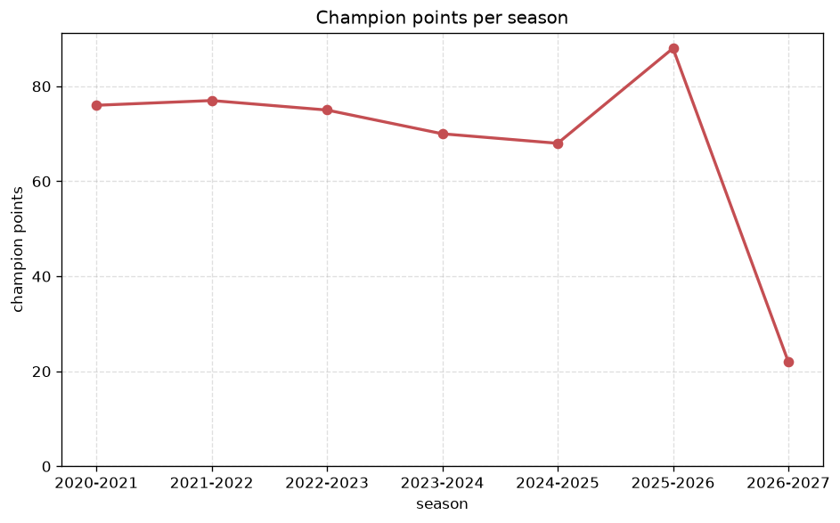
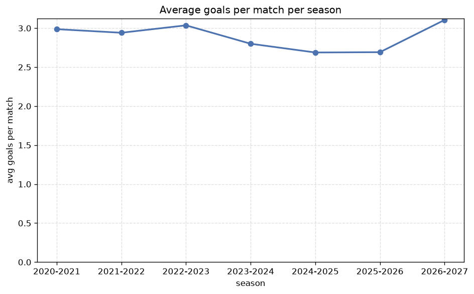

# Season Trends Analysis
- Report: `season_trends`
- Generated: 2026-10-26T01:27:08+00:00
- Script: `backend/scripts/analyze_seasons.py` v1.0.0
- League: Jupiler Pro League (Belgium)
- Scope: league `belgium1`

## 1. Champions per season
| season | champion | pts | runner-up | margin |
|---|---|---|---|---|
| 2020-2021 | Club Brugge KV | 76 | Antwerp | 16 pts |
| 2021-2022 | Royale Union SG | 77 | Club Brugge KV | 5 pts |
| 2022-2023 | Genk | 75 | Royale Union SG | 0 pts |
| 2023-2024 | Royale Union SG | 70 | Anderlecht | 7 pts |
| 2024-2025 | Genk | 68 | Club Brugge KV | 9 pts |
| 2025-2026 | Club Brugge KV | 88 | Royale Union SG | 2 pts |
| 2026-2027 | Gent | 22 | Club Brugge KV | 1 pts |

## 2. Title-race tightness
- Tight races (margin <= 3 pts): **3** of 7 seasons
- Tightest race: **2022-2023** - Genk beat Royale Union SG by **0** pts

| season | margin | tight |
|---|---|---|
| 2020-2021 | 16 pts |  |
| 2021-2022 | 5 pts |  |
| 2022-2023 | 0 pts | yes |
| 2023-2024 | 7 pts |  |
| 2024-2025 | 9 pts |  |
| 2025-2026 | 2 pts | yes |
| 2026-2027 | 1 pts | yes |

## 3. Points thresholds
_Position-specific points per season. Key: 1 = champion, 2 = runner-up, 4 = CL line, 6 = Europa, 15 = last safe, 18 = bottom._

| season | pos 1 | pos 2 | pos 4 | pos 6 | pos 15 | pos 18 |
|---|---|---|---|---|---|---|
| 2020-2021 | 76 | 60 | 56 | 50 | 38 | 31 |
| 2021-2022 | 77 | 72 | 63 | 54 | 32 | 16 |
| 2022-2023 | 75 | 75 | 59 | 55 | 28 | 20 |
| 2023-2024 | 70 | 63 | 51 | 47 | 24 | - |
| 2024-2025 | 68 | 59 | 51 | 45 | 26 | - |
| 2025-2026 | 88 | 86 | 59 | 55 | 34 | 1 |
| 2026-2027 | 22 | 21 | 20 | 14 | 6 | 3 |

## 4. Relegation battle
| season | safe pos | safe pts | drop pos | drop pts | gap |
|---|---|---|---|---|---|
| 2020-2021 | 15 | 38 | 16 | 36 | 2 pts |
| 2021-2022 | 15 | 32 | 16 | 32 | 0 pts |
| 2022-2023 | 15 | 28 | 16 | 27 | 1 pts |
| 2023-2024 | 15 | 24 | 16 | 23 | 1 pts |
| 2024-2025 | 15 | 26 | 16 | 18 | 8 pts |
| 2025-2026 | 15 | 34 | 16 | 26 | 8 pts |
| 2026-2027 | 15 | 6 | 16 | 6 | 0 pts |

## 5. League-level trends
| season | matches | total goals | avg goals | home win | draw | away win | goalless | avg pts/team |
|---|---|---|---|---|---|---|---|---|
| 2020-2021 | 306 | 914 | 2.987 | 40.2% | 22.9% | 36.9% | 4.6% | 47.11 |
| 2021-2022 | 306 | 900 | 2.941 | 41.8% | 22.2% | 35.9% | 3.9% | 47.22 |
| 2022-2023 | 306 | 929 | 3.036 | 44.1% | 22.2% | 33.7% | 4.9% | 47.22 |
| 2023-2024 | 240 | 672 | 2.8 | 45.0% | 27.1% | 27.9% | 5.0% | 40.94 |
| 2024-2025 | 240 | 645 | 2.688 | 45.8% | 28.8% | 25.4% | 9.2% | 40.69 |
| 2025-2026 | 321 | 864 | 2.692 | 41.1% | 25.2% | 33.6% | 7.8% | 43.8 |
| 2026-2027 | 76 | 236 | 3.105 | 48.7% | 19.7% | 31.6% | 3.9% | 11.83 |

## 6. View divergence
- Largest divergence: **2026-2027** (goals view, avg abs position diff = 6.889)

_Avg absolute position difference between classic view and alternative view per season._

| season | classic vs luck | classic vs goals |
|---|---|---|
| 2020-2021 | 5.556 | 5.556 |
| 2021-2022 | 3.444 | 5.778 |
| 2022-2023 | 2.778 | 6.222 |
| 2023-2024 | 4.125 | 4.250 |
| 2024-2025 | 2.875 | 5.625 |
| 2025-2026 | 4.900 | 6.200 |
| 2026-2027 | 1.556 | 6.889 |

---
*All statistics are computed from PostgreSQL tables (read-only). Run with `python backend/scripts/analyze_seasons.py` to regenerate.*

## Charts

