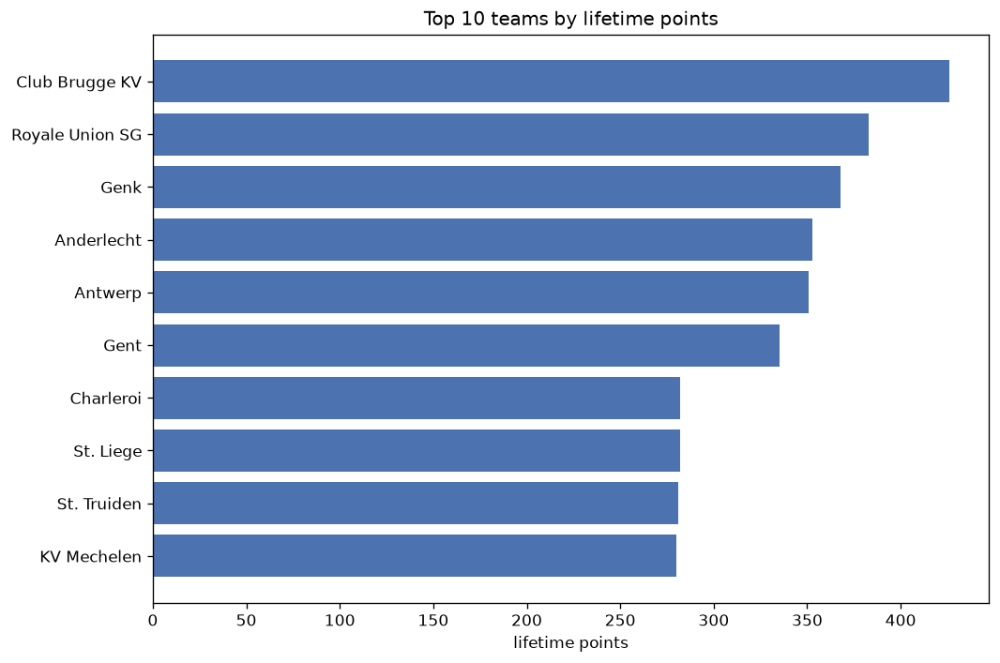
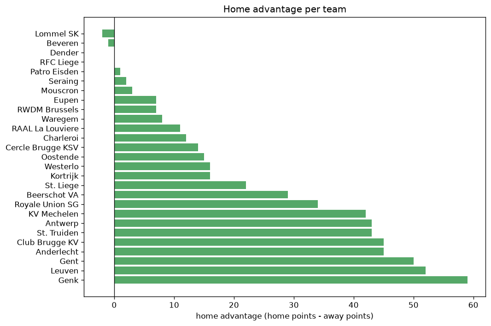

# Team Analysis
- Report: `teams_analysis`
- Generated: 2026-10-29T01:54:12+00:00
- Script: `backend/scripts/analyze_teams.py` v1.0.0
- League: Jupiler Pro League (Belgium)
- Scope: league `belgium1`

- Teams: **27** | Seasons: **7** | Matches: **1799**

## 1. Team standings (lifetime)
| team | seasons | played | W | D | L | pts | GF | GA | GD | avg pts/season | best pos | worst pos | titles |
|---|---|---|---|---|---|---|---|---|---|---|---|---|---|
| Club Brugge KV | 7 | 211 | 128 | 45 | 38 | 429 | 446 | 215 | 231 | 61.29 | 1 | 4 | 2 |
| Royale Union SG | 6 | 177 | 115 | 41 | 21 | 386 | 353 | 157 | 196 | 64.33 | 1 | 3 | 2 |
| Genk | 7 | 212 | 106 | 53 | 53 | 371 | 393 | 264 | 129 | 53.0 | 1 | 8 | 2 |
| Anderlecht | 7 | 211 | 99 | 56 | 56 | 353 | 348 | 245 | 103 | 50.43 | 2 | 11 | 0 |
| Antwerp | 7 | 211 | 101 | 48 | 62 | 351 | 331 | 239 | 92 | 50.14 | 2 | 12 | 0 |
| Gent | 7 | 212 | 93 | 59 | 60 | 338 | 343 | 243 | 100 | 48.29 | 1 | 9 | 1 |
| Charleroi | 7 | 211 | 78 | 48 | 85 | 282 | 274 | 291 | -17 | 40.29 | 4 | 13 | 0 |
| St. Liege | 7 | 211 | 75 | 57 | 79 | 282 | 255 | 274 | -19 | 40.29 | 5 | 14 | 0 |
| St. Truiden | 7 | 211 | 77 | 50 | 84 | 281 | 274 | 299 | -25 | 40.14 | 3 | 15 | 0 |
| KV Mechelen | 7 | 210 | 76 | 52 | 82 | 280 | 301 | 330 | -29 | 40.0 | 7 | 15 | 0 |
| Cercle Brugge KSV | 7 | 207 | 67 | 53 | 87 | 254 | 276 | 300 | -24 | 36.29 | 7 | 17 | 0 |
| Leuven | 7 | 211 | 61 | 63 | 87 | 246 | 268 | 321 | -53 | 35.14 | 9 | 16 | 0 |
| Westerlo | 5 | 143 | 49 | 37 | 57 | 184 | 227 | 234 | -7 | 36.8 | 7 | 11 | 0 |
| Waregem | 5 | 147 | 44 | 32 | 71 | 164 | 208 | 281 | -73 | 32.8 | 10 | 16 | 0 |
| Kortrijk | 6 | 170 | 42 | 34 | 94 | 160 | 176 | 296 | -120 | 26.67 | 12 | 18 | 0 |
| Eupen | 4 | 132 | 32 | 31 | 69 | 127 | 145 | 249 | -104 | 31.75 | 12 | 15 | 0 |
| Oostende | 3 | 102 | 32 | 21 | 49 | 117 | 120 | 178 | -58 | 39.0 | 5 | 17 | 0 |
| Beerschot VA | 4 | 102 | 22 | 19 | 61 | 85 | 123 | 209 | -86 | 21.25 | 9 | 19 | 0 |
| Dender | 2 | 68 | 13 | 19 | 36 | 58 | 66 | 116 | -50 | 29.0 | 13 | 16 | 0 |
| Seraing | 2 | 68 | 13 | 9 | 46 | 48 | 58 | 136 | -78 | 24.0 | 17 | 18 | 0 |
| RAAL La Louviere | 2 | 45 | 9 | 14 | 22 | 41 | 46 | 68 | -22 | 20.5 | 14 | 15 | 0 |
| Beveren | 2 | 43 | 11 | 8 | 24 | 41 | 56 | 88 | -32 | 20.5 | 12 | 18 | 0 |
| Mouscron | 1 | 34 | 7 | 10 | 17 | 31 | 32 | 54 | -22 | 31.0 | 17 | 17 | 0 |
| Lommel SK | 2 | 15 | 8 | 4 | 3 | 28 | 25 | 16 | 9 | 14.0 | 8 | 17 | 0 |
| RWDM Brussels | 1 | 30 | 5 | 8 | 17 | 23 | 31 | 67 | -36 | 23.0 | 16 | 16 | 0 |
| Patro Eisden | 1 | 2 | 0 | 1 | 1 | 1 | 3 | 4 | -1 | 1.0 | 18 | 18 | 0 |
| RFC Liege | 1 | 2 | 0 | 0 | 2 | 0 | 1 | 5 | -4 | 0.0 | 20 | 20 | 0 |

## 2. Home vs away split
| team | home P | H-W | H-D | H-L | H-pts | away P | A-W | A-D | A-L | A-pts | adv |
|---|---|---|---|---|---|---|---|---|---|---|---|
| Genk | 106 | 63 | 26 | 17 | 215 | 106 | 43 | 27 | 36 | 156 | 59 |
| Leuven | 106 | 40 | 29 | 37 | 149 | 105 | 21 | 34 | 50 | 97 | 52 |
| Gent | 107 | 56 | 26 | 25 | 194 | 105 | 37 | 33 | 35 | 144 | 50 |
| Club Brugge KV | 106 | 71 | 24 | 11 | 237 | 105 | 57 | 21 | 27 | 192 | 45 |
| Anderlecht | 105 | 57 | 28 | 20 | 199 | 106 | 42 | 28 | 36 | 154 | 45 |
| Antwerp | 106 | 58 | 23 | 25 | 197 | 105 | 43 | 25 | 37 | 154 | 43 |
| St. Truiden | 105 | 46 | 24 | 35 | 162 | 106 | 31 | 26 | 49 | 119 | 43 |
| KV Mechelen | 105 | 43 | 32 | 30 | 161 | 105 | 33 | 20 | 52 | 119 | 42 |
| Royale Union SG | 89 | 65 | 15 | 9 | 210 | 88 | 50 | 26 | 12 | 176 | 34 |
| Beerschot VA | 51 | 15 | 12 | 24 | 57 | 51 | 7 | 7 | 37 | 28 | 29 |
| St. Liege | 105 | 40 | 32 | 33 | 152 | 106 | 35 | 25 | 46 | 130 | 22 |
| Westerlo | 72 | 28 | 16 | 28 | 100 | 71 | 21 | 21 | 29 | 84 | 16 |
| Kortrijk | 85 | 24 | 16 | 45 | 88 | 85 | 18 | 18 | 49 | 72 | 16 |
| Oostende | 51 | 19 | 9 | 23 | 66 | 51 | 13 | 12 | 26 | 51 | 15 |
| Cercle Brugge KSV | 103 | 36 | 26 | 41 | 134 | 104 | 31 | 27 | 46 | 120 | 14 |
| Charleroi | 105 | 40 | 27 | 38 | 147 | 106 | 38 | 21 | 47 | 135 | 12 |
| RAAL La Louviere | 23 | 6 | 8 | 9 | 26 | 22 | 3 | 6 | 13 | 15 | 11 |
| Waregem | 73 | 24 | 14 | 35 | 86 | 74 | 20 | 18 | 36 | 78 | 8 |
| Eupen | 66 | 17 | 16 | 33 | 67 | 66 | 15 | 15 | 36 | 60 | 7 |
| RWDM Brussels | 15 | 3 | 6 | 6 | 15 | 15 | 2 | 2 | 11 | 8 | 7 |
| Mouscron | 17 | 4 | 5 | 8 | 17 | 17 | 3 | 5 | 9 | 14 | 3 |
| Seraing | 34 | 6 | 7 | 21 | 25 | 34 | 7 | 2 | 25 | 23 | 2 |
| Patro Eisden | 1 | 0 | 1 | 0 | 1 | 1 | 0 | 0 | 1 | 0 | 1 |
| Dender | 34 | 6 | 11 | 17 | 29 | 34 | 7 | 8 | 19 | 29 | 0 |
| RFC Liege | 1 | 0 | 0 | 1 | 0 | 1 | 0 | 0 | 1 | 0 | 0 |
| Beveren | 21 | 6 | 2 | 13 | 20 | 22 | 5 | 6 | 11 | 21 | -1 |
| Lommel SK | 7 | 4 | 1 | 2 | 13 | 8 | 4 | 3 | 1 | 15 | -2 |

## 3. Top performers
### Best points per game (PPG)
| rank | team | PPG |
|---|---|---|
| 1 | Royale Union SG | 2.18 |
| 2 | Club Brugge KV | 2.03 |
| 3 | Lommel SK | 1.87 |
| 4 | Genk | 1.75 |
| 5 | Anderlecht | 1.67 |

### Most goals scored
| rank | team | goals |
|---|---|---|
| 1 | Club Brugge KV | 446 |
| 2 | Genk | 393 |
| 3 | Royale Union SG | 353 |
| 4 | Anderlecht | 348 |
| 5 | Gent | 343 |

### Best goal difference
| rank | team | GD |
|---|---|---|
| 1 | Club Brugge KV | 231 |
| 2 | Royale Union SG | 196 |
| 3 | Genk | 129 |
| 4 | Anderlecht | 103 |
| 5 | Gent | 100 |

### Best defence (goals against per match, standings)
| rank | team | GA/match |
|---|---|---|
| 1 | Royale Union SG | 0.887 |
| 2 | Patro Eisden | 1.000 |
| 3 | Club Brugge KV | 1.019 |
| 4 | Lommel SK | 1.067 |
| 5 | Antwerp | 1.133 |

## 4. Team consistency
- Teams present in all **7** seasons: **11**

Anderlecht, Antwerp, Cercle Brugge KSV, Charleroi, Club Brugge KV, Genk, Gent, KV Mechelen, Leuven, St. Liege, St. Truiden

## 5. Head-to-head dominance
- Distinct fixtures: **265** (showing the 15 most frequent)

| fixture | meetings | home wins | draws | away wins | home pct | draw pct | away pct |
|---|---|---|---|---|---|---|---|
| Anderlecht vs Gent | 15 | 9 | 5 | 1 | 60.0% | 33.3% | 6.7% |
| Club Brugge KV vs St. Truiden | 15 | 9 | 3 | 3 | 60.0% | 20.0% | 20.0% |
| KV Mechelen vs St. Truiden | 15 | 9 | 2 | 4 | 60.0% | 13.3% | 26.7% |
| Antwerp vs Charleroi | 15 | 8 | 2 | 5 | 53.3% | 13.3% | 33.3% |
| Club Brugge KV vs Gent | 15 | 8 | 2 | 5 | 53.3% | 13.3% | 33.3% |
| Gent vs KV Mechelen | 15 | 8 | 5 | 2 | 53.3% | 33.3% | 13.3% |
| Antwerp vs Genk | 15 | 7 | 5 | 3 | 46.7% | 33.3% | 20.0% |
| Genk vs St. Liege | 15 | 7 | 6 | 2 | 46.7% | 40.0% | 13.3% |
| St. Liege vs Leuven | 15 | 7 | 3 | 5 | 46.7% | 20.0% | 33.3% |
| Antwerp vs St. Liege | 15 | 6 | 4 | 5 | 40.0% | 26.7% | 33.3% |
| Anderlecht vs KV Mechelen | 15 | 5 | 4 | 6 | 33.3% | 26.7% | 40.0% |
| St. Liege vs Charleroi | 15 | 5 | 4 | 6 | 33.3% | 26.7% | 40.0% |
| Leuven vs Charleroi | 15 | 3 | 6 | 6 | 20.0% | 40.0% | 40.0% |
| Anderlecht vs St. Truiden | 14 | 8 | 2 | 4 | 57.1% | 14.3% | 28.6% |
| Antwerp vs Leuven | 14 | 8 | 5 | 1 | 57.1% | 35.7% | 7.1% |

## 6. Position per season (classic view)
_Cells show final position; '-' when the team was absent from that season._

| team | 2020-2021 | 2021-2022 | 2022-2023 | 2023-2024 | 2024-2025 | 2025-2026 | 2026-2027 |
|---|---|---|---|---|---|---|---|
| Club Brugge KV | 1 | 2 | 4 | 4 | 2 | 1 | 2 |
| Royale Union SG | - | 1 | 2 | 1 | 3 | 2 | 3 |
| Genk | 4 | 8 | 1 | 5 | 1 | 4 | 6 |
| Anderlecht | 3 | 3 | 11 | 2 | 4 | 6 | 5 |
| Antwerp | 2 | 4 | 3 | 3 | 5 | 12 | 11 |
| Gent | 7 | 5 | 5 | 6 | 6 | 9 | 1 |
| Charleroi | 13 | 6 | 10 | 13 | 10 | 8 | 4 |
| St. Liege | 6 | 14 | 6 | 10 | 7 | 5 | 9 |
| St. Truiden | 15 | 9 | 12 | 9 | 14 | 3 | 13 |
| KV Mechelen | 8 | 7 | 13 | 8 | 8 | 10 | 15 |
| Cercle Brugge KSV | 16 | 10 | 8 | 7 | 12 | 13 | 17 |
| Leuven | 11 | 11 | 9 | 12 | 11 | 14 | 16 |
| Westerlo | - | - | 7 | 11 | 9 | 7 | 7 |
| Waregem | 10 | 16 | 16 | - | - | 11 | 10 |
| Kortrijk | 14 | 12 | 14 | 15 | 15 | - | 18 |
| Eupen | 12 | 15 | 15 | 14 | - | - | - |
| Oostende | 5 | 13 | 17 | - | - | - | - |
| Beerschot VA | 9 | 18 | - | - | 16 | 19 | - |
| Dender | - | - | - | - | 13 | 16 | - |
| Seraing | - | 17 | 18 | - | - | - | - |
| RAAL La Louviere | - | - | - | - | - | 15 | 14 |
| Beveren | 18 | - | - | - | - | - | 12 |
| Mouscron | 17 | - | - | - | - | - | - |
| Lommel SK | - | - | - | - | - | 17 | 8 |
| RWDM Brussels | - | - | - | 16 | - | - | - |
| Patro Eisden | - | - | - | - | - | 18 | - |
| RFC Liege | - | - | - | - | - | 20 | - |

---
*All statistics are computed from PostgreSQL tables (read-only). Run with `python backend/scripts/analyze_teams.py` to regenerate.*

## Charts

