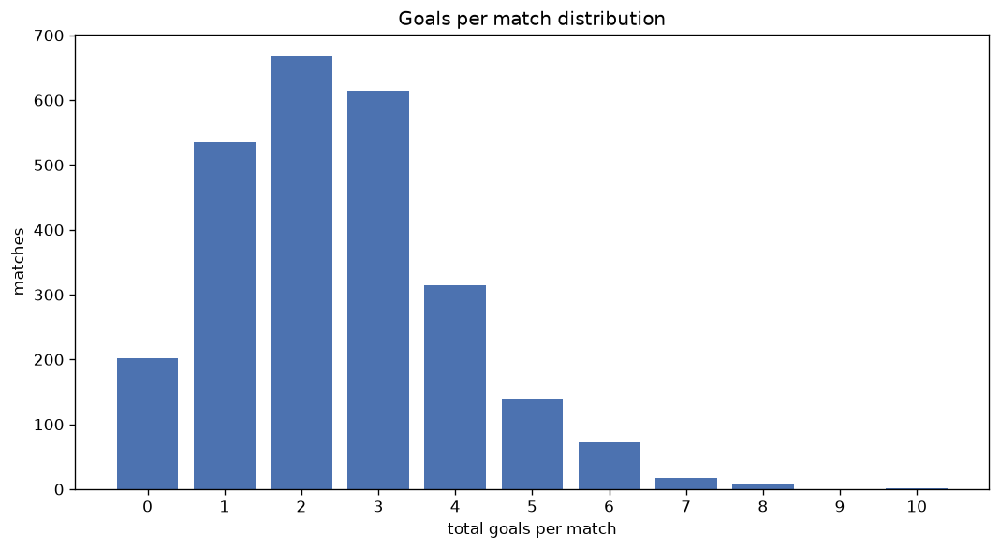
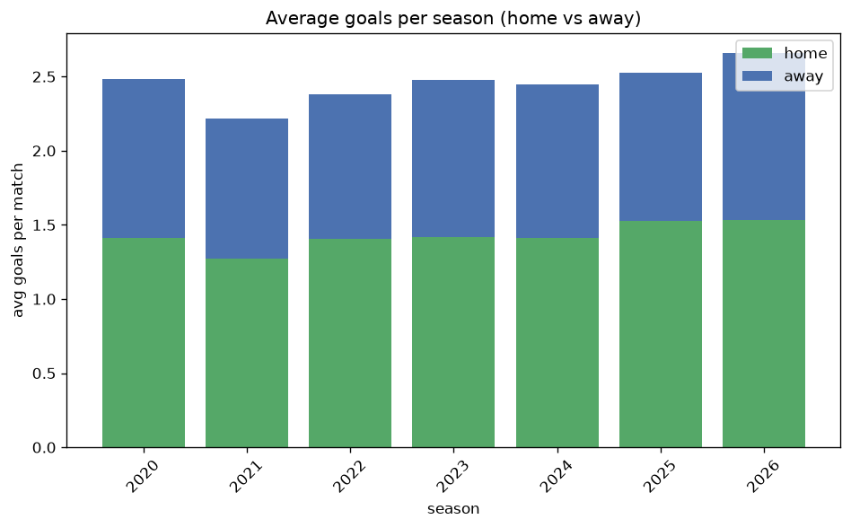

# Goal Analysis
- Report: `goals_analysis`
- Generated: 2026-10-26T01:27:21+00:00
- Script: `backend/scripts/analyze_goals.py` v1.0.0
- League: Serie A Betano (Brazil)
- Scope: league `brazil1`

## 1. Goals per match distribution
| goals | matches | pct |
|---|---|---|
| 0 | 202 | 7.9% |
| 1 | 535 | 20.8% |
| 2 | 668 | 26.0% |
| 3 | 614 | 23.9% |
| 4 | 315 | 12.3% |
| 5 | 138 | 5.4% |
| 6 | 72 | 2.8% |
| 7 | 17 | 0.7% |
| 8 | 9 | 0.4% |
| 9 | 0 | 0.0% |
| 10 | 1 | 0.0% |

## 2. Goals per match per season
| season | matches | total goals | avg home | avg away | avg total |
|---|---|---|---|---|---|
| 2020 | 380 | 944 | 1.411 | 1.074 | 2.484 |
| 2021 | 380 | 842 | 1.271 | 0.945 | 2.216 |
| 2022 | 380 | 905 | 1.405 | 0.976 | 2.382 |
| 2023 | 375 | 930 | 1.416 | 1.064 | 2.48 |
| 2024 | 380 | 929 | 1.411 | 1.034 | 2.445 |
| 2025 | 380 | 959 | 1.526 | 0.997 | 2.524 |
| 2026 | 296 | 787 | 1.534 | 1.125 | 2.659 |

## 3. Home vs away goal share
- Home goals: **3654** (58.0%)
- Away goals: **2642** (42.0%)
- Home/away ratio: **1.383**

| season | home goals | away goals | total | home pct | away pct |
|---|---|---|---|---|---|
| 2020 | 536 | 408 | 944 | 56.8% | 43.2% |
| 2021 | 483 | 359 | 842 | 57.4% | 42.6% |
| 2022 | 534 | 371 | 905 | 59.0% | 41.0% |
| 2023 | 531 | 399 | 930 | 57.1% | 42.9% |
| 2024 | 536 | 393 | 929 | 57.7% | 42.3% |
| 2025 | 580 | 379 | 959 | 60.5% | 39.5% |
| 2026 | 454 | 333 | 787 | 57.7% | 42.3% |

## 4. BTTS (Both Teams To Score)
- Overall: **1296** of `2571` (50.4%)

| season | matches | BTTS | pct |
|---|---|---|---|
| 2020 | 380 | 200 | 52.6% |
| 2021 | 380 | 170 | 44.7% |
| 2022 | 380 | 189 | 49.7% |
| 2023 | 375 | 179 | 47.7% |
| 2024 | 380 | 202 | 53.2% |
| 2025 | 380 | 180 | 47.4% |
| 2026 | 296 | 176 | 59.5% |

## 5. Clean sheets
- Home clean sheets: **900** (35.0%)
- Away clean sheets: **577** (22.4%)
- Total clean sheets recorded: **1477**
- Matches with at least one clean sheet: **1275** (49.6%)
- Both teams kept clean sheets (0-0): **202**

| season | matches | home CS | away CS | total CS | matches w/ CS |
|---|---|---|---|---|---|
| 2020 | 380 | 126 | 86 | 212 | 180 (47.4%) |
| 2021 | 380 | 151 | 103 | 254 | 210 (55.3%) |
| 2022 | 380 | 131 | 86 | 217 | 191 (50.3%) |
| 2023 | 375 | 134 | 92 | 226 | 196 (52.3%) |
| 2024 | 380 | 125 | 79 | 204 | 178 (46.8%) |
| 2025 | 380 | 145 | 82 | 227 | 200 (52.6%) |
| 2026 | 296 | 88 | 49 | 137 | 120 (40.5%) |

## 6. Scoring intensity
- First-half goals: **2495** (45.3%)
- Second-half goals: **3014** (54.7%)
- Avg first-half goals per match: **1.097**
- Avg second-half goals per match: **1.325**
- Second-half-only scoring (HT 0-0, FT goals >= 1): **553** (21.5%)
- *296 match(es) excluded (no HT score recorded).*

| season | matches | 1st half | 2nd half | 1st half pct | 2nd half pct |
|---|---|---|---|---|---|
| 2020 | 380 | 431 | 513 | 45.7% | 54.3% |
| 2021 | 380 | 364 | 478 | 43.2% | 56.8% |
| 2022 | 380 | 420 | 485 | 46.4% | 53.6% |
| 2023 | 375 | 432 | 498 | 46.5% | 53.5% |
| 2024 | 380 | 421 | 508 | 45.3% | 54.7% |
| 2025 | 380 | 427 | 532 | 44.5% | 55.5% |
| 2026 | 296 | 0 | 0 | - | - |

## 7. First-goal timing
- Matches with first-goal time recorded: `2090` of `2571` (81.3%)
- Goalless matches: `481`
- Min `1` | Max `106` | Mean `33.79` | Median (p50) `29.0`

| bucket | count | % of matches | % of scoring matches |
|---|---|---|---|
| 1-15 | 616 | 24.0% | 29.5% |
| 16-30 | 477 | 18.6% | 22.8% |
| 31-45 | 365 | 14.2% | 17.5% |
| 46-60 | 314 | 12.2% | 15.0% |
| 61-75 | 159 | 6.2% | 7.6% |
| 76-90 | 107 | 4.2% | 5.1% |
| 91-120 | 52 | 2.0% | 2.5% |

---
*All statistics are computed from PostgreSQL tables (read-only). Run with `python backend/scripts/analyze_goals.py` to regenerate.*

## Charts

