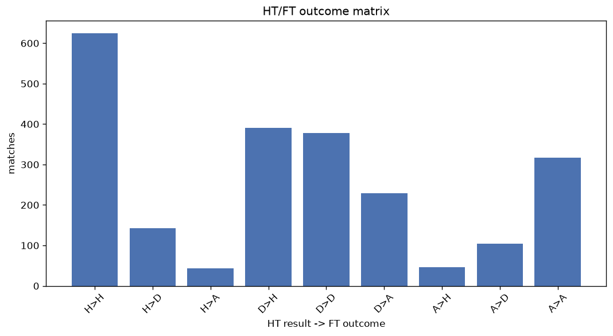
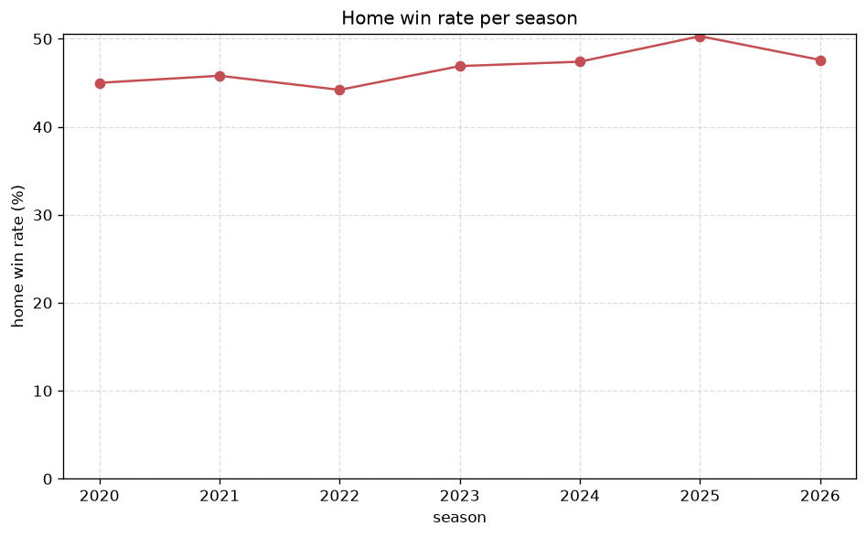

# Match Analysis
- Report: `matches_analysis`
- Generated: 2026-10-26T01:27:20+00:00
- Script: `backend/scripts/analyze_matches.py` v1.0.0
- League: Serie A Betano (Brazil)
- Scope: league `brazil1`

## 1. Overall summary
| metric | value |
|---|---|
| Matches | 2571 |
| Home wins | 1201 (46.7%) |
| Draws | 709 (27.6%) |
| Away wins | 661 (25.7%) |
| Total goals | 6296 |
| Average goals per match | 2.449 |
| Goalless matches | 202 (7.9%) |

## 2. Per-season breakdown
| season | matches | home wins | draws | away wins | total goals | avg goals | goalless |
|---|---|---|---|---|---|---|---|
| 2020 | 380 | 171 (45.0%) | 108 (28.4%) | 101 (26.6%) | 944 | 2.484 | 32 (8.4%) |
| 2021 | 380 | 174 (45.8%) | 113 (29.7%) | 93 (24.5%) | 842 | 2.216 | 44 (11.6%) |
| 2022 | 380 | 168 (44.2%) | 108 (28.4%) | 104 (27.4%) | 905 | 2.382 | 26 (6.8%) |
| 2023 | 375 | 176 (46.9%) | 97 (25.9%) | 102 (27.2%) | 930 | 2.48 | 30 (8.0%) |
| 2024 | 380 | 180 (47.4%) | 101 (26.6%) | 99 (26.1%) | 929 | 2.445 | 26 (6.8%) |
| 2025 | 380 | 191 (50.3%) | 99 (26.1%) | 90 (23.7%) | 959 | 2.524 | 27 (7.1%) |
| 2026 | 296 | 141 (47.6%) | 83 (28.0%) | 72 (24.3%) | 787 | 2.659 | 17 (5.7%) |

## 3. HT/FT outcome matrix
| HT result \ FT result | Home | Draw | Away | total |
|---|---|---|---|---|
| HT home lead | 624 (77.0%) | 143 (17.7%) | 43 (5.3%) | 810 |
| HT draw | 390 (39.1%) | 378 (37.9%) | 229 (23.0%) | 997 |
| HT away lead | 46 (9.8%) | 105 (22.4%) | 317 (67.7%) | 468 |
- *296 match(es) excluded (no HT score recorded).*

## 4. Comeback matches
- Home comebacks (trailing at HT, won at FT): **46** (1.8%)
- Away comebacks (trailing at HT, won at FT): **43** (1.7%)

### Home comebacks
| season | home | away | HT | FT |
|---|---|---|---|---|
| 2020 | Atletico-MG | Corinthians | 0-2 | 3-2 |
| 2020 | Sao Paulo | Fluminense | 0-1 | 3-1 |
| 2020 | Bahia | Atletico-MG | 0-1 | 3-1 |
| 2020 | Athletico-PR | Fortaleza | 0-1 | 2-1 |
| 2020 | Vasco | Goias | 1-2 | 3-2 |
| 2021 | Fortaleza | Chapecoense-SC | 0-1 | 3-2 |
| 2021 | America MG | Palmeiras | 0-1 | 2-1 |
| 2021 | Palmeiras | Sport Recife | 0-1 | 2-1 |
| 2021 | Fluminense | Palmeiras | 0-1 | 2-1 |
| 2022 | Coritiba | Fluminense | 0-2 | 3-2 |
| 2022 | Sao Paulo | Cuiaba | 0-1 | 2-1 |
| 2022 | Atletico-MG | Avai | 0-1 | 2-1 |
| 2022 | Atletico GO | Juventude | 0-1 | 3-1 |
| 2022 | Atletico-MG | Fortaleza | 0-2 | 3-2 |
| 2022 | Fortaleza | Flamengo RJ | 1-2 | 3-2 |
| 2022 | Atletico GO | Fluminense | 1-2 | 3-2 |
| 2022 | Internacional | Ceara | 0-1 | 2-1 |
| 2022 | Fluminense | Sao Paulo | 0-1 | 3-1 |
| 2023 | Bragantino | Bahia | 0-1 | 2-1 |
| 2023 | Athletico-PR | Coritiba | 0-1 | 3-2 |
| 2023 | Sao Paulo | Goias | 0-1 | 2-1 |
| 2023 | Fluminense | Bahia | 0-1 | 2-1 |
| 2023 | Botafogo RJ | Internacional | 0-1 | 3-1 |
| 2023 | Corinthians | Coritiba | 0-1 | 3-1 |
| 2023 | Internacional | Sao Paulo | 0-1 | 2-1 |
| 2023 | Bragantino | Palmeiras | 0-1 | 2-1 |
| 2023 | Fortaleza | America MG | 1-2 | 3-2 |
| 2023 | Gremio | Flamengo RJ | 0-1 | 3-2 |
| 2023 | Gremio | Goias | 0-1 | 2-1 |
| 2024 | Corinthians | Criciuma | 0-1 | 2-1 |
| 2024 | Flamengo RJ | Criciuma | 0-1 | 2-1 |
| 2024 | Internacional | Juventude | 0-1 | 2-1 |
| 2024 | Vasco | Athletico-PR | 0-1 | 2-1 |
| 2024 | Cuiaba | Criciuma | 0-1 | 2-1 |
| 2024 | Juventude | Fluminense | 0-1 | 2-1 |
| 2024 | Juventude | Bahia | 0-1 | 2-1 |
| 2025 | Vasco | Santos | 0-1 | 2-1 |
| 2025 | Corinthians | Sport Recife | 0-1 | 2-1 |
| 2025 | Corinthians | Internacional | 1-2 | 4-2 |
| 2025 | Fluminense | Sport Recife | 0-1 | 2-1 |
| 2025 | Mirassol | Corinthians | 0-1 | 2-1 |
| 2025 | Vitoria | Vasco | 0-1 | 2-1 |
| 2025 | Sao Paulo | Gremio | 0-1 | 2-1 |
| 2025 | Vasco | Vitoria | 1-2 | 4-3 |
| 2025 | Bahia | Bragantino | 0-1 | 2-1 |
| 2025 | Botafogo RJ | Sport Recife | 1-2 | 3-2 |

### Away comebacks
| season | home | away | HT | FT |
|---|---|---|---|---|
| 2020 | Atletico GO | Atletico-MG | 1-0 | 3-4 |
| 2020 | Vasco | Flamengo RJ | 1-0 | 1-2 |
| 2020 | Athletico-PR | Gremio | 1-0 | 1-2 |
| 2020 | Corinthians | Atletico-MG | 1-0 | 1-2 |
| 2020 | Internacional | Fluminense | 1-0 | 1-2 |
| 2020 | Coritiba | Botafogo RJ | 1-0 | 1-2 |
| 2020 | Flamengo RJ | Fluminense | 1-0 | 1-2 |
| 2020 | Santos | Goias | 2-0 | 3-4 |
| 2020 | Gremio | Flamengo RJ | 1-0 | 2-4 |
| 2020 | Gremio | Sao Paulo | 1-0 | 1-2 |
| 2021 | Atletico-MG | Fortaleza | 1-0 | 1-2 |
| 2021 | Corinthians | Bragantino | 1-0 | 1-2 |
| 2021 | Sao Paulo | Bragantino | 1-0 | 1-2 |
| 2021 | Sport Recife | Fluminense | 1-0 | 1-2 |
| 2021 | Corinthians | Atletico-MG | 1-0 | 1-2 |
| 2021 | Juventude | Atletico-MG | 1-0 | 1-2 |
| 2021 | Bragantino | Juventude | 1-0 | 1-2 |
| 2021 | Bahia | Atletico GO | 1-0 | 1-2 |
| 2021 | Bragantino | Chapecoense-SC | 1-0 | 1-2 |
| 2022 | Botafogo RJ | Goias | 1-0 | 1-2 |
| 2022 | Juventude | Santos | 1-0 | 1-2 |
| 2022 | Internacional | Botafogo RJ | 2-1 | 2-3 |
| 2022 | Sao Paulo | Palmeiras | 1-0 | 1-2 |
| 2022 | Avai | Cuiaba | 1-0 | 1-2 |
| 2022 | Atletico-MG | Corinthians | 1-0 | 1-2 |
| 2022 | Atletico-MG | Athletico-PR | 1-0 | 2-3 |
| 2022 | Avai | Botafogo RJ | 1-0 | 1-2 |
| 2022 | Athletico-PR | Palmeiras | 1-0 | 1-3 |
| 2022 | Atletico GO | Santos | 2-1 | 2-3 |
| 2023 | America MG | Cuiaba | 1-0 | 1-2 |
| 2023 | America MG | Internacional | 1-0 | 1-2 |
| 2023 | Atletico-MG | Flamengo RJ | 1-0 | 1-2 |
| 2023 | Botafogo RJ | Palmeiras | 3-0 | 3-4 |
| 2023 | Botafogo RJ | Gremio | 2-1 | 3-4 |
| 2024 | Fluminense | Atletico GO | 1-0 | 1-2 |
| 2024 | Atletico GO | Criciuma | 1-0 | 1-2 |
| 2024 | Gremio | Atletico-MG | 2-0 | 2-3 |
| 2024 | Criciuma | Corinthians | 2-0 | 2-4 |
| 2025 | Bragantino | Palmeiras | 1-0 | 1-2 |
| 2025 | Cruzeiro | Santos | 1-0 | 1-2 |
| 2025 | Sao Paulo | Palmeiras | 2-0 | 2-3 |
| 2025 | Juventude | Fortaleza | 1-0 | 1-2 |
| 2025 | Sport Recife | Atletico-MG | 1-0 | 2-4 |

## 5. HT lead conversion
| HT state | matches | converted to win | held as draw | collapsed to loss |
|---|---|---|---|---|
| Home lead | 810 | 624 (77.0%) | 143 (17.7%) | 43 (5.3%) |
| Away lead | 468 | 317 (67.7%) | 105 (22.4%) | 46 (9.8%) |

### Matches level at half-time
| FT result | count | pct |
|---|---|---|
| Home win | 390 | 39.1% |
| Draw | 378 | 37.9% |
| Away win | 229 | 23.0% |
- *296 match(es) excluded (no HT score recorded).*

## 6. First-goal timing
- Matches with a first-goal time recorded: `2090` of `2571` (81.3%)

Outcome distribution by first-goal timing bucket:
| bucket | matches | % of matches | home | draw | away |
|---|---|---|---|---|---|
| 1-15 | 616 | 24.0% | 325 (52.8%) | 145 (23.5%) | 146 (23.7%) |
| 16-30 | 477 | 18.6% | 234 (49.1%) | 110 (23.1%) | 133 (27.9%) |
| 31-45 | 365 | 14.2% | 178 (48.8%) | 71 (19.5%) | 116 (31.8%) |
| 46-60 | 314 | 12.2% | 158 (50.3%) | 67 (21.3%) | 89 (28.3%) |
| 61-75 | 159 | 6.2% | 81 (50.9%) | 26 (16.4%) | 52 (32.7%) |
| 76-90 | 107 | 4.2% | 55 (51.4%) | 15 (14.0%) | 37 (34.6%) |
| 91-120 | 52 | 2.0% | 29 (55.8%) | 7 (13.5%) | 16 (30.8%) |

## 7. Goalless matches
- Overall: **202** of `2571` (7.9%)

| season | matches | goalless | pct |
|---|---|---|---|
| 2020 | 380 | 32 | 8.4% |
| 2021 | 380 | 44 | 11.6% |
| 2022 | 380 | 26 | 6.8% |
| 2023 | 375 | 30 | 8.0% |
| 2024 | 380 | 26 | 6.8% |
| 2025 | 380 | 27 | 7.1% |
| 2026 | 296 | 17 | 5.7% |

---
*All statistics are computed from PostgreSQL tables (read-only). Run with `python backend/scripts/analyze_matches.py` to regenerate.*

## Charts

