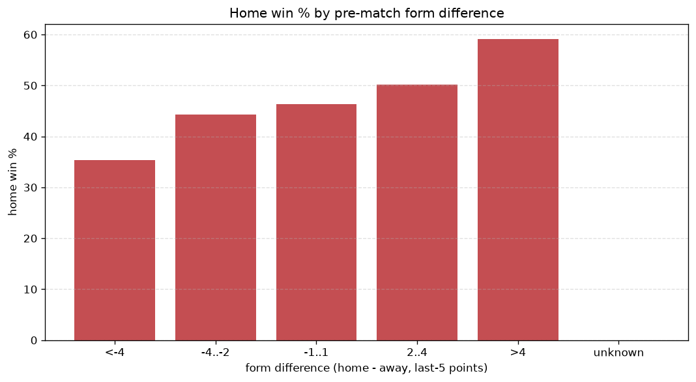
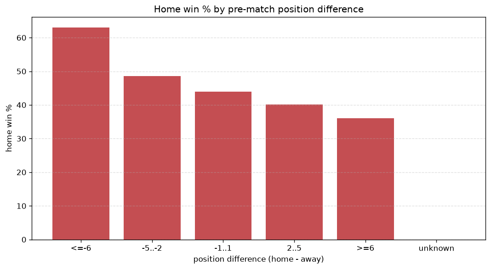

# Relationships Analysis
- Report: `relationships`
- Generated: 2026-10-26T01:27:29+00:00
- Script: `backend/scripts/analyze_relationships.py` v1.0.0
- League: Serie A Betano (Brazil)
- Scope: league `brazil1`

- Matches analysed: **2275** (23 leakage-safe pre-match features).

## 1. Correlation matrix
_Pearson correlation of each pre-match feature with observed goals; sorted by |corr(total goals)|._

| feature | corr(home) | corr(away) | corr(total) |
|---|---|---|---|
| home_position_before_match | -0.176 | 0.098 | -0.069 |
| home_points_before_match | 0.118 | -0.044 | 0.060 |
| position_difference | -0.189 | 0.150 | -0.043 |
| home_team_home_conceded_avg | -0.098 | 0.055 | -0.038 |
| away_points_before_match | -0.014 | 0.071 | 0.036 |
| home_team_wins_last_5 | 0.105 | -0.067 | 0.035 |
| points_difference | 0.193 | -0.169 | 0.035 |
| home_team_points_last_5 | 0.104 | -0.069 | 0.033 |
| home_rest_days | -0.069 | 0.032 | -0.031 |
| home_team_home_win_rate | 0.091 | -0.060 | 0.029 |
| home_team_goals_conceded_last_5 | -0.086 | 0.060 | -0.025 |
| away_rest_days | -0.045 | 0.014 | -0.025 |
| home_team_home_goals_avg | 0.072 | -0.048 | 0.023 |
| home_team_goals_scored_last_5 | 0.078 | -0.056 | 0.022 |
| away_team_goals_conceded_last_5 | 0.076 | -0.054 | 0.021 |
| away_team_away_goals_avg | -0.067 | 0.053 | -0.015 |
| away_team_goals_scored_last_5 | -0.043 | 0.069 | 0.013 |
| rest_days_difference | -0.038 | 0.028 | -0.010 |
| away_team_wins_last_5 | -0.059 | 0.080 | 0.008 |
| away_position_before_match | 0.088 | -0.112 | -0.008 |
| away_team_away_win_rate | -0.077 | 0.078 | -0.007 |
| away_team_away_conceded_avg | 0.052 | -0.053 | 0.004 |
| away_team_points_last_5 | -0.069 | 0.079 | 0.000 |

## 2. Form vs outcome
_Home win/draw/away % per bucket of `home_team_points_last_5 - away_team_points_last_5`._

| bucket | matches | home | draw | away | home % | draw % | away % |
|---|---|---|---|---|---|---|---|
| <-4 | 356 | 126 | 111 | 119 | 35.4% | 31.2% | 33.4% |
| -4..-2 | 522 | 231 | 144 | 147 | 44.3% | 27.6% | 28.2% |
| -1..1 | 683 | 317 | 183 | 183 | 46.4% | 26.8% | 26.8% |
| 2..4 | 406 | 204 | 105 | 97 | 50.2% | 25.9% | 23.9% |
| >4 | 308 | 182 | 83 | 43 | 59.1% | 26.9% | 14.0% |
| unknown | 0 | 0 | 0 | 0 | - | - | - |

## 3. Position vs outcome
_Home win/draw/away % per bucket of `position_difference` (home position - away position; negative favours the home team)._

| bucket | matches | home | draw | away | home % | draw % | away % |
|---|---|---|---|---|---|---|---|
| <=-6 | 552 | 348 | 125 | 79 | 63.0% | 22.6% | 14.3% |
| -5..-2 | 414 | 201 | 114 | 99 | 48.6% | 27.5% | 23.9% |
| -1..1 | 293 | 129 | 87 | 77 | 44.0% | 29.7% | 26.3% |
| 2..5 | 368 | 148 | 111 | 109 | 40.2% | 30.2% | 29.6% |
| >=6 | 648 | 234 | 189 | 225 | 36.1% | 29.2% | 34.7% |
| unknown | 0 | 0 | 0 | 0 | - | - | - |

## 4. Rest advantage
_Home win/draw/away % per bucket of `rest_days_difference` (home rest - away rest). Matches with unknown rest are bucketed separately._

| bucket | matches | home | draw | away | home % | draw % | away % |
|---|---|---|---|---|---|---|---|
| <-1 | 294 | 140 | 93 | 61 | 47.6% | 31.6% | 20.7% |
| -1..0 | 370 | 186 | 94 | 90 | 50.3% | 25.4% | 24.3% |
| 0 | 882 | 392 | 258 | 232 | 44.4% | 29.3% | 26.3% |
| 1..2 | 499 | 239 | 122 | 138 | 47.9% | 24.4% | 27.7% |
| >2 | 166 | 71 | 41 | 54 | 42.8% | 24.7% | 32.5% |
| unknown | 64 | 32 | 18 | 14 | 50.0% | 28.1% | 21.9% |
- *64 match(es) had unknown rest difference (missing rest data on at least one side).*

## 5. Home team quality
_Home win rate by `home_team_home_win_rate` tier (split at 0.5)._

- `< 0.5` tier: **43.0%** home win (547/1272)
- `>= 0.5` tier: **51.1%** home win (513/1003)
- Home-win gap (>= split minus < split): **+8.1 pp**

| tier | label | matches | home | draw | away | home % |
|---|---|---|---|---|---|---|
| low | < 0.5 | 1272 | 547 | 354 | 371 | 43.0% |
| high | >= 0.5 | 1003 | 513 | 272 | 218 | 51.1% |

## 6. Feature averages by result
_Mean feature value per outcome; `range` is home-minus-away spread of the group means._

| feature | home mean | draw mean | away mean | range |
|---|---|---|---|---|
| points_difference | 2.209 | -1.383 | -3.776 | 5.985 |
| position_difference | -1.381 | 1.038 | 2.640 | 4.021 |
| home_points_before_match | 26.812 | 23.527 | 22.883 | 3.929 |
| home_position_before_match | 9.941 | 11.324 | 12.385 | 2.445 |
| away_points_before_match | 24.603 | 24.911 | 26.659 | 2.056 |
| away_position_before_match | 11.322 | 10.286 | 9.745 | 1.576 |
| away_team_points_last_5 | 6.062 | 6.612 | 6.844 | 0.782 |
| home_rest_days | 5.822 | 5.908 | 6.586 | 0.764 |
| home_team_points_last_5 | 6.426 | 5.986 | 5.684 | 0.742 |
| home_team_goals_scored_last_5 | 5.697 | 5.343 | 5.100 | 0.597 |
| away_team_goals_scored_last_5 | 5.370 | 5.751 | 5.937 | 0.567 |
| home_team_goals_conceded_last_5 | 5.443 | 5.591 | 6.003 | 0.560 |
| away_team_goals_conceded_last_5 | 5.676 | 5.270 | 5.173 | 0.503 |
| away_rest_days | 5.828 | 6.054 | 6.308 | 0.480 |
| rest_days_difference | -0.007 | -0.138 | 0.278 | 0.416 |
| away_team_wins_last_5 | 1.591 | 1.788 | 1.842 | 0.252 |
| home_team_wins_last_5 | 1.712 | 1.570 | 1.462 | 0.250 |
| home_team_home_goals_avg | 1.366 | 1.290 | 1.235 | 0.131 |
| home_team_home_conceded_avg | 0.909 | 0.966 | 1.027 | 0.118 |
| away_team_away_conceded_avg | 1.356 | 1.295 | 1.274 | 0.082 |
| away_team_away_goals_avg | 0.915 | 0.982 | 0.995 | 0.080 |
| home_team_home_win_rate | 0.460 | 0.426 | 0.393 | 0.067 |
| away_team_away_win_rate | 0.217 | 0.252 | 0.266 | 0.049 |

---
*All features are leakage-safe pre-match values built by `ml.features.build_features.build_rows` from strictly prior matches. Run with `python backend/scripts/analyze_relationships.py` to regenerate.*

## Charts

