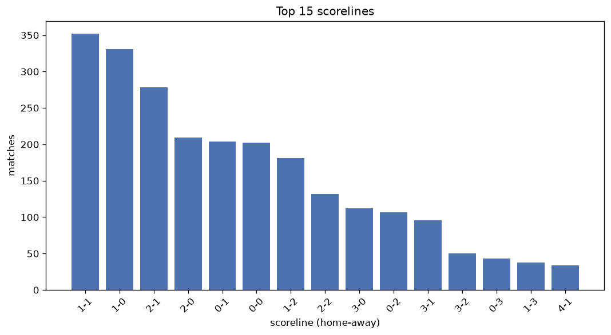
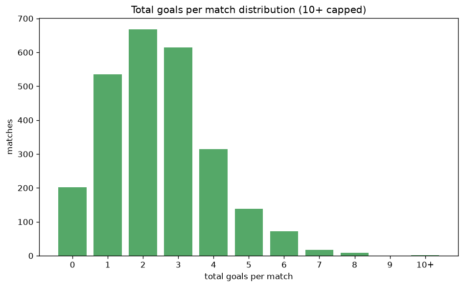

# Scoreline Analysis
- Report: `scoreline_analysis`
- Generated: 2026-10-26T01:27:27+00:00
- Script: `backend/scripts/analyze_scorelines.py` v1.0.0
- League: Serie A Betano (Brazil)
- Scope: league `brazil1`

## 1. Scoreline frequency
- Matches analysed: **2571** across **7** seasons.
- Distinct scorelines seen: **39**.

| scoreline | count | pct |
|---|---|---|
| 1-1 | 352 | 13.7% |
| 1-0 | 331 | 12.9% |
| 2-1 | 278 | 10.8% |
| 2-0 | 209 | 8.1% |
| 0-1 | 204 | 7.9% |
| 0-0 | 202 | 7.9% |
| 1-2 | 181 | 7.0% |
| 2-2 | 132 | 5.1% |
| 3-0 | 112 | 4.4% |
| 0-2 | 107 | 4.2% |
| 3-1 | 96 | 3.7% |
| 3-2 | 50 | 1.9% |
| 0-3 | 43 | 1.7% |
| 1-3 | 38 | 1.5% |
| 4-1 | 34 | 1.3% |
| 2-3 | 33 | 1.3% |
| 4-0 | 32 | 1.2% |
| 4-2 | 23 | 0.9% |
| 3-3 | 22 | 0.9% |
| 0-4 | 17 | 0.7% |

## 2. Scoreline frequency per season

### 2020
| scoreline | count | pct |
|---|---|---|
| 1-1 | 57 | 15.0% |
| 2-1 | 48 | 12.6% |
| 1-0 | 39 | 10.3% |
| 0-0 | 32 | 8.4% |
| 2-0 | 30 | 7.9% |

### 2021
| scoreline | count | pct |
|---|---|---|
| 1-0 | 59 | 15.5% |
| 1-1 | 48 | 12.6% |
| 0-0 | 44 | 11.6% |
| 2-1 | 37 | 9.7% |
| 0-1 | 32 | 8.4% |

### 2022
| scoreline | count | pct |
|---|---|---|
| 1-1 | 58 | 15.3% |
| 1-0 | 53 | 13.9% |
| 0-1 | 42 | 11.1% |
| 1-2 | 32 | 8.4% |
| 2-1 | 31 | 8.2% |

### 2023
| scoreline | count | pct |
|---|---|---|
| 1-0 | 50 | 13.3% |
| 1-1 | 48 | 12.8% |
| 2-1 | 37 | 9.9% |
| 2-0 | 32 | 8.5% |
| 0-0 | 30 | 8.0% |

### 2024
| scoreline | count | pct |
|---|---|---|
| 1-1 | 51 | 13.4% |
| 2-1 | 50 | 13.2% |
| 1-0 | 47 | 12.4% |
| 2-0 | 32 | 8.4% |
| 1-2 | 31 | 8.2% |

### 2025
| scoreline | count | pct |
|---|---|---|
| 1-0 | 53 | 13.9% |
| 1-1 | 46 | 12.1% |
| 2-1 | 37 | 9.7% |
| 2-0 | 33 | 8.7% |
| 0-0 | 27 | 7.1% |

### 2026
| scoreline | count | pct |
|---|---|---|
| 1-1 | 44 | 14.9% |
| 2-1 | 38 | 12.8% |
| 1-0 | 30 | 10.1% |
| 2-0 | 29 | 9.8% |
| 1-2 | 26 | 8.8% |

## 3. Total-goal histogram
_10+ groups all matches with 10 or more total goals._

| total goals | matches | pct |
|---|---|---|
| 0 | 202 | 7.9% |
| 1 | 535 | 20.8% |
| 2 | 668 | 26.0% |
| 3 | 614 | 23.9% |
| 4 | 315 | 12.3% |
| 5 | 138 | 5.4% |
| 6 | 72 | 2.8% |
| 7 | 17 | 0.7% |
| 8 | 9 | 0.4% |
| 9 | 0 | 0.0% |
| 10+ | 1 | 0.0% |

## 4. Extreme scorelines
- Matches with 7+ total goals: **27**

| season | date | scoreline | total goals |
|---|---|---|---|
| 2023 | 2023-10-07 | 4-6 | 10 |
| 2020 | 2020-09-03 | 3-5 | 8 |
| 2020 | 2020-10-15 | 3-5 | 8 |
| 2022 | 2022-06-09 | 5-3 | 8 |
| 2023 | 2023-09-19 | 4-4 | 8 |
| 2023 | 2023-10-22 | 7-1 | 8 |
| 2023 | 2023-10-26 | 5-3 | 8 |
| 2024 | 2024-10-21 | 3-5 | 8 |
| 2025 | 2025-08-26 | 8-0 | 8 |
| 2026 | 2026-02-05 | 5-3 | 8 |
| 2020 | 2020-09-20 | 3-4 | 7 |
| 2020 | 2020-12-20 | 4-3 | 7 |
| 2020 | 2021-01-24 | 3-4 | 7 |
| 2020 | 2021-02-09 | 2-5 | 7 |
| 2021 | 2021-07-01 | 3-4 | 7 |
| 2021 | 2021-10-10 | 5-2 | 7 |
| 2021 | 2021-12-05 | 4-3 | 7 |
| 2021 | 2021-12-10 | 4-3 | 7 |
| 2022 | 2022-08-21 | 5-2 | 7 |
| 2023 | 2023-07-09 | 4-3 | 7 |
| 2023 | 2023-10-29 | 3-4 | 7 |
| 2023 | 2023-11-02 | 3-4 | 7 |
| 2023 | 2023-11-10 | 3-4 | 7 |
| 2024 | 2024-06-02 | 1-6 | 7 |
| 2024 | 2024-06-09 | 2-5 | 7 |
| 2024 | 2024-10-18 | 5-2 | 7 |
| 2025 | 2025-10-05 | 4-3 | 7 |

## 5. Margin-of-victory distribution (decided matches)
- Decided matches: **1862** (draws: **709**)
- Average winning margin: **1.63**

| margin | matches | pct |
|---|---|---|
| 1 | 1088 | 58.4% |
| 2 | 488 | 26.2% |
| 3+ | 286 | 15.4% |

## 6. Margin by outcome

### Home wins
- Matches: **1201** | avg margin: **1.68** | max margin: **8**
| margin | matches | pct |
|---|---|---|
| 1 | 664 | 55.3% |
| 2 | 331 | 27.6% |
| 3+ | 206 | 17.2% |
- *Full match-by-match list available in `scoreline_analysis.json`.*

### Away wins
- Matches: **661** | avg margin: **1.53** | max margin: **6**
| margin | matches | pct |
|---|---|---|
| 1 | 424 | 64.1% |
| 2 | 157 | 23.8% |
| 3+ | 80 | 12.1% |
- *Full match-by-match list available in `scoreline_analysis.json`.*

## 7. Most common exact score by outcome type
| outcome | matches | most common score | count | pct |
|---|---|---|---|---|
| home | 1201 | 1-0 | 331 | 27.6% |
| draw | 709 | 1-1 | 352 | 49.6% |
| away | 661 | 0-1 | 204 | 30.9% |

---
*All statistics are computed from PostgreSQL tables (read-only). Run with `python backend/scripts/analyze_scorelines.py` to regenerate.*

## Charts

