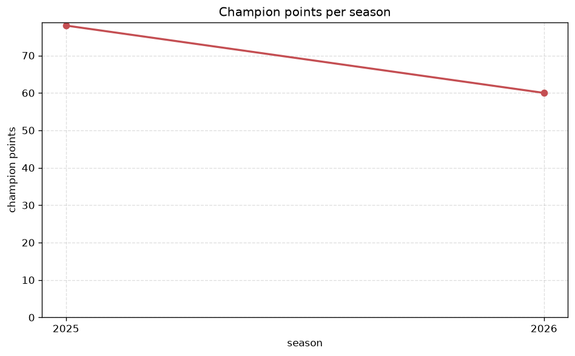
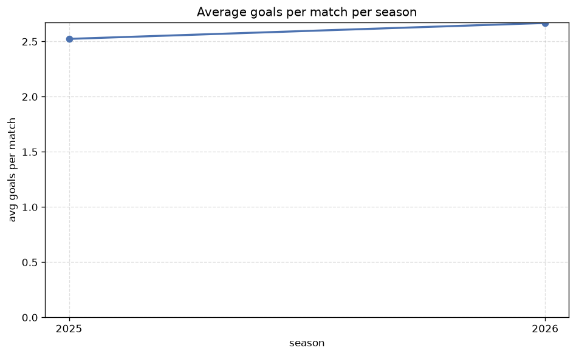

# Season Trends Analysis
- Report: `season_trends`
- Generated: 2026-10-30T03:45:46+00:00
- Script: `backend/scripts/analyze_seasons.py` v1.0.0
- League: Serie A Betano (Brazil)
- Scope: league `brazil1`

## 1. Champions per season
| season | champion | pts | runner-up | margin |
|---|---|---|---|---|
| 2020 | Flamengo RJ | 71 | Internacional | 3 pts |
| 2021 | Flamengo RJ | 69 | Palmeiras | 7 pts |
| 2022 | Palmeiras | 75 | Internacional | 3 pts |
| 2023 | Palmeiras | 65 | Gremio | 0 pts |
| 2024 | Botafogo RJ | 75 | Palmeiras | 8 pts |
| 2025 | Flamengo RJ | 78 | Palmeiras | 5 pts |
| 2026 | Flamengo RJ | 64 | Palmeiras | 1 pts |

## 2. Title-race tightness
- Tight races (margin <= 3 pts): **4** of 7 seasons
- Tightest race: **2023** - Palmeiras beat Gremio by **0** pts

| season | margin | tight |
|---|---|---|
| 2020 | 3 pts | yes |
| 2021 | 7 pts |  |
| 2022 | 3 pts | yes |
| 2023 | 0 pts | yes |
| 2024 | 8 pts |  |
| 2025 | 5 pts |  |
| 2026 | 1 pts | yes |

## 3. Points thresholds
_Position-specific points per season. Key: 1 = champion, 2 = runner-up, 4 = CL line, 6 = Europa, 17 = last safe, 20 = bottom._

| season | pos 1 | pos 2 | pos 4 | pos 6 | pos 17 | pos 20 |
|---|---|---|---|---|---|---|
| 2020 | 71 | 68 | 60 | 55 | 37 | 26 |
| 2021 | 69 | 62 | 52 | 51 | 37 | - |
| 2022 | 75 | 72 | 62 | 54 | 36 | 29 |
| 2023 | 65 | 65 | 63 | 55 | - | 24 |
| 2024 | 75 | 67 | 66 | 56 | 29 | - |
| 2025 | 78 | 73 | 67 | 63 | 42 | 17 |
| 2026 | 64 | 63 | 50 | 48 | 32 | 18 |

## 4. Relegation battle
| season | safe pos | safe pts | drop pos | drop pts | gap |
|---|---|---|---|---|---|
| 2020 | 17 | 37 | 18 | - | - |
| 2021 | 17 | 37 | 18 | 36 | 1 pts |
| 2022 | 17 | 36 | 18 | 35 | 1 pts |
| 2023 | 17 | - | 18 | - | - |
| 2024 | 17 | 29 | 18 | 29 | 0 pts |
| 2025 | 17 | 42 | 18 | - | - |
| 2026 | 17 | 32 | 18 | 31 | 1 pts |

## 5. League-level trends
| season | matches | total goals | avg goals | home win | draw | away win | goalless | avg pts/team |
|---|---|---|---|---|---|---|---|---|
| 2020 | 380 | 944 | 2.484 | 45.0% | 28.4% | 26.6% | 8.4% | 46.65 |
| 2021 | 380 | 842 | 2.216 | 45.8% | 29.7% | 24.5% | 11.6% | 44.1 |
| 2022 | 380 | 905 | 2.382 | 44.2% | 28.4% | 27.4% | 6.8% | 46.75 |
| 2023 | 375 | 930 | 2.48 | 46.9% | 25.9% | 27.2% | 8.0% | 46.5 |
| 2024 | 380 | 929 | 2.445 | 47.4% | 26.6% | 26.1% | 6.8% | 47.1 |
| 2025 | 380 | 959 | 2.524 | 50.3% | 26.1% | 23.7% | 7.1% | 49.6 |
| 2026 | 296 | 787 | 2.659 | 47.6% | 28.0% | 24.3% | 5.7% | 40.25 |

## 6. View divergence
- Largest divergence: **2021** (goals view, avg abs position diff = 31.900)

_Avg absolute position difference between classic view and alternative view per season._

| season | classic vs luck | classic vs goals |
|---|---|---|
| 2020 | 22.550 | 15.800 |
| 2021 | 25.450 | 31.900 |
| 2022 | 21.000 | 15.200 |
| 2023 | 20.800 | 18.600 |
| 2024 | 20.150 | 19.950 |
| 2025 | 10.900 | 11.050 |
| 2026 | 3.000 | 6.100 |

---
*All statistics are computed from PostgreSQL tables (read-only). Run with `python backend/scripts/analyze_seasons.py` to regenerate.*

## Charts

