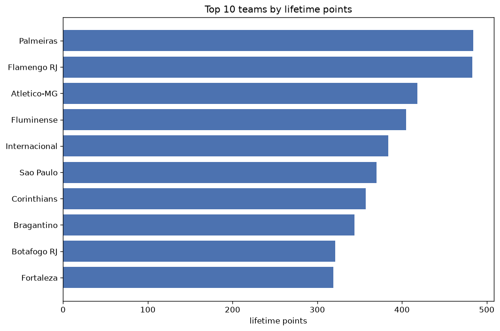
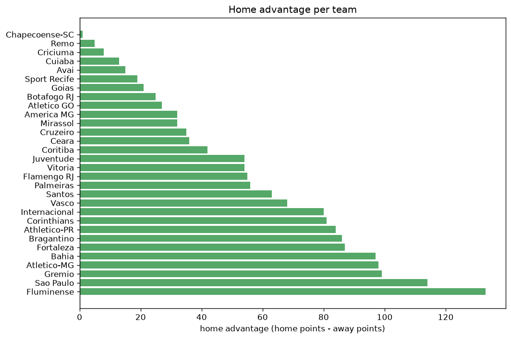

# Team Analysis
- Report: `teams_analysis`
- Generated: 2026-10-26T01:27:23+00:00
- Script: `backend/scripts/analyze_teams.py` v1.0.0
- League: Serie A Betano (Brazil)
- Scope: league `brazil1`

- Teams: **30** | Seasons: **7** | Matches: **2571**

## 1. Team standings (lifetime)
| team | seasons | played | W | D | L | pts | GF | GA | GD | avg pts/season | best pos | worst pos | titles |
|---|---|---|---|---|---|---|---|---|---|---|---|---|---|
| Palmeiras | 7 | 257 | 140 | 64 | 53 | 484 | 416 | 228 | 188 | 69.14 | 1 | 6 | 2 |
| Flamengo RJ | 7 | 258 | 141 | 60 | 57 | 483 | 450 | 259 | 191 | 69.0 | 1 | 4 | 4 |
| Atletico-MG | 7 | 258 | 116 | 70 | 72 | 418 | 359 | 281 | 78 | 59.71 | 7 | 21 | 0 |
| Fluminense | 7 | 258 | 115 | 60 | 83 | 405 | 338 | 283 | 55 | 57.86 | 3 | 13 | 0 |
| Internacional | 7 | 256 | 102 | 78 | 76 | 384 | 334 | 279 | 55 | 54.86 | 2 | 16 | 0 |
| Sao Paulo | 7 | 258 | 98 | 76 | 84 | 370 | 316 | 285 | 31 | 52.86 | 3 | 14 | 0 |
| Corinthians | 7 | 257 | 93 | 78 | 86 | 357 | 302 | 294 | 8 | 51.0 | 5 | 17 | 0 |
| Bragantino | 7 | 257 | 89 | 77 | 91 | 344 | 326 | 318 | 8 | 49.14 | 3 | 14 | 0 |
| Botafogo RJ | 6 | 219 | 87 | 60 | 72 | 321 | 290 | 256 | 34 | 53.5 | 1 | 20 | 1 |
| Fortaleza | 6 | 228 | 87 | 58 | 83 | 319 | 265 | 269 | -4 | 53.17 | 4 | 17 | 0 |
| Athletico-PR | 6 | 219 | 83 | 57 | 79 | 306 | 263 | 252 | 11 | 51.0 | 4 | 22 | 0 |
| Gremio | 6 | 220 | 79 | 58 | 83 | 295 | 283 | 287 | -4 | 49.17 | 2 | 18 | 0 |
| Bahia | 6 | 219 | 80 | 53 | 86 | 293 | 283 | 293 | -10 | 48.83 | 5 | 17 | 0 |
| Santos | 6 | 218 | 71 | 66 | 81 | 279 | 258 | 289 | -31 | 46.5 | 7 | 15 | 0 |
| Cruzeiro | 4 | 143 | 58 | 43 | 42 | 217 | 177 | 144 | 33 | 54.25 | 3 | 13 | 0 |
| Vasco | 5 | 180 | 58 | 42 | 80 | 216 | 211 | 263 | -52 | 43.2 | 9 | 15 | 0 |
| Ceara | 4 | 152 | 43 | 53 | 56 | 182 | 161 | 170 | -9 | 45.5 | 8 | 16 | 0 |
| Cuiaba | 4 | 152 | 40 | 49 | 63 | 169 | 134 | 167 | -33 | 42.25 | 10 | 17 | 0 |
| Atletico GO | 4 | 152 | 40 | 49 | 63 | 169 | 141 | 196 | -55 | 42.25 | 7 | 18 | 0 |
| Juventude | 4 | 152 | 34 | 46 | 72 | 148 | 148 | 241 | -93 | 37.0 | 15 | 21 | 0 |
| Coritiba | 4 | 141 | 36 | 30 | 75 | 138 | 143 | 229 | -86 | 34.5 | 10 | 20 | 0 |
| America MG | 3 | 114 | 33 | 31 | 50 | 130 | 123 | 158 | -35 | 43.33 | 4 | 21 | 0 |
| Vitoria | 3 | 106 | 34 | 26 | 46 | 128 | 113 | 148 | -35 | 42.67 | 11 | 15 | 0 |
| Goias | 3 | 114 | 29 | 34 | 51 | 121 | 117 | 169 | -52 | 40.33 | 12 | 17 | 0 |
| Mirassol | 2 | 68 | 26 | 22 | 20 | 100 | 97 | 83 | 14 | 50.0 | 4 | 15 | 0 |
| Sport Recife | 3 | 114 | 23 | 28 | 63 | 97 | 83 | 162 | -79 | 32.33 | 16 | 20 | 0 |
| Criciuma | 1 | 38 | 9 | 11 | 18 | 38 | 42 | 61 | -19 | 38.0 | 16 | 16 | 0 |
| Avai | 1 | 38 | 9 | 8 | 21 | 35 | 34 | 60 | -26 | 35.0 | 18 | 18 | 0 |
| Chapecoense-SC | 2 | 66 | 4 | 21 | 41 | 33 | 56 | 124 | -68 | 16.5 | 20 | 22 | 0 |
| Remo | 1 | 30 | 5 | 10 | 15 | 25 | 33 | 48 | -15 | 25.0 | 19 | 19 | 0 |

## 2. Home vs away split
| team | home P | H-W | H-D | H-L | H-pts | away P | A-W | A-D | A-L | A-pts | adv |
|---|---|---|---|---|---|---|---|---|---|---|---|
| Fluminense | 129 | 80 | 29 | 20 | 269 | 129 | 35 | 31 | 63 | 136 | 133 |
| Sao Paulo | 129 | 69 | 35 | 25 | 242 | 129 | 29 | 41 | 59 | 128 | 114 |
| Gremio | 110 | 57 | 26 | 27 | 197 | 110 | 22 | 32 | 56 | 98 | 99 |
| Atletico-MG | 129 | 75 | 33 | 21 | 258 | 129 | 41 | 37 | 51 | 160 | 98 |
| Bahia | 110 | 57 | 24 | 29 | 195 | 109 | 23 | 29 | 57 | 98 | 97 |
| Fortaleza | 114 | 57 | 32 | 25 | 203 | 114 | 30 | 26 | 58 | 116 | 87 |
| Bragantino | 128 | 59 | 38 | 31 | 215 | 129 | 30 | 39 | 60 | 129 | 86 |
| Athletico-PR | 110 | 54 | 33 | 23 | 195 | 109 | 29 | 24 | 56 | 111 | 84 |
| Corinthians | 128 | 59 | 42 | 27 | 219 | 129 | 34 | 36 | 59 | 138 | 81 |
| Internacional | 128 | 65 | 37 | 26 | 232 | 128 | 37 | 41 | 50 | 152 | 80 |
| Vasco | 90 | 41 | 19 | 30 | 142 | 90 | 17 | 23 | 50 | 74 | 68 |
| Santos | 109 | 45 | 36 | 28 | 171 | 109 | 26 | 30 | 53 | 108 | 63 |
| Palmeiras | 128 | 81 | 27 | 20 | 270 | 129 | 59 | 37 | 33 | 214 | 56 |
| Flamengo RJ | 129 | 81 | 26 | 22 | 269 | 129 | 60 | 34 | 35 | 214 | 55 |
| Juventude | 76 | 25 | 26 | 25 | 101 | 76 | 9 | 20 | 47 | 47 | 54 |
| Vitoria | 53 | 27 | 10 | 16 | 91 | 53 | 7 | 16 | 30 | 37 | 54 |
| Coritiba | 71 | 24 | 18 | 29 | 90 | 70 | 12 | 12 | 46 | 48 | 42 |
| Ceara | 76 | 28 | 25 | 23 | 109 | 76 | 15 | 28 | 33 | 73 | 36 |
| Cruzeiro | 72 | 35 | 21 | 16 | 126 | 71 | 23 | 22 | 26 | 91 | 35 |
| America MG | 57 | 23 | 12 | 22 | 81 | 57 | 10 | 19 | 28 | 49 | 32 |
| Mirassol | 34 | 18 | 12 | 4 | 66 | 34 | 8 | 10 | 16 | 34 | 32 |
| Atletico GO | 76 | 23 | 29 | 24 | 98 | 76 | 17 | 20 | 39 | 71 | 27 |
| Botafogo RJ | 110 | 48 | 29 | 33 | 173 | 109 | 39 | 31 | 39 | 148 | 25 |
| Goias | 57 | 17 | 20 | 20 | 71 | 57 | 12 | 14 | 31 | 50 | 21 |
| Sport Recife | 57 | 14 | 16 | 27 | 58 | 57 | 9 | 12 | 36 | 39 | 19 |
| Avai | 19 | 7 | 4 | 8 | 25 | 19 | 2 | 4 | 13 | 10 | 15 |
| Cuiaba | 76 | 22 | 25 | 29 | 91 | 76 | 18 | 24 | 34 | 78 | 13 |
| Criciuma | 19 | 5 | 8 | 6 | 23 | 19 | 4 | 3 | 12 | 15 | 8 |
| Remo | 15 | 3 | 6 | 6 | 15 | 15 | 2 | 4 | 9 | 10 | 5 |
| Chapecoense-SC | 32 | 2 | 11 | 19 | 17 | 34 | 2 | 10 | 22 | 16 | 1 |

## 3. Top performers
### Best points per game (PPG)
| rank | team | PPG |
|---|---|---|
| 1 | Palmeiras | 1.88 |
| 2 | Flamengo RJ | 1.87 |
| 3 | Atletico-MG | 1.62 |
| 4 | Fluminense | 1.57 |
| 5 | Cruzeiro | 1.52 |

### Most goals scored
| rank | team | goals |
|---|---|---|
| 1 | Flamengo RJ | 450 |
| 2 | Palmeiras | 416 |
| 3 | Atletico-MG | 359 |
| 4 | Fluminense | 338 |
| 5 | Internacional | 334 |

### Best goal difference
| rank | team | GD |
|---|---|---|
| 1 | Flamengo RJ | 191 |
| 2 | Palmeiras | 188 |
| 3 | Atletico-MG | 78 |
| 4 | Fluminense | 55 |
| 5 | Internacional | 55 |

### Best defence (goals against per match, standings)
| rank | team | GA/match |
|---|---|---|
| 1 | Palmeiras | 0.898 |
| 2 | Flamengo RJ | 0.963 |
| 3 | Cruzeiro | 0.971 |
| 4 | Cuiaba | 1.042 |
| 5 | Internacional | 1.078 |

## 4. Team consistency
- Teams present in all **7** seasons: **8**

Atletico-MG, Bragantino, Corinthians, Flamengo RJ, Fluminense, Internacional, Palmeiras, Sao Paulo

## 5. Head-to-head dominance
- Distinct fixtures: **401** (showing the 15 most frequent)

| fixture | meetings | home wins | draws | away wins | home pct | draw pct | away pct |
|---|---|---|---|---|---|---|---|
| Flamengo RJ vs Bragantino | 14 | 8 | 4 | 2 | 57.1% | 28.6% | 14.3% |
| Flamengo RJ vs Corinthians | 14 | 8 | 2 | 4 | 57.1% | 14.3% | 28.6% |
| Flamengo RJ vs Sao Paulo | 14 | 8 | 3 | 3 | 57.1% | 21.4% | 21.4% |
| Fluminense vs Atletico-MG | 14 | 8 | 5 | 1 | 57.1% | 35.7% | 7.1% |
| Fluminense vs Palmeiras | 14 | 8 | 4 | 2 | 57.1% | 28.6% | 14.3% |
| Palmeiras vs Corinthians | 14 | 8 | 4 | 2 | 57.1% | 28.6% | 14.3% |
| Sao Paulo vs Atletico-MG | 14 | 8 | 5 | 1 | 57.1% | 35.7% | 7.1% |
| Bragantino vs Atletico-MG | 14 | 7 | 5 | 2 | 50.0% | 35.7% | 14.3% |
| Fluminense vs Corinthians | 14 | 7 | 3 | 4 | 50.0% | 21.4% | 28.6% |
| Internacional vs Atletico-MG | 14 | 7 | 3 | 4 | 50.0% | 21.4% | 28.6% |
| Internacional vs Palmeiras | 14 | 6 | 4 | 4 | 42.9% | 28.6% | 28.6% |
| Sao Paulo vs Bragantino | 14 | 6 | 5 | 3 | 42.9% | 35.7% | 21.4% |
| Bragantino vs Corinthians | 14 | 5 | 3 | 6 | 35.7% | 21.4% | 42.9% |
| Internacional vs Sao Paulo | 14 | 5 | 4 | 5 | 35.7% | 28.6% | 35.7% |
| Palmeiras vs Atletico-MG | 14 | 5 | 4 | 5 | 35.7% | 28.6% | 35.7% |

## 6. Position per season (classic view)
_Cells show final position; '-' when the team was absent from that season._

| team | 2020 | 2021 | 2022 | 2023 | 2024 | 2025 | 2026 |
|---|---|---|---|---|---|---|---|
| Palmeiras | 6 | 2 | 1 | 1 | 2 | 2 | 2 |
| Flamengo RJ | 1 | 1 | 4 | 4 | 3 | 1 | 1 |
| Atletico-MG | 21 | 18 | 20 | 19 | 21 | 21 | 7 |
| Fluminense | 4 | 10 | 3 | 6 | 13 | 5 | 3 |
| Internacional | 2 | 11 | 2 | 8 | 5 | 14 | 16 |
| Sao Paulo | 3 | 14 | 7 | 9 | 6 | 8 | 9 |
| Corinthians | 11 | 6 | 5 | 11 | 7 | 12 | 17 |
| Bragantino | 8 | 3 | 11 | 5 | 14 | 9 | 11 |
| Botafogo RJ | 20 | - | 8 | 3 | 1 | 6 | 13 |
| Fortaleza | 14 | 5 | 6 | 7 | 4 | 17 | - |
| Athletico-PR | 22 | 21 | 22 | 22 | 22 | - | 4 |
| Gremio | 5 | 16 | - | 2 | 12 | 10 | 18 |
| Bahia | 13 | 17 | - | 12 | 10 | 7 | 5 |
| Santos | 7 | 13 | 10 | 15 | - | 11 | 8 |
| Cruzeiro | - | - | - | 13 | 8 | 3 | 6 |
| Vasco | 15 | - | - | 14 | 9 | 13 | 14 |
| Ceara | 9 | 8 | 16 | - | - | 16 | - |
| Cuiaba | - | 12 | 14 | 10 | 17 | - | - |
| Atletico GO | 10 | 7 | 17 | - | 18 | - | - |
| Juventude | - | 15 | 21 | - | 15 | 19 | - |
| Coritiba | 19 | - | 13 | 20 | - | - | 10 |
| America MG | - | 4 | 9 | 21 | - | - | - |
| Vitoria | - | - | - | - | 11 | 15 | 12 |
| Goias | 17 | - | 12 | 16 | - | - | - |
| Mirassol | - | - | - | - | - | 4 | 15 |
| Sport Recife | 16 | 19 | - | - | - | 20 | - |
| Criciuma | - | - | - | - | 16 | - | - |
| Avai | - | - | 18 | - | - | - | - |
| Chapecoense-SC | - | 22 | - | - | - | - | 20 |
| Remo | - | - | - | - | - | - | 19 |

---
*All statistics are computed from PostgreSQL tables (read-only). Run with `python backend/scripts/analyze_teams.py` to regenerate.*

## Charts

