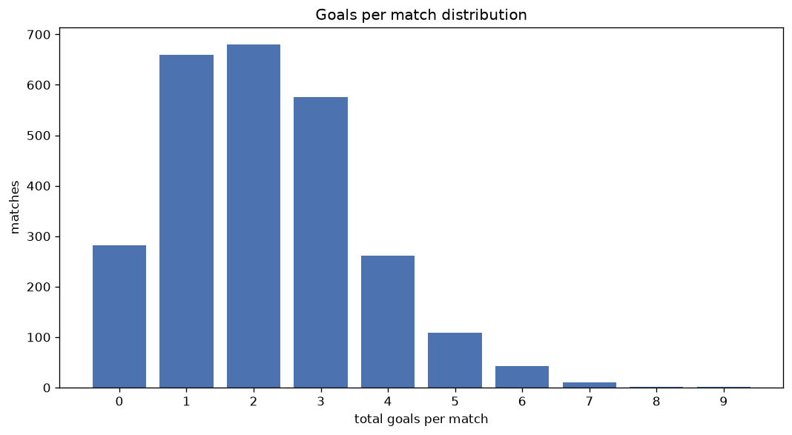
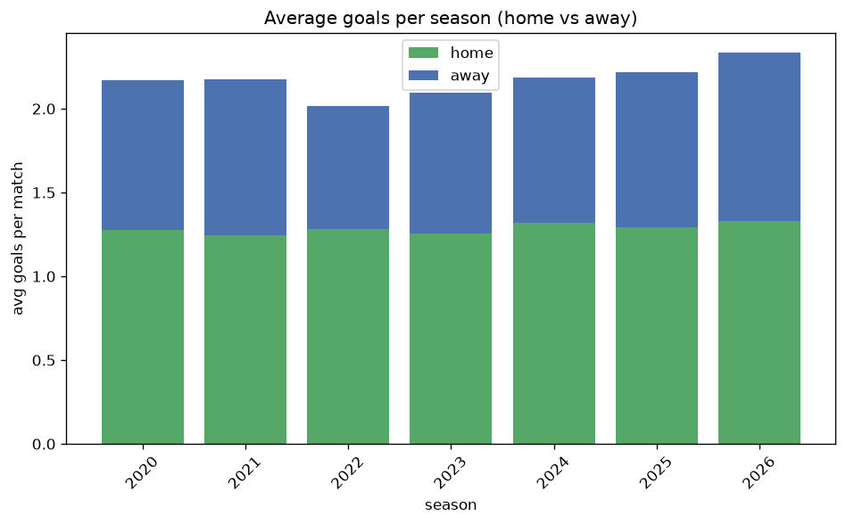

# Goal Analysis
- Report: `goals_analysis`
- Generated: 2026-10-30T03:46:01+00:00
- Script: `backend/scripts/analyze_goals.py` v1.0.0
- League: Serie B (Brazil)
- Scope: league `brazil2`

## 1. Goals per match distribution
| goals | matches | pct |
|---|---|---|
| 0 | 282 | 10.8% |
| 1 | 659 | 25.1% |
| 2 | 680 | 25.9% |
| 3 | 576 | 22.0% |
| 4 | 262 | 10.0% |
| 5 | 109 | 4.2% |
| 6 | 42 | 1.6% |
| 7 | 10 | 0.4% |
| 8 | 2 | 0.1% |
| 9 | 1 | 0.0% |

## 2. Goals per match per season
| season | matches | total goals | avg home | avg away | avg total |
|---|---|---|---|---|---|
| 2020 | 380 | 824 | 1.276 | 0.892 | 2.168 |
| 2021 | 380 | 826 | 1.247 | 0.926 | 2.174 |
| 2022 | 380 | 766 | 1.282 | 0.734 | 2.016 |
| 2023 | 380 | 796 | 1.255 | 0.839 | 2.095 |
| 2024 | 373 | 815 | 1.319 | 0.866 | 2.185 |
| 2025 | 380 | 843 | 1.292 | 0.926 | 2.218 |
| 2026 | 350 | 817 | 1.329 | 1.006 | 2.334 |

## 3. Home vs away goal share
- Home goals: **3371** (59.3%)
- Away goals: **2316** (40.7%)
- Home/away ratio: **1.456**

| season | home goals | away goals | total | home pct | away pct |
|---|---|---|---|---|---|
| 2020 | 485 | 339 | 824 | 58.9% | 41.1% |
| 2021 | 474 | 352 | 826 | 57.4% | 42.6% |
| 2022 | 487 | 279 | 766 | 63.6% | 36.4% |
| 2023 | 477 | 319 | 796 | 59.9% | 40.1% |
| 2024 | 492 | 323 | 815 | 60.4% | 39.6% |
| 2025 | 491 | 352 | 843 | 58.2% | 41.8% |
| 2026 | 465 | 352 | 817 | 56.9% | 43.1% |

## 4. BTTS (Both Teams To Score)
- Overall: **1180** of `2623` (45.0%)

| season | matches | BTTS | pct |
|---|---|---|---|
| 2020 | 380 | 174 | 45.8% |
| 2021 | 380 | 172 | 45.3% |
| 2022 | 380 | 166 | 43.7% |
| 2023 | 380 | 154 | 40.5% |
| 2024 | 373 | 163 | 43.7% |
| 2025 | 380 | 188 | 49.5% |
| 2026 | 350 | 163 | 46.6% |

## 5. Clean sheets
- Home clean sheets: **1057** (40.3%)
- Away clean sheets: **668** (25.5%)
- Total clean sheets recorded: **1725**
- Matches with at least one clean sheet: **1443** (55.0%)
- Both teams kept clean sheets (0-0): **282**

| season | matches | home CS | away CS | total CS | matches w/ CS |
|---|---|---|---|---|---|
| 2020 | 380 | 144 | 105 | 249 | 206 (54.2%) |
| 2021 | 380 | 149 | 106 | 255 | 208 (54.7%) |
| 2022 | 380 | 173 | 90 | 263 | 214 (56.3%) |
| 2023 | 380 | 165 | 105 | 270 | 226 (59.5%) |
| 2024 | 373 | 155 | 92 | 247 | 210 (56.3%) |
| 2025 | 380 | 146 | 79 | 225 | 192 (50.5%) |
| 2026 | 350 | 125 | 91 | 216 | 187 (53.4%) |

## 6. Scoring intensity
- First-half goals: **2589** (45.5%)
- Second-half goals: **3098** (54.5%)
- Avg first-half goals per match: **0.987**
- Avg second-half goals per match: **1.181**
- Second-half-only scoring (HT 0-0, FT goals >= 1): **689** (26.3%)

| season | matches | 1st half | 2nd half | 1st half pct | 2nd half pct |
|---|---|---|---|---|---|
| 2020 | 380 | 385 | 439 | 46.7% | 53.3% |
| 2021 | 380 | 371 | 455 | 44.9% | 55.1% |
| 2022 | 380 | 349 | 417 | 45.6% | 54.4% |
| 2023 | 380 | 371 | 425 | 46.6% | 53.4% |
| 2024 | 373 | 369 | 446 | 45.3% | 54.7% |
| 2025 | 380 | 379 | 464 | 45.0% | 55.0% |
| 2026 | 350 | 365 | 452 | 44.7% | 55.3% |

## 7. First-goal timing
- Matches with first-goal time recorded: `2341` of `2623` (89.2%)
- Goalless matches: `282`
- Min `1` | Max `101` | Mean `35.18` | Median (p50) `30`

| bucket | count | % of matches | % of scoring matches |
|---|---|---|---|
| 1-15 | 647 | 24.7% | 27.6% |
| 16-30 | 527 | 20.1% | 22.5% |
| 31-45 | 391 | 14.9% | 16.7% |
| 46-60 | 355 | 13.5% | 15.2% |
| 61-75 | 214 | 8.2% | 9.1% |
| 76-90 | 150 | 5.7% | 6.4% |
| 91-120 | 57 | 2.2% | 2.4% |

---
*All statistics are computed from PostgreSQL tables (read-only). Run with `python backend/scripts/analyze_goals.py` to regenerate.*

## Charts

