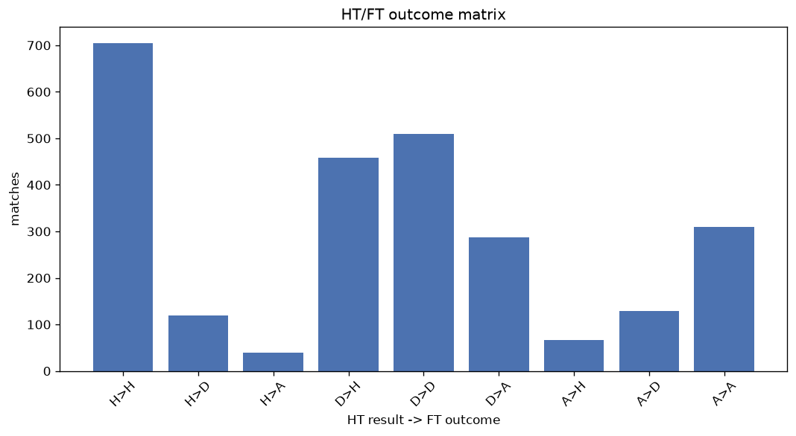
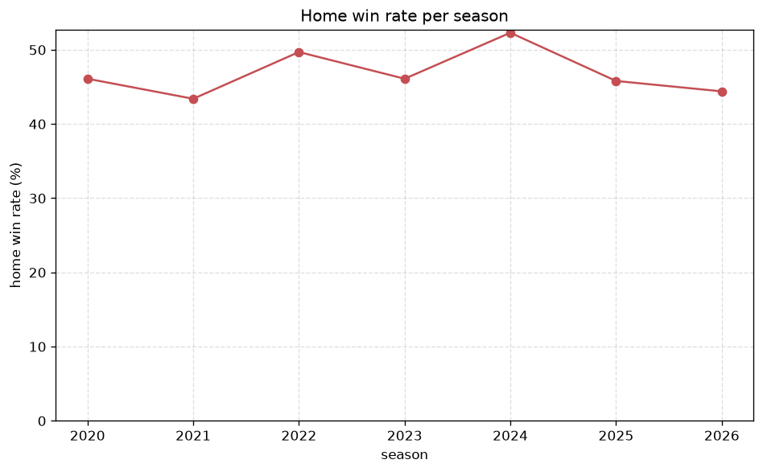

# Match Analysis
- Report: `matches_analysis`
- Generated: 2026-10-27T01:41:42+00:00
- Script: `backend/scripts/analyze_matches.py` v1.0.0
- League: Serie B (Brazil)
- Scope: league `brazil2`

## 1. Overall summary
| metric | value |
|---|---|
| Matches | 2620 |
| Home wins | 1227 (46.8%) |
| Draws | 758 (28.9%) |
| Away wins | 635 (24.2%) |
| Total goals | 5680 |
| Average goals per match | 2.168 |
| Goalless matches | 282 (10.8%) |

## 2. Per-season breakdown
| season | matches | home wins | draws | away wins | total goals | avg goals | goalless |
|---|---|---|---|---|---|---|---|
| 2020 | 380 | 175 (46.1%) | 107 (28.2%) | 98 (25.8%) | 824 | 2.168 | 43 (11.3%) |
| 2021 | 380 | 165 (43.4%) | 115 (30.3%) | 100 (26.3%) | 826 | 2.174 | 47 (12.4%) |
| 2022 | 380 | 189 (49.7%) | 121 (31.8%) | 70 (18.4%) | 766 | 2.016 | 49 (12.9%) |
| 2023 | 380 | 175 (46.1%) | 111 (29.2%) | 94 (24.7%) | 796 | 2.095 | 44 (11.6%) |
| 2024 | 373 | 195 (52.3%) | 94 (25.2%) | 84 (22.5%) | 815 | 2.185 | 37 (9.9%) |
| 2025 | 380 | 174 (45.8%) | 116 (30.5%) | 90 (23.7%) | 843 | 2.218 | 33 (8.7%) |
| 2026 | 347 | 154 (44.4%) | 94 (27.1%) | 99 (28.5%) | 810 | 2.334 | 29 (8.4%) |

## 3. HT/FT outcome matrix
| HT result \ FT result | Home | Draw | Away | total |
|---|---|---|---|---|
| HT home lead | 703 (81.6%) | 120 (13.9%) | 39 (4.5%) | 862 |
| HT draw | 458 (36.5%) | 509 (40.6%) | 287 (22.9%) | 1254 |
| HT away lead | 66 (13.1%) | 129 (25.6%) | 309 (61.3%) | 504 |

## 4. Comeback matches
- Home comebacks (trailing at HT, won at FT): **66** (2.5%)
- Away comebacks (trailing at HT, won at FT): **39** (1.5%)

### Home comebacks
| season | home | away | HT | FT |
|---|---|---|---|---|
| 2020 | Cuiaba | Chapecoense-SC | 0-1 | 2-1 |
| 2020 | Juventude | Confianca | 0-1 | 3-1 |
| 2020 | Ponte Preta | Figueirense | 0-1 | 2-1 |
| 2020 | Sampaio Correa | Vitoria | 0-1 | 2-1 |
| 2020 | CSA | Ponte Preta | 0-1 | 2-1 |
| 2020 | Ponte Preta | Cruzeiro | 0-1 | 2-1 |
| 2020 | Botafogo SP | Sampaio Correa | 0-1 | 2-1 |
| 2021 | Vitoria | Brusque | 0-1 | 3-1 |
| 2021 | Sampaio Correa | Confianca | 0-1 | 3-1 |
| 2021 | CRB | Botafogo RJ | 0-1 | 2-1 |
| 2021 | Brusque | Botafogo RJ | 0-1 | 2-1 |
| 2021 | Brusque | Remo | 0-1 | 3-1 |
| 2021 | Confianca | Brusque | 0-1 | 3-2 |
| 2021 | Ponte Preta | Coritiba | 0-2 | 3-2 |
| 2021 | Avai | Sampaio Correa | 0-1 | 2-1 |
| 2022 | Operario-PR | Ituano | 0-1 | 3-2 |
| 2022 | Sport Recife | Ponte Preta | 0-1 | 2-1 |
| 2022 | Bahia | Criciuma | 0-1 | 2-1 |
| 2022 | Criciuma | CSA | 0-1 | 2-1 |
| 2022 | Bahia | Tombense | 0-1 | 3-1 |
| 2022 | Vila Nova FC | Guarani | 0-1 | 2-1 |
| 2022 | Chapecoense-SC | Bahia | 0-1 | 3-1 |
| 2022 | Chapecoense-SC | Tombense | 1-2 | 3-2 |
| 2022 | Vasco | Criciuma | 0-1 | 2-1 |
| 2022 | Londrina | Sport Recife | 0-1 | 2-1 |
| 2022 | Sampaio Correa | Londrina | 0-1 | 2-1 |
| 2023 | Sampaio Correa | Juventude | 0-1 | 2-1 |
| 2023 | Vitoria | Sampaio Correa | 0-1 | 2-1 |
| 2023 | Atletico GO | Tombense | 0-2 | 3-2 |
| 2023 | Tombense | Vila Nova FC | 0-1 | 2-1 |
| 2023 | Sport Recife | Chapecoense-SC | 0-1 | 2-1 |
| 2024 | Novorizontino | CRB | 0-1 | 2-1 |
| 2024 | Avai | Guarani | 1-2 | 3-2 |
| 2024 | America MG | CRB | 0-1 | 2-1 |
| 2024 | CRB | Coritiba | 0-1 | 2-1 |
| 2024 | Vila Nova FC | Avai | 0-1 | 2-1 |
| 2024 | Paysandu PA | Guarani | 0-1 | 2-1 |
| 2024 | Operario-PR | Coritiba | 0-1 | 2-1 |
| 2024 | America MG | Coritiba | 0-1 | 2-1 |
| 2024 | Botafogo SP | Guarani | 1-2 | 3-2 |
| 2024 | Amazonas | Avai | 0-1 | 2-1 |
| 2024 | Paysandu PA | Coritiba | 0-1 | 2-1 |
| 2024 | Operario-PR | Sport Recife | 0-1 | 2-1 |
| 2024 | Chapecoense-SC | Coritiba | 0-1 | 2-1 |
| 2024 | Paysandu PA | Vila Nova FC | 0-1 | 2-1 |
| 2025 | Cuiaba | Athletico-PR | 0-1 | 2-1 |
| 2025 | Ferroviaria | Coritiba | 0-1 | 2-1 |
| 2025 | Athletico-PR | Remo | 0-1 | 2-1 |
| 2025 | Paysandu PA | Ferroviaria | 0-1 | 2-1 |
| 2025 | Volta Redonda | Athletico-PR | 0-2 | 3-2 |
| 2025 | Criciuma | Athletico-PR | 1-2 | 4-2 |
| 2025 | Amazonas | Criciuma | 0-1 | 2-1 |
| 2025 | CRB | Atletico GO | 0-1 | 2-1 |
| 2025 | Atletico GO | Paysandu PA | 0-1 | 2-1 |
| 2025 | Athletic Club | Paysandu PA | 0-1 | 2-1 |
| 2025 | Operario-PR | Ferroviaria | 0-1 | 2-1 |
| 2026 | Vila Nova FC | Atletico GO | 0-1 | 2-1 |
| 2026 | Fortaleza | Goias | 0-1 | 4-1 |
| 2026 | Ceara | Fortaleza | 0-1 | 2-1 |
| 2026 | CRB | Ponte Preta | 1-2 | 4-2 |
| 2026 | Botafogo SP | Operario-PR | 0-1 | 2-1 |
| 2026 | Avai | America MG | 0-1 | 2-1 |
| 2026 | Juventude | CRB | 0-1 | 2-1 |
| 2026 | Nautico | Athletic Club | 0-1 | 2-1 |
| 2026 | Ceara | Novorizontino | 0-1 | 2-1 |
| 2026 | Goias | Avai | 0-1 | 2-1 |

### Away comebacks
| season | home | away | HT | FT |
|---|---|---|---|---|
| 2020 | Guarani | Parana | 1-0 | 1-2 |
| 2020 | Guarani | Nautico | 1-0 | 1-2 |
| 2020 | Figueirense | Sampaio Correa | 1-0 | 1-2 |
| 2020 | Confianca | Operario-PR | 1-0 | 1-2 |
| 2021 | Brasil de Pelotas | Vasco | 1-0 | 1-2 |
| 2021 | Vitoria | Londrina | 1-0 | 1-2 |
| 2021 | Vitoria | Remo | 1-0 | 1-2 |
| 2021 | Cruzeiro | CSA | 1-0 | 1-2 |
| 2021 | Operario-PR | Nautico | 1-0 | 1-2 |
| 2021 | Ponte Preta | Nautico | 2-1 | 2-3 |
| 2021 | Guarani | Confianca | 1-0 | 1-2 |
| 2021 | CSA | Operario-PR | 2-1 | 2-4 |
| 2022 | Brusque | Nautico | 1-0 | 1-2 |
| 2022 | Chapecoense-SC | Criciuma | 2-1 | 2-3 |
| 2022 | Nautico | Londrina | 1-0 | 1-2 |
| 2022 | Nautico | Vila Nova FC | 1-0 | 1-2 |
| 2022 | Operario-PR | Vasco | 1-0 | 2-3 |
| 2023 | Londrina | Sport Recife | 1-0 | 1-2 |
| 2023 | Londrina | Mirassol | 1-0 | 1-2 |
| 2023 | Londrina | Juventude | 1-0 | 1-2 |
| 2023 | Novorizontino | Chapecoense-SC | 1-0 | 1-2 |
| 2024 | Sport Recife | Avai | 1-0 | 1-2 |
| 2024 | Amazonas | Vila Nova FC | 1-0 | 1-2 |
| 2024 | Operario-PR | Vila Nova FC | 1-0 | 2-3 |
| 2024 | Brusque | CRB | 1-0 | 1-2 |
| 2024 | Ituano | Ceara | 1-0 | 1-2 |
| 2024 | Botafogo SP | Avai | 1-0 | 1-3 |
| 2025 | Athletic Club | CRB | 1-0 | 1-2 |
| 2025 | America MG | Ferroviaria | 1-0 | 1-2 |
| 2025 | Chapecoense-SC | Goias | 1-0 | 1-2 |
| 2025 | Operario-PR | Chapecoense-SC | 1-0 | 1-2 |
| 2025 | Paysandu PA | Volta Redonda | 1-0 | 1-2 |
| 2026 | Atletico GO | Nautico | 1-0 | 1-2 |
| 2026 | Londrina | Sport Recife | 1-0 | 1-2 |
| 2026 | Botafogo SP | Sao Bernardo | 1-0 | 1-2 |
| 2026 | CRB | Athletic Club | 2-0 | 2-3 |
| 2026 | America MG | Vila Nova FC | 1-0 | 1-2 |
| 2026 | Ceara | Operario-PR | 1-0 | 1-2 |
| 2026 | Sao Bernardo | Ceara | 1-0 | 3-4 |

## 5. HT lead conversion
| HT state | matches | converted to win | held as draw | collapsed to loss |
|---|---|---|---|---|
| Home lead | 862 | 703 (81.6%) | 120 (13.9%) | 39 (4.5%) |
| Away lead | 504 | 309 (61.3%) | 129 (25.6%) | 66 (13.1%) |

### Matches level at half-time
| FT result | count | pct |
|---|---|---|
| Home win | 458 | 36.5% |
| Draw | 509 | 40.6% |
| Away win | 287 | 22.9% |

## 6. First-goal timing
- Matches with a first-goal time recorded: `2338` of `2620` (89.2%)

Outcome distribution by first-goal timing bucket:
| bucket | matches | % of matches | home | draw | away |
|---|---|---|---|---|---|
| 1-15 | 646 | 24.7% | 341 (52.8%) | 148 (22.9%) | 157 (24.3%) |
| 16-30 | 527 | 20.1% | 273 (51.8%) | 120 (22.8%) | 134 (25.4%) |
| 31-45 | 391 | 14.9% | 200 (51.2%) | 79 (20.2%) | 112 (28.6%) |
| 46-60 | 354 | 13.5% | 190 (53.7%) | 82 (23.2%) | 82 (23.2%) |
| 61-75 | 214 | 8.2% | 111 (51.9%) | 28 (13.1%) | 75 (35.0%) |
| 76-90 | 150 | 5.7% | 81 (54.0%) | 15 (10.0%) | 54 (36.0%) |
| 91-120 | 56 | 2.1% | 31 (55.4%) | 4 (7.1%) | 21 (37.5%) |

## 7. Goalless matches
- Overall: **282** of `2620` (10.8%)

| season | matches | goalless | pct |
|---|---|---|---|
| 2020 | 380 | 43 | 11.3% |
| 2021 | 380 | 47 | 12.4% |
| 2022 | 380 | 49 | 12.9% |
| 2023 | 380 | 44 | 11.6% |
| 2024 | 373 | 37 | 9.9% |
| 2025 | 380 | 33 | 8.7% |
| 2026 | 347 | 29 | 8.4% |

---
*All statistics are computed from PostgreSQL tables (read-only). Run with `python backend/scripts/analyze_matches.py` to regenerate.*

## Charts

