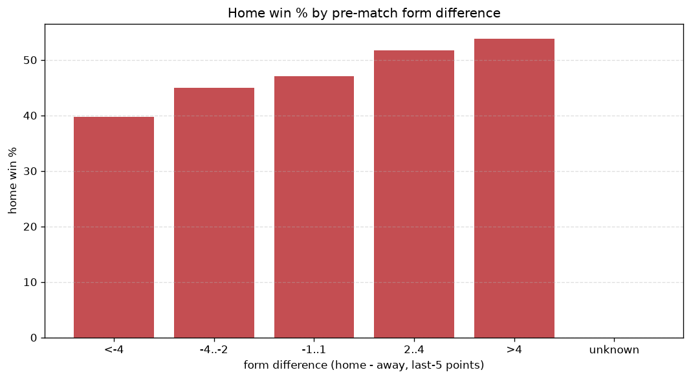
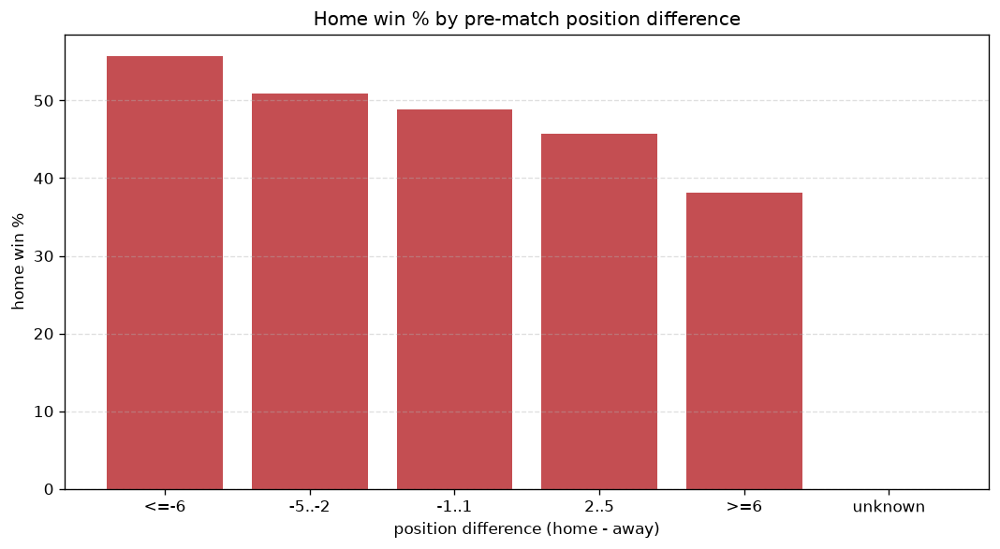

# Relationships Analysis
- Report: `relationships`
- Generated: 2026-10-27T01:41:52+00:00
- Script: `backend/scripts/analyze_relationships.py` v1.0.0
- League: Serie B (Brazil)
- Scope: league `brazil2`

- Matches analysed: **2273** (23 leakage-safe pre-match features).

## 1. Correlation matrix
_Pearson correlation of each pre-match feature with observed goals; sorted by |corr(total goals)|._

| feature | corr(home) | corr(away) | corr(total) |
|---|---|---|---|
| home_points_before_match | 0.108 | 0.011 | 0.088 |
| position_difference | -0.167 | 0.067 | -0.081 |
| points_difference | 0.164 | -0.069 | 0.077 |
| away_team_away_conceded_avg | 0.083 | 0.011 | 0.069 |
| home_team_home_goals_avg | 0.093 | -0.006 | 0.065 |
| away_position_before_match | 0.096 | -0.019 | 0.059 |
| home_team_goals_scored_last_5 | 0.071 | 0.009 | 0.059 |
| home_team_wins_last_5 | 0.088 | -0.017 | 0.054 |
| home_position_before_match | -0.137 | 0.074 | -0.054 |
| away_rest_days | 0.040 | 0.037 | 0.053 |
| home_team_points_last_5 | 0.090 | -0.026 | 0.050 |
| away_team_away_win_rate | -0.070 | 0.003 | -0.050 |
| rest_days_difference | -0.058 | -0.003 | -0.045 |
| home_team_home_win_rate | 0.098 | -0.044 | 0.044 |
| away_team_goals_conceded_last_5 | 0.065 | -0.010 | 0.042 |
| away_points_before_match | 0.009 | 0.053 | 0.041 |
| away_team_points_last_5 | -0.046 | 0.024 | -0.018 |
| away_team_wins_last_5 | -0.041 | 0.024 | -0.015 |
| home_rest_days | -0.010 | 0.034 | 0.015 |
| home_team_goals_conceded_last_5 | -0.066 | 0.065 | -0.007 |
| away_team_goals_scored_last_5 | -0.007 | 0.015 | 0.004 |
| home_team_home_conceded_avg | -0.051 | 0.061 | 0.002 |
| away_team_away_goals_avg | -0.025 | 0.028 | -0.001 |

## 2. Form vs outcome
_Home win/draw/away % per bucket of `home_team_points_last_5 - away_team_points_last_5`._

| bucket | matches | home | draw | away | home % | draw % | away % |
|---|---|---|---|---|---|---|---|
| <-4 | 315 | 125 | 94 | 96 | 39.7% | 29.8% | 30.5% |
| -4..-2 | 544 | 245 | 178 | 121 | 45.0% | 32.7% | 22.2% |
| -1..1 | 719 | 339 | 193 | 187 | 47.1% | 26.8% | 26.0% |
| 2..4 | 470 | 243 | 135 | 92 | 51.7% | 28.7% | 19.6% |
| >4 | 225 | 121 | 64 | 40 | 53.8% | 28.4% | 17.8% |
| unknown | 0 | 0 | 0 | 0 | - | - | - |

## 3. Position vs outcome
_Home win/draw/away % per bucket of `position_difference` (home position - away position; negative favours the home team)._

| bucket | matches | home | draw | away | home % | draw % | away % |
|---|---|---|---|---|---|---|---|
| <=-6 | 531 | 296 | 141 | 94 | 55.7% | 26.6% | 17.7% |
| -5..-2 | 379 | 193 | 120 | 66 | 50.9% | 31.7% | 17.4% |
| -1..1 | 324 | 158 | 93 | 73 | 48.8% | 28.7% | 22.5% |
| 2..5 | 398 | 182 | 118 | 98 | 45.7% | 29.6% | 24.6% |
| >=6 | 641 | 244 | 192 | 205 | 38.1% | 30.0% | 32.0% |
| unknown | 0 | 0 | 0 | 0 | - | - | - |

## 4. Rest advantage
_Home win/draw/away % per bucket of `rest_days_difference` (home rest - away rest). Matches with unknown rest are bucketed separately._

| bucket | matches | home | draw | away | home % | draw % | away % |
|---|---|---|---|---|---|---|---|
| <-1 | 377 | 188 | 92 | 97 | 49.9% | 24.4% | 25.7% |
| -1..0 | 411 | 198 | 125 | 88 | 48.2% | 30.4% | 21.4% |
| 0 | 696 | 331 | 206 | 159 | 47.6% | 29.6% | 22.8% |
| 1..2 | 545 | 245 | 160 | 140 | 45.0% | 29.4% | 25.7% |
| >2 | 181 | 77 | 59 | 45 | 42.5% | 32.6% | 24.9% |
| unknown | 63 | 34 | 22 | 7 | 54.0% | 34.9% | 11.1% |
- *63 match(es) had unknown rest difference (missing rest data on at least one side).*

## 5. Home team quality
_Home win rate by `home_team_home_win_rate` tier (split at 0.5)._

- `< 0.5` tier: **43.8%** home win (523/1194)
- `>= 0.5` tier: **51.0%** home win (550/1079)
- Home-win gap (>= split minus < split): **+7.2 pp**

| tier | label | matches | home | draw | away | home % |
|---|---|---|---|---|---|---|
| low | < 0.5 | 1194 | 523 | 359 | 312 | 43.8% |
| high | >= 0.5 | 1079 | 550 | 305 | 224 | 51.0% |

## 6. Feature averages by result
_Mean feature value per outcome; `range` is home-minus-away spread of the group means._

| feature | home mean | draw mean | away mean | range |
|---|---|---|---|---|
| points_difference | 1.012 | -0.684 | -2.752 | 3.764 |
| position_difference | -0.658 | 0.852 | 2.409 | 3.067 |
| home_points_before_match | 25.777 | 23.943 | 23.595 | 2.182 |
| home_position_before_match | 10.352 | 11.245 | 12.358 | 2.006 |
| away_points_before_match | 24.765 | 24.627 | 26.347 | 1.721 |
| away_position_before_match | 11.010 | 10.393 | 9.950 | 1.061 |
| home_team_goals_conceded_last_5 | 4.791 | 5.009 | 5.308 | 0.517 |
| home_team_points_last_5 | 6.244 | 5.950 | 5.733 | 0.511 |
| away_team_goals_conceded_last_5 | 4.938 | 4.569 | 4.724 | 0.368 |
| away_team_points_last_5 | 6.292 | 6.492 | 6.567 | 0.275 |
| home_team_goals_scored_last_5 | 4.898 | 4.646 | 4.627 | 0.272 |
| home_rest_days | 5.473 | 5.527 | 5.675 | 0.202 |
| home_team_wins_last_5 | 1.617 | 1.536 | 1.461 | 0.156 |
| away_rest_days | 5.636 | 5.551 | 5.707 | 0.156 |
| rest_days_difference | -0.164 | -0.023 | -0.032 | 0.140 |
| home_team_home_goals_avg | 1.215 | 1.154 | 1.128 | 0.086 |
| away_team_goals_scored_last_5 | 5.020 | 4.938 | 5.019 | 0.081 |
| away_team_wins_last_5 | 1.652 | 1.715 | 1.728 | 0.075 |
| home_team_home_conceded_avg | 0.763 | 0.788 | 0.833 | 0.070 |
| away_team_away_conceded_avg | 1.207 | 1.145 | 1.151 | 0.062 |
| home_team_home_win_rate | 0.468 | 0.439 | 0.417 | 0.050 |
| away_team_away_goals_avg | 0.777 | 0.785 | 0.819 | 0.042 |
| away_team_away_win_rate | 0.208 | 0.220 | 0.230 | 0.022 |

---
*All features are leakage-safe pre-match values built by `ml.features.build_features.build_rows` from strictly prior matches. Run with `python backend/scripts/analyze_relationships.py` to regenerate.*

## Charts

