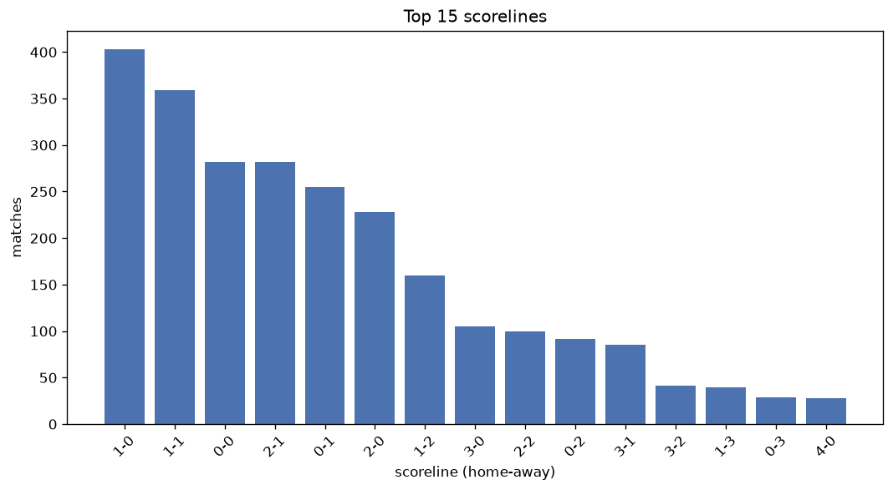
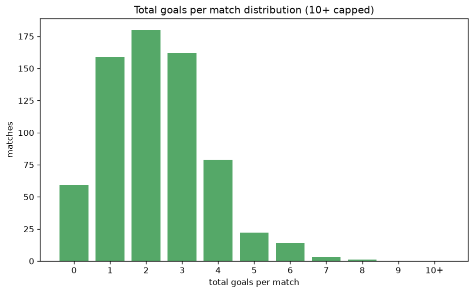

# Scoreline Analysis
- Report: `scoreline_analysis`
- Generated: 2026-10-27T01:41:50+00:00
- Script: `backend/scripts/analyze_scorelines.py` v1.0.0
- League: Serie B (Brazil)
- Scope: league `brazil2`

## 1. Scoreline frequency
- Matches analysed: **2620** across **7** seasons.
- Distinct scorelines seen: **34**.

| scoreline | count | pct |
|---|---|---|
| 1-0 | 403 | 15.4% |
| 1-1 | 359 | 13.7% |
| 0-0 | 282 | 10.8% |
| 2-1 | 282 | 10.8% |
| 0-1 | 255 | 9.7% |
| 2-0 | 228 | 8.7% |
| 1-2 | 160 | 6.1% |
| 3-0 | 105 | 4.0% |
| 2-2 | 100 | 3.8% |
| 0-2 | 92 | 3.5% |
| 3-1 | 85 | 3.2% |
| 3-2 | 41 | 1.6% |
| 1-3 | 40 | 1.5% |
| 0-3 | 29 | 1.1% |
| 4-0 | 28 | 1.1% |
| 2-3 | 25 | 1.0% |
| 4-1 | 24 | 0.9% |
| 3-3 | 17 | 0.6% |
| 4-2 | 14 | 0.5% |
| 1-4 | 13 | 0.5% |

## 2. Scoreline frequency per season

### 2020
| scoreline | count | pct |
|---|---|---|
| 1-0 | 55 | 14.5% |
| 0-1 | 49 | 12.9% |
| 1-1 | 48 | 12.6% |
| 2-1 | 47 | 12.4% |
| 0-0 | 43 | 11.3% |

### 2021
| scoreline | count | pct |
|---|---|---|
| 1-0 | 54 | 14.2% |
| 1-1 | 49 | 12.9% |
| 0-0 | 47 | 12.4% |
| 0-1 | 39 | 10.3% |
| 2-1 | 38 | 10.0% |

### 2022
| scoreline | count | pct |
|---|---|---|
| 1-1 | 66 | 17.4% |
| 1-0 | 61 | 16.1% |
| 0-0 | 49 | 12.9% |
| 2-0 | 44 | 11.6% |
| 2-1 | 41 | 10.8% |

### 2023
| scoreline | count | pct |
|---|---|---|
| 1-0 | 60 | 15.8% |
| 1-1 | 49 | 12.9% |
| 0-0 | 44 | 11.6% |
| 0-1 | 37 | 9.7% |
| 2-0 | 36 | 9.5% |

### 2024
| scoreline | count | pct |
|---|---|---|
| 1-0 | 69 | 18.5% |
| 1-1 | 47 | 12.6% |
| 2-1 | 41 | 11.0% |
| 0-0 | 37 | 9.9% |
| 0-1 | 36 | 9.7% |

### 2025
| scoreline | count | pct |
|---|---|---|
| 1-0 | 60 | 15.8% |
| 1-1 | 57 | 15.0% |
| 2-1 | 44 | 11.6% |
| 2-0 | 37 | 9.7% |
| 0-0 | 33 | 8.7% |

### 2026
| scoreline | count | pct |
|---|---|---|
| 1-0 | 44 | 12.7% |
| 1-1 | 43 | 12.4% |
| 2-1 | 42 | 12.1% |
| 0-1 | 36 | 10.4% |
| 0-0 | 29 | 8.4% |

## 3. Total-goal histogram
_10+ groups all matches with 10 or more total goals._

| total goals | matches | pct |
|---|---|---|
| 0 | 282 | 10.8% |
| 1 | 658 | 25.1% |
| 2 | 679 | 25.9% |
| 3 | 576 | 22.0% |
| 4 | 261 | 10.0% |
| 5 | 109 | 4.2% |
| 6 | 42 | 1.6% |
| 7 | 10 | 0.4% |
| 8 | 2 | 0.1% |
| 9 | 1 | 0.0% |
| 10+ | 0 | 0.0% |

## 4. Extreme scorelines
- Matches with 7+ total goals: **13**

| season | date | scoreline | total goals |
|---|---|---|---|
| 2020 | 2021-01-29 | 2-7 | 9 |
| 2024 | 2024-06-15 | 3-5 | 8 |
| 2026 | 2026-05-16 | 2-6 | 8 |
| 2020 | 2020-09-20 | 2-5 | 7 |
| 2020 | 2021-01-19 | 5-2 | 7 |
| 2021 | 2021-06-02 | 2-5 | 7 |
| 2021 | 2021-06-06 | 3-4 | 7 |
| 2021 | 2021-11-02 | 4-3 | 7 |
| 2022 | 2022-10-05 | 4-3 | 7 |
| 2024 | 2024-11-17 | 3-4 | 7 |
| 2025 | 2025-07-19 | 2-5 | 7 |
| 2026 | 2026-06-20 | 4-3 | 7 |
| 2026 | 2026-07-26 | 3-4 | 7 |

## 5. Margin-of-victory distribution (decided matches)
- Decided matches: **1862** (draws: **758**)
- Average winning margin: **1.53**

| margin | matches | pct |
|---|---|---|
| 1 | 1172 | 62.9% |
| 2 | 462 | 24.8% |
| 3+ | 228 | 12.2% |

## 6. Margin by outcome

### Home wins
- Matches: **1227** | avg margin: **1.59** | max margin: **6**
| margin | matches | pct |
|---|---|---|
| 1 | 729 | 59.4% |
| 2 | 327 | 26.7% |
| 3+ | 171 | 13.9% |
- *Full match-by-match list available in `scoreline_analysis.json`.*

### Away wins
- Matches: **635** | avg margin: **1.41** | max margin: **5**
| margin | matches | pct |
|---|---|---|
| 1 | 443 | 69.8% |
| 2 | 135 | 21.3% |
| 3+ | 57 | 9.0% |
- *Full match-by-match list available in `scoreline_analysis.json`.*

## 7. Most common exact score by outcome type
| outcome | matches | most common score | count | pct |
|---|---|---|---|---|
| home | 1227 | 1-0 | 403 | 32.8% |
| draw | 758 | 1-1 | 359 | 47.4% |
| away | 635 | 0-1 | 255 | 40.2% |

---
*All statistics are computed from PostgreSQL tables (read-only). Run with `python backend/scripts/analyze_scorelines.py` to regenerate.*

## Charts

