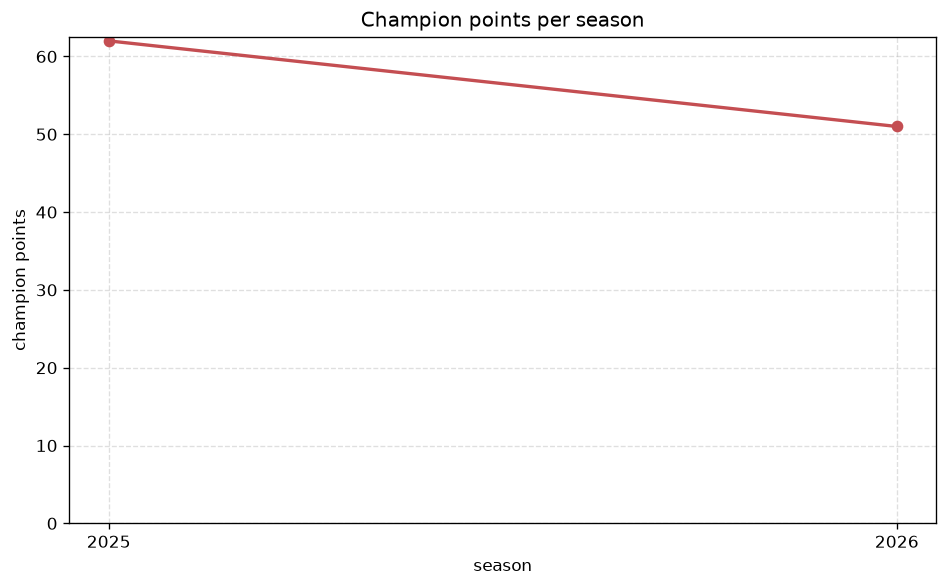
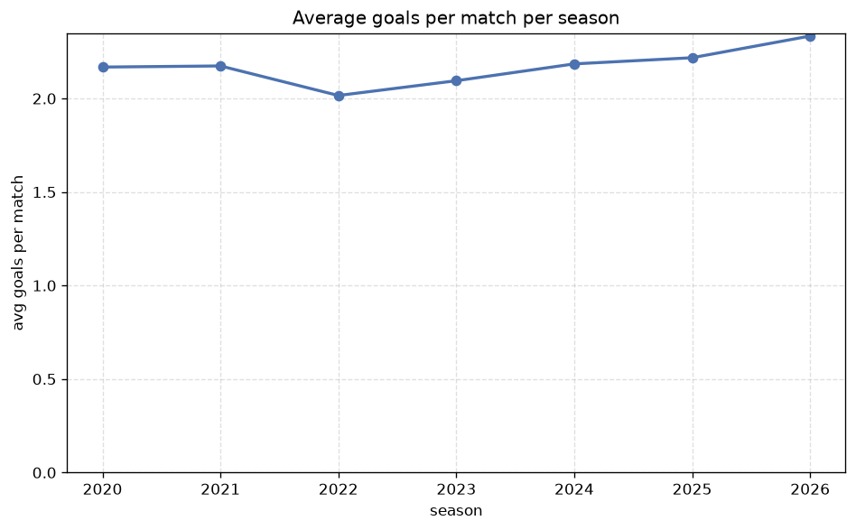

# Season Trends Analysis
- Report: `season_trends`
- Generated: 2026-10-30T03:46:05+00:00
- Script: `backend/scripts/analyze_seasons.py` v1.0.0
- League: Serie B (Brazil)
- Scope: league `brazil2`

## 1. Champions per season
| season | champion | pts | runner-up | margin |
|---|---|---|---|---|
| 2020 | America MG | 69 | Juventude | 8 pts |
| 2021 | Botafogo RJ | 70 | Goias | 6 pts |
| 2022 | Cruzeiro | 72 | Gremio | 11 pts |
| 2023 | Vitoria | 72 | Criciuma | 9 pts |
| 2024 | Santos | 68 | Sport Recife | 3 pts |
| 2025 | Coritiba | 62 | Criciuma | 1 pts |
| 2026 | Novorizontino | 64 | Juventude | 0 pts |

## 2. Title-race tightness
- Tight races (margin <= 3 pts): **3** of 7 seasons
- Tightest race: **2026** - Novorizontino beat Juventude by **0** pts

| season | margin | tight |
|---|---|---|
| 2020 | 8 pts |  |
| 2021 | 6 pts |  |
| 2022 | 11 pts |  |
| 2023 | 9 pts |  |
| 2024 | 3 pts | yes |
| 2025 | 1 pts | yes |
| 2026 | 0 pts | yes |

## 3. Points thresholds
_Position-specific points per season. Key: 1 = champion, 2 = runner-up, 4 = CL line, 6 = Europa, 17 = last safe, 20 = bottom._

| season | pos 1 | pos 2 | pos 4 | pos 6 | pos 17 | pos 20 |
|---|---|---|---|---|---|---|
| 2020 | 69 | 61 | 57 | 56 | 37 | 33 |
| 2021 | 70 | 64 | 64 | 59 | 37 | 23 |
| 2022 | 72 | 61 | 58 | 56 | 33 | - |
| 2023 | 72 | 63 | 62 | 61 | 34 | - |
| 2024 | 68 | 65 | 60 | 57 | 34 | - |
| 2025 | 62 | 61 | 58 | 52 | 34 | - |
| 2026 | 64 | 64 | 61 | 55 | 37 | 15 |

## 4. Relegation battle
| season | safe pos | safe pts | drop pos | drop pts | gap |
|---|---|---|---|---|---|
| 2020 | 17 | 37 | 18 | 34 | 3 pts |
| 2021 | 17 | 37 | 18 | 36 | 1 pts |
| 2022 | 17 | 33 | 18 | 30 | 3 pts |
| 2023 | 17 | 34 | 18 | 31 | 3 pts |
| 2024 | 17 | 34 | 18 | - | - |
| 2025 | 17 | 34 | 18 | - | - |
| 2026 | 17 | 37 | 18 | 32 | 5 pts |

## 5. League-level trends
| season | matches | total goals | avg goals | home win | draw | away win | goalless | avg pts/team |
|---|---|---|---|---|---|---|---|---|
| 2020 | 380 | 824 | 2.168 | 46.1% | 28.2% | 25.8% | 11.3% | 46.85 |
| 2021 | 380 | 826 | 2.174 | 43.4% | 30.3% | 26.3% | 12.4% | 48.6 |
| 2022 | 380 | 766 | 2.016 | 49.7% | 31.8% | 18.4% | 12.9% | 46.1 |
| 2023 | 380 | 796 | 2.095 | 46.1% | 29.2% | 24.7% | 11.6% | 48.95 |
| 2024 | 373 | 815 | 2.185 | 52.3% | 25.2% | 22.5% | 9.9% | 46.8 |
| 2025 | 380 | 843 | 2.218 | 45.8% | 30.5% | 23.7% | 8.7% | 44.15 |
| 2026 | 350 | 817 | 2.334 | 44.6% | 26.9% | 28.6% | 8.3% | 47.8 |

## 6. View divergence
- Largest divergence: **2025** (luck view, avg abs position diff = 23.100)

_Avg absolute position difference between classic view and alternative view per season._

| season | classic vs luck | classic vs goals |
|---|---|---|
| 2020 | 20.450 | 13.350 |
| 2021 | 11.350 | 10.950 |
| 2022 | 20.650 | 19.500 |
| 2023 | 12.050 | 10.200 |
| 2024 | 19.700 | 16.450 |
| 2025 | 23.100 | 18.550 |
| 2026 | 1.500 | 7.300 |

---
*All statistics are computed from PostgreSQL tables (read-only). Run with `python backend/scripts/analyze_seasons.py` to regenerate.*

## Charts

