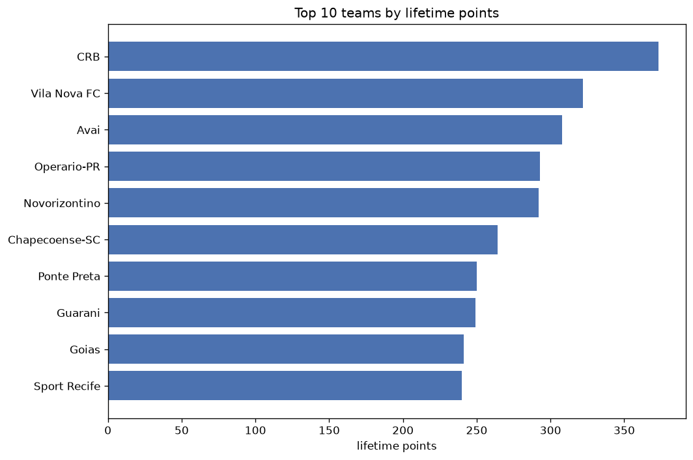
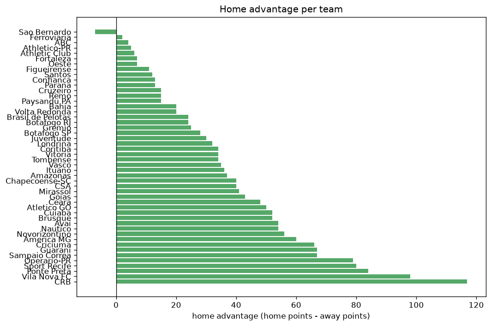

# Team Analysis
- Report: `teams_analysis`
- Generated: 2026-10-29T01:54:52+00:00
- Script: `backend/scripts/analyze_teams.py` v1.0.0
- League: Serie B (Brazil)
- Scope: league `brazil2`

- Teams: **48** | Seasons: **7** | Matches: **2623**

## 1. Team standings (lifetime)
| team | seasons | played | W | D | L | pts | GF | GA | GD | avg pts/season | best pos | worst pos | titles |
|---|---|---|---|---|---|---|---|---|---|---|---|---|---|
| CRB | 7 | 262 | 103 | 64 | 95 | 373 | 311 | 300 | 11 | 53.29 | 5 | 13 | 0 |
| Vila Nova FC | 6 | 224 | 83 | 73 | 68 | 322 | 242 | 229 | 13 | 53.67 | 3 | 14 | 0 |
| Avai | 6 | 224 | 82 | 62 | 80 | 308 | 236 | 248 | -12 | 51.33 | 4 | 17 | 0 |
| Operario-PR | 6 | 224 | 76 | 65 | 83 | 293 | 223 | 255 | -32 | 48.83 | 10 | 23 | 0 |
| Novorizontino | 5 | 186 | 80 | 52 | 54 | 292 | 238 | 171 | 67 | 58.4 | 1 | 16 | 1 |
| Chapecoense-SC | 5 | 189 | 69 | 57 | 63 | 264 | 203 | 182 | 21 | 52.8 | 18 | 22 | 0 |
| Ponte Preta | 6 | 225 | 62 | 64 | 99 | 250 | 209 | 291 | -82 | 41.67 | 5 | 20 | 0 |
| Guarani | 5 | 189 | 65 | 54 | 70 | 249 | 202 | 208 | -6 | 49.8 | 7 | 19 | 0 |
| Goias | 4 | 148 | 67 | 40 | 41 | 241 | 181 | 138 | 43 | 60.25 | 2 | 9 | 0 |
| Sport Recife | 4 | 149 | 65 | 45 | 39 | 240 | 200 | 146 | 54 | 60.0 | 2 | 8 | 0 |
| Criciuma | 4 | 149 | 67 | 39 | 43 | 240 | 171 | 127 | 44 | 60.0 | 2 | 7 | 0 |
| Botafogo SP | 5 | 186 | 54 | 52 | 80 | 214 | 158 | 221 | -63 | 42.8 | 12 | 20 | 0 |
| Sampaio Correa | 4 | 152 | 53 | 42 | 57 | 201 | 170 | 165 | 5 | 50.25 | 5 | 16 | 0 |
| America MG | 4 | 149 | 53 | 41 | 55 | 200 | 157 | 156 | 1 | 50.0 | 1 | 19 | 1 |
| Juventude | 3 | 111 | 53 | 31 | 27 | 190 | 139 | 96 | 43 | 63.33 | 2 | 5 | 0 |
| Coritiba | 3 | 114 | 51 | 29 | 34 | 182 | 129 | 102 | 27 | 60.67 | 1 | 9 | 1 |
| Cruzeiro | 3 | 114 | 47 | 40 | 27 | 181 | 138 | 102 | 36 | 60.33 | 1 | 10 | 1 |
| Atletico GO | 3 | 111 | 44 | 38 | 29 | 170 | 137 | 116 | 21 | 56.67 | 6 | 9 | 0 |
| Nautico | 4 | 149 | 43 | 41 | 65 | 170 | 156 | 203 | -47 | 42.5 | 8 | 18 | 0 |
| CSA | 3 | 114 | 43 | 33 | 38 | 162 | 127 | 107 | 20 | 54.0 | 4 | 15 | 0 |
| Cuiaba | 3 | 111 | 42 | 36 | 33 | 162 | 123 | 112 | 11 | 54.0 | 3 | 12 | 0 |
| Vitoria | 3 | 114 | 41 | 37 | 36 | 160 | 126 | 108 | 18 | 53.33 | 1 | 17 | 1 |
| Londrina | 4 | 149 | 40 | 40 | 69 | 160 | 142 | 187 | -45 | 40.0 | 9 | 18 | 0 |
| Ceara | 3 | 110 | 42 | 28 | 40 | 154 | 133 | 129 | 4 | 51.33 | 5 | 16 | 0 |
| Ituano | 3 | 113 | 35 | 31 | 47 | 136 | 118 | 134 | -16 | 45.33 | 6 | 16 | 0 |
| Mirassol | 2 | 75 | 36 | 19 | 20 | 127 | 83 | 57 | 26 | 63.5 | 3 | 7 | 0 |
| Brusque | 3 | 114 | 29 | 31 | 54 | 118 | 89 | 138 | -49 | 39.33 | 13 | 17 | 0 |
| Vasco | 2 | 76 | 30 | 21 | 25 | 111 | 91 | 88 | 3 | 55.5 | 4 | 9 | 0 |
| Remo | 2 | 76 | 27 | 24 | 25 | 105 | 82 | 81 | 1 | 52.5 | 4 | 16 | 0 |
| Athletic Club | 2 | 73 | 22 | 22 | 29 | 88 | 83 | 93 | -10 | 44.0 | 12 | 14 | 0 |
| Amazonas | 2 | 75 | 21 | 22 | 32 | 85 | 68 | 92 | -24 | 42.5 | 11 | 15 | 0 |
| Confianca | 2 | 76 | 21 | 20 | 35 | 83 | 73 | 94 | -21 | 41.5 | 13 | 18 | 0 |
| Tombense | 2 | 76 | 19 | 25 | 32 | 82 | 75 | 97 | -22 | 41.0 | 12 | 17 | 0 |
| Paysandu PA | 2 | 75 | 17 | 26 | 32 | 77 | 75 | 93 | -18 | 38.5 | 12 | 22 | 0 |
| Brasil de Pelotas | 2 | 76 | 15 | 27 | 34 | 72 | 54 | 85 | -31 | 36.0 | 10 | 20 | 0 |
| Botafogo RJ | 1 | 38 | 20 | 10 | 8 | 70 | 56 | 31 | 25 | 70.0 | 1 | 1 | 1 |
| Santos | 1 | 38 | 20 | 8 | 10 | 68 | 57 | 32 | 25 | 68.0 | 1 | 1 | 1 |
| Gremio | 1 | 38 | 17 | 14 | 7 | 65 | 50 | 26 | 24 | 65.0 | 2 | 2 | 0 |
| Athletico-PR | 1 | 38 | 19 | 8 | 11 | 65 | 53 | 43 | 10 | 65.0 | 17 | 17 | 0 |
| Bahia | 1 | 38 | 17 | 11 | 10 | 62 | 43 | 29 | 14 | 62.0 | 3 | 3 | 0 |
| Fortaleza | 1 | 35 | 16 | 13 | 6 | 61 | 43 | 31 | 12 | 61.0 | 4 | 4 | 0 |
| Sao Bernardo | 1 | 35 | 13 | 10 | 12 | 49 | 49 | 39 | 10 | 49.0 | 11 | 11 | 0 |
| Ferroviaria | 1 | 38 | 8 | 16 | 14 | 40 | 43 | 52 | -9 | 40.0 | 13 | 13 | 0 |
| Figueirense | 1 | 38 | 9 | 12 | 17 | 39 | 35 | 49 | -14 | 39.0 | 16 | 16 | 0 |
| Parana | 1 | 38 | 9 | 10 | 19 | 37 | 34 | 50 | -16 | 37.0 | 17 | 17 | 0 |
| Volta Redonda | 1 | 38 | 8 | 12 | 18 | 36 | 26 | 43 | -17 | 36.0 | 16 | 16 | 0 |
| Oeste | 1 | 38 | 7 | 8 | 23 | 29 | 28 | 60 | -32 | 29.0 | 21 | 21 | 0 |
| ABC | 1 | 38 | 5 | 13 | 20 | 28 | 28 | 51 | -23 | 28.0 | 19 | 19 | 0 |

## 2. Home vs away split
| team | home P | H-W | H-D | H-L | H-pts | away P | A-W | A-D | A-L | A-pts | adv |
|---|---|---|---|---|---|---|---|---|---|---|---|
| CRB | 132 | 69 | 38 | 25 | 245 | 130 | 34 | 26 | 70 | 128 | 117 |
| Vila Nova FC | 111 | 56 | 42 | 13 | 210 | 113 | 27 | 31 | 55 | 112 | 98 |
| Ponte Preta | 113 | 44 | 35 | 34 | 167 | 112 | 18 | 29 | 65 | 83 | 84 |
| Sport Recife | 75 | 47 | 19 | 9 | 160 | 74 | 18 | 26 | 30 | 80 | 80 |
| Operario-PR | 112 | 51 | 33 | 28 | 186 | 112 | 25 | 32 | 55 | 107 | 79 |
| Guarani | 95 | 44 | 26 | 25 | 158 | 94 | 21 | 28 | 45 | 91 | 67 |
| Sampaio Correa | 76 | 39 | 17 | 20 | 134 | 76 | 14 | 25 | 37 | 67 | 67 |
| Criciuma | 74 | 47 | 12 | 15 | 153 | 75 | 20 | 27 | 28 | 87 | 66 |
| America MG | 75 | 36 | 22 | 17 | 130 | 74 | 17 | 19 | 38 | 70 | 60 |
| Novorizontino | 92 | 49 | 27 | 16 | 174 | 94 | 31 | 25 | 38 | 118 | 56 |
| Avai | 112 | 50 | 31 | 31 | 181 | 112 | 32 | 31 | 49 | 127 | 54 |
| Nautico | 74 | 30 | 22 | 22 | 112 | 75 | 13 | 19 | 43 | 58 | 54 |
| Cuiaba | 55 | 31 | 14 | 10 | 107 | 56 | 11 | 22 | 23 | 55 | 52 |
| Brusque | 57 | 23 | 16 | 18 | 85 | 57 | 6 | 15 | 36 | 33 | 52 |
| Atletico GO | 56 | 31 | 17 | 8 | 110 | 55 | 13 | 21 | 21 | 60 | 50 |
| Ceara | 55 | 30 | 11 | 14 | 101 | 55 | 12 | 17 | 26 | 53 | 48 |
| Goias | 74 | 42 | 16 | 16 | 142 | 74 | 25 | 24 | 25 | 99 | 43 |
| Mirassol | 38 | 25 | 9 | 4 | 84 | 37 | 11 | 10 | 16 | 43 | 41 |
| Chapecoense-SC | 94 | 41 | 29 | 24 | 152 | 95 | 28 | 28 | 39 | 112 | 40 |
| CSA | 57 | 28 | 17 | 12 | 101 | 57 | 15 | 16 | 26 | 61 | 40 |
| Amazonas | 37 | 17 | 10 | 10 | 61 | 38 | 4 | 12 | 22 | 24 | 37 |
| Ituano | 57 | 23 | 17 | 17 | 86 | 56 | 12 | 14 | 30 | 50 | 36 |
| Vasco | 38 | 21 | 10 | 7 | 73 | 38 | 9 | 11 | 18 | 38 | 35 |
| Coritiba | 57 | 30 | 18 | 9 | 108 | 57 | 21 | 11 | 25 | 74 | 34 |
| Vitoria | 57 | 27 | 16 | 14 | 97 | 57 | 14 | 21 | 22 | 63 | 34 |
| Tombense | 38 | 14 | 16 | 8 | 58 | 38 | 5 | 9 | 24 | 24 | 34 |
| Londrina | 74 | 24 | 24 | 26 | 96 | 75 | 16 | 16 | 43 | 64 | 32 |
| Juventude | 56 | 31 | 17 | 8 | 110 | 55 | 22 | 14 | 19 | 80 | 30 |
| Botafogo SP | 93 | 31 | 28 | 34 | 121 | 93 | 23 | 24 | 46 | 93 | 28 |
| Gremio | 19 | 14 | 3 | 2 | 45 | 19 | 3 | 11 | 5 | 20 | 25 |
| Brasil de Pelotas | 38 | 11 | 15 | 12 | 48 | 38 | 4 | 12 | 22 | 24 | 24 |
| Botafogo RJ | 19 | 15 | 2 | 2 | 47 | 19 | 5 | 8 | 6 | 23 | 24 |
| Bahia | 19 | 12 | 5 | 2 | 41 | 19 | 5 | 6 | 8 | 21 | 20 |
| Volta Redonda | 19 | 7 | 7 | 5 | 28 | 19 | 1 | 5 | 13 | 8 | 20 |
| Cruzeiro | 57 | 26 | 20 | 11 | 98 | 57 | 21 | 20 | 16 | 83 | 15 |
| Remo | 38 | 17 | 9 | 12 | 60 | 38 | 10 | 15 | 13 | 45 | 15 |
| Paysandu PA | 38 | 11 | 13 | 14 | 46 | 37 | 6 | 13 | 18 | 31 | 15 |
| Confianca | 38 | 13 | 9 | 16 | 48 | 38 | 8 | 11 | 19 | 35 | 13 |
| Parana | 19 | 6 | 7 | 6 | 25 | 19 | 3 | 3 | 13 | 12 | 13 |
| Santos | 19 | 12 | 4 | 3 | 40 | 19 | 8 | 4 | 7 | 28 | 12 |
| Figueirense | 19 | 6 | 7 | 6 | 25 | 19 | 3 | 5 | 11 | 14 | 11 |
| Fortaleza | 17 | 9 | 7 | 1 | 34 | 18 | 7 | 6 | 5 | 27 | 7 |
| Oeste | 19 | 5 | 3 | 11 | 18 | 19 | 2 | 5 | 12 | 11 | 7 |
| Athletic Club | 36 | 12 | 11 | 13 | 47 | 37 | 10 | 11 | 16 | 41 | 6 |
| Athletico-PR | 19 | 10 | 5 | 4 | 35 | 19 | 9 | 3 | 7 | 30 | 5 |
| ABC | 19 | 3 | 7 | 9 | 16 | 19 | 2 | 6 | 11 | 12 | 4 |
| Ferroviaria | 19 | 4 | 9 | 6 | 21 | 19 | 4 | 7 | 8 | 19 | 2 |
| Sao Bernardo | 18 | 5 | 6 | 7 | 21 | 17 | 8 | 4 | 5 | 28 | -7 |

## 3. Top performers
### Best points per game (PPG)
| rank | team | PPG |
|---|---|---|
| 1 | Botafogo RJ | 1.84 |
| 2 | Santos | 1.79 |
| 3 | Fortaleza | 1.74 |
| 4 | Juventude | 1.71 |
| 5 | Gremio | 1.71 |

### Most goals scored
| rank | team | goals |
|---|---|---|
| 1 | CRB | 311 |
| 2 | Vila Nova FC | 242 |
| 3 | Novorizontino | 238 |
| 4 | Avai | 236 |
| 5 | Operario-PR | 223 |

### Best goal difference
| rank | team | GD |
|---|---|---|
| 1 | Novorizontino | 67 |
| 2 | Sport Recife | 54 |
| 3 | Criciuma | 44 |
| 4 | Goias | 43 |
| 5 | Juventude | 43 |

### Best defence (goals against per match, standings)
| rank | team | GA/match |
|---|---|---|
| 1 | Gremio | 0.722 |
| 2 | Bahia | 0.722 |
| 3 | Mirassol | 0.767 |
| 4 | Santos | 0.778 |
| 5 | Botafogo RJ | 0.811 |

## 4. Team consistency
- Teams present in all **7** seasons: **1**

CRB

## 5. Head-to-head dominance
- Distinct fixtures: **754** (showing the 15 most frequent)

| fixture | meetings | home wins | draws | away wins | home pct | draw pct | away pct |
|---|---|---|---|---|---|---|---|
| Ponte Preta vs CRB | 12 | 9 | 2 | 1 | 75.0% | 16.7% | 8.3% |
| CRB vs Vila Nova FC | 12 | 8 | 2 | 2 | 66.7% | 16.7% | 16.7% |
| Avai vs CRB | 12 | 5 | 2 | 5 | 41.7% | 16.7% | 41.7% |
| CRB vs Operario-PR | 11 | 6 | 4 | 1 | 54.5% | 36.4% | 9.1% |
| CRB vs Guarani | 10 | 7 | 2 | 1 | 70.0% | 20.0% | 10.0% |
| Chapecoense-SC vs CRB | 10 | 7 | 1 | 2 | 70.0% | 10.0% | 20.0% |
| Avai vs Operario-PR | 10 | 6 | 3 | 1 | 60.0% | 30.0% | 10.0% |
| CRB vs Novorizontino | 10 | 6 | 2 | 2 | 60.0% | 20.0% | 20.0% |
| CRB vs Botafogo SP | 10 | 5 | 2 | 3 | 50.0% | 20.0% | 30.0% |
| Vila Nova FC vs Novorizontino | 10 | 5 | 4 | 1 | 50.0% | 40.0% | 10.0% |
| Avai vs Vila Nova FC | 10 | 4 | 5 | 1 | 40.0% | 50.0% | 10.0% |
| Ponte Preta vs Guarani | 10 | 4 | 5 | 1 | 40.0% | 50.0% | 10.0% |
| Ponte Preta vs Vila Nova FC | 10 | 4 | 5 | 1 | 40.0% | 50.0% | 10.0% |
| Operario-PR vs Vila Nova FC | 10 | 3 | 5 | 2 | 30.0% | 50.0% | 20.0% |
| Avai vs Ponte Preta | 10 | 2 | 2 | 6 | 20.0% | 20.0% | 60.0% |

## 6. Position per season (classic view)
_Cells show final position; '-' when the team was absent from that season._

| team | 2020 | 2021 | 2022 | 2023 | 2024 | 2025 | 2026 |
|---|---|---|---|---|---|---|---|
| CRB | 8 | 5 | 13 | 9 | 13 | 5 | 6 |
| Vila Nova FC | - | 11 | 14 | 8 | 10 | 10 | 3 |
| Avai | 7 | 4 | - | 13 | 8 | 8 | 17 |
| Operario-PR | 22 | 21 | 22 | - | 21 | 23 | 10 |
| Novorizontino | - | - | 16 | 4 | 7 | 3 | 1 |
| Chapecoense-SC | 18 | - | 21 | 21 | 22 | 21 | - |
| Ponte Preta | 5 | 14 | 10 | 15 | 15 | - | 20 |
| Guarani | 12 | 7 | 11 | 10 | 19 | - | - |
| Goias | - | 2 | - | - | 4 | 6 | 9 |
| Sport Recife | - | - | 8 | 3 | 2 | - | 7 |
| Criciuma | - | - | 7 | 2 | - | 2 | 5 |
| Botafogo SP | 20 | - | - | 12 | 14 | 14 | 13 |
| Sampaio Correa | 6 | 12 | 5 | 16 | - | - | - |
| America MG | 1 | - | - | - | 6 | 11 | 19 |
| Juventude | 2 | - | - | 5 | - | - | 2 |
| Coritiba | - | 3 | - | - | 9 | 1 | - |
| Cruzeiro | 9 | 10 | 1 | - | - | - | - |
| Atletico GO | - | - | - | 6 | - | 9 | 8 |
| Nautico | 14 | 8 | 18 | - | - | - | 15 |
| CSA | 4 | 6 | 15 | - | - | - | - |
| Cuiaba | 3 | - | - | - | - | 7 | 12 |
| Vitoria | 11 | 17 | - | 1 | - | - | - |
| Londrina | - | 15 | 9 | 18 | - | - | 18 |
| Ceara | - | - | - | 11 | 5 | - | 16 |
| Ituano | - | - | 6 | 14 | 16 | - | - |
| Mirassol | - | - | - | 7 | 3 | - | - |
| Brusque | - | 13 | 17 | - | 17 | - | - |
| Vasco | - | 9 | 4 | - | - | - | - |
| Remo | - | 16 | - | - | - | 4 | - |
| Athletic Club | - | - | - | - | - | 12 | 14 |
| Amazonas | - | - | - | - | 11 | 15 | - |
| Confianca | 13 | 18 | - | - | - | - | - |
| Tombense | - | - | 12 | 17 | - | - | - |
| Paysandu PA | - | - | - | - | 12 | 22 | - |
| Brasil de Pelotas | 10 | 20 | - | - | - | - | - |
| Botafogo RJ | - | 1 | - | - | - | - | - |
| Santos | - | - | - | - | 1 | - | - |
| Gremio | - | - | 2 | - | - | - | - |
| Athletico-PR | - | - | - | - | - | 17 | - |
| Bahia | - | - | 3 | - | - | - | - |
| Fortaleza | - | - | - | - | - | - | 4 |
| Sao Bernardo | - | - | - | - | - | - | 11 |
| Ferroviaria | - | - | - | - | - | 13 | - |
| Figueirense | 16 | - | - | - | - | - | - |
| Parana | 17 | - | - | - | - | - | - |
| Volta Redonda | - | - | - | - | - | 16 | - |
| Oeste | 21 | - | - | - | - | - | - |
| ABC | - | - | - | 19 | - | - | - |

---
*All statistics are computed from PostgreSQL tables (read-only). Run with `python backend/scripts/analyze_teams.py` to regenerate.*

## Charts

