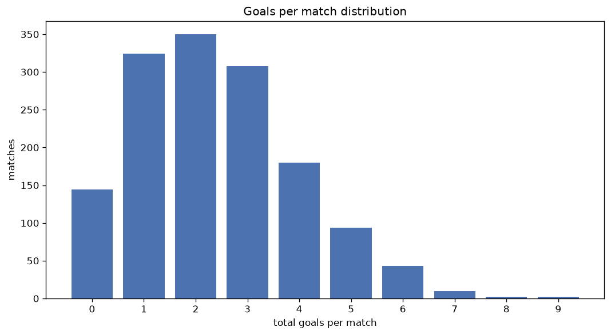
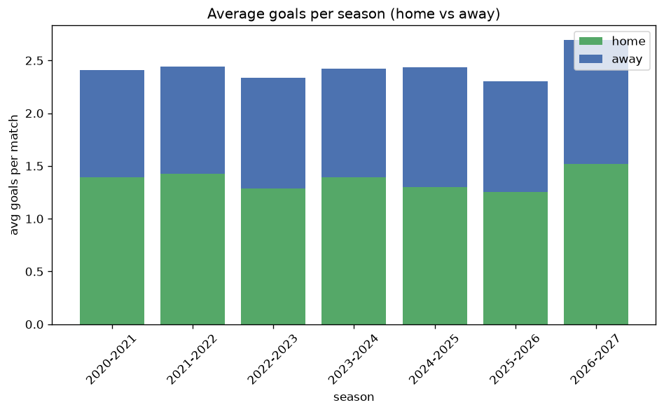

# Goal Analysis
- Report: `goals_analysis`
- Generated: 2026-10-26T01:27:54+00:00
- Script: `backend/scripts/analyze_goals.py` v1.0.0
- League: efbet League (Bulgaria)
- Scope: league `bulgaria1`

## 1. Goals per match distribution
| goals | matches | pct |
|---|---|---|
| 0 | 144 | 9.9% |
| 1 | 324 | 22.2% |
| 2 | 350 | 24.0% |
| 3 | 308 | 21.1% |
| 4 | 180 | 12.4% |
| 5 | 94 | 6.5% |
| 6 | 43 | 3.0% |
| 7 | 10 | 0.7% |
| 8 | 2 | 0.1% |
| 9 | 2 | 0.1% |

## 2. Goals per match per season
| season | matches | total goals | avg home | avg away | avg total |
|---|---|---|---|---|---|
| 2020-2021 | 182 | 439 | 1.396 | 1.016 | 2.412 |
| 2021-2022 | 182 | 445 | 1.429 | 1.016 | 2.445 |
| 2022-2023 | 240 | 560 | 1.288 | 1.046 | 2.333 |
| 2023-2024 | 240 | 582 | 1.396 | 1.029 | 2.425 |
| 2024-2025 | 240 | 584 | 1.3 | 1.133 | 2.433 |
| 2025-2026 | 294 | 677 | 1.255 | 1.048 | 2.303 |
| 2026-2027 | 79 | 213 | 1.519 | 1.177 | 2.696 |

## 3. Home vs away goal share
- Home goals: **1959** (56.0%)
- Away goals: **1541** (44.0%)
- Home/away ratio: **1.271**

| season | home goals | away goals | total | home pct | away pct |
|---|---|---|---|---|---|
| 2020-2021 | 254 | 185 | 439 | 57.9% | 42.1% |
| 2021-2022 | 260 | 185 | 445 | 58.4% | 41.6% |
| 2022-2023 | 309 | 251 | 560 | 55.2% | 44.8% |
| 2023-2024 | 335 | 247 | 582 | 57.6% | 42.4% |
| 2024-2025 | 312 | 272 | 584 | 53.4% | 46.6% |
| 2025-2026 | 369 | 308 | 677 | 54.5% | 45.5% |
| 2026-2027 | 120 | 93 | 213 | 56.3% | 43.7% |

## 4. BTTS (Both Teams To Score)
- Overall: **627** of `1457` (43.0%)

| season | matches | BTTS | pct |
|---|---|---|---|
| 2020-2021 | 182 | 78 | 42.9% |
| 2021-2022 | 182 | 84 | 46.2% |
| 2022-2023 | 240 | 98 | 40.8% |
| 2023-2024 | 240 | 95 | 39.6% |
| 2024-2025 | 240 | 103 | 42.9% |
| 2025-2026 | 294 | 126 | 42.9% |
| 2026-2027 | 79 | 43 | 54.4% |

## 5. Clean sheets
- Home clean sheets: **570** (39.1%)
- Away clean sheets: **404** (27.7%)
- Total clean sheets recorded: **974**
- Matches with at least one clean sheet: **830** (57.0%)
- Both teams kept clean sheets (0-0): **144**

| season | matches | home CS | away CS | total CS | matches w/ CS |
|---|---|---|---|---|---|
| 2020-2021 | 182 | 75 | 51 | 126 | 104 (57.1%) |
| 2021-2022 | 182 | 77 | 40 | 117 | 98 (53.8%) |
| 2022-2023 | 240 | 92 | 75 | 167 | 142 (59.2%) |
| 2023-2024 | 240 | 104 | 63 | 167 | 145 (60.4%) |
| 2024-2025 | 240 | 83 | 71 | 154 | 137 (57.1%) |
| 2025-2026 | 294 | 116 | 88 | 204 | 168 (57.1%) |
| 2026-2027 | 79 | 23 | 16 | 39 | 36 (45.6%) |

## 6. Scoring intensity
- First-half goals: **1555** (44.5%)
- Second-half goals: **1941** (55.5%)
- Avg first-half goals per match: **1.068**
- Avg second-half goals per match: **1.333**
- Second-half-only scoring (HT 0-0, FT goals >= 1): **356** (24.4%)
- *1 match(es) excluded (no HT score recorded).*

| season | matches | 1st half | 2nd half | 1st half pct | 2nd half pct |
|---|---|---|---|---|---|
| 2020-2021 | 182 | 203 | 236 | 46.2% | 53.8% |
| 2021-2022 | 182 | 195 | 250 | 43.8% | 56.2% |
| 2022-2023 | 240 | 243 | 317 | 43.4% | 56.6% |
| 2023-2024 | 240 | 266 | 316 | 45.7% | 54.3% |
| 2024-2025 | 240 | 269 | 315 | 46.1% | 53.9% |
| 2025-2026 | 294 | 291 | 382 | 43.2% | 56.8% |
| 2026-2027 | 79 | 88 | 125 | 41.3% | 58.7% |

## 7. First-goal timing
- Matches with first-goal time recorded: `1312` of `1457` (90.0%)
- Goalless matches: `145`
- Min `1` | Max `108` | Mean `33.37` | Median (p50) `29.0`

| bucket | count | % of matches | % of scoring matches |
|---|---|---|---|
| 1-15 | 379 | 26.0% | 28.9% |
| 16-30 | 314 | 21.6% | 23.9% |
| 31-45 | 226 | 15.5% | 17.2% |
| 46-60 | 190 | 13.0% | 14.5% |
| 61-75 | 111 | 7.6% | 8.5% |
| 76-90 | 72 | 4.9% | 5.5% |
| 91-120 | 20 | 1.4% | 1.5% |

---
*All statistics are computed from PostgreSQL tables (read-only). Run with `python backend/scripts/analyze_goals.py` to regenerate.*

## Charts

