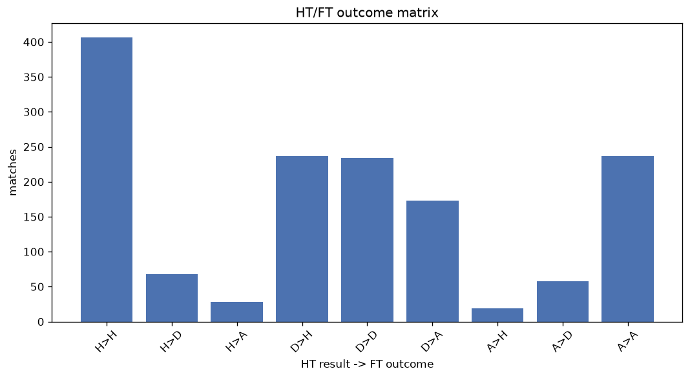
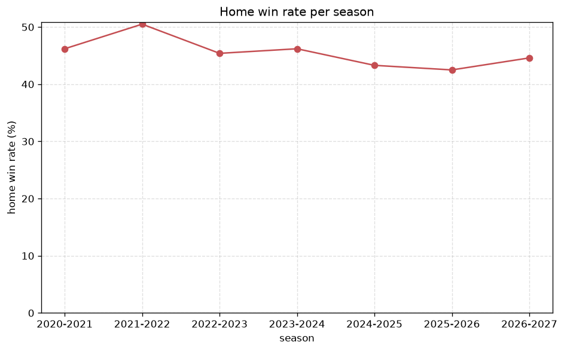

# Match Analysis
- Report: `matches_analysis`
- Generated: 2026-10-29T01:55:06+00:00
- Script: `backend/scripts/analyze_matches.py` v1.0.0
- League: efbet League (Bulgaria)
- Scope: league `bulgaria1`

## 1. Overall summary
| metric | value |
|---|---|
| Matches | 1461 |
| Home wins | 662 (45.3%) |
| Draws | 360 (24.6%) |
| Away wins | 439 (30.0%) |
| Total goals | 3506 |
| Average goals per match | 2.400 |
| Goalless matches | 145 (9.9%) |

## 2. Per-season breakdown
| season | matches | home wins | draws | away wins | total goals | avg goals | goalless |
|---|---|---|---|---|---|---|---|
| 2020-2021 | 182 | 84 (46.2%) | 50 (27.5%) | 48 (26.4%) | 439 | 2.412 | 22 (12.1%) |
| 2021-2022 | 182 | 92 (50.5%) | 46 (25.3%) | 44 (24.2%) | 445 | 2.445 | 19 (10.4%) |
| 2022-2023 | 240 | 109 (45.4%) | 55 (22.9%) | 76 (31.7%) | 560 | 2.333 | 25 (10.4%) |
| 2023-2024 | 240 | 111 (46.2%) | 51 (21.2%) | 78 (32.5%) | 582 | 2.425 | 22 (9.2%) |
| 2024-2025 | 240 | 104 (43.3%) | 55 (22.9%) | 81 (33.8%) | 584 | 2.433 | 17 (7.1%) |
| 2025-2026 | 294 | 125 (42.5%) | 82 (27.9%) | 87 (29.6%) | 677 | 2.303 | 36 (12.2%) |
| 2026-2027 | 83 | 37 (44.6%) | 21 (25.3%) | 25 (30.1%) | 219 | 2.639 | 4 (4.8%) |

## 3. HT/FT outcome matrix
| HT result \ FT result | Home | Draw | Away | total |
|---|---|---|---|---|
| HT home lead | 406 (80.9%) | 68 (13.5%) | 28 (5.6%) | 502 |
| HT draw | 237 (36.8%) | 234 (36.3%) | 173 (26.9%) | 644 |
| HT away lead | 19 (6.1%) | 58 (18.5%) | 237 (75.5%) | 314 |
- *1 match(es) excluded (no HT score recorded).*

## 4. Comeback matches
- Home comebacks (trailing at HT, won at FT): **19** (1.3%)
- Away comebacks (trailing at HT, won at FT): **28** (1.9%)

### Home comebacks
| season | home | away | HT | FT |
|---|---|---|---|---|
| 2020-2021 | Arda | Botev Plovdiv | 1-2 | 3-2 |
| 2020-2021 | Arda | Slavia Sofia | 0-1 | 2-1 |
| 2020-2021 | Slavia Sofia | Arda | 1-2 | 3-2 |
| 2021-2022 | Levski Sofia | Tsarsko Selo | 0-1 | 3-1 |
| 2021-2022 | CSKA Sofia | Arda | 0-1 | 2-1 |
| 2021-2022 | Ludogorets | Levski Sofia | 0-1 | 2-1 |
| 2022-2023 | Slavia Sofia | Lok. Sofia | 0-1 | 2-1 |
| 2022-2023 | Cherno More | Botev Vratsa | 0-1 | 2-1 |
| 2022-2023 | CSKA 1948 Sofia | Pirin Blagoevgrad | 0-1 | 2-1 |
| 2022-2023 | Arda | Botev Plovdiv | 0-1 | 2-1 |
| 2022-2023 | Ludogorets | Cherno More | 1-2 | 3-2 |
| 2024-2025 | Spartak Varna | Lok. Sofia | 1-2 | 3-2 |
| 2024-2025 | Botev Vratsa | Slavia Sofia | 0-1 | 3-2 |
| 2025-2026 | Dobrudzha | CSKA 1948 Sofia | 0-1 | 2-1 |
| 2025-2026 | Botev Plovdiv | Dobrudzha | 0-1 | 2-1 |
| 2025-2026 | CSKA Sofia | Botev Plovdiv | 0-1 | 2-1 |
| 2025-2026 | Lok. Sofia | Beroe | 0-1 | 2-1 |
| 2025-2026 | Botev Vratsa | Lok. Sofia | 1-2 | 3-2 |
| 2025-2026 | Septemvri Sofia | Yantra Gabrovo | 0-1 | 2-1 |

### Away comebacks
| season | home | away | HT | FT |
|---|---|---|---|---|
| 2020-2021 | Levski Sofia | Cherno More | 1-0 | 1-2 |
| 2020-2021 | Botev Vratsa | Levski Sofia | 1-0 | 1-3 |
| 2021-2022 | Pirin Blagoevgrad | Beroe | 2-1 | 2-3 |
| 2021-2022 | Pirin Blagoevgrad | Lok. Plovdiv | 1-0 | 2-3 |
| 2021-2022 | Tsarsko Selo | Beroe | 1-0 | 1-2 |
| 2022-2023 | Botev Plovdiv | Cherno More | 2-1 | 3-4 |
| 2022-2023 | Levski Sofia | Slavia Sofia | 1-0 | 1-2 |
| 2022-2023 | Beroe | Septemvri Sofia | 1-0 | 1-2 |
| 2022-2023 | Arda | Ludogorets | 1-0 | 1-2 |
| 2023-2024 | Botev Plovdiv | Krumovgrad | 1-0 | 1-2 |
| 2023-2024 | Lok. Sofia | Ludogorets | 1-0 | 1-3 |
| 2023-2024 | Pirin Blagoevgrad | CSKA Sofia | 1-0 | 1-2 |
| 2023-2024 | Lok. Plovdiv | Hebar | 1-0 | 1-2 |
| 2023-2024 | Lok. Sofia | Slavia Sofia | 1-0 | 1-2 |
| 2023-2024 | CSKA 1948 Sofia | CSKA Sofia | 1-0 | 1-2 |
| 2023-2024 | Arda | CSKA Sofia | 2-1 | 2-3 |
| 2024-2025 | Septemvri Sofia | Lok. Plovdiv | 1-0 | 2-3 |
| 2024-2025 | Levski Sofia | Cherno More | 1-0 | 1-2 |
| 2025-2026 | Septemvri Sofia | Levski Sofia | 1-0 | 1-2 |
| 2025-2026 | Cherno More | Levski Sofia | 1-0 | 1-3 |
| 2025-2026 | Beroe | Cherno More | 1-0 | 1-2 |
| 2025-2026 | Lok. Sofia | Ludogorets | 1-0 | 1-3 |
| 2025-2026 | Spartak Varna | Beroe | 1-0 | 1-2 |
| 2025-2026 | Cherno More | Arda | 1-0 | 2-3 |
| 2026-2027 | Cherno More | Ludogorets | 1-0 | 2-3 |
| 2026-2027 | Lok. Plovdiv | Dunav Ruse | 1-0 | 1-2 |
| 2026-2027 | Slavia Sofia | CSKA 1948 Sofia | 1-0 | 1-2 |
| 2026-2027 | Septemvri Sofia | Dunav Ruse | 2-0 | 2-3 |

## 5. HT lead conversion
| HT state | matches | converted to win | held as draw | collapsed to loss |
|---|---|---|---|---|
| Home lead | 502 | 406 (80.9%) | 68 (13.5%) | 28 (5.6%) |
| Away lead | 314 | 237 (75.5%) | 58 (18.5%) | 19 (6.1%) |

### Matches level at half-time
| FT result | count | pct |
|---|---|---|
| Home win | 237 | 36.8% |
| Draw | 234 | 36.3% |
| Away win | 173 | 26.9% |
- *1 match(es) excluded (no HT score recorded).*

## 6. First-goal timing
- Matches with a first-goal time recorded: `1315` of `1461` (90.0%)

Outcome distribution by first-goal timing bucket:
| bucket | matches | % of matches | home | draw | away |
|---|---|---|---|---|---|
| 1-15 | 380 | 26.0% | 193 (50.8%) | 63 (16.6%) | 124 (32.6%) |
| 16-30 | 316 | 21.6% | 158 (50.0%) | 52 (16.5%) | 106 (33.5%) |
| 31-45 | 226 | 15.5% | 115 (50.9%) | 44 (19.5%) | 67 (29.6%) |
| 46-60 | 190 | 13.0% | 98 (51.6%) | 31 (16.3%) | 61 (32.1%) |
| 61-75 | 111 | 7.6% | 42 (37.8%) | 18 (16.2%) | 51 (45.9%) |
| 76-90 | 72 | 4.9% | 44 (61.1%) | 7 (9.7%) | 21 (29.2%) |
| 91-120 | 20 | 1.4% | 12 (60.0%) | 0 (0.0%) | 8 (40.0%) |

## 7. Goalless matches
- Overall: **145** of `1461` (9.9%)

| season | matches | goalless | pct |
|---|---|---|---|
| 2020-2021 | 182 | 22 | 12.1% |
| 2021-2022 | 182 | 19 | 10.4% |
| 2022-2023 | 240 | 25 | 10.4% |
| 2023-2024 | 240 | 22 | 9.2% |
| 2024-2025 | 240 | 17 | 7.1% |
| 2025-2026 | 294 | 36 | 12.2% |
| 2026-2027 | 83 | 4 | 4.8% |

---
*All statistics are computed from PostgreSQL tables (read-only). Run with `python backend/scripts/analyze_matches.py` to regenerate.*

## Charts

